# APOC Survival — Encounter Stat Blocks

Full stat blocks for every creature placed on the encounter tables (339 distinct: 125 full, 214 partial, 0 missing), in alphabetical order. Full blocks are the published roster text verbatim (APOC notes live in encounters.json / the roller, never blended into the published lines). Partial blocks are the fullest on file — type line, CR, and published description — labeled as partial; nothing was invented. Pictures are the creature's own roster picture where one is on file.

## Abeil Queen — CR 12 — Monster Manual II


*Picture: APOC-VTT monster library art — Monster Manual II*

**Partial — fullest block on file:**

Type: Medium Monstrous Humanoid
Challenge Rating: 12
Source book(s): Monster Manual II
Description: Abeils are insectlike humanoids known for their industriousness and their complex social structure. They are commonly referred to as “bee people.” Their society has an expansionist philosophy—a fact that troubles those whose lands they intrude upon. Rather than resorting to war, abeils prefer to overcome rivals through superior resourcefulness and industry. An abeil looks like a cross between an elf and a bee. A vassal or queen stands more than 7 feet high and has slender but sinewy legs and arms.
[Partial — fullest available from APOC-VTT registry record; no roster stat block found. No stat lines invented.]

## Aboleth Mage — CR 17 — Monster Manual I


*Picture: Monster library art — Monster Manual I*

**Partial — fullest block on file:**

Type: Huge Aberration (Aquatic)
Challenge Rating: 17
Source book(s): Monster Manual I
Description: The aboleth is a revolting fishlike amphibian found primarily in subterranean lakes and rivers. An aboleth has a pink belly. Four pulsating blueblack orifices line the bottom of its body and secrete gray slime that smells like rancid grease. It uses its tail for propulsion in the water and drags itself along with its tentacles on land. An aboleth weighs about 6,500 pounds. Aboleths speak their own language, as well as Undercommon and Aquan.
[Partial — fullest available from APOC-VTT registry record; no roster stat block found. No stat lines invented.]

## Abyssal Skulker — CR 2 — Monster Manual II


*Picture: Demons roster picture index: LIBRARY (tier 1)*

ABYSSAL SKULKER — Monster Manual II, p.57


- **Size/Type:** Small Outsider (Chaotic, Evil)
- **Hit Dice:** 2d8+2 (11 hp)
- **Initiative:** +2
- **Speed:** 40 ft.
- **Armor Class:** 15 (+1 size, +2 Dex, +2 natural), touch 13, flat-footed 13
- **Base Attack/Grapple:** +2/−2
- **Attack:** Claw +5 melee (1d2)
- **Full Attack:** 2 claws +5 melee (1d2 each)
- **Space/Reach:** 5 ft./5 ft.
- **Special Attacks:** — (none listed in the MM2 table)
- **Special Qualities:** Outsider traits
- **Saves:** Fort +4, Ref +5, Will +5
- **Abilities:** Str 10, Dex 15, Con 12, Int 13, Wis 14, Cha 9
- **Skills:** Hide +9, Listen +7, Move Silently +7, Spot +7
- **Feats:** Weapon Finesse (claw)
- **Environment:** Any land and underground (Climate/Terrain line as printed)
- **Organization:** Solitary, pair, or gang (3–5)
- **Challenge Rating:** 2
- **Treasure:** None
- **Alignment:** Always chaotic evil
- **Advancement:** 3–4 HD (Small); 5–6 HD (Medium-size)
- **Level Adjustment:** — (none published in Monster Manual II)
- **Description:** "This demon is small but mean. Gangs of abyssal skulkers usually stalk ahead of evil armies and raiding parties to seek out and eliminate enemy scouts and pickets. An abyssal skulker resembles a hairless ape with large hands and feet. Knobs of horn run along the crown of its head and down its spine. Although capable of walking upright, it habitually creeps about on all fours, keeping its body close to the ground." 

**Nature/role:** Small, quick, comparatively bright skulking demon — scout and sneak of the low ranks.

## Air Weird — CR 12 — Monster Manual II


*Picture: APOC-VTT monster library art — Monster Manual II*

**Partial — fullest block on file:**

Type: Large Elemental (Air)
Challenge Rating: 12
Source book(s): Monster Manual II
Description: Air weirds are elemental spirits that offer direction and guidance to those traveling into unknown areas. They can point out paths not considered, reveal unknown doors into new worlds, and describe what may be needed to survive such journeys. An air weird’s pool is often found outside, in an open-air place such as a windy plain or on a mountaintop. An air weird appears as a ghostly, translucent woman composed of flowing vapors. Its eyes are deep blue, and its hair appears windblown. The lower half of the creature’s body is a tendril of mist that trails back into its pool.
[Partial — fullest available from APOC-VTT registry record; no roster stat block found. No stat lines invented.]

## Alchemical Golem — CR 11 — Monster Manual III


*Picture: APOC-VTT monster library art — Monster Manual III*

**Partial — fullest block on file:**

Type: Large Construct
Challenge Rating: 11
Source book(s): Monster Manual III
Description: A large, humanoid-shaped creature with swollen, unformed features lumbers toward you. Fluid bulges beneath its skin. The body of an alchemical golem is composed of a single tough, transparent membrane in the shape of a humanoid, with the face usually mimicking the appearance of its creator.
[Partial — fullest available from APOC-VTT registry record; no roster stat block found. No stat lines invented.]

## Ammit — CR 15 — Encyclopedia of Demons & Devils Vol. 1


*Picture: Demons roster picture index: LIBRARY (tier 1)*

Ammit — CR 15 [3RD-PARTY — Publisher: Fast Forward Entertainment]


**Source:** *The Encyclopedia of Demons & Devils* Vol. 1, book p. 23 (PDF p. 24). "Book is 3.0-era d20 — reproduced as published."
**Classification evidence (verbatim from the page):** heading "Ammit (Tanar'ri)"; type line "Huge Outsider (Chaotic, Evil)"; "Challenge Rating: 15"; "Alignment: Always chaotic evil." A genuine demon entry in this book — rostered.

- **Ammit (Tanar'ri)**
- Huge Outsider (Chaotic, Evil)
- **Hit Dice:** 15d8+75 (142 hp)
- **Initiative:** +3 (–1 Dex, +4 Improved Initiative)
- **Speed:** 40 ft.
- **AC:** 27 (–2 size, –1 Dex, +30 natural)
- **Attacks:** Bite +22 melee, 2 claws +20 melee
- **Damage:** Bite 2d6+9, claw 2d4+4
- **Face/Reach:** 10 ft. by 20 ft./10 ft. *(no spaces around the slash, as printed)*
- **Special Attacks:** Soul devour, spell-like abilities, summon tanar'ri
- **Special Qualities:** Alternate forms, damage reduction 20/+2, SR 25, tanar'ri qualities
- **Saves:** Fort +14, Ref +10, Will +10
- **Abilities:** Str 28, Dex 9, Con 20, Int 10, Wis 12, Cha 14
- **Skills:** Hide +14, Knowledge (arcana) +15, Listen +16, Move Silently +14, Search +15, Sense Motive +16, Spellcraft +15, Spot +16
- **Feats:** Improved Initiative, Lightning Reflexes, Multiattack, Power Attack
- **Climate/Terrain:** Any land and underground
- **Organization:** Solitary
- **Challenge Rating:** 15
- **Treasure:** Standard
- **Alignment:** Always chaotic evil
- **Advancement:** None *(label printed "Advancement," not "Advancement Range")*

**Description (verbatim, book p. 23):** "Ammit is a monstrous demon who waits under the Scales of Justice for the dead to be weighed. If a dead person's heart is found too heavy with sins, Ammit devours it, obliterating the soul of the deceased." / "Ammit's hunger is wicked, however. Though the demon feeds well and often on heavy, dark hearts, she also likes variety. To sate her palate, she sometimes seeks souls on earth, beyond the Hall of Two Truths where she regularly feasts. When she hunts in the land of the living, she preys on balanced hearts, or even pure ones, as a delicacy rather than her normal heavy, sinful meals." / "Ammit is rarely subtle on these hunts. She rages across the land in her true form: a monster with the head of a crocodile, the forequarters of a great cat, and the hindquarters of a hippopotamus. Individually, all of these creatures are man-eaters. When combined into one terrifying creature, this image causes even brave heroes flee. Ammit revels in the fear this form brings. She continually uses her fear spell-like ability just to watch the living run from her." *[sic — "causes even brave heroes flee" as printed, the verb form uncorrected in the book; reproduced as published]* / "The demon occasionally appears as a female human, usually when on a subtler hunt for powerfully pure souls. She is no seductress, but she sometimes uses allies she gains with her summon tanar'ri ability to contrive morally ambiguous situations with which to tempt the pure. This draws the sweet tang of uncertainty into a potential meal." / "When duty calls, Ammit must return immediately to her place beneath the Scale of Justice. This summons sometimes forces her away from situations she would rather not leave. When victims are spared by such a summons, Ammit is sure to tell them that they have gained only a short reprieve." / "Ammit is also called Eater of the Dead, the Dweller in Amenta, and the Devourer."

**Combat (verbatim):** "Ammit begins combat with her fear spell-like ability and charges into battle, fully expecting foes to flee. She furiously attacks any who resist her fear effect. Unless she is grievously wounded, Ammit attempts to soul devour downed foes immediately, using her death knell ability to hurry an opponent's demise. If mortally wounded, before dying, she uses her plane shift ability to escape to a safe place where she may return to the Hall of Two Truths to feast again and heal."
**Soul Devour (Su) (verbatim):** "Ammit can eat a dead creature's heart as a standard action. When she does, the creature's soul is utterly annihilated. The creature cannot be brought back from the dead."
**Spell-Like Abilities (verbatim):** "At will—death knell, detect evil, fear, plane shift, unholy aura, unholy blight. These abilities are as the spells cast as a 12th-level sorcerer (save DC 12 + spell level)."
**Summon Tanar'ri (Sp) (verbatim):** "Twice per day Ammit can attempt to summon 1d4 vrocks and 1d4 hezrou with a 50% chance of success, or one glabrezu with a 20% chance of success."

**APOC NOTE (Shaun's canon — separate from the published text above):** Third-party lore is reference only, not FR canon — the Egyptian judgment-hall treatment (Scales of Justice, Hall of Two Truths, Amenta) is the book's mythology, not FR canon. In APOC Ammit is mortal and trapped inside the scarred crystal sphere; planar travel is severed and summoning spells DON'T WORK, so her printed summon tanar'ri calls nothing and her printed plane shift escape goes nowhere; the Bastion's mythal bars demons absolutely. A unique, soul-devouring demon already inside the sphere is a horror of the badlands dead, never of the Bastion.

---

## Animated Object — CR 2 — Monster Manual I


*Picture: Monster library art — Monster Manual I*

**Partial — fullest block on file:**

Type: Medium Construct
Challenge Rating: 2
Source book(s): Monster Manual I
Description: Animated objects come in all sizes, shapes, and colors. They owe their existence as creatures to spells such as animate objects or similar supernatural abilities.
[Partial — fullest available from APOC-VTT registry record; no roster stat block found. No stat lines invented.]

## Anvil-7 — CR 5 — NPCs — ALL-150 (Shaun's cast)


*Picture: Roster picture file (npc roster pictures; named in the creature's roster entry)*

86. Anvil-7 — Warforged Fighter 13 / Warforged Juggernaut 5


**Alignment:** LN · **Faction:** Free Warforged of the Bastion
**Abilities:** Str 22 (+6, 15 base +3 level + *belt of giant strength +4*), Dex 12 (+1), Con 20 (+5, 14 base +2 racial + *amulet of health +4* — an embedded component equivalent, same cost), Int 10 (+0), Wis 13 (+1, 13 base −2 racial + *periapt of wisdom +2*), Cha 6 (−2, 8 base −2 racial)
**HD/HP:** 18 HD (13d10 Fighter + 5d10 Warforged Juggernaut); 10 + (17 × 5.5, averaged down) + (18 × 5) = **193 hp** · **Init:** +1 · **Speed:** 30 ft.
**AC:** 28, touch 13, flat-footed 27 (+1 Dex, +10 adamantine body plating with *+2 enhancement*, +5 *+3 heavy steel shield* (embedded), +2 *ring of protection +2*)
**BAB/Grapple:** +18 / +24 · **Attack:** *+3 adamantine greatsword* +27 melee (2d6+12/19–20)
**Full Attack:** +27/+22/+17/+12 · **Space/Reach:** 5 ft./5 ft.
**Special Attacks:** charging spiked body, powerful charge
**Special Qualities:** warforged traits (composite plating, living construct, no need to eat/sleep/breathe, immune to poison/sleep/paralysis/disease/nausea/fatigue/ability damage/drain/energy drain), damage reduction 2/adamantine (body), juggernaut armour spikes, construct perfection 40% (critical hit negation, per juggernaut progression), immune to nonlethal damage, healing progression (juggernaut: reduced benefit from conjuration (healing) — in APOC, repaired by Craft checks and *repair* spells)
**Saves:** Fort +19 (base 12 +5 Con +2 *cloak of resistance +2*), Ref +8 (base 5 +1 Dex +2), Will +8 (base 5 +1 Wis +2)
**Skills:** Climb +18 (12), Craft (armoursmithing) +21 (21 — self-repair), Intimidate +19 (21), Jump +18 (12), Swim +16 (10)
**Feats:** Adamantine Body, Power Attack, Cleave, Weapon Focus (greatsword), Weapon Specialisation (greatsword), Improved Bull Rush, Improved Sunder, Shock Trooper, Greater Weapon Focus (greatsword), Melee Weapon Mastery (slashing), Greater Weapon Specialisation (greatsword), Improved Critical (greatsword), Combat Brute — 13 feats, within his fighter bonus + character feat slots.
**Kit (122,000 gp):** *+3 adamantine greatsword* (21,350 incl. adamantine), *belt of giant strength +4* (16,000), *amulet of health +4* (16,000), *+3 heavy steel shield* (9,170), *ring of protection +2* (8,000), *boots of striding and springing* (5,500), *oil of repair serious damage* ×6 (4,500), adamantine body enhancement +2 (4,000), *periapt of wisdom +2* (4,000), *cloak of resistance +2* (4,000), embedded alchemical repair-kit and spare plating (3,000), warforged component: *armblade* backup (2,300), 24,180 gp held in trust for the Free Warforged foundry — he does not consider it his.
**Steampunk aesthetic:** Seven feet of riveted adamantine war-plating, piston joints that vent faint steam when he moves, an amber boiler-glow behind the welded Aster heart-plate, and spare plating, rivets and repair irons carried in an iron-banded frame on his back.
**Appearance:** Seven feet of scarred adamantine plating, Aster sigil welded — not painted — over the heart-plate, one optic amber, one white. **Traits:** Literal, immovable, keeps a written ledger of every promise ever made to him and by him. **Voice hook:** Flat, resonant; counts seconds aloud before answering a new question. "…Three. No." **Motivation:** No warforged in the Bastion will ever be deactivated for salvage while he stands. **Secret/Flaw:** His original designation records are pre-calamity military: he was built as a siege-breaker *against* a city like this one. He has never told the foundry council which city. **Background:** Activated before the Severance, fought in the calamity, carried wounded out of the Temple Fires on his back-plating. The free warforged call him Elder without irony. **DM Use:** Warforged-rights fulcrum, an immovable negotiation wall, and a tank the party must protect *socially*, not physically.

---

## Apparition — CR 7 — Tome of Horrors Revised (Necromancer Games


*Picture: Undead roster picture index: official book art — official book art — Tome of Horrors Revised (Necromancer Games)*

Apparition


**Source:** Tome of Horrors Revised (Necromancer Games, 2005), p.19

```
APPARITION
               Medium Undead (Incorporeal)                                               Spectral Strangulation (Su): An apparition attacks
               Hit Dice:                8d12 (52 hp)                                   an opponent by implanting a suggestion in the victim’s
               Initiative:              +6                                             mind, convincing it that it is being strangled by the
               Speed:                   30 ft. (6 squares), fly 60 ft. (perfect)
                                                                                       apparition’s bony claws. The apparition must be on the
               Armor Class:             15 (+2 Dex, +3 deflection), touch 15, flat-
                                        footed 13                                      same plane as the target creature to use this ability.
               Base Attack/Grapple:     +4/—                                             The target of the spectral strangulation feels the
               Attack:                  Spectral strangulation (see text)              bony, claw-like fingers of the apparition at its throat—
               Full Attack:             Spectral strangulation (see text)              even through armor. The target must succeed on a DC
               Space/Reach:             5 ft./5 ft.
                                                                                       17 Will save to disbelieve the suggestion. A creature that
               Special Attacks:         Create spawn, spectral strangulation
               Special Qualities:       Detect living, incorporeal traits, plane       successfully saves cannot be affected again by the same
                                        shift, +2 turn resistance, sunlight power-                      apparition’s suggestion for one day.
                                        lessness, unnatural aura, undead traits                                    On a failed save, the victim
               Saves:                   Fort +2, Ref +3, Will +7
                                                                                                                        must immediately suc-
               Abilities:               Str –, Dex 14, Con –, Int 10, Wis 13, Cha
                                        16                                                                                      ceed on a DC 17
               Skills:                  Hide +9, Intimidate +10, Knowledge (any                                                  Fortitude save
                                        one) +6, Listen +9, Search +6, Spot +9,                                                   or die from
                                        Survival +7 (+9 following tracks)
                                                                                                                                  fright due to
               Feats:                   Alertness, Blind-Fight, Improved Initia-
                                        tive                                                                                     heart failure. If
               Environment:             Any                                                                                   the Fortitude save
               Organization:            Solitary or gang (2-4)                                                              succeeds, the victim
               Challenge Rating:        7                                                                                    acts as if affected
               Treasure:                Standard
               Alignment:               Always chaotic evil
               Advancement:             9-24 HD (Medium)
               Level Adjustment:        —

                  This translucent and skeletal creature is donned in tat-
               tered rags. Its eyes burn with a crimson light.
                  Apparitions are undead spirits of creatures that
               died as the result of an accident. The twist of fate
               that ended their life prematurely has driven them
               totally and completely to the side of evil. An
               apparition is often mistaken for a ghost or spectre.
               Apparitions hate all living creatures and attack them
               on sight. Apparitions are ethereal creatures and they
               exist mainly on the Ethereal Plane.
                  An apparition looks much like it did in life.

               Combat
                  An apparition has no physical attacks and
               attacks by fear alone. By implanting a suggestion
               in a victim’s mind, it attempts to actually scare
               the life out of its opponent. Once the appa-
               rition selects a target, it uses its plane shift
               ability to transfer itself from the Ethereal
               to the Material Plane. Then it uses its
               spectral strangulation ability. If over-
               powered or if it fails in its attempt to
               slay a living creature, the apparition flees
               by plane shifting back to the Ethereal Plane.
                  Create Spawn (Su): Any humanoid slain by
               an apparition becomes an apparition in 1d4 hours.
               Spawn are not commanded by or under control of
               the apparition that created them. They possess
               none of the abilities they had in life.


                                                                                      19
                                                              the        tome          of      horrors            revised

                          by a fear spell for 1d4 rounds. A creature protected by                    (not merely a daylight spell) and flee from it. An appa-
                          magic circle against evil or protection from evil cannot be                rition caught in sunlight cannot attack and can take
                          affected by an apparition’s spectral strangulation. The                    only a single move or attack action in a round.
                          save DCs are Charisma-based.                                                  Unnatural Aura (Su): Both wild and domesticated
                             Sense Living (Su): An apparition notices and locates                    animals can sense the unnatural presence of an apparition
                          living creatures within 100 feet, just as if it possessed the              at a distance of 30 feet. They will not willingly approach
                          blindsight ability. It also senses the strength of their life              nearer than that and will panic if forced to do so; they
                          force automatically, as if it had cast deathwatch.                         remain panicked as long as they are within that range.
                             Plane Shift (Ex): An apparition is an ethereal crea-                       Credit
                          ture. As a standard action, it can plane shift as the spell                   The Apparition originally appeared in the First Edi-
                          (caster level 12th) from the Ethereal Plane to the                         tion Fiend Folio (© TSR/Wizards of the Coast, 1981)
                          Material Plane or vice versa. An apparition on the                         and is used by permission.
                          Material Plane is incorporeal.                                                Copyright Notice
                             Sunlight Powerlessness (Ex): Apparitions on the                            Authors Scott Greene and Clark Peterson, based on
                          Material Plane are utterly powerless in natural sunlight                   original material by Underworld Oracle.
```

**Kit / Treasure (as published):** Treasure line: "Standard" — no itemized gear is published for this entry; none invented.

**APOC Note** *(Shaun's — separate from the published text above)*
- Counts toward the **Kingdom of the Undead** faction in the badlands war (2701 DR).
- **Planar travel is severed** — any plane shift / Ethereal travel / manifestation in the published text does not function as written in APOC; this undead is bound to the Material Plane on Toril.
- Its create spawn still makes more of its kind from Toril's dead — creation on Toril, not summoning — and feeds the Kingdom of the Undead's numbers.
- **The Bastion's Melairshield bars undead** — it cannot enter the Bastion of Last Hope.
- **Raw magic blights** the land around the caster in APOC — necromancy worked through raw magic carrie

## Arkamoi — CR 4 — Monster Manual V


*Picture: APOC-VTT monster library art — Monster Manual V*

**Partial — fullest block on file:**

Type: Usually NE Medium monstrous humanoid
Challenge Rating: 4
Source book(s): Monster Manual V
Description: This bald, gray-skinned humanoid is clad in blue robes that barely cover its portly body. As the skin across its head and face undulates like rippling water, it clutches an ornate staff with soft fingers and begins to intone eldritch phrases in a rumbling voice.
[Partial — fullest available from APOC-VTT registry record; no roster stat block found. No stat lines invented.]

## Armand — CR 3 — Monster Manual III


*Picture: APOC-VTT monster library art — Monster Manual III*

**Partial — fullest block on file:**

Type: Small Monstrous Humanoid
Challenge Rating: 3
Source book(s): Monster Manual III
Description: This short, solidly built humanoid with thick, plated skin seems as patient as a stone. Its stance lends it stability. Armands are nomadic humanoids who wander the desert in search of new experiences. They operate as a democratic unit with all adult armands able to voice and vote in council. They don't believe in individual ownership and share all possessions and resources among other armands. Their philosophy scorns wealth because of its transitory nature.
[Partial — fullest available from APOC-VTT registry record; no roster stat block found. No stat lines invented.]

## Aspect of Dispater — CR 21 — Fiendish Codex II


*Picture: APOC-VTT monster library art — Fiendish Codex II*

**Partial — fullest block on file:**

Type: Medium outsider (baatezu, evil, extraplanar, lawful)
Challenge Rating: 21
Source book(s): Fiendish Codex II
Description: This dark-haired figure stands just over seven feet tall. He could pass for human if it weren't for the small horns protruding from his brow and his glowing red eyes. Dressed in regal finery, he carries a long rod capped with a macelike head.
[Partial — fullest available from APOC-VTT registry record; no roster stat block found. No stat lines invented.]

## Aspect of Vecna — CR 10 — Miniatures Handbook


*Picture: Undead roster picture index: official book art — official book art — Exemplars of Evil*

ASPECT OF VECNA — CR 10

*Source: Miniatures Handbook, pp.54–55. Illus. by A. Smith (p.55).*

Medium Undead
Hit Dice: 10d12 (65 hp)
Initiative: +3
Speed: 30 ft. (6 squares)
Armor Class: 22 (+3 Dex, +5 natural, +4 deflection), touch +17, flat-footed +19 [plus signs as printed]
Base Attack/Grapple: +5/+8
Attack: +1 ghost touch dagger +9 melee (1d4+4/19–20)
Full Attack: +1 ghost touch dagger +9 melee (1d4+4/19–20)
Space/Reach: 5 ft./5 ft.
Special Attacks: Magic missile
Special Qualities: Damage reduction 5/epic, darkvision 60 ft., spell resistance 21, undead traits
Saves: Fort +3, Ref +6, Will +13
Abilities: Str 17, Dex 16, Con —, Int 28, Wis 23, Cha 18
Skills: Appraise +22, Concentration +17 (casting defensively +21), Craft (alchemy) +22, Decipher Script +22, Diplomacy +6, Knowledge (arcana) +22, Knowledge (history) +22, Knowledge (the planes) +22, Knowledge (religion) +22, Listen +21, Search +22, Sense Motive +19, Spellcraft +24, Spot +21, Survival +6 (+8 following tracks, +10 following tracks on other planes, +8 on other planes)
Feats: Alertness, Blind-Fight, Combat Casting, Spell Penetration
Environment: Any
Organization: Solitary
Challenge Rating: 10
Treasure: None
Alignment: Always neutral evil
Advancement: —
Level Adjustment: —

Description (verbatim): "This withered humanoid stands 6 feet tall. Its flesh seems partly mummified, and portions of its flesh are absent, most notably one eye and one hand. It wears dark robes and cloaks, each embroidered with secret mystical runes. Its one remaining eye flashes with magic, malice, and perhaps madness."
"An aspect of Vecna manifests the god's destructive mastery over magic. An aspect of Vecna speaks Abyssal, Common, Draconic, and Infernal. An aspect of Vecna strikes vulnerable targets with its magic missile, using its dagger only as a last resort."

Magic Missile (Sp): At will, an aspect of Vecna can use an empowered magic missile effect, as the spell (caster level 10th). An aspect's Concentration modifier is high enough that it can cast defensively with no chance of failure.
Undead Traits: as published (standard text, p.55).

**Kit (published in the attack line):** +1 ghost touch dagger.

**APOC Note:** An aspect is a god's projected presence — the route an aspect arrives by is planar/divine, and planar travel is severed in APOC; an aspect already on Toril in 2701 DR is cut off from Vecna, a free-willed fragment of a god of undeath and secrets. The Kingdom of the Undead would treat it as a sovereign power, not a recruit. Melairshield bars it from the Bastion.

## Atropal Scion — CR 11 — Libris Mortis


*Picture: Undead roster picture index: official book art — official book art — Libris Mortis*

2. ATROPAL SCION — Libris Mortis p.84, CR 11

**Medium Undead**
**Hit Dice:** 9d12+9 (67 hp) **Initiative:** +6 **Speed:** Fly 30 ft. (6 squares) **Armor Class:** 25 (+2 Dex, +8 natural, +5 deflection), touch 17, flat-footed 23 **Base Attack/Grapple:** +4/+5 **Attack:** Slam +6 melee (1d8+1) **Full Attack:** Slam +6 melee (1d8+1) **Space/Reach:** 5 ft./5 ft. **Special Attacks:** Death gaze, negative energy aura, spell-like abilities **Special Qualities:** Damage reduction 10/adamantine, darkvision 60 ft., fast healing 8, rebuke undead 5/day (+5, 2d6+14, 9th), undead traits, unholy grace **Saves:** Fort +7, Ref +11, Will +16 **Abilities:** Str 13, Dex 15, Con —, Int 16, Wis 22, Cha 20 **Skills:** Listen +11, Knowledge (arcana) +8, Knowledge (religion) +8, Move Silently +10, Spot +11 **Feats:** Alertness, Improved Initiative, Improved Toughness†, Lightning Reflexes **Environment:** Any **Organization:** Solitary **Challenge Rating:** 11 **Treasure:** None **Alignment:** Always chaotic evil **Advancement:** 10–13 HD (Medium); 14–27 HD (Large) **Level Adjustment:** —
> *This creature's hairless, overlarge head surmounts its wet, wrinkled, and bloated humanoid body. Its eyes are glassy and vacant. Its arms are too slender, and its tiny hands end in cruelly sharpened nails, while its legs are atrophied, dead things that hang useless below it.*
Flavor/combat prose (read in full): clots of divine flesh from a stillborn godling, animated by gods of death; speaks Common, Abyssal, Infernal, Celestial. Death Gaze (Su): death, 60 ft., Fort DC 19 negates; humanoids killed rise as wights 24 hours later. Negative Energy Aura (Su): 60-ft. radius, undead gain +4 turn resistance and fast healing 5, living creatures take two negative levels, creatures of 2 HD or less fall dead and may rise as wights under its command. Spell-Like Abilities: 3/day — animate dead, cone of cold (DC 18), create undead, desecrate, dispel magic, invisibility, plane shift, speak with dead, teleport. Caster level 9th.
**Kit:** Published treasure: **None.** No gear published; nothing invented.
**APOC Note:** A would-be general of the Kingdom of the Undead — its aura and wight-making make it a force multiplier in the badlands war. **Plane shift is inert** (planar travel severed) and **teleport fails as extra-dimensional/planar movement per APOC rulings**; its remaining spell-likes stand, and animate dead / create undead are creation, not summoning — they stand, with the raw-magic blight applying where Shaun rules the ability counts as raw magic. Victims rising as wights is spawn creation on Toril and stands. Barred from the Bastion by the Melairshield.

## Automaton Hammerer — CR 3 — Monster Manual II


*Picture: APOC-VTT monster library art — Monster Manual II*

**Partial — fullest block on file:**

Type: Medium Construct
Challenge Rating: 3
Source book(s): Monster Manual II
Description: The hammerer automaton is a roughly human-shaped, bipedal war machine adapted from another automaton that was designed for construction and heavy lifting. One of the creature’s two arms ends in a massive claw or pincer, the other in an even more massive hammer. Hammerers are not built for fancy tactical maneuvers, but they are still fearsome opponents. On the battlefield, commanders simply point teams of these constructs at the enemy and let them go. The powerful hammer-arm that gives the hammerer its name is a nasty piece of business—heavy, solid, and deadly.
[Partial — fullest available from APOC-VTT registry record; no roster stat block found. No stat lines invented.]

## Avvite — CR 5 — Anger of Angels

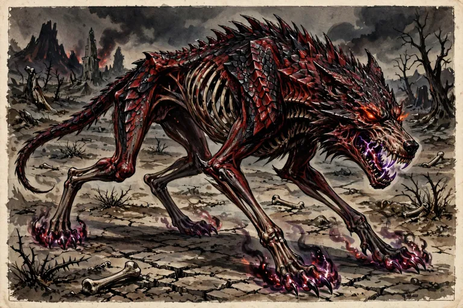

*Picture: GENERATED — generated from the published description (Anger of Angels sample: nearly skeletal dire wolf in red and black scales)*

### 2b. Avvite — TEMPLATE (variant entry)

Description (verbatim excerpts, book pp.111–112): "Avvim are the greatest of the three kinds of corrupt nephilim. Their name means “the devastators,” and they are capable of great destruction. Most avvim were born into their current form, but some are gibborim who succumbed to their race's doom." — "Avvim (singular “avvite”) look like black- and red-scaled reptilian versions of animals or monsters, with or without gangly arms and legs. … Their teeth (and claws, if any) cause horrible bleeding wounds, and their bite can destroy any creature instantly." — "No matter what sort of creature its mortal parent was, an avvite is an evil spirit in a corrupt physical form. … In other words, the base creature for the template need not be the same sort of creature as its mortal parent. Avvim are always twisted, leaner, and more evil-looking than their non-nephilim counterparts."

Sample headline: **Sample Avvite — Avvite Dire Wolf — CR 5.** Sample description (verbatim): "This nearly skeletal dire wolf is covered in red and black scales. Its teeth and claws glint with evil power." / "This example uses a dire wolf as the base creature."
Sample block (as printed): Avvite Dire Wolf; Large Outsider (Augmented Animal) (Native); Hit Dice: 6d8+18 (45 hp); Initiative: +4 (Dexterity); Speed: 50 feet; AC: 18 (–1 size, +2 Dexterity, +7 natural); touch 11, flat-footed 16; Base Attack/Grapple: +4/+15; Attack: Bite +11 melee (1d8+10) plus 1 Constitution [as printed]; Full Attack: Bite +11 melee (1d8+10) plus 1 Constitution [as printed]; Space/Reach: 10 feet/5 feet; Special Attacks: Devastating bite, ghost touch, spell-like abilities, trip, wounding; Special Qualities: Darkvision, damage reduction 5/magic, immunity to fear, low-light vision, resistance to acid, cold, and electricity 5, scent; Saves: Fortitude +8, Reflex +8, Will +6; Abilities: Str 25, Dex 19, Con 17, Int 3, Wis 12, Cha 12; Skills: Hide +2, Listen +7, Move Silently +6, Spot +7, Survival +2*; Feats: Alertness, Run, TrackB, Weapon Focus (bite); Environment: Any forest, hill, mountains, plains, and underground; Organization: Solitary or pack (1 avvite dire wolf and 4–7 followers); Challenge Rating: 5; Treasure: None; Alignment: Neutral evil; Advancement: 7–18 HD (Large) or by character class; Level Adjustment: —. Combat notes (as printed): DC 14 Fortitude vs. devastating bite; DC 15 for unholy blight; Trip (Ex) as dire wolf; +2 racial bonus to Hide, Listen, Move Silently, Spot; +4 racial bonus to Survival when tracking by scent.

Creating Avvim (FULL template mechanics, as published, book pp.112–113):
- "“Avvite” is an acquired or inherited template that you can add to any living animal, fey, giant, humanoid, monstrous humanoid, or gibborite, (referred to hereafter as the “base creature”)."
- "The creature's type changes to “outsider (native)” Do not recalculate base attack bonus, skill points, or saves. It uses all the base creature's statistics and special abilities except as noted here."
- "AC: Increase natural armor by +4"
- "Attacks: If the base creature lacked a bite attack, it gains one as a natural attack."
- "Damage: An avvite's bite attack deals the damage listed below or the base creature's bite damage, whichever is greater. All other damage is as the base creature." — Table 10–1: Bite Attack: Fine 1; Diminutive 1d2; Tiny 1d3; Small 1d4; Medium 1d6; Large 1d8; Huge 2d6; Gargantuan 2d8; Colossal 4d6.
- "Special Attacks: An avvite retains all the special attacks of the base creature and also gains the following attacks:"
- "Wounding (Su): Avvite teeth and claws are treated as weapons with the wounding property."
- "Devastating Bite (Su): A target that suffers a critical hit from an avvite's bite must succeed at a Fortitude saving throw (DC 10 + 1/2 the avvite's Hit Dice + the avvite's Charisma bonus) or be disintegrated as if by a disintegrate spell. Success at the save means the bite deals normal Constitution damage, but no extra damage from the thwarted disintegrate."
- "Ghost Touch: All of an avvite's natural attacks may strike incorporeal creatures normally as if they had the ghost touch property."
- "Spell-Like Abilities (Sp): 1/day—unholy blight. Caster level 7th. The save DCs are Charisma based."
- "Special Qualities: An avvite retains all the special qualities of the base creature and also gains darkvision, low-light vision, and the following:"
- "Damage Reduction: Avvim have damage reduction 5/magic."
- "Fear Immunity (Ex): Avvim are completely immune to fear."
- "Resistances: Avvim have acid, cold, and electricity resistance 5. If the base creature has energy resistance or immunity for these types, use the greater value."
- "Abilities: Increase from the base creature's as follows: Dexterity +4, Charisma +2, and Intelligence is at least 3."
- "Environment: Any land and underground"
- "Organization: Same as the base creature or solitary"
- "Challenge Rating: Same as the base creature +2"
- "Treasure: Same as the base creature or standard, whichever is greater"
- "Alignment: Always evil"
- "Advancement: By character class or as the base creature"
- "Level Adjustment: —"

## Azi-Dahaka — CR 10 — Encyclopedia of Demons & Devils Vol. 1


*Picture: Demons roster picture index: LIBRARY (tier 1)*

Azi-Dahaka — CR 10 [3RD-PARTY — Publisher: Fast Forward Entertainment]


**Source:** *The Encyclopedia of Demons & Devils* Vol. 1, book p. 32 (PDF p. 33). "Book is 3.0-era d20 — reproduced as published."
**Classification evidence (verbatim from the page):** heading "Azi-Dahaka (Tanar'ri)"; type line "Large Outsider (Chaotic, Evil)"; "Challenge Rating: 10"; "Alignment: Always chaotic evil." A genuine demon entry in this book — rostered.

- **Azi-Dahaka (Tanar'ri)**
- Large Outsider (Chaotic, Evil)
- **Hit Dice:** 14d8+42 (105 hp)
- **Initiative:** +8 (+4 Dex, +4 Improved Initiative)
- **Speed:** 30 ft.
- **AC:** 25 (–1 size, +4 Dex, +12 natural)
- **Attacks:** 2 bites +19 melee, great sword +15 melee *("great sword" as two words as printed)*
- **Damage:** bite 1d8+6 plus poison, great sword 2d6+3 *("great sword" as two words as printed; lowercase "bite" as printed)*
- **Face/Reach:** 5 ft. by 5 ft./10 ft.
- **Special Attacks:** Poison, spell-like abilities, summon tanar'ri
- **Special Qualities:** Damage reduction 15/+2, SR 22, tanar'ri qualities, unkillable
- **Saves:** Fort +12, Ref +13, Will +13
- **Abilities:** Str 22, Dex 18, Con 16, Int 11, Wis 18, Cha 8
- **Skills:** Escape Artist +18, Handle Animal +13, Hide +18, Listen +18, Move Silently +18, Search +14, Spot +18, Wilderness Lore +18
- **Feats:** Dodge, Improved Initiative, Mobility, Spring Attack
- **Climate/Terrain:** Any land and underground
- **Organization:** Solitary
- **Challenge Rating:** 10
- **Treasure:** Triple coins, no goods, no items
- **Alignment:** Always chaotic evil
- **Advancement:** None

**Description (verbatim, book p. 32):** "Quick as a snake, and clever like a human, Azi-Dahaka is a demon whose name literally means "fiendish snake." This Indo-Aryan demon combines some of the worst aspects of these two enemies into one mean being." / "Though evil as any fiend, Azi-Dahaka is pretty small-time as demons go. He does not want to rule the world or corrupt souls. His goal is to create misery and destroy lives on a smaller scale. His favorite method of destruction is to steal cattle and harm common people." / "Cattle theft is an attempt to steal kingly glory for himself. Azi-Dahaka understands that—especially in smaller communities—cattle is a measure of wealth, and stealing cattle can destroy the entire economy of an area, and take the power of that wealth for himself. He revels in oppressing small communities in this way and ruining the livelihood of those who make their living from livestock. He avoids killing cattle workers, however, only so their terrified stories can spread fear and misery more effectively." / "The snake demon usually begins by spooking cattle with a dark storm cloud and lightning bolts. Whipping them into a stampede, Azi-Dahaka drives the cattle out of their pens or pastures and down to a prepared cave or remote place hiding place where he sets up a "palace," usually a small complex built into a cave or hillside. Sometimes he resells cattle to a community's enemies." *[sic — "remote place hiding place" as printed, verified at 300 dpi; reproduced as published]* / "Azi-Dahaka's death is reserved by the gods for a special moment at the end of time. Unfortunately, this means the demon cannot be killed before then. Just before a killing blow lands, he always disappears. This disappearance always puts him out of commission for a while, sometimes for entire generations."

**Combat (verbatim):** "Azi-Dahaka is shrewd, but not creative. He has a couple of good tricks, and he uses them repeatedly. He uses his lightning bolt ability to scatter and scare groups of opponents, then spring attacks on anyone cut off, striking with his weapon and snake heads. If these tricks don't work, he teleports away to a place where he can harm people who give less opposition."
**Left Head Poison (Ex) (verbatim):** "Bite, Fortitude save (DC 20), initial and secondary damage 1d6 temporary Constitution."
**Right Head Poison (Ex) (verbatim):** "Bite, Fortitude save (DC 20), initial and secondary damage 1d6 temporary Strength."
**Spell-Like Abilities (verbatim):** "At will—control weather, dominate animal, invisibility to animals, lightning bolt, neutralize poison, scare, teleport (self plus 50 pounds of objects only). These are as the spells cast by a 6th-level sorcerer (save DC 9 + spell level)."
**Summon Tanar'ri (Sp) (verbatim):** "Once per day, it can attempt to summon one succubus with a 20% chance of success."
**Unkillable (Ex) (verbatim):** "Azi-Dahaka's death has been predestined. Any time a source of damage would kill him before then, he is instead teleported to a mountaintop near the gods, where he is chained and imprisoned."

**APOC NOTE (Shaun's canon — separate from the published text above):** Third-party lore is reference only, not FR canon — the Indo-Aryan treatment and the predestined-death myth are the book's, not Faerûn's. In APOC Azi-Dahaka is mortal like every demon — no god has reserved his death and no teleport whisks him to any mountaintop; he is trapped inside the scarred crystal sphere, planar travel is severed and summoning spells DON'T WORK, so his summon tanar'ri calls nothing; the Bastion's mythal bars demons absolutely.

---

## Baneguard — CR 2 — Lost Empires of Faerûn


*Picture: Undead roster picture index: official book art — official book art — Lost Empires of Faerûn, p. 162 (art: Jim Pavelec)*

BANEGUARD — CR 2

*Source: Lost Empires of Faerûn, pp.162–163 (flavor and illustration p.162; stat table p.163).*

*A skeleton clutches a longsword tightly in one bony hand.*

The clerics of Bane first developed baneguards in the ancient past and kept the secret of their creation within the church for many years. Knowledge of the creation process has long since spread beyond Bane's church, however, and nowadays these undead guardians are not especially difficult to make. The knowledge of how to make these creatures serves the entire continent well, for baneguards make excellent guards, especially since they require neither food nor sleep.

Baneguards look exactly like ordinary animated skeletons. A cleric of at least 11th level can create a baneguard using the *create undead* spell if the spell's subject is the corpse of a Medium humanoid. A baneguard can also be created as described in the sidebar (see below).

**Baneguard**
**Medium Undead**
**Hit Dice:** 4d12 (26 hp)
**Initiative:** +0
**Speed:** 30 ft. (6 squares)
**Armor Class:** 13 (+3 natural), touch 10, flat-footed 13
**Base Attack/Grapple:** +2/+5
**Attack:** Claw +5 melee (1d4+3) or longsword +5 melee (1d8+3/19–20)
**Full Attack:** 2 claws +5 melee (1d4+3) or longsword +5 melee (1d8+3/19–20) and claw +0 melee (1d4+1)
**Space/Reach:** 5 ft./5 ft.
**Special Attacks:** *Magic missile*
**Special Defenses:** *Blink*, damage reduction 5/bludgeoning, darkvision 60 ft., immunity to cold, undead traits
**Saves:** Fort +1, Ref +1, Will +5
**Abilities:** Str 16, Dex 11, Con —, Int 9, Wis 12, Cha 13
**Skills:** Hide +4, Listen +5, Move Silently +4, Search +4, Spot +5
**Feats:** Blind-Fight, Combat Casting
**Environment:** Any land and underground
**Organization:** Solitary, pair, or squad (3–10)
**Challenge Rating:** 2
**Treasure:** Standard
**Alignment:** Always neutral evil
**Advancement:** —
**Level Adjustment:** +3

Sidebar, "Creating a Baneguard" (p.162): A spellcaster can create a baneguard using a variant of the *animate dead* spell known as *animate baneguard*. In all ways, the spell functions similarly to *animate dead*, with the following changes: *animate baneguard* is a 4th-level cleric and 5th-level sorcerer/wizard spell. Like the *animate dead* spell, *animate baneguard* allows the caster to create skeletons of up to twice his or her caster level (limit 40 Hit Dice). Since a baneguard has 4 HD, the maximum number of baneguards that can be created with one casting of the spell is five (caster level 10th) — and the *desecrate* spell does not double that amount, as it does for *animate dead*. A baneguard requires a corpse with an intact skeleton. Material Component: A black onyx gem worth 50 gp per Hit Die of the baneguard (200 gp for a Medium baneguard), placed in the corpse's mouth or eye socket.

## Beholder, Gauth — CR 6 — Monster Manual I

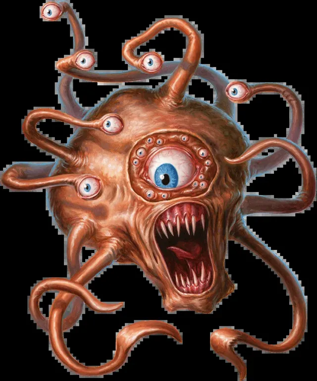

*Picture: Monster library art — Monster Manual I*

**Partial — fullest block on file:**

Type: Medium Aberration
Challenge Rating: 6
Source book(s): Monster Manual I
Description: The gauth, sometimes known as the lesser beholder, is a 4-foot wide orb dominated by a central eye. Six smaller eyes on stalks sprout from the top of its body. It is a rapacious and tyrannical creature that seeks to exact tribute from anything weaker than itself, and often attacks adventurers simply to acquire their wealth.
[Partial — fullest available from APOC-VTT registry record; no roster stat block found. No stat lines invented.]

## Belker — CR 6 — Monster Manual I


*Picture: Monster library art — Monster Manual I*

**Partial — fullest block on file:**

Type: Large Elemental (Air, Extraplanar)
Challenge Rating: 6
Source book(s): Monster Manual I
Description: Belkers are creatures from the Plane of Air. They are composed primarily of smoke. Although undeniably evil, they are very reclusive and usually have no interest in the affairs of others. A belker’s winged shape makes it look distinctly demonic. It is about 7 feet long and weighs about 8 pounds. Belkers speak Auran.
[Partial — fullest available from APOC-VTT registry record; no roster stat block found. No stat lines invented.]

## Bile Thrall — CR 3 — Monsternomicon Vol. II


*Picture: Undead roster picture index: official book art — official book art — Monsternomicon Vol. II (Privateer Press)*

Bile Thrall (Necrotech Construct)


**Source:** Monsternomicon Vol. II: The Iron Kingdoms and Beyond (Privateer Press), pp.120–122 (Necrotech Constructs)

*Stat table (left column of the Necrotech Constructs spread, as published):*

```
Necrotech Constructs
Bile Thrall
NE Medium Undead (Necrotech Construct) CR 3
Hit Dice:            3d12+20 (38 hp)
Immunities/Resist:   Necrotech construct traits, turn resistance
Senses:              Listen +5, Spot +5
Initiative:          +0
Speed:               30 ft. (5 squares),
Armor Class:         14, touch 14, flat-footed 14 (+4 natural)
Base Attack/Grapple: +2/+3
Attack:              Slam +3 melee (1d6+1)
Full Attack:         Slam +3 melee (1d6+1)
Special Attacks:     Bile cannon, purge
Space/Reach:         5 ft./5 ft.
Saves:               Fort +1, Ref +1, Will +6
Abilities:           Str 13, Dex 10, Con -,
Int 6, Wis 10, Cha 8
Skills:              Listen +5, Spot +5
Feats:               Alertness, Iron Will ,
Ability Focus (bile cannon)B
Environment:         Any
Organization:        Solitary or troop (6-10); often accompa-
nies Cryx armies
Advancement:         4-9 HD (Medium)
```

*The full Necrotech Constructs section text — the Pendrake narrative, the shared necrotech construct traits, and all three thralls' ability write-ups (Bile Cannon, Purge, Despoiler Cannon, Soul Fuel, Soul Consumption, Soul Prison, Trample, and the Soulhunter weapons note) — is reproduced in full under Soul Hunter below, the last of the three entries, so the shared text appears exactly once.*

**Kit / Treasure (as published):** the bile cannon is a grafted body weapon, not carried gear; no treasure line is published for it; none invented.

**APOC Note** *(Shaun's — separate from the published text above)*
- Counts toward the **Kingdom of the Undead** faction in the badlands war (2701 DR).
- **The Bastion's Melairshield bars undead** — it cannot enter the Bastion of Last Hope.
- **Raw magic blights** the land around the caster in APOC — necromancy worked through raw magic carries that cost; alchemy is the cornerstone inside the walls.

---

## Black Troll — CR 8 — Monsternomicon Vol. I


*Picture: Undead roster picture index: GENERATED from the published description — generated from the Monsternomicon Vol. I published description (via the APOC-VTT monster build)*

Black Troll

**Source:** Monsternomicon Vol. I (Privateer Press), p.192 [2005 v3.5 revision text; re-checked 2026-11-08 against the library copy (2002 original), edition differences flagged on the entry]

**2002-original check (2026-11-08, pp.192–193):** CR 8, HD 7d12 (45 hp), AC 19, abilities and saves confirmed as filed; Blood Drain (1d4 Con/round; trolls bitten suffer permanent drain; slain trolls rise as black trolls within one week), Command Whelps (Will DC 16), Touch of Corruption (DC 16) and Troll Bane all match the filed text. Edition differences: the 2002 original prints **regeneration 1** (filed 2005 text: regeneration 5), claw damage **2d4+6** (filed 2005 text: 2d6+6), and Feculent Decay leaves witnesses **shaken** for 2d6 rounds (filed 2005 text: frightened).
[In the Trolls section, pp.186–195. **Type verified: Large Undead (Troll).** Descriptive text p.192, abilities continued p.193.]

Large Undead (Troll)
Hit Dice: 7d12 (45 hp)
Initiative: +1
Speed: 30 ft. (6 squares)
Armor Class: 19 (–1 size, +1 Dex, +9 natural), touch 10, flat-footed 18
Base Attack/Grapple: +3/+13
Attack: Claw +8 melee (2d4+6) or greataxe +8 melee (3d6+9/x3)
Full Attack: Claw +8 melee (2d4+6) and bite +3 melee (1d8+3); or greataxe +8 melee (3d6+9/x3)
Space/Reach: 10 ft./10 ft.
Special Attacks: Blood drain, command whelps, feculent decay, touch of corruption, troll bane
Special Qualities: Blood dependency, darkvision 60 ft., regeneration 1, scent, undead traits
Saves: Fort +2, Ref +3, Will +7
Abilities: Str 22, Dex 12, Con —, Int 13, Wis 15, Cha 14
Skills: Hide +7, Intimidate +11*, Listen +11, Move Silently +10, Spot +12, Survival +9
Feats: Ability Focus (touch of corruption), Cleave, Great Cleave, Power Attack
Environment: Any land and underground
Organization: Solitary
Challenge Rating: 8
Alignment: Always chaotic evil
Advancement: 8–15 HD (Large)
Level Adjustment: —

Description (p.192): "Black trolls are the most despised of all trolls. They are undead abominations that are a twisted mockery of other trolls. Trollkin especially revile black trolls, and their legends claim that they are born of a tainted bloodline—thus their dependency on the fluid. All black trolls are solitary creatures that live only to torment others. They commonly raid troll and human settlements alike, murdering and pillaging as they go. They delight in stealing command of other trolls' whelps and turning them upon their masters."
Combat: In combat black trolls are shifty and clever. They try to isolate opponents, slaying them one by one. Any survivors are kidnapped and added to the black troll's feeding stock.
Regeneration (Ex): A black troll's regeneration abilities function even in death, however they are diminished. Fire and acid do normal damage to a black troll. Severed limbs do not regrow, but still may be reattached as usual.
Blood Dependency (Ex): Black trolls must drink no less than 3 pints of blood every day. For each day they fail to consume this amount, they suffer 1 point of cumulative Strength damage to a maximum of -5. Black trolls regain 1 point of this Strength damage per day while feeding normally. They usually keep a "herd" of humanoid hostages for feeding when they can. Note that they are not restricted to drinking humanoid blood, though they prefer it (trollkin blood is the most favored).
Blood Drain (Ex): On a successful grapple attempt, a black troll can drain the blood of its opponent. Victims suffer 1d4 Con damage each round the pin is maintained. Any troll species bitten by this attack suffers 1d4 Con drain each round. Any troll (excluding pygmies) killed by a black troll in this manner rise as black trolls within one week. The black troll has no control over this spawn, and they seldom kill other trolls in this manner. (p.193)
Command Whelps (Su): Black trolls do not produce whelps as other trolls do. However, they may possess the whelps of other trolls. To do this they make a command check, just as an evil cleric would versus undead (PHB). Any rebuking success is ignored (whelps cannot be rebuked), however if command success is rolled, then the whelps fall under the command of the black troll. The same HD restrictions apply. If the whelps are in the immediate presence of their progenitor, then they can attempt a Will save (DC 16) to avoid becoming possessed. Whelps commanded in such a fashion begin to rot and decay, suffering 1 point of Con drain every day until they die.
Feculent Decay (Ex): A black troll, despite its regeneration, is in a constant state of decay. This visage is quite unsettling. Creatures with fewer HD than the black troll are shaken for 2d6 rounds by its horrible appearance, Will DC 15 negates. The save DC is Charisma-based. Other breeds of troll are not affected by this ability.
Touch of Corruption (Ex): As a standard action, a black troll can cause the rotting flesh on its body to expand and whip forth as a ghastly tentacle. On a successful ranged touch attack (20 ft. range increment), the black troll poisons its victim. Contact, Fortitude DC 17, initial damage 3d4 Str, secondary damage 1d6 Str. The save DC is Charisma-based. Any damage done to the fleshy tentacle does not harm the black troll.
Troll Bane (Ex): All physical attacks made by a black troll versus any other species of troll do normal damage to the target, ignoring their regeneration.
Skills: *Black trolls use their Strength modifier instead of their Charisma modifier for Intimidate checks.
[No separate Treasure or Legends & Lore block for black trolls is printed in the Trolls section; general troll treasure is on p.194.]

---

**Count: 15 entries, 20 separate stat blocks.**
Entries: Disembodied (1), Dread (1 sample + template), Eldritch (1 sample + template), Sythyss (1 sample + template), Excruciator (1), Hollowed (1), Husk (1 — NOT undead, Vermin, verification only), Progeny (1 sample + template), Iron Lich (1 sample + template), Mechanithrall (1), Pistol Wraith (1), Sepulchral Lurker (1), Shaft Wight (1), Thrall (6: Risen, Slave, Warrior, Lieutenant, Bane Thrall, Skarlock), Black Troll (1).
Stat blocks: 1+1+1+1+1+1+1+1+1+1+1+1+1+6+1 = 20.

**Kit / Treasure (as published):** no separate Treasure/Legends & Lore block is printed for the black troll entry (pp.192–193); none invented. **Confirmed against the 2002 original (pp.192–193): the black troll entry prints no Treasure or Legends & Lore block in either edition (treasure for trolls is handled in the chapter's general text); *verify* cleared 2026-11-08.**

**APOC Note** *(Shaun's — separate from the published text above)*
- Counts toward the **Kingdom of the Undead** faction in the badlands war (2701 DR).
- **The Bastion's Melairshield bars undead** — it cannot enter the Bastion of Last Hope.
- **Raw magic blights** the land around the caster in APOC — necromancy worked through raw magic carries that cost; alchemy is the cornerstone inside the walls.

---

## Blackspawn Stalker — CR 9 — Monster Manual IV


*Picture: APOC-VTT monster library art — Monster Manual IV*

**Partial — fullest block on file:**

Type: Large magical beast (dragonblood)
Challenge Rating: 9
Source book(s): Monster Manual IV
Description: Looking like a cross between a black dragon and a spider of nightmarish proportions, this creature glares out at the world with six baleful eyes. It drools a putrid green acid that steams and hisses. Two spined tails eject globules of sticky webbing.
[Partial — fullest available from APOC-VTT registry record; no roster stat block found. No stat lines invented.]

## Blackstone Gigant — CR 18 — Fiend Folio


*Picture: Constructs roster picture index: Official book art — Fiend Folio, p. 22 (captioned)*

BLACKSTONE GIGANT [3.0-format as published]

**Gargantuan Construct**
**Hit Dice:** 32d10+60 (236 hp)
**Initiative:** –2
**Speed:** 40 ft., climb 20 ft., fly 40 ft. (perfect)
**AC:** 31 (–4 size, –2 Dex, +27 natural), touch 4, flat-footed 31
**Base Attack/Grapple:** +24/+53
**Attack:** Slam +38 melee
**Full Attack:** 4 slams +38 melee
**Damage:** Slam 4d8+17 plus petrification
**Face/Reach:** 20 ft./20 ft.
**Special Attacks:** Petrification, trample
**Special Qualities:** Acid resistance 20, animate statue, cold resistance 20, construct traits, DR 30/+5, electricity resistance 20, fire resistance 20, SR 32
**Saves:** Fort +10, Ref +10, Will +12
**Abilities:** Str 45, Dex 7, Con —, Int 6, Wis 10, Cha 10
**Skills:** Climb +30*, Listen +15, Spot +15
**Feats:** Blind-Fight, Cleave, Combat Reflexes, Great Cleave, Improved Bull Rush, Improved Critical (slam), Iron Will, Lightning Reflexes, Power Attack, Sunder, Weapon Focus (slam)
**Climate/Terrain:** Any land
**Organization:** Solitary
**Challenge Rating:** 18
**Treasure:** —
**Alignment:** Often neutral evil (same as creator)
**Advancement:** 33–54 HD (Gargantuan); 55–96 HD (Colossal)

A blackstone gigant is an enormous construct created by a powerful cleric to be either a bodyguard or a guardian of a sacred site. Possessed of a limited intelligence, a blackstone gigant can serve as an assassin or retrieve an object or creature.
Most blackstone gigants look like fierce, eight-armed women. Evil creators sometimes carve blackstone gigants to look like mariliths or other demonic creatures.
Blackstone gigants have the power to petrify foes, and they often take grisly trophies from creatures defeated in such a manner and craft them into a belt of petrified arms or a necklace of petrified heads.
A blackstone gigant speaks the language of its creator.

## Blackwing — CR 8 — Monster Manual V


*Picture: Undead roster picture index: official book art — official book art — Monster Manual V*

BLACKWING — Monster Manual V, p.12


- **Size/Type:** Always NE Large undead
- **Hit Dice:** hp 78 (12 HD); DR 5/bludgeoning
- **Initiative:** Init +7; **Senses:** darkvision 60 ft.; Listen +17, Spot +21
- **Languages:** Auran, Common
- **Armor Class:** AC 20, touch 12, flat-footed 17 (–1 size, +3 Dex, +8 natural)
- **Immune/Resist:** Immune cold, undead immunities; Resist evasion
- **Saves:** Fort +4, Ref +9, Will +10
- **Speed:** 30 ft. (6 squares), fly 80 ft. (average); Hover
- **Melee:** 2 claws +13 each (1d6+8) and bite +8 (1d8+4)
- **Space/Reach:** Space 10 ft.; Reach 5 ft.
- **Base Attack/Grapple:** Base Atk +6; Grp +18
- **Atk Options:** Blind-Fight
- **Special Actions:** frightful dive, wail of despair
- **Abilities:** Str 26, Dex 17, Con —, Int 10, Wis 14, Cha 14
- **Special Attacks:** SA frightful dive, wail of despair
- **Special Qualities:** SQ undead traits
- **Feats:** Blind-Fight, Hover, Improved Initiative, Lightning Reflexes, Weapon Focus (claw)
- **Skills:** Hide +14, Listen +17, Search +7, Sense Motive +10, Spot +21
- **Advancement:** 13–24 HD (Large); 25–28 HD (Huge)
- **Challenge Rating:** 8
- **Frightful Dive (Su):** When a flying blackwing charges a target below it, that foe must succeed on a DC 18 Will save or be shaken for 1 round (or frightened if already shaken). In addition, a blackwing can make two claw attacks against a target that fails its save. The save DC is Charisma-based. This is a mind-affecting fear effect.
- **Wail of Despair (Su):** When two or more blackwings within 30 feet of one another scream, their cries combine to create a wail of despair, which affects all creatures within 100 feet of any wailing blackwing. Any creature in the area must succeed on a DC 18 Will save or cower for 1d4 rounds and be shaken for 4 rounds thereafter. For every additional two blackwings participating in a wail of despair, the DC increases by 2. The effect of multiple wails does not stack. The save DC is Charisma-based. This is a mind-affecting fear effect.
- **Skills note:** A blackwing has a +4 racial bonus on Spot checks.
- **Treasure (prose, p.13):** "Blackwings do not covet treasure for its value, but they have standard treasure for their Challenge Rating because they are attracted to shiny items."
- **Alignment:** Always neutral evil (prose: "Blackwings are always neutral evil.")
- **Environment (prose, p.13):** "Blackwings guard tombs hidden high up in treacherous mountains… Blackwings never enter the tomb itself, instead lairing on the ledge and in the entrance caverns."
- **Description:** "This large skeletal bird's ragged, ebony wings end in masses of sharp, broken-off bones. Its red eyes seem full of malice and malign intelligence. Talons and a curved beak make up its natural armaments."
- **Errata flag (prose inconsistency, as published):** the MM5 entry's own text (p.13) says a blackwing "can fight when carrying a rider, but the rider must succeed on a Ride check to attack while the blackwing does so," while its Sample Encounters text (pp.12–13) says of a blackwing hunting with a mohrg that "in subsequent rounds, it hovers over the fire, plunging the battlefield into darkness" — no errata is applied; both passages stand as published.

## Bladerager Troll — CR 8 — Monster Manual V


*Picture: APOC-VTT monster library art — Monster Manual V*

**Partial — fullest block on file:**

Type: Always CE Large giant
Challenge Rating: 8
Source book(s): Monster Manual V
Description: A snarling and muscular giant lumbers into view, plates of steel embedded in its rubbery green skin. A cap of steel is riveted to its head, and steel claws are affixed to its hands. Blood oozes from around the plating and down the claws. The creature's wild eyes betray unthinkable agony.
[Partial — fullest available from APOC-VTT registry record; no roster stat block found. No stat lines invented.]

## Blood Ape — CR 6 — Monster Manual II


*Picture: APOC-VTT monster library art — Monster Manual II*

**Partial — fullest block on file:**

Type: Large Magical Beast
Challenge Rating: 6
Source book(s): Monster Manual II
Description: Blood apes are peaceful diurnal foragers with a unique defense mechanism. The alpha male (or leader) of a troop or patrol has the magical ability to make himself and other members of the group larger. Their Huge forms (see Growth, below) allow them to deal more damage in combat, but the ability to return to Large size means that they require substantially less food than Huge creatures would. Sages and scholars suggest that this ability is a residual effect of exceptionally strong growth and form-altering magic practiced on the ancestors of the current blood apes millennia ago.
[Partial — fullest available from APOC-VTT registry record; no roster stat block found. No stat lines invented.]

## Blood Fiend — CR 14 — Fiend Folio


*Picture: Demons roster picture index: LIBRARY (tier 1)*

BLOOD FIEND — Fiend Folio, pp.47–48 — **PAGE CONFIRMED by library extraction** (stat block p.47, abilities and description pp.47–48). Reproduced exactly as published — Large Undead — per Shaun's standing instruction. **Faction ruling (Shaun, 2026-11-08): DEMON side** — Fiend Folio classes it among the demons, and in APOC it belongs to the demon enclaves/faction. The published type (Large Undead (Extraplanar)) is reproduced verbatim and is unchanged — the ruling is faction placement only.


- **Size/Type:** **Large Undead (Extraplanar)** — FLAG: the type is **Undead, not Outsider**, though Fiend Folio classes it as a demon. It is a vampiric demon that makes more blood fiends from slain demons, vampire-style.
- **Hit Dice:** 12d12 (78 hp)
- **Initiative:** +6
- **Speed:** 40 ft., fly 80 ft. (perfect)
- **Armor Class:** 31 (−1 size, +2 Dex, +20 natural), touch 11, flat-footed 29
- **Base Attack/Grapple:** +6/+18
- **Attack:** Claw +13 melee
- **Full Attack:** 4 claws +13 melee and bite +8 melee
- **Damage:** Claw 1d6+8 plus energy drain, bite 1d8+4 plus blood drain
- **Space/Reach:** 10 ft./10 ft. [FF Face/Reach line]
- **Special Attacks:** **Energy drain** (Su; claw hit: Fort DC 21 or gain 1 negative level; the blood fiend heals 5 hp per level bestowed, excess as temporary hit points); **blood drain** (Su; bite: 1d4 points of Constitution drain); **domination** (Su; gaze-like standard action, dominate monster, CL 18th, Will DC 21); spell-like abilities (at will: detect good, detect magic, teleport without error [self plus maximum load of objects only]; 3/day: chaos hammer, darkness, unholy blight; 1/day: blasphemy, desecrate; CL 18th; save DC 15 + spell level); **create spawn (Su, verbatim FF p.48):** "An outsider of the evil subtype slain by a blood fiend's energy drain attack (negative levels equal to current Hit Dice, or drained below 1st level) rises as a blood fiend 1d4 days after death. The new blood fiend does not have any of the abilities it had in life."
- **Special Qualities:** DR 15/good (3.5 update value; as printed in FF: DR 20/+2); acid resistance 20, cold resistance 20, electricity immunity, fire resistance 20; alternate form (regular or fiendish dire bat, dire wolf, howler, or nightmare); fast healing 5; gaseous form (at will, as the spell, CL 5th, indefinite, fly 20 ft. perfect); SR 24; turn resistance +6; undead traits (per type)
- **Saves:** Fort +4, Ref +8, Will +13
- **Abilities:** Str 26, Dex 15, Con — (undead), Int 17, Wis 20, Cha 21
- **Skills:** Concentration +20, Diplomacy +7, Hide +17, Listen +20, Move Silently +17, Search +19, Sense Motive +20, Spot +20, Survival +5 (+7 following tracks) (printed note: +8 racial bonus on Bluff, Hide, Listen, Move Silently, Search, Sense Motive, and Spot checks)
- **Feats:** Combat Reflexes, Dodge, Improved Initiative, Lightning Reflexes, Mobility
- **Environment:** Any land and underground (Abyss) [FF Climate/Terrain line]
- **Organization:** Solitary, pair, or gang (3–5)
- **Challenge Rating:** 14 (Fiend Folio and FC1 agree; confirmed p.47)
- **Treasure:** Standard
- **Alignment:** Always chaotic evil
- **Advancement:** 13–18 HD (Large); 19–36 HD (Huge)
- **Level Adjustment:** — (no Level Adjustment line published in Fiend Folio)
- **Description (verbatim, FF pp.47–48):** "Blood fiends create more blood fiends from other demons in a manner similar to the way vampires create more vampires from humanoids. Their gaze can sap the will of mortals. A blood fiend is an ogre-sized demonic creature that stands about 9 feet tall. Its thick, scaly hide is a deep purple color, almost black. Each of its four strong arms ends in a humanlike hand, each finger of which is tipped with a claw. A blood fiend has glowing red eyes and a wolflike muzzle lined with sharp teeth that seem too large to fit in its mouth. Blood fiends speak Abyssal."

**Nature/role:** A vampire among demons — it preys on demonkind itself and raises its kills as new blood fiends.

## Bloodmote Cloud — CR 6 — Libris Mortis


*Picture: Undead roster picture index: official book art — official book art — Libris Mortis*

6. BLOODMOTE CLOUD — Libris Mortis p.88, CR 6 — SWARM

**Fine Undead (Swarm)**
**Hit Dice:** 10d12 (65 hp) **Initiative:** — **Speed:** Fly 20 ft. (4 squares) **Armor Class:** 19 (+8 size, +1 Dex), touch 11, flat-footed 18 [touch figure as printed in the mirror — *verify — web extraction*] **Base Attack/Grapple:** +5/— **Attack:** Swarm (1d4 plus blood drain) **Full Attack:** Swarm (1d4 plus blood drain) **Space/Reach:** 10 ft./0 ft. **Special Attacks:** Blood drain, distraction **Special Qualities:** Darkvision 60 ft., diet dependent, immune to weapon damage, swarm traits, undead traits **Saves:** Fort +2, Ref +3, Will +6 **Abilities:** Str 4, Dex 13, Con —, Int —, Wis 10, Cha 1 **Skills:** — **Feats:** — **Environment:** Any **Organization:** Solitary, cloud (2–4 swarms), or infestation (7–12 swarms) **Challenge Rating:** 6 **Treasure:** None **Alignment:** Always neutral evil **Advancement:** None **Level Adjustment:** —
> *This cloud of buzzing insects boils toward its victims, droning ominously in its strangely deep pitch and accompanied by the sickly sweet aroma of blood.*
Flavor/combat prose (read in full): a swarm of undead mosquitoes; never sated. Blood Drain (Ex): 1d3 damage and 1d2 Constitution damage to any creature whose space it occupies at the end of its move. Distraction (Ex): Fort DC 15 or nauseated 1 round. Diet Dependent: blood.
**Kit:** Mindless swarm; published treasure: **None.**
**APOC Note:** A badlands plague-weapon in waiting — the Kingdom of the Undead can point an infestation at a Life-held ruin and walk away. No planar/summoning mechanics. As a swarm of fliers it still cannot cross the Melairshield into the Bastion.

## Bluespawn Ambusher — CR 4 — Monster Manual IV


*Picture: APOC-VTT monster library art — Monster Manual IV*

**Partial — fullest block on file:**

Type: Medium magical beast (dragonblood)
Challenge Rating: 4
Source book(s): Monster Manual IV
Description: The ground trembles, and a blue form bursts from the ground in a shower of dirt and stones. The creature has the shape of a giant badger, but it bears the thick scales, sharp horn, and gnashing teeth of a blue dragon. Suddenly, its body crackles with electricity as sparks leap and arc across its scales.
[Partial — fullest available from APOC-VTT registry record; no roster stat block found. No stat lines invented.]

## Bluespawn Burrower — CR 9 — Monster Manual IV


*Picture: APOC-VTT monster library art — Monster Manual IV*

**Partial — fullest block on file:**

Type: Large magical beast (dragonblood)
Challenge Rating: 9
Source book(s): Monster Manual IV
Description: Possessing a head that closely resembles that of a blue dragon and armed with a pair of massive claws, this creature moves through the sand as if it were swimming in water. Its tail is spiked like the head of a great mace, with electricity visibly coursing up and down its length.
[Partial — fullest available from APOC-VTT registry record; no roster stat block found. No stat lines invented.]

## Bluespawn Stormlizard — CR 6 — Monster Manual IV


*Picture: APOC-VTT monster library art — Monster Manual IV*

**Partial — fullest block on file:**

Type: Large magical beast (dragonblood)
Challenge Rating: 6
Source book(s): Monster Manual IV
Description: A hulking creature, as big as a horse and twice as wide, circles around you with surprising speed. It looks similar to a wingless blue dragon, but its body shape is more burly. It lowers its horn at you but seems to be waiting for something. Suddenly you notice another of the beasts circling you, taking a similar stance. Electricity crackles along their horns.
[Partial — fullest available from APOC-VTT registry record; no roster stat block found. No stat lines invented.]

## Boar — CR 2 — Monster Manual I


*Picture: Monster library art — Monster Manual I*

**Partial — fullest block on file:**

Type: Medium Animal
Challenge Rating: 2
Source book(s): Monster Manual I
Description: Though not carnivores, these wild swine are bad-tempered and usually charge anyone who disturbs them. A boar is covered in coarse, grayish-black fur. Adult males are about 4 feet long and 3 feet high at the shoulder.
[Partial — fullest available from APOC-VTT registry record; no roster stat block found. No stat lines invented.]

## Boatman — CR 7 — Monsternomicon Vol. 1


*Picture: APOC-VTT monster library art — Monsternomicon Vol. 1*

**Partial — fullest block on file:**

Type: Medium Monstrous Humanoid (Aquatic)
Challenge Rating: 7
Source book(s): Monsternomicon Vol. 1
Description: Wherever there is water to be found you have the chance of crossing paths with an urshan, or in layman's terms a 'boatman.' Born from the pairing of a man and a sea witch (at least according to rumors), these creatures prowl lakes and marshes alike (Fenn Marsh being a notable example) offering to ferry men to the other side. Boatmen normally appear elderly and almost always reveal themselves when you need a ferry most.
[Partial — fullest available from APOC-VTT registry record; no roster stat block found. No stat lines invented.]

## Bodak — CR 8 — Monster Manual I


*Picture: Undead roster picture index: official book art — official book art — Monster Manual I*

2. BODAK


**Source:** Monster Manual (3.5), p. 28 — book copy in the local library (`MonsterManual1.pdf` / `MonsterManual1.txt`). SRD cross-check: https://dnd-wiki.org/wiki/SRD:Bodak

**Size/Type:** Medium Undead (Extraplanar)
**Hit Dice:** 9d12 (58 hp)
**Initiative:** +6
**Speed:** 20 ft. (4 squares)
**Armor Class:** 20 (+2 Dex, +8 natural), touch 12, flat-footed 18
**Base Attack/Grapple:** +4/+5
**Attack:** Slam +6 melee (1d8+1)
**Full Attack:** Slam +6 melee (1d8+1)
**Space/Reach:** 5 ft./5 ft.
**Special Attacks:** Death gaze
**Special Qualities:** Damage reduction 10/cold iron, darkvision 60 ft., immunity to electricity, resistance to acid 10 and fire 10, undead traits, vulnerability to sunlight
**Saves:** Fort +3, Ref +5, Will +7
**Abilities:** Str 13, Dex 15, Con —, Int 6, Wis 12, Cha 12
**Skills:** Listen +11, Move Silently +10, Spot +11
**Feats:** Alertness, Dodge, Improved Initiative, Weapon Focus (slam)
**Environment:** A chaotic evil-aligned plane
**Organization:** Solitary or gang (2–4)
**Challenge Rating:** 8
**Treasure:** None
**Alignment:** Always chaotic evil
**Advancement:** 10–13 HD (Medium); 14–27 HD (Large)
**Level Adjustment:** —

*This creature is a gray-fleshed, hairless humanoid with an elongated skull-like head, noseless face, and white, empty eyes.*
*(Book flavor line; the SRD omits it.)*

Bodaks are the undead remnants of humanoids who have been destroyed by the touch of absolute evil.

A bodak retains fleeting memories of its past life and can speak Common (or some other humanoid language).

## Bog Mummy — CR 6 — Tome of Horrors Revised (Necromancer Games


*Picture: Undead roster picture index: official book art — official book art — Tome of Horrors Revised (Necromancer Games)*

## Bog Mummy

**Source:** Tome of Horrors Revised (Necromancer Games, 2005), p.42

```
BOG MUMMY
                          Medium Undead
                          Hit Dice:                 8d12+3 (55 hp)
                          Initiative:               +4
                          Speed:                    20 ft. (4 squares)
                          Base Attack/Grapple:      +4/+7
                          Armor Class:              18 (+8 natural), touch 10, flat-footed
                                                    18
                          Attack:                   Slam +7 melee (1d6+4 plus bog
                                                    rot)
                          Full Attack:              Slam +7 melee (1d6+4 plus bog
                                                    rot)
                          Space/Reach:              5 ft./5 ft.
                          Special Attacks:          Bog rot, create spawn, despair
                          Special Qualities:        Damage reduction 5/—, darkvision
                                                    60 ft., marsh move, resistance to
                                                    fire 10, undead traits, vulnerability
                                                    to cold
                          Saves:                    Fort +2, Ref +2, Will +8
                          Abilities:                Str 17, Dex 10, Con –, Int 6, Wis 14,
                                                    Cha 15
                          Skills:                   Hide +5, Listen +8, Move Silently
                                                    +6, Spot +7
                          Feats:                    Alertness, Improved Initiative,
                                                    Toughness
                          Environment:              Any marsh
                          Organization:             Solitary, warden squad (2-4), or guard-
                                                    ian detail (6-10)
                          Challenge Rating:         6
                          Treasure:                 Standard
                          Alignment:                Always chaotic evil
                          Advancement:              9-16 HD (Medium); 17-24 HD (Large)
                          Level Adjustment:         —

                              This creature appears as a desiccated humanoid wrapped in
                          filthy bandages and caked in mud. Its eyes show no spark of life
                          and it looses a low, guttural moan as its moves forward.
                              When a corpse preserved by swamp mud is imbued with
                          negative energy, it rises as a bog mummy. Bog mummies
                          resemble normal mummies, but are covered with a thin
                          layer of swamp mud. Bog mummies rarely leave the
                          swamp where they were formed. They hate life and attack
                          any living creature that trespasses in their swamp.


                                                                                              42
                                                     the tome of horrors revised

               Combat                                                                    mummy that created them and remain enslaved until their
                  In battle, a bog mummy attacks with its fists, attempt-                death. They do not possess any of the abilities they had in life.
               ing to smash any living creature it encounters.                             Despair (Su): At the mere sight of a bog mummy, the
                  Bog Rot (Su): Supernatural disease—slam, Fortitude                     viewer must succeed on a DC 16 Will save or be
               DC 16, incubation period 1 day; damage 1d6 Str, Dex,                      paralyzed with fear for 1d4 rounds. Whether or not the
               Con, or Cha (determine randomly using 1d4), second-                       save is successful, that creature cannot be affected again
               ary damage 1d6 from the same ability score. The save                      by the same bog mummy’s despair ability for one day.
               DC is Charisma-based.                                                     The save DC is Charisma-based.
                  Creatures afflicted with bog rot do not heal naturally and               Marsh Move (Ex): Bog mummies can move at their
               gain only one-half benefit from magical healing until the                 normal movement speed through mud, marshes, and
               disease is cured. Unlike normal diseases, bog rot continues               swamps with no penalty.
               until the victim reaches Constitution 0 (and dies) or                       Credit
               receives a remove disease spell or similar magic.                           The Bog Mummy originally appeared in the Second
                  Create Spawn (Su): Any humanoid that dies from bog rot                 Edition Return to White Plume Mountain (© Wizards of
               becomes a bog mummy in 1d4 days unless a remove disease is                the Coast, 1999) and is used by permission.
               cast (within one day after death) or the creature is brought                Copyright Notice
               back to life (raise dead is ineffective, but resurrection or true           Author Scott Greene, based on original material by
               resurrection works). Spawn are under the command of the bog               Bruce Cordell.
```

**Kit / Treasure (as published):** Treasure line: "Standard" — no itemized gear is published for this entry; none invented.

## Bog Trog — CR 1 — Monsternomicon Vol. 1


*Picture: APOC-VTT monster library art — Monsternomicon Vol. 1*

**Partial — fullest block on file:**

Type: Medium Humanoid (Aquatic)
Challenge Rating: 1
Source book(s): Monsternomicon Vol. 1
Description: I think I am one of the few travelers of the Iron Kingdoms who has ventured a peaceful encounter with the dangerous swamp-dwellers known as bog trogs. Of course, we don't often hear about the violent encounters had with such creatures because few who encounter them live to tell of it. I have to consider myself doubly lucky. My guide was a tradesman who made part of his business peddling camouflaged gear made by bog trog craftsmen.
[Partial — fullest available from APOC-VTT registry record; no roster stat block found. No stat lines invented.]

## Boggle — CR 3 — Monster Manual II


*Picture: APOC-VTT monster library art — Monster Manual II*

**Partial — fullest block on file:**

Type: Small Monstrous Humanoid
Challenge Rating: 3
Source book(s): Monster Manual II
Description: Boggles are clever, gibbering scavengers that behave much like some species of monkeys. They do not value treasure, but they do like to collect bright, shiny objects such as coins, precious gems, and jewelry, as well as bits of polished junk. In addition, they can often be tempted with food and sweets. A boggle is a 3-foot-tall, hairless humanoid with a rubbery hide. It has a large, bulbous, bald head, huge ears, and disproportionate body parts, though the exact details vary from one individual to another.
[Partial — fullest available from APOC-VTT registry record; no roster stat block found. No stat lines invented.]

## Bogun — CR 1 — Monster Manual II


*Picture: Constructs roster picture index: Official book art — Monster Manual II, p. 34*

**Partial — fullest block on file:**

Type: Tiny Construct
Challenge Rating: 1
Source book(s): Monster Manual II
Description: A bogun is a small nature servant created by a druid. Like a homunculus, it is an extension of its creator. Thus, it has the same alignment and link to nature that its master has. A bogun looks like a vaguely humanoid mound of compost. The creator determines its precise features, but the typical version stands about 18 inches tall and has a wingspan of about 2 feet. Its skin is covered with nettles and branches. Insect carapaces, feathers, scales, and other forest detritus may also be part of its form.
[Partial — fullest available from APOC-VTT registry record; no roster stat block found. No stat lines invented.]

## Boneyard — CR 14 — Libris Mortis


*Picture: Undead roster picture index: official book art — official book art — Libris Mortis*

8. BONEYARD — Libris Mortis p.89, CR 14

**Huge Undead**
**Hit Dice:** 17d12+17 (127 hp) **Initiative:** +6 **Speed:** 20 ft. (4 squares), fly 60 ft. (good) **Armor Class:** 30 (–2 size, +2 Dex, +20 natural), touch 10, flat-footed 28 **Base Attack/Grapple:** +8/+26 **Attack:** Bite +16 melee (2d8+15/19–20 plus bone subsumption) **Full Attack:** Bite +16 melee (2d8+15/19–20 plus bone subsumption) **Space/Reach:** 15 ft./10 ft. **Special Attacks:** Bone subsumption, improved grab, summon skeletons, utter subsumption **Special Qualities:** Damage reduction 10/—, darkvision 60 ft., fast healing 10, immunity to cold, inescapable craving, spell resistance 24, undead traits **Saves:** Fort +7, Ref +9, Will +15 **Abilities:** Str 31, Dex 14, Con —, Int 18, Wis 20, Cha 18 **Skills:** Balance +22, Climb +30, Hide +22, Jump +30, Listen +25, Move Silently +22, Search +24, Spot +25 **Feats:** Combat Reflexes, Dodge, Great Fortitude, Improved Critical (bite), Improved Initiative, Improved Toughness†, Lightning Reflexes **Environment:** Any **Organization:** Solitary **Challenge Rating:** 14 **Treasure:** Standard **Alignment:** Always chaotic evil **Advancement:** 18–25 HD (Huge); 26–51 HD (Gargantuan) **Level Adjustment:** —
> *The pile of bones before you stirs. The bones rise and reform, and as each bone finds its proper place, the shape of a huge serpentine creature emerges, one whose form is composed of interlocking bones, its head the skull of some unnamed and long-dead beast.*
Flavor/combat prose (read in full): also called bone weirds, dancing bones, bonetakers; 4,000–8,000 lb.; speaks Common, Terran, Abyssal. Bone Subsumption (Su): bite, Fort DC 22 (Will for undead), 2d4 damage each to Str, Dex, Con as the victim's bones melt into it. Utter Subsumption (Su): a second successful grapple check on a pinned victim tears out every bone, instantly killing it. Inescapable Craving: bones.
**Kit:** Published treasure is a line only — "Standard." No itemized gear published for this intelligent undead; nothing invented.
**APOC Note:** **Summon Skeletons is a summoning ability — in APOC, summoning is dead; flag this ability INERT as published** (its skeletons were drawn from its own bones, so a Shaun ruling could re-read it as shedding, but as published it is a summon and is flagged, not rewritten). Even without it, a boneyard is a Kingdom of the Undead siege engine that literally eats armies' bones. Barred from the Bastion by the Melairshield.

## Brain Golem — CR 10 — Fiend Folio


*Picture: Constructs roster picture index: Official book art — Fiend Folio, p. 87 — labeled shared plate; brain figure cropped; full plate also filed as golem-plate-ff-p87.png*

BRAIN GOLEM [3.0-format as published]

**Large Construct**
**Hit Dice:** 12d10+30 (96 hp)
**Initiative:** +0
**Speed:** 20 ft.
**AC:** 17 (–1 size, +4 inertial armor, +4 natural), touch 9, flat-footed 17
**Base Attack/Grapple:** +9/+19
**Attack:** Slam +14 melee
**Full Attack:** Slam +14 melee
**Damage:** Slam 2d6+9
**Face/Reach:** 10 ft./10 ft.
**Special Attacks:** Mind blast
**Special Qualities:** Construct traits, DR 20/+2, inertial armor, SR 25
**Saves:** Fort +4, Ref +4, Will +4
**Abilities:** Str 23, Dex 11, Con —, Int 6, Wis 11, Cha 8
**Skills:** Listen +11, Spot +12
**Feats:** Alertness, Cleave, Power Attack, Skill Focus (Listen), Skill Focus (Spot)
**Climate/Terrain:** Any underground
**Organization:** Solitary
**Challenge Rating:** 10
**Treasure:** —
**Alignment:** Always lawful evil
**Advancement:** 13–18 HD (Large); 19–36 HD (Huge)

A creation of the mind flayers, a brain golem exists purely to fulfill their desires.
A brain golem appears as a burly humanoid, about 8 feet tall and 5 feet wide, with an oversized brain serving as its entire head. In fact, the whole body is made up of brain tissue that is covered with a thin film of slimy skin.
Brain golems do not speak or understand any language, despite their intelligence, but they respond to telepathic commands from any mind flayer.

## Bram Holt — CR 1 — NPCs — ALL-150 (Shaun's cast)


*Picture: Roster picture file (npc roster pictures; named in the creature's roster entry)*

1. Bram Holt — Human Fighter 1


**Alignment:** Lawful Neutral | **Faction:** Bastion City Watch | **Role:** Combat (gate guard)

**Abilities:** Str 15 (+2), Dex 13 (+1), Con 14 (+2), Int 10 (+0), Wis 12 (+1), Cha 8 (−1)
**HD:** 1d10+2; **hp** 12 | **Init** +1 | **Speed** 20 ft. (medium armor)
**AC** 18 (+5 chainmail, +2 heavy wooden shield, +1 Dex), touch 11, flat-footed 17
**BAB** +1; **Grapple** +3
**Attack:** Longsword +4 melee (1d8+2, 19–20/×2); light crossbow +2 ranged (1d8, 19–20/×2, 80 ft.)
**Space/Reach:** 5 ft./5 ft.
**Special Qualities:** None (human bonus feat and bonus skill points accounted for)
**Saves:** Fort +4 (+2 base, +2 Con), Ref +1 (+0 base, +1 Dex), Will +1 (+0 base, +1 Wis)
**Skills:** Climb +6 (4 ranks, +2 Str; armor check penalty −7 applies), Intimidate +3 (4 ranks, −1 Cha), Jump +6 (4 ranks, +2 Str; ACP applies)
**Feats:** Power Attack, Cleave, Weapon Focus (longsword)
**Equipment:** Chainmail (150 gp), heavy wooden shield (7 gp), longsword (15 gp), light crossbow (35 gp), 20 bolts (2 gp), potion of *cure light wounds* (50 gp), backpack, bedroll, waterskin, 5 days' trail rations, flint and steel, watchman's whistle, manacles. ~270 gp spent; ~630 gp in savings kept at the barracks (mostly owed to his sister).

**Appearance:** A broad, tired man in his late twenties with a shaved scalp, a broken nose set crooked, and watch-issue chainmail polished only where the sergeant inspects. His shield is painted with the Bastion gate sigil, re-painted many times.
**Steampunk aesthetic:** His watch-issue chainmail is blackened iron gone grey-green with the damp, its broken rings re-linked in copper wire, and his heavy shield is hammered iron under flaking gate-sigil paint. His watchman's whistle is dull brass, his manacle keys hang from a riveted leather strap, and everything he wears smells faintly of coal-smoke and lamp oil.
**Traits:** Dutiful, literal-minded, quietly kind to drunks and stray dogs. Takes orders at face value and dislikes improvisation.
**Mannerism/Voice Hook:** Stamps his spear-butt twice before speaking on duty; off duty he speaks softly and apologizes to furniture he bumps into. "Gate's closed at bell. Bell's the bell."
**Motivation:** Earn a sergeant's stripe and the pay bump that comes with it so he can buy his sister out of a debt-bond at a textile mill.
**Secret/Flaw:** He cannot read more than a few words. He memorizes the watch orders when the clerk reads them aloud and is terrified of being handed written orders on duty.
**Background:** Born in the Bastion's lower wards, third son of a cartwright. He mans the south gate on the day rotation, checks carts for contraband alchemical stock, and sleeps in the Watch barracks. The Fog of Life is just weather to him; he has never seen a clear sky and doesn't believe travelers' tales of one.
**DM Use Hook:** The first uniform the party meets at the gate — he can wave them through, detain them by the book, or (if befriended) quietly tell them which sergeant takes bribes and which inspector is a demon-enclave plant.

---

## Brammin Ironroot — CR 19 — NPCs — ALL-150 (Shaun's cast)


*Picture: Roster picture file (npc roster pictures; named in the creature's roster entry)*

93. Brammin Ironroot — Dwarf Druid 19


**Alignment:** N · **Faction:** Remnants — Ancient of the Rotwood
**Abilities:** Str 12 (+1), Dex 12 (+1, 14 −2 racial), Con 21 (+5, 15 base +2 racial + *amulet of health +4*), Int 12 (+1), Wis 25 (+7, 15 base +4 level + *periapt of wisdom +6*), Cha 8 (−1, 10 −2 racial)
**HD/HP:** 19d8; 8 + (18 × 4.5) + 95 = **184 hp** · **Init:** +1 · **Speed:** 20 ft.
**AC:** 25, touch 13, flat-footed 24 (+1 Dex, +8 *+3 wild ironwood breastplate*, +4 *+2 wild heavy wooden shield*, +2 *ring of protection +2*)
**BAB/Grapple:** +14 / +15 · **Attack:** *+3 quarterstaff* +18 melee (1d6+4) or sling +15 ranged (1d4+1)
**Full Attack:** +18/+13/+8 · **Space/Reach:** 5 ft./5 ft.
**Special Attacks:** spells, wild shape 8/day (Huge, elemental 3/day, plant)
**Special Qualities:** animal companion (dire bear), nature sense, wild empathy, woodland stride, trackless step, resist nature's lure, venom immunity, a thousand faces, timeless body, dwarf traits
**Saves:** Fort +18 (11 +5 +2 cloak), Ref +9 (6 +1 +2), Will +20 (11 +7 +2)
**Skills:** Concentration +27 (22), Handle Animal +21 (22), Heal +29 (22), Knowledge (nature) +25 (22 +2), Listen +29 (22), Spot +29 (22), Survival +31 (22 +2)
**Feats:** 1 Track, 3 Endurance, 6 Natural Spell, 9 Craft Wondrous Item, 12 Extend Spell, 15 Quicken Spell, 18 Fast Wild Shape — 7 feats.
**Kit (170,000 gp):** *periapt of wisdom +6* (36,000), *+3 wild ironwood breastplate* (35,000), *+2 wild heavy wooden shield* (25,170), *wand of cure critical wounds* (21,000), *+3 quarterstaff* (18,312), *amulet of health +4* (16,000), *ring of protection +2* (8,000), *cloak of resistance +2* (4,000), alchemical grove-wards and blight-neutralising compounds (4,000), 2,518 gp in cut gems sewn into his beard-braids (dwarven custom).
**Spells Prepared (6/7/7/7/7/6/6/6/5/5; DC 17 + level):** As Kaelis's list (No. 81), one level higher in slot counts, plus 9th: *foresight, regeneration, shapechange, storm of vengeance* (conjuration (creation), alchemically augmented; not a summoning spell).
**Steampunk aesthetic:** Reluctant, practical iron — his ironwood armour banded and riveted in black iron, brass-capped pots of blight-neutralising compound on a root-and-leather belt, a copper-can alchemical sprinkler for wounded groves, and grey-green moss growing unbothered over the metalwork.
**Appearance:** Root-bearded, moss in the beard that he waters, eyes like wet slate, smells of turned earth. **Traits:** Speaks in seasons, not days; judges people by how they treat wounded animals. **Voice hook:** Slow rumble; "Aye. In spring, we'll see. Everything's spring to me." **Motivation:** The Rotwood will outlive the blight. He intends to be compost for it if needed. **Secret/Flaw:** Timeless body or not, he is dying — of an ordinary dwarf disease no magic has named. He is choosing his successor by watching the young druids, and Kaelis Thornwarden does not know he is winning. **Background:** He planted the Rotwood from calamity ash with his own hands, seed by seed, over 30 years. **DM Use:** Druidic politics, succession quests, and a death the natural world itself will mourn — weather-free, Fog-grey, and quiet.

---

## Breathdrinker — CR 7 — Monster Manual II


*Picture: APOC-VTT monster library art — Monster Manual II*

**Partial — fullest block on file:**

Type: Medium Elemental (Air, Evil)
Challenge Rating: 7
Source book(s): Monster Manual II
Description: The breathdrinker is a dreadful elemental that feeds on air extracted from the lungs of living creatures. How it actually derives sustenance from such a source is unknown, but the cruel monster seems to take great delight in stealing the breath of its helpless victims. The breathdrinker is normally invisible, except when attacking. When it does become visible, it roughly mimics the form of its chosen victim, appearing as a misty, translucent duplicate. Its eyes resemble tiny, red spheres of light. Most breathdrinkers reside on the Elemental Plane of Air.
[Partial — fullest available from APOC-VTT registry record; no roster stat block found. No stat lines invented.]

## Bronze Serpent — CR 10 — Monster Manual II


*Picture: APOC-VTT monster library art — Monster Manual II*

**Partial — fullest block on file:**

Type: Huge Construct
Challenge Rating: 10
Source book(s): Monster Manual II
Description: First seen in tropical lands, bronze serpents are golemlike guardians that resemble the serpent gods whose temples they once protected. Over the course of centuries, the secret of the creatures’ construction has spread far and wide, so now they may appear anywhere. A bronze serpent is a 20-foot-long snake built of articulated bronze rings. Its eyes glow blue-white, and its powerful jaws are equipped with impressive fangs that drip fat electrical sparks instead of venom. A bronze serpent cannot speak, but it can understand simple instructions in its creator’s language.
[Partial — fullest available from APOC-VTT registry record; no roster stat block found. No stat lines invented.]

## Brood Keeper Larva Swarm — CR 12 — Monster Manual III


*Picture: APOC-VTT monster library art — Monster Manual III*

**Partial — fullest block on file:**

Type: Tiny Magical Beast (Swarm)
Challenge Rating: 12
Source book(s): Monster Manual III
Description: As you watch, the plates of chitin on the creature's back slowly open, revealing mucus-filled cavities and the writhing forms of giant maggots with wasp wings. Suddenly, dozens of the footand-a-half-long winged larvae wriggle out of their pockets on the beetle-creature's back and take to the air. Once they are freed from the confines of the shell, you see that their pulpy white bodies are ringed in brown chitin. Brood keeper larvae do not grow while they live with their brood keeper parent but they enjoy the protection the swarm and their parent offer.
[Partial — fullest available from APOC-VTT registry record; no roster stat block found. No stat lines invented.]

## Bugbear — CR 2 — Monster Manual I


*Picture: Monster library art — Monster Manual I*

**Partial — fullest block on file:**

Type: Medium Humanoid (Goblinoid)
Challenge Rating: 2
Source book(s): Monster Manual I
Description: Bugbears speak Goblin and Common.
[Partial — fullest available from APOC-VTT registry record; no roster stat block found. No stat lines invented.]

## Cadaver — CR 2 — Tome of Horrors II


*Picture: Undead roster picture index: GENERATED from the published description — GENERATED from the published description — Tome of Horrors II*

CADAVER — Tome of Horrors II, p. 22 — CR 2

[NOT LIBRARY-VERIFIED — web extraction]

**Medium Undead**
**Hit Dice:** 2d12 (13 hp)
**Initiative:** +5
**Speed:** 30 ft. (6 squares)
**Armor Class:** 13 (+1 Dex, +2 natural), touch 11, flat-footed 12
**Base Attack/Grapple:** +1/+2
**Attack:** Claw +2 melee (1d4+1 plus disease)
**Full Attack:** 2 claws +2 melee (1d4+1 plus disease) and bite −3 (1d6 plus disease)
**Space/Reach:** 5 ft./5 ft.
**Special Attacks:** Disease
**Special Qualities:** Damage reduction 5/bludgeoning, darkvision 60 ft., immunity to cold, reanimation, undead traits
**Saves:** Fort +0, Ref +1, Will +3
**Abilities:** Str 13, Dex 13, Con —, Int —, Wis 10, Cha 10
**Skills:** —
**Feats:** Improved Initiative (B)
**Environment:** Any
**Organization:** Solitary or gang (2–5)
**Challenge Rating:** 2
**Treasure:** Standard
**Alignment:** Always chaotic evil
**Advancement:** 3–6 HD (Medium)
**Level Adjustment:** —

> This monster resembles a humanoid dressed in tattered rags. Rotted flesh reveals corded muscles stretched tightly over its skeletal frame. Hollow eye sockets flicker with a hellish glow. Broken and rotted teeth line its mouth and its hand end in wicked claws.

Cadavers are the undead skeletal remains of people who have been buried alive or given an improper burial (an unmarked grave or mass grave for example). They can be found haunting graveyards and cemeteries. Cadavers are infused with a hatred that rivals many other undead creatures. This hatred includes its own existence as well as the existence of all living creatures. They have a distinct hatred for light, but it does not damage them. All encounters with cadavers are at night or places cloaked in darkness. Encounters are most often with a solitary creature. Multiple cadavers do not work in concert with each other; being mindless they simply charge into combat, killing all creatures they can. Cadavers are sometimes found in the employ of greater undead (such as wights or ghasts).

**Combat:** A cadaver attacks by raking with its filthy claws or biting with its sharp, disease-infested teeth. They often lie in shallow graves waiting for potential victims to wander too close, where they immediately spring to the attack, raking and biting until destroyed or until all foes are dead.

**Disease (Ex):** Filth fever — claw or bite, Fortitude save DC 11, incubation period 1d3 days; damage 1d3 Dexterity and 1d3 Constitution (see Disease in the DMG). The save DC is Charisma-based.

**Reanimation (Ex):** When reduced to 0 hit points or less, a cadaver is not destroyed; rather it begins the process of reanimating by regaining 1 hit point per round. Hit points lost to magical weapons or spells are not regained. When the creature reaches its full hit point total (minus damage dealt from magical attacks and weapons), it stands up, ready to fight again. If the creature is destroyed by a cleric's turning ability, it cannot reanimate. If a cleric casts *gentle repose* on the cadaver when it reaches 0 hit points, it cannot reanimate. A *bless* spell delays the reanimation, causing the creature to regain hit points at half its normal rate (i.e., 1 hit point every other round).

**Kit:** Mindless monster undead; published treasure line is "Standard" — no itemized gear published, none invented.

**APOC Note:** Cadavers are exactly the kind of grave-spawn the Kingdom of the Undead fields in bulk across the badlands — mindless, self-reassembling, and already printed as serving greater undead. Reanimation is an inherent trait, not summoning or planar magic, so it stands in full. Barred from the Bastion by the Melairshield; a cadaver infestation outside the walls is a siege that keeps standing back up unless a cleric finishes it properly.

---

## Cadaver Collector — CR 12 — Monster Manual III


*Picture: Constructs roster picture index: Official book art — Monster Manual III, p. 22 (captioned; the single plate serves the Greater variant in the same entry — no separate Greater illustration on p. 23)*

Stat block — Cadaver Collector (as published)


- Large Construct
- Hit Dice: 17d10+30 (123 hp)
- Initiative: +4
- Speed: 40 ft. (8 squares)
- Armor Class: 29 (–1 size, +20 natural), touch 9, flat-footed 29
- Base Attack/Grapple: +12/+26
- Attack: Slam +22 melee (4d8+10)
- Full Attack: 2 slams +22 melee (4d8+10)
- Space/Reach: 10 ft./10 ft.
- Special Attacks: Breath weapon, impale, improved grab, trample 4d8+15
- Special Qualities: Construct traits, damage reduction 10/adamantine, darkvision 60 ft., immunity to magic, low-light vision
- Saves: Fort +5, Ref +5, Will +8
- Abilities: Str 31, Dex 10, Con —, Int 5, Wis 16, Cha 14
- Skills: Listen +15, Spot +15
- Feats: Alertness, Cleave, Improved Initiative, Improved Natural Attack (slam), Power Attack, Weapon Focus (slam)
- Environment: Any
- Organization: Solitary, pair, or squad (3–5)
- Challenge Rating: 12
- Treasure: Standard
- Alignment: Usually lawful neutral
- Advancement: 18–34 HD (Large)
- Level Adjustment: —

## Cadaver Lord — CR 5 — Tome of Horrors II


*Picture: Roster picture file — undead roster pictures (filename match in the roster picture pool; see that roster's PICTURE-INDEX.md)*

Sample: CADAVER LORD (undead lord cadaver) — CR 5

**Medium Undead**
**Hit Dice:** 5d12 (32 hp)
**Initiative:** +6
**Speed:** 30 ft. (6 squares)
**Armor Class:** 18 (+2 Dex, +6 natural), touch 12, flat-footed 16
**Base Attack/Grapple:** +2/+5
**Attack:** Claw +6 melee (1d4+4 plus disease)
**Full Attack:** 2 claws +6 melee (1d4+4 plus disease) and bite +1 (1d6+2 plus disease)
**Space/Reach:** 5 ft./5 ft.
**Special Attacks:** Aura of desecration, command undead, create spawn, disease, spell-like abilities, summon undead
**Special Qualities:** Damage reduction 5/magic and bludgeoning, immunity to cold, reanimation, turn resistance +4, undead traits, undead telepathy
**Saves:** Fort +2, Ref +4, Will +6
**Abilities:** Str 16, Dex 15, Con —, Int 10, Wis 12, Cha 15
**Skills:** Intimidate +10, Listen +9, Search +8, Spot +9
**Feats:** Improved Initiative (B), Power Attack
**Environment:** Any
**Organization:** Solitary or troupe (cadaver lord plus 1–4 cadavers)
**Challenge Rating:** 5
**Treasure:** Standard
**Alignment:** Always chaotic evil
**Advancement:** By character class
**Level Adjustment:** +4

**Combat/abilities (as printed for the sample):**
- **Command Undead (Su):** Cadaver lords command or rebuke undead as 5th-level clerics.
- **Create Spawn (Su):** A creature slain by a cadaver lord rise in 1d4 minutes as a cadaver. Spawn are under control of the cadaver lord. [sic — "rise" as printed]
- **Disease (Ex):** Filth fever — claw or bite, Fortitude save (DC 14), incubation period 1d3 days; damage 1d3 Dexterity and 1d3 Constitution (see Disease in the DMG). The save DC is Charisma-based.
- **Spell-Like Abilities:** 1/day — *darkness*, *fear* (DC 16). Caster level 5th. The save DCs are Charisma-based.
- **Summon Undead (Sp):** Once per day, a cadaver lord can summon 7 HD worth of cadavers.
- **Aura of Desecration (Su):** Cadaver lords constantly project an aura in a 20-foot radius that functions as a permanent *desecrate* spell. Undead within the area (including the cadaver lord) gain a +1 profane bonus to attack rolls, damage rolls, and saves (included in the above statistics block). In addition, all turning checks made in the area suffer a –3 profane penalty. Summoned or created undead that appear in the area gain +1 hit points per HD.
- **Reanimation (Ex):** When reduced to 0 hit points or less, the cadaver lord is not destroyed; rather it begins the process of reanimating by regaining 1 hit point per round. Hit points lost to magical weapons or spells are not regained. When the creature reaches its full hit point total (minus damage dealt from any magical attacks and weapons), it stands up, ready to fight again. If the creature is destroyed by a cleric's turning ability, it cannot reanimate. If a cleric casts *gentle repose* on the cadaver when it reaches 0 hit points, it cannot reanimate. A *bless* spell delays the reanimation, causing the creature to regain hit points at half its normal rate (i.e., 1 hit point every other round).
- **Undead Telepathy (Su):** Cadaver lords can communicate telepathically with any other undead within 100 feet, including mindless undead such as zombies and skeletons.

**Kit:** Published treasure line: Standard. No itemized gear published for the sample; nothing invented.

**APOC Note (template + sample):** This template is the Kingdom of the Undead's org chart: "for every type of undead, there exists an undead lord" — a ready-made hierarchy of commanders who telepathically direct even mindless troops, raise their slain foes as spawn of their own kind in minutes, and project a desecration aura that blunts turning. In APOC one clause breaks: **summon undead** — summoning is dead, so that 1/day call brings nothing; a lord's army in 2701 DR is only what it has killed and raised itself, which makes create spawn the real power. Everything else — command, telepathy, aura — is inherent and stands at full strength. The Melairshield bars lords and troops alike; the Kingdom's lords rule the badlands side of the wall.

---

## Camel — CR 1 — Monster Manual I


*Picture: Monster library art — Monster Manual I*

**Partial — fullest block on file:**

Type: Large Animal
Challenge Rating: 1
Source book(s): Monster Manual I
Description: Camels are known for their ability to travel long distances without food or water. The statistics presented here are for the dromedary, or one-humped camel, which thrives in warm deserts. A dromedary stands about 7 feet tall at the shoulder, with its hump rising 1 foot higher. The two-humped, or Bactrian, camel is suited to cooler, rocky areas. It is stockier, slower (speed 40 feet), and has a higher Constitution score (16).
[Partial — fullest available from APOC-VTT registry record; no roster stat block found. No stat lines invented.]

## Carrionette — CR 3 — Dragon Magazine #339


*Picture: Constructs roster picture index: Official book art — Dragon #339, p. 49*

## 1. CARRIONETTE — CR 3 [WEB-ONLY]

**Source:** Dragon Magazine #339 (January 2006), "Creature Catalog IV: Campaign Classics," Ravenloft section, pp. 48–49. Read from the archive.org scan of the issue; stat block transcribed from the printed pages. Not in the local library.

**Gate:** Intelligence 8; written as free-willed persons — "Carrionettes are free-willed and do not need to obey their creator." Speaks in "high shrill voices."

### Published stat block (as printed)

Tiny Construct
Hit Dice: 2d10 (11 hp)
Initiative: +2
Speed: 20 ft., climb 20 ft.
Armor Class: 14 (+2 size, +2 Dex), touch 14, flat-footed 12
Base Attack/Grapple: +1/–9
Attack: Short sword +1 melee (1d3–2/19–20) or needle +5 (1 plus slow)
Full Attack: Short sword +1 melee (1d3–2/19–20) or needle +5 (1 plus slow)
Space/Reach: 2½ ft./0 ft.
Special Attacks: Mind switch, slow needle
Special Qualities: Detect carrionette, ventriloquism, electricity immunity, construct traits
Saves: Fort +0, Ref +2, Will +1
Abilities: Str 6, Dex 15, Con —, Int 8, Wis 12, Cha 10
Skills: Climb +6, Hide +15, Listen +4, Move Silently +7, Spot +5
Feats: Alertness
Environment: Any
Organization: Solitary or pack (2d4)
Challenge Rating: 3
Treasure: None *(printed at the head of the entry's continuation column; attribution to the carrionette is probable from layout but not 100% certain — flagged, not hidden)*
Alignment: Usually chaotic evil *(same column note)*
Advancement: — *(same column note)*
Level Adjustment: — *(same column note)*

**Detect Carrionette (Su):** A carrionette notices all other carrionettes within 30 feet.
**Mind Switch (Su):** By driving its silver needle into a helpless opponent's neck, a carrionette can exchange minds with the victim, as the *magic jar* spell; the construct body is inert for 1 hour after the switch. Reversal is by needle or silver wire; effects that negate *magic jar* end the switch.
**Slow Needles (Su):** Ranged attack, 15 ft.; DC 11 Fortitude save or *slow*; a second failed save leaves the victim paralyzed. Maximum 3/day. The save DC is Charisma-based.
**Ventriloquism (Sp):** At will, as the spell. Caster level 1st.
**Skills:** Carrionettes have a +4 racial bonus on Hide and Move Silently checks and a +8 racial bonus on Climb checks; they can always choose to take 10 on Climb checks.

### Published description (verbatim, abridged only for length of the society passage — full text in work files)

"Stumbling around like a murderous child's doll, the puppet has articulated joints and tiny silver pins devoid of a puppeteer's strings."

Evil dolls that desire living bodies; they speak in high shrill voices, lie motionless for years among ordinary toys, and can be made of any common material. They have no culture or society of their own and live as parasites among human cities, stealing bodies with their mind switch.

**Construction:** DC 14 Craft check (appropriate type); one-month ritual in an alchemist's laboratory. CL 5th; Craft Construct (see MM p. 303), *detect magic*, *slow*, *magic jar*, caster must be at least 5th level; Price 2,500 gp + 100 XP (as printed).

## Caryatid Column — CR 6 — Fiend Folio


*Picture: Constructs roster picture index: Official book art — Fiend Folio, p. 30 (captioned)*

CARYATID COLUMN [3.0-format as published]

**Medium-Size Construct**
**Hit Dice:** 6d10+20 (53 hp)
**Initiative:** +3
**Speed:** 30 ft.
**AC:** 22 (+3 Dex, +9 natural), touch 13, flat-footed 19
**Base Attack/Grapple:** +4/+9
**Attack:** +2 *bastard sword* +12 melee (two-handed), or slam +9 melee
**Full Attack:** +2 *bastard sword* +12 melee (two-handed), or +2 *bastard sword* +12 melee and slam +4 melee, or 2 slams +9 melee
**Damage:** +2 *bastard sword* 1d10+9 (two-handed), or +2 *bastard sword* 1d10+7 and slam 1d4+2, or slam 1d4+7
**Face/Reach:** 5 ft./5 ft.
**Special Attacks:** —
**Special Qualities:** Break weapon, column form, construct traits, hardness 8, magic weapon
**Saves:** Fort +2, Ref +5, Will –3
**Abilities:** Str 20, Dex 16, Con —, Int 6, Wis 1, Cha 1
**Skills:** Diplomacy –3, Sense Motive +4
**Feats:** Improved Sunder, Power Attack, Weapon Focus (bastard sword) (B)
**Climate/Terrain:** Any
**Organization:** Solitary, corbel (2), or colonnade (4–24)
**Challenge Rating:** 6
**Treasure:** —
**Alignment:** Always neutral
**Advancement:** 7–10 HD (Medium-size); 11–21 HD (Large)
**Kit (published, integral to the creature):** a +2 *bastard sword* is incorporated into every caryatid column at creation (see Magic Weapon, below); the weapon is part of the creature, not separate treasure — the block's Treasure line is "—". Construction prices the sword separately: 8,335 gp for a +2 *bastard sword*.

A caryatid column looks like a simple stone pillar until an unwary creature violates the strictures given to the construct by its creator. In the blink of an eye, the caryatid column becomes a silk-draped, beautiful female figure that wields a deadly magic weapon.
Caryatid columns are relentless opponents, and they are surprisingly agile despite their stone composition. They dance fearlessly into combat and expect feeble weapons to shatter against their marble skin. With martial skill uncommon in constructs, they attack and break their foes' weapons.
Caryatid columns are incapable of speech.

## Cataphract Beetle — CR 3 — Monsternomicon Vol. 2


*Picture: APOC-VTT monster library art — Monsternomicon Vol. 2*

**Partial — fullest block on file:**

Type: Small Vermin
Challenge Rating: 3
Source book(s): Monsternomicon Vol. 2
Description: While I can’t say that my forced travels into the east were comfortable, I admit that I’ve participated in expeditions where worries about food, which paths to follow, and what beasts might harry my footsteps have been more personally pressing concerns. In retrospect, while I offer my corpse-faced captors few thanks for their efforts, my survival doubtlessly hinged upon their treading each step of our journey before me. In skorne lands even the most unassuming sands can quickly grow fangs.
[Partial — fullest available from APOC-VTT registry record; no roster stat block found. No stat lines invented.]

## Catoblepas — CR 6 — Monster Manual II


*Picture: APOC-VTT monster library art — Monster Manual II*

**Partial — fullest block on file:**

Type: Huge Aberration
Challenge Rating: 6
Source book(s): Monster Manual II
Description: The catoblepas is a bizarre, loathsome creature that inhabits dismal swamps and marshes. It is thought to be the result of a magical experiment gone terribly wrong. Though it hunts for meat only occasionally, the creature’s deadly nature is legendary. The body of a catoblepas resembles that of a bloated buffalo, and its legs are stumpy, like those of a pygmy elephant or a hippopotamus. Its muscular tail, which it can move with blinding speed, ends in a chitinous knob.
[Partial — fullest available from APOC-VTT registry record; no roster stat block found. No stat lines invented.]

## Cerebral Symbiont, Mind Leech — CR 0.125 — Fiend Folio


*Picture: APOC-VTT monster library art — Fiend Folio*

**Partial — fullest block on file:**

Type: Fine Aberration (Symbiont)
Challenge Rating: 1/8
Source book(s): Fiend Folio
Description: A mind leech is a small, slimy creature that coils itself around the brain stem of the creature carrying it. A mind leech’s host creature can gain no benefit from a magic amulet, brooch, medallion, necklace, periapt, or scarab. A mind leech does not speak any language, but it understands Undercommon. Combat A mind leech is almost totally helpless when not attached to a host.
[Partial — fullest available from APOC-VTT registry record; no roster stat block found. No stat lines invented.]

## Cerebrilith — CR 10 — Expanded Psionics Handbook


*Picture: Demons roster picture index: LIBRARY (tier 1)*

## CEREBRILITH — CR 10

**Sources:** Expanded Psionics Handbook (XPH), Chapter 8 — primary, 3.5; the XPH cerebrilith text is Open Game Content and is reproduced identically in the Psionics SRD, from which the block below is verified line for line. Classed in FC1 Appendix III as a tanar'ri: "Cerebrilith — Tanar'ri — EPH," CR 10 (FC1 Appendix III CR rankings). **Variant flagged:** the earlier 3.0 *Psionics Handbook* cerebrilith (CR 14 in that book's own rankings, DR 15/good, PR 23, resistances 20, different psi-like suite — *mass domination, whitefire*, etc.) is superseded by the XPH 3.5 version below.

### Stat block — Expanded Psionics Handbook (3.5, primary)

- **Cerebrilith**
- Large Outsider (Chaotic, Evil, Extraplanar, Psionic, Tanar'ri) — **CORRECTED by library extraction:** the XPH header (p.193) DOES carry the Tanar'ri subtype alongside Psionic; the earlier note in this entry saying the XPH header carries Psionic in place of Tanar'ri was wrong and is removed. FC1 Appendix III's tanar'ri classing agrees with the book.
- **Hit Dice:** 9d8+63 (103 hp)
- **Initiative:** +1
- **Speed:** 30 ft. (6 squares)
- **Armor Class:** 25 (–1 size, +1 Dex, +15 natural), touch 10, flat-footed 24
- **Base Attack/Grapple:** +9/+19
- **Attack:** Bite +14 melee (1d8+6)
- **Full Attack:** Bite +14 melee (1d8+6) and 2 claws +9 melee (1d6+3)
- **Space/Reach:** 10 ft./10 ft.
- **Special Attacks:** Psi-like abilities, spell-like abilities, summon tanar'ri — **as printed in XPH p.193** (the SRD text renames this line *summon demon*; the book reads "summon tanar'ri," and its ability text is headed "Summon Tanar'ri (Sp)")
- **Special Qualities:** Damage reduction 10/good, darkvision 60 ft., immunity to electricity and poison, outsider traits, psionic traits, resistance to acid 10, cold 10, and fire 10, power resistance 20, telepathy 100 ft.
- **Saves:** Fort +13, Ref +7, Will +10
- **Abilities:** Str 22, Dex 13, Con 25, Int 15, Wis 18, Cha 21
- **Skills:** Concentration +17, Hide +7, Jump +16, Knowledge (arcana) +12, Knowledge (psionics) +12, Knowledge (planes) +12, Listen +22, Move Silently +11, Psicraft +12, Search +12, Sense Motive +14, Spot +22
- **Feats:** Power Attack, Psionic Meditation, Psionic Fist, Unavoidable Strike, Wild Talentᴮ
- **Environment:** Infinite Layers of the Abyss — **as printed in XPH p.194** (the SRD text reads "Chaotic evil planes"; the book line is primary here, SRD wording flagged as the variant)
- **Organization:** Solitary or gang (2–4)
- **Challenge Rating:** 10
- **Treasure:** Standard
- **Alignment:** Always chaotic evil
- **Advancement:** 10–18 HD (Large); 19–27 HD (Huge)
- **Level Adjustment:** +9

### Combat text (verbatim, XPH/SRD)

"Cerebriliths favor telepathic attacks, usually beginning a battle by launching a furious barrage of *ego whip* and *id insinuation* attacks. In melee, cerebriliths often use their Concentration skill to gain psionic focus, so that they can use Psionic Fist or Unavoidable Strike (the latter in conjunction with Power Attack). A cerebrilith's natural weapons, as well as any weapons it wields, are treated as chaotic-aligned and evil-aligned for the purpose of overcoming damage reduction."

- **Psi-Like Abilities:** At will — *brain lock* (any nonmindless, DC 17*), *detect psionics, ego whip* (2d4, DC 19*), *id insinuation* (four targets, DC 20*), *mind trap* (5 rounds*); 3/day — *psionic dominate* (24 hours, DC 20*), *ectoplasmic form, mind probe* (DC 20); 1/day — *mind thrust* (9d10, DC 20*). Manifester level 9th. The save DCs are Charisma-based. (*Includes augmentation for the cerebrilith's manifester level.)
- **Spell-Like Abilities:** At will — *deeper darkness, desecrate, detect good, dispel good* (DC 20), *greater teleport* (self plus 50 pounds of objects only), *magic circle against good* (DC 18), *unholy blight* (DC 19). Caster level 9th. The save DCs are Charisma-based.
- **Summon Demon (Sp):** Once per day a cerebrilith can attempt to summon 4d6 dretches or another cerebrilith with a 35% chance of success. This ability is equivalent to a 4th-level spell.
- **Outsider Traits:** A cerebrilith cannot be *raised, reincarnated* or *resurrected* (though a *limited wish, wish, miracle,* or *true resurrection* spell can restore life). It has darkvision out to 60 feet.
- **Skills:** Cerebriliths have a +8 racial bonus on Listen and Spot checks.

### Description

**VERIFIED verbatim, XPH pp.193–194** (library copy). Italic flavor text (p.193): "This monstrosity appears to be a massive humanoid about 8 feet tall, with an unbelievably swollen brain. Its bulging, elongated skull is swept back, fusing seamlessly with its hunched back. Its fanged maw protrudes from beneath a bony brow. The rest of the body is spindly but slick, as if coated with constantly leaking fluid. The demon walks on all fours but fights standing up." Body text (pp.193–194): "Cerebriliths are demons whose already fearsome powers are augmented by psionics. They are specialists that join demonic armies only in response to specific requirements (such as the need to defeat mortal psionic creatures and characters). When not so occupied, they continually develop and train their already impressive mental abilities (alone or in small groups), usually by stalking mortals. Cerebriliths stop at nothing to slay intelligent foes. They delight in extracting the brains of their victims, examining them in hopes of prying loose new insights into the mental arts." (The earlier draft's Forgotten Realms Wiki summary — breeding from dretch and tiefling stock, spinal-bone lattice — is NOT in the XPH entry text and is retired from the reproduced lines; the tiefling-stock point is addressed, as a flagged non-XPH claim, in the APOC Note below.)

**Nature/role:** The brain demon — a bred psionic enforcer, all telepathic domination and mind-blasts, serving whichever lord owns the leash.

## Chain Golem — CR 5 — Monster Manual II


*Picture: APOC-VTT monster library art — Monster Manual II*

**Partial — fullest block on file:**

Type: Medium Construct
Challenge Rating: 5
Source book(s): Monster Manual II
Description: Creations of the diabolical kytons (see the Monster Manual), chain golems serve as bodyguards for devils and as guardians of unholy places. Occasionally, one of these creatures is selected to carry out a special mission. When a chain golem appears on the Material Plane, it is usually delivering or retrieving a message or an item of particular interest to its kyton master. The body of a chain golem is composed entirely of shifting chains that vary in size and shape, ranging from extremely thin and razor-sharp to thick and mounted with barbs, spikes, and blades.
[Partial — fullest available from APOC-VTT registry record; no roster stat block found. No stat lines invented.]

## Chaos Beast — CR 7 — Monster Manual I


*Picture: Monster library art — Monster Manual I*

**Partial — fullest block on file:**

Type: Medium Outsider (Chaotic, Extraplanar)
Challenge Rating: 7
Source book(s): Monster Manual I
Description: The horrific creatures known as chaos beasts have mutable, ever-changing forms. A chaos beast’s dimensions vary, but it always weighs about 200 pounds. Chaos beasts do not speak.
[Partial — fullest available from APOC-VTT registry record; no roster stat block found. No stat lines invented.]

## Chelicera — CR 6 — Monster Manual III


*Picture: APOC-VTT monster library art — Monster Manual III*

**Partial — fullest block on file:**

Type: Medium Vermin
Challenge Rating: 6
Source book(s): Monster Manual III
Description: This creature looks like a spindly black spider as large as a human. Two thin arms extend from the insect's small body, each ending in a sharp looking claw. A strange pair of thick antennae sits atop its head like a tuning fork. The chelicera is a spidery creature that can reproduce any sound it hears. Cheliceras are a common problem in towns and cities built in warm climates, where the vermin tend to live in neighborhoods with poor sanitation. A chelicera can remember and duplicate sounds. It has no understanding of speech, but can duplicate many of the component sounds.
[Partial — fullest available from APOC-VTT registry record; no roster stat block found. No stat lines invented.]

## Chimera — CR 7 — Monster Manual I


*Picture: Monster library art — Monster Manual I*

**Partial — fullest block on file:**

Type: Colossal Dragon
Challenge Rating: 22
Source book(s): Monsternomicon Vol. 2
Description: The skorne inhabit some of the harshest lands I’ve ever encountered, enslave beasts capable of beating a warjack into scrap, and dare the elemental fury of the Stormlands, but even they know bone-shaking fear. In the shadow of their preposterously named “Conqueror’s Bridge,” skorne troops whisper of the chimera. I first learned of this creature from my captors, although Kaleda spoke only reluctantly of what had unnerved her soldiers.
[Partial — fullest available from APOC-VTT registry record; no roster stat block found. No stat lines invented.]

## Chuul — CR 7 — Monster Manual I


*Picture: Monster library art — Monster Manual I*

**Partial — fullest block on file:**

Type: Large Aberration (Aquatic)
Challenge Rating: 7
Source book(s): Monster Manual I
Description: A horrible mix of crustacean, insect, and serpent, the chuul is an abomination that lurks submerged or partially submerged, awaiting intelligent prey to devour. Although amphibious, chuuls are not good swimmers and actually prefer to be on land or in very shallow water when they attack. A chuul is about 8 feet long and weighs 650 pounds. Chuuls speak Common (or Undercommon, for the underground variety).
[Partial — fullest available from APOC-VTT registry record; no roster stat block found. No stat lines invented.]

## Cinder Ghoul — CR 7 — Tome of Horrors II


*Picture: Undead roster picture index: GENERATED from the published description — GENERATED from the published description — Tome of Horrors II*

CINDER GHOUL — Tome of Horrors II, p. 27 — CR 7

[NOT LIBRARY-VERIFIED — web extraction]

**Large Undead (Fire)**
**Hit Dice:** 8d12 (52 hp)
**Initiative:** +9
**Speed:** Fly 40 ft. (perfect) (8 squares)
**Armor Class:** 20 (−1 size, +5 Dex, +6 natural), touch 14, flat-footed 15
**Base Attack/Grapple:** +4/+11
**Attack:** Slam +8 (1d8+4 plus 1d6 fire and energy drain)
**Full Attack:** Slam +8 (1d8+4 plus 1d6 fire and energy drain)
**Space/Reach:** 10 ft./5 ft.
**Special Attacks:** Energy drain, fire, smoke inhalation
**Special Qualities:** Damage reduction 10/magic, darkvision 60 ft., fire subtype, +2 turn resistance, smoke form, undead traits
**Saves:** Fort +2, Ref +9, Will +7
**Abilities:** Str 16, Dex 20, Con —, Int 4, Wis 12, Cha *verify — web extraction* (the hosted text layer truncates the Charisma value; its Charisma-based save DCs print as 18)
**Skills:** Spot +12
**Feats:** Improved Initiative, Lightning Reflexes, Weapon Finesse
**Environment:** Any
**Organization:** Solitary, gang (2–5), or mob (6–11)
**Challenge Rating:** 7
**Treasure:** None
**Alignment:** Always chaotic evil
**Advancement:** 9–24 HD (Large)
**Level Adjustment:** —

> This creature is a swirling, humanoid cloud of burning ash and charred body parts. A red glow of burning embers can be glimpsed floating within the mass. This creature reeks of smoke and burnt flesh.

A creature that is burned to death by magical fire may rise again as a fiery undead being called a cinder ghoul. The lairs of old red dragons may be haunted by many of these pathetic, angry spirits, and many a wizard that has dispatched a foe with a well-placed *fireball* has been found mysteriously charred to death many months after the deed. Cinder ghouls are barely intelligent, but they do have a very vivid recollection of the pain they endured in the moments before their death. Filled with anger as fiery as the flames that took their life, cinder ghouls harbor a strong hatred of fire and any living creature that has control over it. Although it cannot speak, the sound of wailing and screaming and the rushing of fire-stoked wind constantly accompany a cinder ghoul.

**Combat:** In melee, a cinder ghoul slams with the charred remains of its fists. If a cinder ghoul encounters an opponent that demonstrates any form of control over fire — either through casting a fire spell or using a magic item that produces fire — it attacks that opponent to the exclusion of all others.

**Energy Drain (Su):** Living creatures hit by a cinder ghoul's slam attack gain one negative level. The DC is 18 for the Fortitude save to remove a negative level. The save DC is Charisma-based. For each such negative level bestowed, a cinder ghoul gains 5 temporary hit points.

**Fire (Su):** Any opponent struck by a cinder ghoul's slam attack must succeed on a DC 18 Reflex save or catch fire (see Catching on Fire in the DMG). The save DC is Charisma-based.

**Smoke Inhalation (Su):** As a full round action, a cinder ghoul can attempt to force some of its smoky form into the lungs of a living opponent by moving into a space occupied by an opponent. The target must succeed on a DC 18 Fortitude save or inhale part of the creature. Smoke inside the victim's lungs burns the surrounding tissues and organs, dealing 1 point of Constitution damage each round for 1d4+2 rounds. The affected creature can attempt another Fortitude save each round to cough out the burning residue. A successful save halts the damage. The save DC is Charisma-based.

**Smoke Form (Ex):** A cinder ghoul's natural form is similar to the *gaseous form* spell, though the creature retains its natural armor bonus, all attacks, and can use its supernatural abilities. Its fly speed is 40 feet per round with perfect maneuverability. A cinder ghoul is subject to the effects of wind (in that it can be blown away, but it cannot be dispersed and takes no damage from wind). A cinder ghoul cannot enter water or other liquid and cannot pass through small holes or narrow openings.

**Kit:** Published treasure: None. Nothing to itemize; nothing invented.

**APOC Note:** A cinder ghoul is born when raw spellfire kills — in APOC, where raw magic blights and burns out of control, magical-fire deaths are common in the badlands, so cinder ghouls are a predictable by-product of reckless casting near the Kingdom of the Undead's borders. It hates fire-users above all else, which makes it a weapon that aims itself at enemy spellcasters. No planar or summoning mechanics to sever. The Melairshield bars it from the Bastion regardless of its smoky form.

---

## Cinder Swarm — CR 13 — Monster Manual III


*Picture: APOC-VTT monster library art — Monster Manual III*

**Partial — fullest block on file:**

Type: Fine Elemental (Fire, Swarm)
Challenge Rating: 13
Source book(s): Monster Manual III
Description: Flickering flames move along the ground and through the air as one unified mass. It sparks and crackles, setting fire to all it touches. While most elementals tend toward neutrality, cinders are most definitely evil. They glory in inflicting pain and causing destruction. Individually, they are no more significant than a fleck of hot ash that snaps out of a campfire. Collectively, they possess great destructive power. Each elemental composing a cinder swarm speaks Ignan, but communicating with a single Fine elemental in the swarm is virtually impossible.
[Partial — fullest available from APOC-VTT registry record; no roster stat block found. No stat lines invented.]

## Clockroach — CR 1 — Monster Manual IV


*Picture: APOC-VTT monster library art — Monster Manual IV*

**Partial — fullest block on file:**

Type: Small Construct
Challenge Rating: 1
Source book(s): Monster Manual IV
Description: Chewing on the ground is a whirring, scuttling metal bug about the size of a large dog. Glass eyes dotting its body look in all directions as it sinks sharp pincers into the ground and spews a stream of acid onto a bit of debris.
[Partial — fullest available from APOC-VTT registry record; no roster stat block found. No stat lines invented.]

## Clockwork Horror — CR 4 — Monster Manual II


*Picture: Constructs roster picture index: Official book art — Monster Manual II, p. 48 (group illustration of all four horror grades — the one entry covers all four blocks)*

## 3. CLOCKWORK HORROR — CR 4 / 5 / 7 / 9 (IN)

**Source:** Monster Manual II, pp. 47–49. **Edition:** 3.0 as published.
**Sentience basis:** Int 5 / 9 / 13 / 17 by caste; an intelligent, hierarchical collective that plans, commands, and (in the adamantine horror's case) designs new castes. One entry covering all four published blocks.

### Stat blocks (as published)

**Electrum Horror** — Small Construct
- Hit Dice: 4d10 (22 hp)
- Initiative: +2
- Speed: 30 ft.
- AC: 19 (+1 size, +1 Dex, +7 natural), touch 12, flat-footed 18
- Attacks: Razor saw +5 melee, or pressure dart +5 ranged
- Damage: Razor saw 1d8+1, pressure dart 2d4+1
- Face/Reach: 5 ft. by 5 ft./5 ft.
- Special Attacks: —
- Special Qualities: Construct traits, electricity immunity, linked mind, spell vulnerability, SR 17
- Saves: Fort +1, Ref +2, Will +3
- Abilities: Str 12, Dex 13, Con —, Int 5, Wis 14, Cha 5
- Feats: Point Blank Shot (B), Precise Shot (B)
- Climate/Terrain: Any land and underground
- Organization: Pair or component (3–8)
- Challenge Rating: 4
- Treasure: 50% coins, 50% goods (gems only)
- Alignment: Always lawful evil
- Advancement: —

**Gold Horror** — Small Construct
- Hit Dice: 8d10 (44 hp)
- Initiative: +2
- Speed: 30 ft.
- AC: 22 (+1 size, +2 Dex, +9 natural), touch 13, flat-footed 20
- Attacks: Razor saw +9 melee
- Damage: Razor saw 1d10+3
- Face/Reach: 5 ft. by 5 ft./5 ft.
- Special Attacks: Lightning bolt
- Special Qualities: Construct traits, electricity immunity, linked mind, spell vulnerability, SR 18
- Saves: Fort +2, Ref +4, Will +5
- Abilities: Str 14, Dex 15, Con —, Int 9, Wis 16, Cha 11
- Feats: Cleave (B), Power Attack (B), Sunder (B)
- Climate/Terrain: Any land and underground
- Organization: Module (1–2 plus 3–12 electrum horrors)
- Challenge Rating: 5
- Treasure: 50% coins, 50% goods (gems only)
- Alignment: Always lawful evil
- Advancement: —

**Platinum Horror** — Small Construct
- Hit Dice: 12d10 (66 hp)
- Initiative: +3
- Speed: 40 ft.
- AC: 25 (+1 size, +3 Dex, +11 natural), touch 14, flat-footed 22
- Attacks: Razor saw +13 melee
- Damage: Razor saw 1d12+4
- Face/Reach: 5 ft. by 5 ft./5 ft.
- Special Attacks: Lightning bolt
- Special Qualities: Construct traits, electricity immunity, linked mind, spell vulnerability, SR 20
- Saves: Fort +4, Ref +7, Will +9
- Abilities: Str 16, Dex 17, Con —, Int 13, Wis 20, Cha 15
- Feats: Cleave (B), Great Cleave (B), Power Attack (B), Sunder (B)
- Climate/Terrain: Any land and underground
- Organization: Series (1 plus 1–2 gold horrors and 4–16 electrum horrors)
- Challenge Rating: 7
- Treasure: 50% coins, 50% goods (gems only)
- Alignment: Always lawful evil
- Advancement: —

**Adamantine Horror** — Small Construct
- Hit Dice: 16d10 (88 hp)
- Initiative: +8
- Speed: 50 ft.
- AC: 28 (+1 size, +4 Dex, +13 natural), touch 15, flat-footed 24
- Attacks: Razor saw +18 melee
- Damage: Razor saw 2d10+7
- Face/Reach: 5 ft. by 5 ft./5 ft.
- Special Attacks: Spell-like abilities
- Special Qualities: Construct traits, electricity immunity, linked mind, spell vulnerability, SR 22
- Saves: Fort +5, Ref +9, Will +12
- Abilities: Str 20, Dex 19, Con —, Int 17, Wis 24, Cha 21
- Feats: Cleave (B), Great Cleave (B), Improved Initiative (B), Power Attack (B), Sunder (B)
- Climate/Terrain: Any land and underground
- Organization: Assembly (1 plus 1–2 platinum horrors, 3–4 gold horrors, and 5–20 electrum horrors)
- Challenge Rating: 9
- Treasure: 50% coins, 50% goods (gems only)
- Alignment: Always lawful evil
- Advancement: —

### Description (verbatim)

Clockwork horrors are intelligent, arachnidlike constructs that live as a hierarchical collective. They exist solely to strip entire worlds of worked and raw metals, which they use to produce more horrors. These activities take clockwork horrors into areas where metal can be found, from underground mines to civilized areas where processed metal is often readily available. Clockwork horrors ignore nonmechanical creatures unless such beings pose a threat or obviously possess metal. The horrors' searches are methodical and efficient, resulting in the destruction of nearly everything in their path. An army of horrors can devastate an entire nation in a matter of weeks.

A clockwork horror appears as a four-legged, mechanical arachnid with a body about 2 feet in diameter. It is made of a base metal (such as iron) overlaid with a thin patina of precious or semiprecious metal. A large gem is embedded in the creature's brow. A single razor saw is situated near the front of its head where a mouth would normally be located. The more powerful clockwork horrors are more fantastically designed and decorated than the lesser ones. Servant clockwork horrors with precious metal overlays are known to exist, but these serve the hierarchy primarily as laborers.

Clockwork horrors communicate in their own language of mechanical sounds. The linked mind allows for instant communication among individual horrors within 10 miles of each other.

Logic indicates that since the horrors are mechanical beings, someone or something must have created them. What happened to that being is unknown. Some sages theorize that the adamantine horror rebelled against and slew its creator, then devised the other types of clockwork horrors to serve as its armies.

### Combat (verbatim)

Clockwork horrors attack their foes with calculated, merciless precision. Lesser horrors unswervingly follow the orders of their superiors, fighting to the death if so commanded. In battle, clockwork horrors swarm around foes and whittle away at them while calling for reinforcements. A clockwork horror's weaponry is a part of its being, so it cannot be disarmed. When it dies, the gem in its brow disintegrates, and its body fuses into a mass of melted metal.

All clockwork horrors share the following qualities.

**Construct Traits:** A clockwork horror is immune to mind-affecting effects, poison, sleep, paralysis, stunning, disease, death effects, necromantic effects, and any effect that requires a Fortitude save unless it also works on objects. The creature is not subject to critical hits, subdual damage, ability damage, ability drain, energy drain, or death from massive damage. It cannot heal itself but can be healed through repair. It cannot be raised or resurrected. A clockwork horror has darkvision (60-foot range).

**Linked Mind (Ex):** All clockwork horrors within 10 miles of a gold, platinum, or adamantine horror are in constant communication. If one is aware of a particular danger, they all are. If one in a particular group is not flat-footed, none of them are. No clockwork horror in such a group is considered flanked unless they all are.

**Spell Vulnerability (Ex):** A clockwork horror is susceptible to the *shatter* spell, which blinds it for 1d4+1 rounds.

**Electrum Horror** — Electrum horrors are the shock troops of the clockwork horror collective. They are sent in to scout out areas, assess potential resistance, and overcome any opposition. *Combat:* Electrum horrors advance into combat in precise battle lines, with the individual horrors spaced about 10 feet apart. They open fire with volleys of pressure darts. Upon closing with the enemy, some continue firing darts at perceived spellcasters or opponents using ranged weapons, while others slice away at nearby foes with their razor-sharp saws. After a battle, additional electrum horrors scavenge the area, retrieving fallen companions and any abandoned weapons for smelting down and making new horrors.

**Gold Horror** — Gold horrors are the commanders of the clockwork horror armies. They supervise the electrums and other lesser horrors, ensuring that the orders of their superiors are obeyed. *Combat:* Gold horrors fight from behind a line of electrum guards, shooting lightning bolts at their foes. In melee, a gold horror strikes at an enemy's weapon to destroy it. Against magic weapons and items, a gold horror's razor saw functions as a +2 weapon. **Lightning Bolt (Sp):** Once every 2 rounds, the monster can generate a lightning bolt 5 feet wide and 40 feet long that deals 6d6 points of damage. A successful Reflex save (DC 13) halves the damage. *(Verify cleared 2026-11-08: DC 13, read from the MM II text layer — the number was clipped only in the scan's page image.)*

**Platinum Horror** — Platinum horrors are the generals and governors of all lesser clockwork horrors. It is they who identify targets, devise strategies, and decide how best to deploy other horrors to achieve their goals. *Combat:* In combat, platinum horrors fire lightning bolts at opponents before closing with them. In melee, they use their razor saws to sunder the weapons and armor of their enemies. Against magic weapons and items, a platinum horror's razor saw functions as a +3 weapon. **Lightning Bolt (Sp):** A platinum horror's lightning bolt ability produces more powerful lightning bolts than the gold horror can emit. Once every 2 rounds, the platinum horror can fire a lightning bolt 5 feet wide and 80 feet long, dealing 12d6 points of electricity damage. A successful Reflex save (DC 15) halves the damage.

**Adamantine Horror** — An adamantine horror is the supreme leader of the clockwork horror collective. Only one is believed to exist. The adamantine horror directs the harvesting of metal and the creation of new horrors. It alone decides which new horrors to make; thus it controls the composition of the collective. The adamantine horror holds the secret of animating a newly built horror body. The adamantine horror's motives in its aggressive campaign to grow the collective are unknown. Some sages speculate that it strives to destroy rival cultures; others claim it has acquired a living thing's drive to reproduce. Whatever its motives, the creature is a master at destroying other civilizations. *Combat:* An adamantine horror devastates foes with its spell-like abilities from afar. In melee, it slashes through its enemies with its razor saw. Against magic weapons and items, an adamantine horror's razor saw functions as a +5 weapon. **Spell-Like Abilities:** At will—*disintegrate*, *implosion*, *Mordenkainen's disjunction*. Caster level 14th; save DC 15 + spell level. *(Verify cleared 2026-11-08: base DC 15, read from the MM II text layer.)*

### Variants note (3.0-isms)

- Bonus feats are printed with the 3.0 "(B)" tag inside the Feats line; treasure is given as percentages (50% coins, 50% goods, gems only) rather than a 3.5 treasure category. No conversion made.

## Clockwork Horror, Adamantine — CR 9 — Monster Manual II


*Picture: APOC-VTT monster library art — Monster Manual II*

**Partial — fullest block on file:**

Type: Small Construct
Challenge Rating: 9
Source book(s): Monster Manual II
Description: An adamantine horror is the supreme leader of the entire clockwork horror collective. Only one is believed to exist. The adamantine horror directs the harvesting of metal and the creation of new horrors. It alone decides which new horrors to make; thus it controls the composition of the collective. The adamantine horror holds the secret of animating a newly built horror body. The adamantine horror’s motives in its aggressive campaign to grow the collective are unknown.
[Partial — fullest available from APOC-VTT registry record; no roster stat block found. No stat lines invented.]

## Clockwork Mender Swarm — CR 3 — Monster Manual IV


*Picture: APOC-VTT monster library art — Monster Manual IV*

**Partial — fullest block on file:**

CLOCKWORK MENDER SWARM — CR 3

Always LN Tiny construct (extraplanar, lawful, swarm)
**Init** +4; **Senses** darkvision 60 ft., low-light vision; Listen +3, Spot +3
**Languages** Abyssal, Celestial, Infernal (can't speak)
**AC** 18, touch 16, flat-footed 14 (+2 size, +4 Dex, +2 natural)
**hp** 22 (4 HD)
**Immune** construct immunities, swarm immunities
**Resist** half damage from slashing and piercing
**Weakness** swarm vulnerabilities
**Fort** +1, **Ref** +5, **Will** +2
**Speed** 10 ft. (2 squares), fly 30 ft. (perfect)
**Melee** swarm (1d6 plus poison and distraction)
**Space** 10 ft.; **Reach** 0 ft.
**Base Atk** +3; **Grp** —
**Atk Options** aligned strike (lawful), distraction, poison (DC 14, 2d4 Dex/2d4 Dex)
**Special Actions** swarm repair, swarm sacrifice
**Abilities** Str 3, Dex 19, Con —, Int 4, Wis 12, Cha 10
**SQ** construct traits, swarm traits
**Feats** Alertness, Skill Focus (Craft)
**Skills** Craft (any one) +7, Listen +3, Spot +3
**Advancement** —

**Poison (Ex)** The save DC includes a +2 racial bonus.
**Distraction (Ex)** Fortitude DC 12, nauseated 1 round. The save DC is Constitution-based.
**Swarm Repair (Su)** A clockwork mender swarm can choose not to damage a construct with its swarm attack. When the clockwork mender swarm occupies a construct's space at the end of the swarm's turn, it can repair of 1 point of damage on that construct. The swarm can use its swarm repair on itself if it does not move for 1 round. *[sic — "repair of 1 point" as printed.]*
**Swarm Sacrifice (Ex)** A clockwork mender swarm can choose not to damage a construct with its swarm attack. When the swarm occupies a construct's space at the end of the swarm's turn, it can repair damage to that construct, up to the swarm's current hit points. The swarm loses an equal number of hit points as its members sacrifice themselves to become building material to repair the construct. If the swarm sacrifice reduces the clockwork mender swarm's hit points to 0, it breaks up.

## Clockwork Stallion — CR 3 — Monster Manual IV


*Picture: APOC-VTT monster library art — Monster Manual IV*

**Partial — fullest block on file:**

Type: Large Construct
Challenge Rating: 3
Source book(s): Monster Manual IV
Description: This creature resembles a horse crafted of sturdy metal plates and taut springs. A whistle of steam and the ratcheting click of gears accompany its movements.
[Partial — fullest available from APOC-VTT registry record; no roster stat block found. No stat lines invented.]

## Crawling Apocalypse — CR 11 — Sandstorm


*Picture: Undead roster picture index: official book art — official book art — Sandstorm, p. 143*

CRAWLING APOCALYPSE — CR 11

*Source: Sandstorm, pp.143–144. Illus. by M. Phillippi (p.144).*

Gargantuan Undead
Hit Dice: 20d12+100 (230 hp)
Initiative: +4
Speed: 20 ft. (4 squares), burrow 20 ft.
Armor Class: 30 (–4 size, +24 natural), touch 6, flat-footed 30
Base Attack/Grapple: +10/+34
Attack: Tentacle +18 melee (2d8+12/19–20 plus mummy rot)
Full Attack: 2 tentacles +18 melee (2d8+12/19–20 plus mummy rot) and 6 arms +13 melee (1d6+6)
Space/Reach: 20 ft./15 ft. (25 ft. with tentacles)
Special Attacks: Despair, mummy rot
Special Qualities: Damage reduction 5/—, darkvision 60 ft., fast healing 10, undead traits, unholy toughness, vulnerability to fire
Saves: Fort +6, Ref +6, Will +17
Abilities: Str 34, Dex 10, Con —, Int 6, Wis 20, Cha 20
Skills: Listen +18, Spot +19
Feats: Alertness, Blind-Fight, Combat Expertise, Improved Critical (tentacle), Improved Initiative, Improved Trip, Iron Will
Environment: Warm deserts
Organization: Solitary
Challenge Rating: 11
Treasure: Standard
Alignment: Always lawful evil
Advancement: 21–32 HD (Gargantuan); 33–60 HD (Colossal)
Level Adjustment: —

Description (verbatim): "A horrific nest of withered, desiccated tentacles heaves from the sand. Behind the tentacles is a barrel-like body wrapped in centuries-old funeral dressings. Two staring orbs surmount the gargantuan form, promising annihilation."
"A few crawling apocalypses yet traverse the trackless sands, self-impelled immortal remnants of ancient wars. Each crawling apocalypse is actually a war machine created by a race called the marru. Known for their power over the flesh of the living, splinter factions of marru wandered into realms of necromancy, and in their madness to win at any cost, they introduced monstrosities of the sea to mummification and the sea of sand. Too potent to perish with the conclusion of the wars and the eradication of their creators, crawling apocalypses yet patrol ancient perimeters, guarding against intrusion by enemies long vanished. While some roving weapons of the ancient marru still sometimes rise to the surface and cause desolation, most remaining crawling apocalypses are secreted in ancient weapon depots, well hidden beneath hundreds of feet of sand. They have vague memories of their former living existence, thousands of years ago. The memory of their former mastery, and what was taken from them, fuels their violence against all creatures. Some could still respond to command codes devised by the marru, though those codes are most likely all forgotten. 'A crawling apocalypse is an undead war relic from a lost era' (caption)."

Despair (Su): At the mere sight of a crawling apocalypse, a creature must succeed on a DC 25 Will save or be paralyzed with fear for 1d4 rounds. Whether or not the save is successful, that creature cannot be affected again by that same crawling apocalypse's despair ability for 24 hours. The save DC is Charisma-based.
Mummy Rot (Su): Supernatural disease—tentacles, Fortitude DC 25, incubation period 1 minute, damage 1d6 Con and 1d6 Cha. The save DC is Charisma-based. Unlike normal diseases, mummy rot continues until the victim reaches Constitution 0 (and dies) or is cured as described on page 190 of the Monster Manual.
Unholy Toughness (Ex): A crawling apocalypse gains a bonus to its hit points equal to its Charisma modifier times its Hit Dice (already figured).

**APOC Note:** An ancient undead war machine still patrolling dead perimeters — in APOC it slots directly into the badlands as a Kingdom of the Undead siege asset or an independent relic hazard. The marru are not FR canon; treat the marru origin as pre-APOC deep-history color, mechanics unaffected. No planar or summoning dependency. Melairshield bars it from the Bastion.

## Crawling Head — CR 20 — Fiend Folio


*Picture: Undead roster picture index: official book art — official book art — Fiend Folio*

CRAWLING HEAD — Fiend Folio, pp.35–36


- **Size/Type:** Huge Undead
- **Hit Dice:** 28d12 (182 hp)
- **Initiative:** +6
- **Speed:** 20 ft., climb 20 ft.
- **Armor Class:** 12 (–2 size, –2 Dex, +6 natural), touch 8, flat-footed 12
- **Base Attack/Grapple:** +14/+32
- **Attack:** Bite +23 melee
- **Full Attack:** Bite +23 melee and 4 tentacles +17 melee
- **Damage:** Bite 2d6+10/19–20, tentacle 1d8+5
- **Face/Reach:** 15 ft./10 ft.
- **Special Attacks:** Cacophony, constrict 1d8+5, improved grab, spell-like abilities, vorpal bite
- **Special Qualities:** Absorb head, DR 35/+4, electricity immunity, sonic immunity, SR 31, true seeing, undead traits, water vulnerability
- **Saves:** Fort +9, Ref +7, Will +20
- **Abilities:** Str 30, Dex 7, Con —, Int 20, Wis 19, Cha 25
- **Skills:** Climb +49, Concentration +38, Knowledge (arcana) +36, Knowledge (religion) +36, Search +36, Spellcraft +38 (+40 deciphering scrolls), Spot +35, Survival +4 (+6 following tracks), Use Magic Device +38 (+40 scrolls)
- **Feats:** Cleave, Expertise, Great Cleave, Improved Critical (bite), Improved Disarm, Improved Initiative, Improved Trip, Power Attack, Spell Penetration, Weapon Focus (bite)
- **Climate/Terrain:** Any underground or desert
- **Organization:** Solitary
- **Challenge Rating:** 20
- **Treasure:** Standard, double items
- **Alignment:** Always chaotic evil
- **Advancement:** 29–56 HD (Huge); 57–84 HD (Gargantuan)
- **Description:** "The crawling head is a horrifying undead monstrosity spawned from the severed head of a giant. A crawling head's body is a huge, bloated giant's head that has grown to enormous size. Its jaws are overdeveloped and filled with multiple rows of sharklike teeth. A seething nest of animated intestines, arteries, and veins spreads out from the head's neck, allowing the creature to slither across any surface (even vertical ones) with surprising and disturbing grace. The creature's body is studded with numerous severed heads that it has swallowed, each one trapped in a sac just beneath the surface of the creature's translucent skin."

## Crocodile, Giant — CR 4 — Monster Manual I

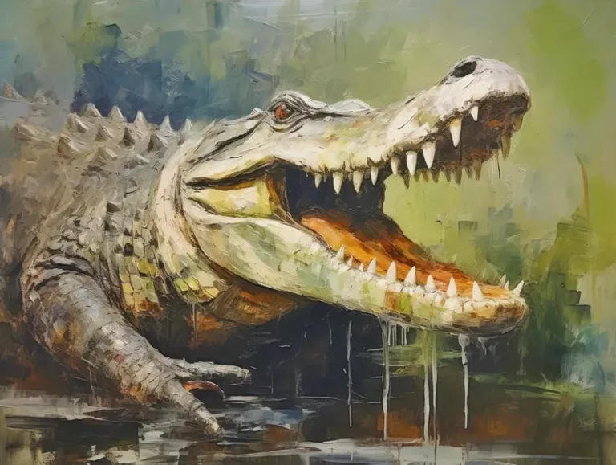

*Picture: Monster library art — Monster Manual I*

**Partial — fullest block on file:**

Type: Huge Animal
Challenge Rating: 4
Source book(s): Monster Manual I
Description: These huge creatures usually live in salt water and can be more than 20 feet long. Giant crocodiles fight and behave like their smaller cousins.
[Partial — fullest available from APOC-VTT registry record; no roster stat block found. No stat lines invented.]

## Cullenrock Barnacle — CR 0.5 — Monsternomicon Vol. 2


*Picture: APOC-VTT monster library art — Monsternomicon Vol. 2*

**Partial — fullest block on file:**

Type: Tiny Vermin (Aquatic)
Challenge Rating: ½
Source book(s): Monsternomicon Vol. 2
Description: uring my expedition to the southern islands east of Mercir, we weighed anchor near a tree-covered coastline of the largely unexplored island of Cullenrock. Together with my top aide Lynus and Gorden and Hadge, a pair of local Cygnaran bravos who offered to serve as bodyguards for a few coins, I boarded a rowboat and paddled from our hired steamship to the beach. As would be our luck, we accidentally disturbed a slumbering dracodile as we neared the rocky beach. The thing reared, and its sudden assault sent my guards overboard into the shallows.
[Partial — fullest available from APOC-VTT registry record; no roster stat block found. No stat lines invented.]

## Curst — CR 6 — Lost Empires of Faerûn


*Picture: Roster picture file — undead roster pictures (filename match in the roster picture pool; see that roster's PICTURE-INDEX.md)*

## CURST (template) + SAMPLE CURST — CR 6 (sample)
*Source: Lost Empires of Faerûn, pp.165–166 (sample and template pp.165–166; illustration p.165).*

Cursts are undead humanoids trapped under a curse that will not let them die. They are created when an evil spellcaster casts *bestow curse* on a dying subject, then uses *create undead* or *create greater undead* to grant the victim undeath.

The skin of a curst pales to an eerie white pallor. The whites of its eyes turn black and the color of the iris deepens, so that its eyes become black pools of glinting darkness. Cursts favor dark-colored clothing and wear cloaks and hoods to disguise their undead status while walking among the living. They prefer darkness to light and tend not to speak unless absolutely necessary.

A curst is not controlled by its creator, and it seldom chooses to serve any master who does not offer an escape from its undead condition. In addition, the transformation into an undead being causes some cursts to go slightly mad, reducing their effectiveness as servitors. A *remove curse* effect destroys a curst, causing it to crumble into dust.

A curst speaks whatever languages it knew in life.

### Sample Curst
*This white-skinned warrior has tortured eyes that reflect the pain of his terrible undead existence. He wears a heavy black cloak over his leather armor and carries an ancient bastard sword in his hands.*

This example curst uses a 5th-level human fighter as the base creature. Its ability scores before its transformation were Str 16, Dex 13, Con 14, Int 10, Wis 12, Cha 8.

**Curst 5th-Level Human Fighter**
**Medium Undead (Augmented Humanoid)**
**Hit Dice:** 5d12 (32 hp)
**Initiative:** +5
**Speed:** 30 ft. (6 squares)
**Armor Class:** 17 (+1 Dex, +3 masterwork studded leather armor, +3 natural), touch 11, flat-footed 16
**Base Attack/Grapple:** +5/+9
**Attack:** Slam +9 melee (1d4+6) or masterwork bastard sword +11 melee (1d10+8/19–20)
**Full Attack:** Slam +9 melee (1d4+6) or masterwork bastard sword +11 melee (1d10+8/19–20)
**Space/Reach:** 5 ft./5 ft.
**Special Qualities:** Fast healing 1, immunity to cold and fire, spell resistance 17, turning immunity, unkillable, undead traits
**Saves:** Fort +4, Ref +2, Will −1
**Abilities:** Str 18, Dex 13, Con —, Int 6, Wis 6, Cha 6
**Skills:** Climb +10, Listen +1, Ride +7, Spot +1
**Feats:** Dodge^B, Exotic Weapon Proficiency (bastard sword), Improved Initiative^B, Mobility^B, Weapon Focus (bastard sword), Weapon Specialization (bastard sword)
**Environment:** Any
**Organization:** Solitary
**Challenge Rating:** 6
**Treasure:** Standard
**Alignment:** Always chaotic neutral
**Advancement:** By character class
**Level Adjustment:** +3

### Combat
The curst fights recklessly, knowing that even if it is carved to pieces, it will simply rise again in a matter of hours or days. It often moves past a foe to reach another enemy, counting on its Mobility feat to protect it against any attacks of opportunity that its movement provokes.
**Unkillable (Ex):** The DC for the caster level check for the *remove curse* spell to lay this curst to rest is 15.

### Creating a Curst
"Curst" is an acquired template that can be added to any humanoid creature (referred to hereafter as the base creature).
**Size and Type:** The creature's type changes to undead (augmented humanoid). Do not recalculate base attack bonus, base saves, or skill points. Size is unchanged.
**Hit Dice:** All current and future Hit Dice become d12s.
**Armor Class:** The base creature's natural armor bonus improves by 3 over that of the base creature.
**Attack:** A curst retains all the attacks of the base creature and also gains a slam attack if it didn't already have one. If the base creature can use weapons, the curst retains this ability. A curst fighting without weapons uses either its slam attack or its primary natural weapon (if it has any) when making an attack action. When it has a weapon, it usually uses that weapon.
**Full Attack:** A curst fighting without weapons uses either its slam attack (see above) or its natural weapons (if it has any). If armed with a weapon, it usually uses the weapon as its primary attack along with a slam or other natural weapon as a natural secondary attack.
**Damage:** A curst has a slam attack. If the base creature does not have this attack form, use the damage values in the table (Small 1d3, Medium 1d4, Large 1d6). A creature with other kinds of natural weapons retains its old damage values or uses the appropriate value from the table, whichever is better.
**Special Qualities:** A curst retains all the special qualities of the base creature and also gains the following:
— **Fast Healing (Ex):** A curst heals 1 point of damage each round, so long as it has at least 1 hit point. If it is reduced to 0 or fewer hit points, it falls to the ground paralyzed, and its fast healing stops. After 1 hour, the curst makes a DC 20 level check. If the check succeeds, the curst regains 1 hit point, its fast healing resumes, and it is no longer paralyzed. If the check fails, it must make another check at the same DC 24 hours later, and every 24 hours thereafter until it succeeds and begins to recover hit points again. Thus, even a dismembered curst eventually recovers from its injuries, so it is implacable in its efforts.
— **Immunity to Cold and Fire (Ex):** Cursts take no damage from cold or fire attacks.
— **Madness (Ex):** A curst whose Wisdom score is 1 or 2 is afflicted with bouts of madness. In combat, it has a 5% chance each round to behave erratically. On any round in which this occurs, the curst takes no action.
— **Spell Resistance (Ex):** A curst has spell resistance equal to 12 + its character level.
— **Turning Immunity (Ex):** Cursts cannot be turned, rebuked, destroyed, or commanded.
— **Unkillable (Ex):** Only two ways exist to destroy a curst permanently. One is to destroy its body (by total immersion in acid, or a *disintegrate* or *undeath to death* spell, for example). The other is to remove the curse that keeps it from dying. The caster of the *remove curse* spell must succeed on a caster level check (DC 10 + the curst's Hit Dice) to successfully remove the curse.
**Abilities:** Increase from the base creature as follows: Str +2, Int −4 (minimum score 3), Wis −6 (minimum score 1), Cha −2 (minimum score 1). As an undead creature, a curst has no Constitution score. A curst whose Wisdom score is reduced to 1 or 2 gains the madness special quality (see above).
**Skills:** Same as the base creature. Do not reduce existing skill ranks because of the drop in Intelligence, but apply the new Intelligence modifier normally to any Intelligence-based skill checks and to the number of skill points gained when the curst gains new levels.
**Organization:** Solitary.
**Challenge Rating:** Same as the base creature +1.
**Alignment:** Often chaotic (any).
**Advancement:** By character class.
**Level Adjustment:** +3.

**Kit (sample, as published in its block):** masterwork bastard sword, masterwork studded leather armor. Treasure line: Standard.

## Cyclonic Ravager — CR 15 — Monster Manual IV


*Picture: APOC-VTT monster library art — Monster Manual IV*

**Partial — fullest block on file:**

Type: Large Elemental (Air, Extraplanar)
Challenge Rating: 15
Source book(s): Monster Manual IV
Description: The air before you seems to explode in fury. Dirt and debris funnels upward, creating a rough outline of a whirlwind with humanoid features. The creature extends its arms from its body and begins to spin in place, blasting you with hurricane-force winds.
[Partial — fullest available from APOC-VTT registry record; no roster stat block found. No stat lines invented.]

## Cyclops — CR 5 — Monsternomicon Vol. 2


*Picture: APOC-VTT monster library art — Monsternomicon Vol. 2*

**Partial — fullest block on file:**

Type: Large Monstrous Humanoid
Challenge Rating: 5
Source book(s): Monsternomicon Vol. 2
Description: My journeys through eastern Immoren often brought me afoul of the enormous, semi-prescient beasts I have named cyclopes. Possessing only a massive single eye, these creatures take in their surroundings with a malevolence I have not often seen outside my own species. Either in the wild or as conditioned slaves in the service of the skorne, I quickly learned to loath these brutes.
[Partial — fullest available from APOC-VTT registry record; no roster stat block found. No stat lines invented.]

## Darktentacles — CR 7 — Monster Manual II


*Picture: APOC-VTT monster library art — Monster Manual II*

**Partial — fullest block on file:**

Type: Large Aberration
Challenge Rating: 7
Source book(s): Monster Manual II
Description: The darktentacles is a justly feared swamp monster. Both intelligent and malicious, it often leaves treasure from previous victims scattered about to attract new prey. The creature can flatten its squishy body across the ground so as to be inconspicuous, and it usually hides in or near water. A darktentacles resembles an octopus with thirty-six tentacles, each of which can be up to 20 feet long. Instead of suction cups, each of its tentacles is lined with eyes. The creature uses some tentacles for movement and others for combat, striking with whichever tentacles are convenient.
[Partial — fullest available from APOC-VTT registry record; no roster stat block found. No stat lines invented.]

## Darkweaver — CR 10 — Fiend Folio


*Picture: APOC-VTT monster library art — Fiend Folio*

**Partial — fullest block on file:**

Type: Medium-Size Aberration (Extraplanar)
Challenge Rating: 10
Source book(s): Fiend Folio
Description: Darkweavers are sinister and alien beings from the Plane of Shadow that have found that the Material Plane offers far more plentiful hunting grounds than their home. Relatively new arrivals to the Material Plane, the darkweavers seek to learn more about the Material Plane and the power of the creatures that reside there so that they can make a bid for control.
[Partial — fullest available from APOC-VTT registry record; no roster stat block found. No stat lines invented.]

## Darnoc — CR 6 — Tome of Horrors Revised (Necromancer Games


*Picture: Undead roster picture index: official book art — official book art — Tome of Horrors Revised (Necromancer Games)*

Darnoc


**Source:** Tome of Horrors Revised (Necromancer Games, 2005), p.90

```
DARNOC
                          Medium Undead (Incorporeal)
                          Hit Dice:                   8d12 (52 hp)
                          Initiative:                 +6
                          Speed:                      30 ft. (6 squares)
                          Armor Class:                16 (+2 Dex, +4 natural), touch 12, flat-footed
                                                      14; in ghost form 14 (+2 Dex, +2 deflection),
                                                      touch 14, flat-footed 12
                          Base Attack/Grapple:        +4/+5
                          Attack:                     Slam +5 melee (1d6+1)
                          Full Attack:                Slam +5 melee (1d6+1)
                          Space/Reach:                5 ft./5 ft.
                          Special Attacks:            Create spawn, curse of the grave, frightful
                                                      presence, symbol of discord
                          Special Qualities:          Darkvision 60 ft., ghost form, +2 turn resis-
                                                      tance, undead traits
                          Saves:                      Fort +2, Ref +4, Will +7
                          Abilities:                  Str 12, Dex 14, Con —, Int 12, Wis 12, Cha 14
                          Skills:                     Hide +13, Intimidate +13, Listen +12, Search
                                                      +12, Spot +12
                          Feats:                      Blind-Fight, Combat Reflexes, Improved Ini-
                                                      tiative
                          Environment:                Any
                          Organization:               Solitary or gang (2-4)
                          Challenge Rating:           6
                          Treasure:                   Standard
                          Alignment:                  Usually lawful evil
                          Advancement:                9-18 HD (Medium); 19-24 HD (Large)
                          Level Adjustment:           —

                             This entity appears as a translucent humanoid whose face is                    Curse of the Grave (Su): Any damage dealt by a darnoc’s
                          twisted in an evil scowl. Its eyes burn with a hellish red glow.              slam attack does not heal naturally and resists all magical
                             The darnoc is a corrupting evil presence whose very touch                  healing (potions, cure spells, and so on). Before the damage
                          sucks the life from an opponent bit by painful bit. The darnoc                can be healed, the curse must first be broken with a break
                          are said to be the restless spirits of oppressive, cruel, and power           enchantment or remove curse spell (requiring a DC 20 caster
                          hungry individuals cursed forever to a life of monotony and                   level check for either spell).
                          toil, forbidden by the gods to taste the spoils of the afterlife                  Frightful Presence (Ex): This ability takes effect automati-
                          they so desperately craved in life. Often seen in the clothes                 cally whenever the darnoc attacks or charges. Creatures within
                          and guise it wore in life, a darnoc often walks the same halls                a 30-foot radius and with less HD than the darnoc become
                          and repeats the same actions of its insipid existence over and                shaken for 4d6 rounds if they fail a DC 16 Will save. If the save
                          over again. Due to their great greed, a darnoc may be found                   is successful, that creature is immune to the frightful presence
                          within its treasury endlessly counting its coins, or within                   of that darnoc for one day. The save DC is Charisma-based.
                          a graveyard noting the headstones of its vanquished foes                          Symbol of Discord (Sp): Once per day as a standard
                          with cruel mirth. When distracted from its reverie of its                     action, a darnoc can scribe a symbol in the air. All creatures
                          remembered past life, the creature flies into an inconsolable                 with an Intelligence score of 3 or higher within 60 feet who
                          rage, often lashing out without warning or provocation at the                 see the symbol must succeed on a DC 16 Will save or
                          first individual who attempts to speak to it.                                 immediately fall into loud bickering and arguing. Meaning-
                                                                                                        ful communication is impossible. If the affected creatures
                          Combat                                                                        have different alignments, there is a 50% chance that they
                             Darnoc are vicious combatants, using their symbol of                       attack each other. Bickering lasts 5d4 rounds. Fighting
                          discord and frightful presence to mind-numbing effect. The                    begins 1d4 rounds into the bickering and lasts 2d4 rounds.
                          darnoc is a cunning adversary who waits for bickering or                      Once triggered, the symbol lasts 2 hours. This is a mind-
                          terrified opponents to begin attacking one another while it                   affecting effect. The save DC is Charisma-based.
                          moves in and out of material form to assault foes that remain                     Ghost Form (Su): As a standard action, a darnoc can
                          unaffected by its symbol of discord.                                          become incorporeal for up to 10 minutes each day. While
                             Create Spawn (Su): Any humanoid slain by a darnoc                          incorporeal, the darnoc has AC 14 (+2 Dex, +2 deflection).
                          becomes a darnoc in 1d4 rounds. Spawn are under the                           The darnoc gains all the special qualities of an incorporeal
                          command of the darnoc that created them and remain                            creature (see the MM). While incorporeal, the darnoc can
                          enslaved until its death. They do not possess any of the                      use its slam attack against corporeal and incorporeal targets.
                          abilities they had in life.                                                       Copyright Notice
                                                                                                            Author Scott Greene.

                                                                                                       90
                                               the          tome of horrors revised
```

**Kit / Treasure (as published):** Treasure line: "Standard" — no itemized gear is published for this entry; none invented.

**APOC Note** *(Shaun's — separate from the published text above)*
- Counts toward the **Kingdom of the Undead** faction in the badlands war (2701 DR).
- **Planar travel is severed** — any plane shift / Ethereal travel / manifestation in the published text does not function as written in APOC; this undead is bound to the Material Plane on Toril.
- Its create spawn still makes more of its kind from Toril's dead — creation on Toril, not summoning — and feeds the Kingdom of the Undead's numbers.
- **The Bastion's Melairshield bars undead** — it cannot enter the Bastion of Last Hope.
- **Raw magic blights** the land around the caster in APOC — necromancy worked through raw magic carries that cost; alchemy is the cornerstone inside the walls.

---

## Deadborn Vulture — CR 8 — Monster Manual V


*Picture: Roster picture file — undead roster pictures (filename match in the roster picture pool; see that roster's PICTURE-INDEX.md)*

**Partial — fullest block on file:**

Type: Large Magical Beast
Challenge Rating: 8
Source book(s): Monster Manual V
Description: This gigantic bird has black feathers, but like a vulture, its plumage doesn't cover the ebony skin of its head. Its wings shine with an oily substance. A pair of glowing red eyes peers out from above a jagged beak. Necromancers create deadborn vultures from the eggs of giant eagles and giant owls.
[Partial — fullest available from APOC-VTT registry record; no roster stat block found. No stat lines invented.]

## Deadly Sin, Envy — CR 5 — Encyclopedia of Demons & Devils Vol. 1


*Picture: Demons roster picture index: LIBRARY (tier 1)*

Deadly Sin, Lust — CR 5 [3RD-PARTY — Publisher: Fast Forward Entertainment]


**Source:** *The Encyclopedia of Demons & Devils* Vol. 1, book p. 56 (PDF p. 57). "Book is 3.0-era d20 — reproduced as published."
**Classification evidence (verbatim from the page):** heading "Deadly Sin, Lust (Tanar'ri)"; type line "Medium-size Outsider (Chaotic, Evil)"; "Challenge Rating: 5"; "Alignment: Always chaotic evil." A genuine demon entry in this book — rostered.

- **Deadly Sin, Lust (Tanar'ri)**
- Medium-size Outsider (Chaotic, Evil)
- **Hit Dice:** 6d8+18 (45 hp)
- **Initiative:** +4 (Improved Initiative)
- **Speed:** 30 ft.
- **AC:** 15 (+6 natural)
- **Attacks:** Claws +11 melee
- **Damage:** Claws 1d4+5
- **Face/Reach:** 5 ft. by 5 ft. /5 ft. *(space before the slash, none after, as printed)*
- **Special Attacks:** Kiss of death, seduction *(lowercase as printed)*
- **Special Qualities:** Damage reduction 20/+2, SR 22, tanar'ri qualities
- **Saves:** Fort +8, Ref +7, Will +5
- **Abilities:** Str 20, Dex 10, Con 16, Int 10, Wis 10, Cha 20
- **Skills:** Balance +8, Diplomacy +13, Intimidate +13, Move Silently +8, Open Lock +8, Spot +8
- **Feats:** Improved Initiative, Lightning Reflexes
- **Climate/Terrain:** Any land or underground
- **Organization:** Solitary
- **Challenge Rating:** 5
- **Treasure:** Standard
- **Alignment:** Always chaotic evil
- **Advancement Range:** None

**Description (verbatim, book p. 56):** "Uncontrolled sexual desire draws demonic Lust into the material world. Once summoned, she presents herself as a willing surrogate, alluring and available, awash in deadly charms." / "Lust is a medium-size outsider, though every bit as strong and powerful as her other sinful counterparts. Most often summoned from the mind of a lustful mortal male, she appears at first to be female, but, in fact, her appearance is completely in the eye of the beholder. Lust appears to every mortal as the perfect embodiment of what they feel is sexually desirable, from sex and body form to mannerisms and dress. She appears differently to different people in the same instant. A man might see an alluring young woman with flowing hair in a flattering gown, while at the same time a woman might see a handsome, powerfully built gentleman. Lust knows no bounds. Armed with her supernatural powers of seduction, she knows exactly what to say and how to say it, how to move and slip inside a victim's personal space and finally lure that person into an intense sexual encounter that costs her mortal partner his life." / "Mortal lust draws its demonic form into existence and to the prime material plane. A single instance of intense lust, pure sexual desire untainted by love or emotional attachment, is sufficient to call her into being. In a city's seamier districts where the sex trade runs unfettered by law enforcement, many demons of Lust may be present on any given evening. Patrons enticed by exotic dancers may find themselves beset by demonic Lust who presents herself as an eager and willing partner. The creature always preys upon the indiscrete lustful mortal who calls her into being, but once finished with him, she remains among the living, destroying victim after victim until found out and destroyed. Lust immediately tries to seduce every character she comes across. On meeting multiple characters at once, she evaluates which is most likely to succumb to her charms and immediately takes steps to separate him from his comrades." *[sic — "indiscrete" as printed, the book's spelling of "indiscreet"]* / "Lust is not particularly cunning or patient. She quickly reduces her behavior to the most base level to achieve her ends, often when the situation does not warrant such crude manner. Unable to tempt one character, she makes no bones about dumping him for another."

**Combat (verbatim):** "Lust can attack opponents with her claws, but only as a last resort. Her methods are subtler than most demons', and she may take several days to lure one victim into a compromising position to endure her kiss of death."
**Kiss of Death (Su) (verbatim):** "Lust uses her kiss of death only after successfully reaching the last stage of her seduction power. Lust clamps her mouth against the victim's and literally sucks the life force out of that person. Every round, the victim suffers a loss of 10 hit points and permanent reduction of one point in all six ability scores unless he can make a successful Fortitude save (DC 30) to break it."
**Seduction (Su) (verbatim):** "Characters must make a series of Willpower saves to avoid Lust's powers of seduction. A character's failing the first save (DC 20) allows Lust to engage in conversation with the character and lure him toward her with her charismatic charms. Failing the second save (DC 25) forces the character to accompany Lust to a secluded spot away from companions and other mortals. Failing the third save (DC 30) forces the character to begin making love, an act that never reaches conclusion before she unleashes her kiss of death. Note, however, that in a role-playing situation, any character who freely wants to speak with, accompany, and then make love to demonic Lust automatically fails these saves." *("Willpower saves" as printed)*

**APOC NOTE (Shaun's canon — separate from the published text above):** Third-party lore is reference only, not FR canon. The book's p. 51 "Deadly Sins" essay frames the sins as demonic embodiments coalesced from unchecked mortal passion — reference only. In APOC Lust is mortal and trapped inside the scarred crystal sphere; planar travel is severed and summoning spells DON'T WORK, so no mortal's lust calls her into being across any plane; the Bastion's mythal bars demons absolutely.

---

## Deadly Sin, Gluttony — CR 5 — Encyclopedia of Demons & Devils Vol. 1


*Picture: Demons roster picture index: LIBRARY (tier 1)*

Deadly Sin, Lust — CR 5 [3RD-PARTY — Publisher: Fast Forward Entertainment]


**Source:** *The Encyclopedia of Demons & Devils* Vol. 1, book p. 56 (PDF p. 57). "Book is 3.0-era d20 — reproduced as published."
**Classification evidence (verbatim from the page):** heading "Deadly Sin, Lust (Tanar'ri)"; type line "Medium-size Outsider (Chaotic, Evil)"; "Challenge Rating: 5"; "Alignment: Always chaotic evil." A genuine demon entry in this book — rostered.

- **Deadly Sin, Lust (Tanar'ri)**
- Medium-size Outsider (Chaotic, Evil)
- **Hit Dice:** 6d8+18 (45 hp)
- **Initiative:** +4 (Improved Initiative)
- **Speed:** 30 ft.
- **AC:** 15 (+6 natural)
- **Attacks:** Claws +11 melee
- **Damage:** Claws 1d4+5
- **Face/Reach:** 5 ft. by 5 ft. /5 ft. *(space before the slash, none after, as printed)*
- **Special Attacks:** Kiss of death, seduction *(lowercase as printed)*
- **Special Qualities:** Damage reduction 20/+2, SR 22, tanar'ri qualities
- **Saves:** Fort +8, Ref +7, Will +5
- **Abilities:** Str 20, Dex 10, Con 16, Int 10, Wis 10, Cha 20
- **Skills:** Balance +8, Diplomacy +13, Intimidate +13, Move Silently +8, Open Lock +8, Spot +8
- **Feats:** Improved Initiative, Lightning Reflexes
- **Climate/Terrain:** Any land or underground
- **Organization:** Solitary
- **Challenge Rating:** 5
- **Treasure:** Standard
- **Alignment:** Always chaotic evil
- **Advancement Range:** None

**Description (verbatim, book p. 56):** "Uncontrolled sexual desire draws demonic Lust into the material world. Once summoned, she presents herself as a willing surrogate, alluring and available, awash in deadly charms." / "Lust is a medium-size outsider, though every bit as strong and powerful as her other sinful counterparts. Most often summoned from the mind of a lustful mortal male, she appears at first to be female, but, in fact, her appearance is completely in the eye of the beholder. Lust appears to every mortal as the perfect embodiment of what they feel is sexually desirable, from sex and body form to mannerisms and dress. She appears differently to different people in the same instant. A man might see an alluring young woman with flowing hair in a flattering gown, while at the same time a woman might see a handsome, powerfully built gentleman. Lust knows no bounds. Armed with her supernatural powers of seduction, she knows exactly what to say and how to say it, how to move and slip inside a victim's personal space and finally lure that person into an intense sexual encounter that costs her mortal partner his life." / "Mortal lust draws its demonic form into existence and to the prime material plane. A single instance of intense lust, pure sexual desire untainted by love or emotional attachment, is sufficient to call her into being. In a city's seamier districts where the sex trade runs unfettered by law enforcement, many demons of Lust may be present on any given evening. Patrons enticed by exotic dancers may find themselves beset by demonic Lust who presents herself as an eager and willing partner. The creature always preys upon the indiscrete lustful mortal who calls her into being, but once finished with him, she remains among the living, destroying victim after victim until found out and destroyed. Lust immediately tries to seduce every character she comes across. On meeting multiple characters at once, she evaluates which is most likely to succumb to her charms and immediately takes steps to separate him from his comrades." *[sic — "indiscrete" as printed, the book's spelling of "indiscreet"]* / "Lust is not particularly cunning or patient. She quickly reduces her behavior to the most base level to achieve her ends, often when the situation does not warrant such crude manner. Unable to tempt one character, she makes no bones about dumping him for another."

**Combat (verbatim):** "Lust can attack opponents with her claws, but only as a last resort. Her methods are subtler than most demons', and she may take several days to lure one victim into a compromising position to endure her kiss of death."
**Kiss of Death (Su) (verbatim):** "Lust uses her kiss of death only after successfully reaching the last stage of her seduction power. Lust clamps her mouth against the victim's and literally sucks the life force out of that person. Every round, the victim suffers a loss of 10 hit points and permanent reduction of one point in all six ability scores unless he can make a successful Fortitude save (DC 30) to break it."
**Seduction (Su) (verbatim):** "Characters must make a series of Willpower saves to avoid Lust's powers of seduction. A character's failing the first save (DC 20) allows Lust to engage in conversation with the character and lure him toward her with her charismatic charms. Failing the second save (DC 25) forces the character to accompany Lust to a secluded spot away from companions and other mortals. Failing the third save (DC 30) forces the character to begin making love, an act that never reaches conclusion before she unleashes her kiss of death. Note, however, that in a role-playing situation, any character who freely wants to speak with, accompany, and then make love to demonic Lust automatically fails these saves." *("Willpower saves" as printed)*

**APOC NOTE (Shaun's canon — separate from the published text above):** Third-party lore is reference only, not FR canon. The book's p. 51 "Deadly Sins" essay frames the sins as demonic embodiments coalesced from unchecked mortal passion — reference only. In APOC Lust is mortal and trapped inside the scarred crystal sphere; planar travel is severed and summoning spells DON'T WORK, so no mortal's lust calls her into being across any plane; the Bastion's mythal bars demons absolutely.

---

## Death Centaur (Bone Golem) — CR 13 — Constructs: It Is Alive


*Picture: Constructs roster picture index: Official book art — Constructs: It Is Alive, printed p. 14 — the page's worked-example illustration: the centaur-form skeletal bone golem with its creator (the build the text describes)*

## 7. DEATH CENTAUR (BONE GOLEM) [3RD-PARTY] — BORDERLINE
**Source:** Constructs: It Is Alive, p. 15 (worked example, The Drawing Board, pp. 14–15) (Mongoose Publishing, 2002, 3.0)
**Gate:** BORDERLINE — the book's only full creature stat block, a *named, unique* construct ("Organisation: Solitary (unique)"), entered in full under the BORDERLINE rule because its printed **Int –** puts it outside the sentience gate while its unique/named status puts it inside the brief's named-construct scope. For Shaun to rule.

### As published (3.0, verbatim)

**Planning text (p. 14, the construct's making, abridged to the creature's own facts):** Narsell builds "a terrifying golem: a large skeletal warrior wielding a scythe… a centaur-like skeletal shape, with an elongated snout adorned with fangs," from a Large bone golem (56 CP), the feat Extra Pair of Legs (6 CP), Combat Expertise (2 CP), Melee Weapon Proficiency (scythe) (2 CP), and the special ability Unavoidable (Su). Totals: 66 CP, BR 21, CR modifier +7. Cost: 66 CPs × 25 = 1,650 XP; 82,500 gp total (1,650 × 50), body 1,050 gp (21 BR × 50). The Huge scythe costs 354 gp (18 gp × 3 for one size increment, +300 gp masterwork), deals 2d6 and weighs 36 pounds.

> **DEATH CENTAUR (BONE GOLEM)**
> **Large Construct**
> **Hit Dice:** 12d10 (66 hp)
> **Initiative:** +0
> **Speed:** 40 ft. (cannot run)
> **AC:** 21 (-1 size, +12 natural)
> **Attacks:** 2 slams +16 melee or 1 huge scythe +17 / +14 melee [*verify* — second attack value as read from the scan; see 3.5 Update]
> **Damage:** Slam 3d8+8, scythe 2d6+9
> **Face/Reach:** 5 ft. by 5 ft./10 ft.
> **Special Attacks:** Unavoidable
> **Special Qualities:** Construct, magic immunity, damage reduction 20/+2, brittle, darkvision 60 ft.
> **Saves:** Fort +4, Ref +4, Will +4
> **Abilities:** Str 26, Dex 10, Con –, Int –, Wis 11, Cha 1
> **Climate/Terrain:** Any land
> **Organisation:** Solitary (unique)
> **Challenge Rating:** 13
> **Treasure:** None (1 huge masterwork scythe)
> **Alignment:** Always neutral
>
> The death centaur is a golem made from a collection of bones forming a strange centaur-like shape with an inhuman head dotted with small fangs, wielding a great scythe.
>
> **Construct:** Immune to mind-influencing effects, poison, disease, and similar effects. Not subject to critical hits, subdual damage, ability damage, energy drain, or death from massive damage.
> **Magic Immunity (Ex):** Bone golems are immune to all spells, spell-like abilities, and supernatural effects, except as follows. Acid-based effects slow them (as the spell) for 1d6 rounds, with no saving throw. An electricity effect breaks any slow effect on the golem and cures 1 point of damage for each 3 points of damage it would otherwise deal. For example, a bone golem hit by a *lightning bolt* cast by a 5th-level wizard gains back 6 hit points if the damage total is 18. The golem rolls no saving throw against electricity effects.
> **Brittle (Ex):** Unlike normal constructs, bone golems are subject to critical hits from bludgeoning weapons, but not to sneak attacks.
> **Unavoidable (Su):** The creator can designate a target creature via scrying or by providing a link with it, or the death centaur may acquire one through sight. From then on, the construct is always aware of the location of the target creature and will follow it wherever it may be, as long as they are on the same plane of existence. The death centaur is not fooled by polymorph spells and is only slowed down by effects that block scrying. The creator can recall the construct at any time.
>
> **Construction:** The golem costs 82,500 gp to create, which includes 1,050 gp for the construction of the body. Assembling the body requires a successful Craft (sculpture) check (DC 19). The creator must be 14th level and able to cast arcane spells. Completing the ritual drains 1,650 XP from the creator and requires *geas/quest, limited wish, locate creature, polymorph any object* and *scrying*.

**Kit (fully kitted — unique/named construct):** 1 Huge masterwork scythe — 354 gp (18 gp × 3 size increment + 300 gp masterwork, as printed p. 15), damage 2d6, weight 36 lb. Treasure as published: None beyond the scythe, which is listed in its Treasure line above.

### 3.5 Update
**3.5 conversion:** **DR printed as 20/+2; converted to 20/magic** (3.5 DR is bypassed by type/material/alignment, not by a plus; the magnitude 20 is steep by 3.5 norms but is carried as printed-converted, not re-balanced). **Hit points change:** 12d10 (66 hp) → **12d10+30 (96 hp)** — 3.5 constructs gain bonus hit points by size (Large +30) in place of a Constitution bonus. **Face/Reach 5 ft. by 5 ft./10 ft. converts to Space/Reach: 10 ft./10 ft.** (3.5 Large creatures take a 10 ft. space; the 5 ft. face was a 3.0 long-creature facing artifact; reach 10 ft. as printed). **Base Attack/Grapple added in 3.5 format:** BAB +9 (¾ × 12 HD), grapple +21 (+9 BAB, +8 Str, +4 size). **Attack line in 3.5 format:** slam +16 melee (2 slams), scythe +17 melee — the printed iterative "+14" does not follow from any 3.0 or 3.5 iteration (BAB +9 gives +17/+12 with the masterwork scythe); the printed value is reproduced above, flagged *verify* against the scan, and the 3.5 full attack reads **2 slams +16 melee or Huge masterwork scythe +17/+12 melee (2d6+9)** — note the scythe damage as printed (+9) matches neither a one-handed (+8) nor a two-handed (+12) Strength application; retained as published, arithmetic flagged, not fixed. **AC line in 3.5 format:** 21 (–1 size, +12 natural), touch 9, flat-footed 21. **Saves do not change:** Fort +4, Ref +4, Will +4 already equal the 3.5 construct progression for 12 HD (base +4, no relevant ability modifiers) — the book's worked example happens to match 3.5 even though the template chapter's cleric-saves rule does not. **Skills/Feats:** none in either edition (mindless). **CR sanity check:** CR 13 for 96 hp, AC 21, DR 20/magic, magic immunity and a homing special attack is high by 3.5 norms (a 3.5 stone golem is CR 11) but defensible given the DR magnitude and Unavoidable; 13 stands as the printed/construction-derived value (base bone golem + modifiers per the book's own table), flagged as the book's arithmetic, not re-derived.

## Deathshrieker — CR 15 — Monster Manual III


*Picture: Undead roster picture index: official book art — official book art — Monster Manual III*

DEATHSHRIEKER — Monster Manual III, pp.32–33


- **Size/Type:** Medium Undead (Incorporeal)
- **Hit Dice:** 18d12 plus 18 (135 hp)
- **Initiative:** +11
- **Speed:** Fly 40 ft. (good) (8 squares)
- **Armor Class:** 28 (+7 Dex, +5 deflection, +6 profane), touch 28, flat-footed 21
- **Base Attack/Grapple:** +9/—
- **Attack:** Incorporeal touch +16 melee (1d4 Cha drain)
- **Full Attack:** Incorporeal touches +16/+11/+6 melee (1d4 Cha drain)
- **Space/Reach:** 5 ft./5 ft.
- **Special Attacks:** Death wail, horrific visage
- **Special Qualities:** Darkvision 60 ft., incorporeal traits, undead traits, unholy grace, unholy toughness
- **Saves:** Fort +8, Ref +15, Will +14
- **Abilities:** Str —, Dex 24, Con —, Int 12, Wis 12, Cha 22
- **Skills:** Hide +18, Listen +12, Move Silently +18, Perform (oratory) +17, Spot +12
- **Feats:** Ability Focus (death wail), Flyby Attack, Hover, Improved Initiative, Improved Toughness, Quicken Spell-Like Ability, Snatch *(as printed)*
- **Environment:** Any cold
- **Organization:** Solitary
- **Challenge Rating:** 15
- **Treasure:** None
- **Alignment:** Always chaotic evil
- **Advancement:** 19–25 HD (Medium)
- **Level Adjustment:** —
- **Variant (as published in the same entry):** the MM3 entry prints a second, advanced stat block — **CR 19**: 25d12 plus 25 (187 hp), Init +12, fly 40 ft. (good), AC 31 (+8 Dex, +5 deflection, +8 profane), touch 31, flat-footed 23, Base Atk +12/—, incorporeal touches +20/+15/+10. Filed as a variant under this entry, not a separate creature.

## Demon, Kastighur — CR 11 — Monster Manual IV


*Picture: APOC-VTT monster library art — Monster Manual IV*

KASTIGHUR — Monster Manual IV, p.42 (entry pp.42–43)


- **Size/Type:** Huge Outsider (Chaotic, Evil, Extraplanar, Tanar'ri)
- **Hit Dice:** 15 HD (172 hp) (MM4 format prints hp and HD count; no dice formula published)
- **Initiative:** −1
- **Speed:** 30 ft. (6 squares) in breastplate; base speed 40 ft.
- **Armor Class:** 23 (−2 size, −1 Dex, +7 armor, +9 natural), touch 7, flat-footed 23 (wears a +2 breastplate — Possessions line, below)
- **Base Attack/Grapple:** +15/+31
- **Attack:** Gore +21 melee (2d6+8)
- **Full Attack:** Gore +21 melee (2d6+8) and 2 slams +19 each (1d8+4)
- **Space/Reach:** 15 ft./15 ft.
- **Special Attacks:** Frightful presence (Su; on charging or attacking, creatures within 60 ft. must succeed on a DC 18 Will save or become shaken, remaining in that condition as long as they remain within 60 ft. of the kastighur; save DC Charisma-based and includes the bonus from Ability Focus); stunning charge (Ex; single gore attack at a +23 attack bonus dealing 5d6+12 damage; the struck creature must succeed on a DC 25 Fortitude save or be stunned for 1 round; save DC Strength-based); fear bolstered (Ex; +2 bonus on attack rolls against shaken, frightened, or panicked creatures); aligned strike (chaotic, evil)
- **Special Qualities:** Tanar'ri traits; spell-like abilities (CL 18th; at will — feather fall, teleport [self only]); immune acid, electricity, poison; resist cold 10, fire 10; SR 17; DR 10/cold iron or good; darkvision 60 ft.; scent; telepathy 100 ft.; **lacks** summon tanar'ri and greater teleport — unusual for a tanar'ri of its power (its teleport is the standard spell-like ability above; per the entry's tactics and lore, kastighurs are loath to teleport great distances and can teleport as a swift action via Quicken Spell-Like Ability)
- **Saves:** Fort +16, Ref +8, Will +10
- **Abilities:** Str 27, Dex 8, Con 25, Int 8, Wis 12, Cha 8
- **Skills:** Concentration +15, Diplomacy +1, Intimidate +17, Knowledge (dungeoneering) +4, Knowledge (nature) +6, Knowledge (the planes) +5, Listen +19, Search +8, Sense Motive +13, Spellcraft +8, Spot +19, Survival +19 (+21 on other planes, +21 following tracks, +21 in aboveground environments, +21 underground)
- **Feats:** Ability Focus (frightful presence), Improved Bull Rush, Improved Overrun, Multiattack, Power Attack, Powerful Charge, Quicken Spell-Like Ability (teleport), Track (B)
- **Environment:** Infinite Layers of the Abyss (kastighurs live in the Infinite Layers of the Abyss; in Faerûn they make their home on the Barrens of Doom and Despair — MM4 p.43)
- **Organization:** Solitary or pair (Fox Hunt, EL 16: two kastighurs — MM4 p.43; kastighurs typically serve more intelligent and powerful demons as hunters and jailers)
- **Challenge Rating:** 11
- **Treasure:** Half standard for a creature of its Challenge Rating, usually in the form of the magic breastplate bolted to its body (Typical Treasure, MM4 p.43); Possessions: +2 breastplate
- **Alignment:** Always chaotic evil
- **Advancement:** 16–30 HD (Huge); 31–45 HD (Gargantuan)
- **Level Adjustment:** — (none published in Monster Manual IV)
- **Description:** "This hideous demon's body ripples with muscle. Its massive head is heavy with long horns while its powerful legs end in cloven hooves. Most of its head is hidden by an enormous steel helm that has been bolted to the creature's neck. A breastplate fastened onto its body provides additional protection for its already tough hide. Cruel and sadistic, the brutish kastighurs act as hunters and prison wardens among the tanar'ri. Kastighurs stand anywhere from 15 feet to 20 feet tall, and can weigh as much as 10,000 pounds." 

**Nature/role:** Hunter and prison warden of demonkind — the thing demon lords send to drag escapees back.

## Demon, Zovvut — CR 9 — Monster Manual II


*Picture: APOC-VTT monster library art — Monster Manual II*

ZOVVUT — Monster Manual II, pp.60–61


- **Size/Type:** Medium Outsider (Chaotic, Evil) — NOT tanar'ri
- **Hit Dice:** 10d8+20 (65 hp)
- **Initiative:** +1
- **Speed:** 30 ft., fly 50 ft. (average)
- **Armor Class:** 20 (+1 Dex, +9 natural), touch 11, flat-footed 19
- **Base Attack/Grapple:** — (not published in Monster Manual II's 3.0 stat format)
- **Attack:** Claw +13 melee (1d12+3)
- **Full Attack:** 2 claws +13 melee (1d12+3)
- **Space/Reach:** 5 ft. by 5 ft./5 ft.
- **Special Attacks:** Draining gaze (30 ft., Will DC 17 or gain 1 negative level; for each negative level bestowed, the zovvut heals 5 points of damage; a humanoid slain by the gaze rises as a wight in 1d4 rounds); spell-like abilities (at will: clairaudience/clairvoyance, darkness, desecrate, detect good, detect thoughts, doom, suggestion, teleport without error — self plus 50 pounds of objects only; caster level 12th; save DC 12 + spell level)
- **Special Qualities:** Create spawn, DR 20/+2 (as printed, 3.0), outsider traits, SR 20
- **Saves:** Fort +9, Ref +8, Will +10
- **Abilities:** Str 17, Dex 13, Con 15, Int 14, Wis 16, Cha 14
- **Skills:** Bluff +10, Concentration +12, Diplomacy +6, Hide +11, Intimidate +4, Listen +13, Move Silently +11, Scry +11, +15 [skill name omitted as printed in MM2 — published error, flagged and reproduced as published], Sense Motive +16, Spellcraft +8, Spot +18
- **Feats:** Alertness, Dodge, Mobility
- **Environment:** Any land and underground (Climate/Terrain line as printed)
- **Organization:** Solitary or squad (1 plus 2–4 wights)
- **Challenge Rating:** **7** (Fiendish Codex I App. III revision) — **VARIANT: MM2 as printed, CR 9**
- **Treasure:** Standard
- **Alignment:** Always chaotic evil
- **Advancement:** 11–16 HD (Medium-size)
- **Level Adjustment:** — (none published in Monster Manual II)
- **Description:** "Zovvuts are the spawn of some terrible demon prince. The first of them were created during horrible blood rites centuries ago. Rumors link zovvuts to that master of demons and necromancy known as Orcus, though the secret of the creatures' creation has become widely known among the lords of the Abyss. A zovvut is a muscular, pale-skinned, hairless creature of humanoid shape. Its arms end in sharp, barbed claws that are well designed for rending flesh. Foul, feathered wings stretch upward from the zovvut's shoulders. A third eye is set into the center of its forehead." 

**Nature/role:** Undead-adjacent eye-demon in Orcus's orbit; its gaze makes wights of the slain.

## Derek Windsfire — CR 11 — NPCs — ALL-150 (Shaun's cast)


*Picture: Roster picture file (npc roster pictures; named in the creature's roster entry)*

149. Derek Windsfire — NG Male Half-Moon Elf Fighter 11


**Tracker status (as-is):** "Grand Civilar, City Watch"
**Tracker detail:** NG male half-moon elf fighter 11 — used exactly as given (half-moon elf built as a moon elf: +2 Dex, −2 Con, elf traits). Senior commander of the City Watch under Captain Rulathon.
**Abilities:** Str 16 (+3; 15 +1 level), Dex 18 (+4; 13 +2 racial +1 level +2 gloves), Con 12 (+1; 14 −2 racial), Int 12 (+1), Wis 12 (+1), Cha 13 (+1). **HD** 11d10+11; **hp** 71 (10 +10×5 +11). **Init** +8; **Speed** 30 ft. **AC** 23 (+6 *+2 mithral chain shirt*, +4 Dex, +2 *+1 buckler*, +1 *ring of protection +1*), touch 15, flat-footed 19. **BAB/Grapple** +11/+14. **Attack:** *+2 longsword* +16 melee (1d8+5/19–20) or masterwork composite longbow (+3 Str) +16 ranged (1d8+3/x3). **Full Attack:** longsword +16/+11/+6. **Space/Reach** 5 ft./5 ft. **SA/SQ:** Grand Civilar (senior Watch commander; jurisdiction city-wide under Rulathon), elf traits (sleep immunity, low-light vision, +2 Listen/Search/Spot included), fighter feat chain as listed. **Saves:** Fort +9 (base +7, Con +1, vest +1), Ref +8 (+3, +4, +1), Will +5 (+3, +1, +1). **Skills:** Diplomacy +9, Gather Information +9, Intimidate +10, Jump +13, Knowledge (local) +7, Listen +9, Ride +14, Sense Motive +8, Spot +10. **Feats:** Weapon Focus (longsword), Weapon Specialisation (longsword), Greater Weapon Focus, Dodge, Mobility, Spring Attack, Improved Initiative, Combat Reflexes, Power Attack, Quick Draw.
**Equipment (20,500 gp):** *+2 mithral chain shirt* (5,100), *+2 longsword* (8,315), *gloves of dexterity +2* (4,000), *+1 buckler* (1,165), *vest of resistance +1* (1,000), masterwork composite longbow (+3 Str) (700), Grand Civilar's brass seal and lamp (Watch issue), 220 gp.
**Steampunk aesthetic:** A moon elf in Bastion service wears the city like a well-cut coat: grey-green mithral shirt under a Watch commander's frock coat with brass civilar gears at the cuffs, a buckler fitted with a small amber patrol lamp, and bow and sword both in oiled, riveted leather; his Grand Civilar's seal is a geared brass press that stamps orders with a hiss of steam.
**Appearance/Personality:** Quick, dry-humoured, and visibly half a step ahead of every conversation — the field commander to Rulathon's strategist. Where the Captain is the map, Derek is the patrol. **Voice hook:** finishes other people's reports for them, correctly, which his subordinates find equal parts impressive and infuriating. **Motivation:** a Watch that is *present* — seen on the streets, known by name, faster than the trouble it answers. **Secret/Flaw:** his moon-elf heritage makes him the Watch's most visible "not quite human" senior officer, and he overcompensates with a workload that is slowly wrecking his health; the Con he lost to his bloodline is being spent again on sixteen-hour days. **DM Hook:** the most approachable of the Watch's senior command — he will meet the party in the field, hear them out at speed, and either back them fully or warn them off once, plainly, before the Captain hears their names.

---

*Part C complete: 15 tracker people (entries 35–49) fully statted, kitted to NPC wealth-by-level, with steampunk aesthetic lines. Judgement calls flagged in-entry: Steam Mage and Watchman are Bastion source classes built on legal 3.5 chassis (noted at Naronen and Tells); Maaril's race is not stated in the tracker and none was invented; Lyra Ivessa was built cleric 16 as a senior high priestess and Bastion councilor; Mylor Orvid holds the most wizard class levels in the Bastion (Wizard 20) per his tracker status.*

---

## Desert Hydra (5-headed) — CR 15 — Monsternomicon Vol. 2


*Picture: APOC-VTT monster library art — Monsternomicon Vol. 2*

**Partial — fullest block on file:**

Type: Huge Magical Beast
Challenge Rating: 15
Source book(s): Monsternomicon Vol. 2
Description: Ican honestly say that, in all my extensive travels, I’ve delighted in encountering few creatures more than the desert hydra. Gigantic, powerful, terrible to behold, and foul-tempered in the extreme, these beasts offer a very definition of monsters. Their appeal extends beyond their obviously fearsome appearances, however. Naturalists dream of studying creatures possessed of such a wholly unique physiology and reproductive and maturation processes that one might best describe as terrifyingly novel. Already I’m excitedly outlining an extensive thesis on these sand-bound horrors.
[Partial — fullest available from APOC-VTT registry record; no roster stat block found. No stat lines invented.]

## Desiccator — CR 2 — Libris Mortis


*Picture: Undead roster picture index: official book art — official book art — Libris Mortis*

15. DESICCATOR — Libris Mortis p.94, CR 2

**Small Undead (Water)**
**Hit Dice:** 4d12 (26 hp) **Initiative:** +5 **Speed:** 20 ft. (4 squares), swim 60 ft. **Armor Class:** 15 (+1 size, +1 Dex, +3 natural), touch 12, flat-footed 14 **Base Attack/Grapple:** +2/+1 **Attack:** Slam +6 melee (1d6 plus fatigue) **Full Attack:** Slam +6 melee (1d6 plus fatigue) **Space/Reach:** 5 ft./5 ft. **Special Attacks:** Desiccating breath, fatiguing touch **Special Qualities:** Darkvision 60 ft., elemental turning vulnerability, inescapable craving, undead traits **Saves:** Fort +1, Ref +2, Will +4 **Abilities:** Str 16, Dex 12, Con —, Int 8, Wis 11, Cha 13 **Skills:** Listen +7, Search +7, Spot +7 **Feats:** Ability Focus (desiccating breath), Improved Initiative **Environment:** Any **Organization:** Solitary or gang (2–5) **Challenge Rating:** 2 **Treasure:** None **Alignment:** Always neutral evil **Advancement:** 5–7 HD (Medium), 8–12 HD (Large) **Level Adjustment:** +3
> *This small, salt-encrusted humanoid figure looks parched and gasping. Around it, a dry, hot breeze seems to blow from nowhere.*
Flavor/combat prose (verbatim, Libris Mortis pp.94–95): Desiccators are the dried-out undead remnants of creatures of elemental water. They long to quench their tremendous thirst with the precious fluids of living creatures. Thanks to their withered forms, desiccators are sometimes mistaken for mummies, although they wear none of the wrappings common to those creatures. Cursed to remain forever bereft of the watery form it had in life, the desiccator envies and despises all living things. Most desiccators stand about 4 feet tall but weigh only 30 to 40 pounds. Desiccators speak Aquan. COMBAT: A desiccator opens combat with its breath weapon, seeking to weaken opponents' resistance to its fatiguing touch. Desiccating Breath (Su): 15-foot cone of desiccating air every 1d4 rounds, damage 1 Con, Fortitude DC 15 negates. (Creatures with the water subtype take a –4 penalty on this save.) The save DC is Charisma-based and includes a +2 bonus from the Ability Focus feat. Fatiguing Touch (Su): The slam of a desiccator, in addition to dealing 1d8 points of damage, makes living creatures fatigued. A DC 13 Fortitude save negates the fatigue but not the damage. (Creatures with the water subtype take a –4 penalty on this save.) If the victim fails the save, the desiccator also gains 5 temporary hit points, which last for up to 1 hour. A creature already fatigued cannot become exhausted as a result of this touch. The save DC is Charisma-based. Elemental Turning Vulnerability (Ex): A character who can turn undead and also turn water creatures gains a +2 bonus on turning checks to turn a desiccator. A character who can rebuke undead and also rebuke water creatures gains a +2 bonus on turning checks to rebuke a desiccator. Inescapable Craving: A desiccator has an inescapable craving (see the Undead Metabolism section in Chapter 1) for water, which it absorbs by using its fatiguing touch ability.
**Kit:** Published treasure: **None.**
**APOC Note:** Companion piece to the Cinderspawn — a water remnant stranded by the severing, craving the fluids of the living. Kingdom of the Undead gang-level threat. No summoning/planar abilities on its block. Barred from the Bastion by the Melairshield.

## Devil Rat Swarm — CR 3 — Monsternomicon Vol. 2


*Picture: APOC-VTT monster library art — Monsternomicon Vol. 2*

**Partial — fullest block on file:**

Type: Tiny Magical Beast (Swarm)
Challenge Rating: 3
Source book(s): Monsternomicon Vol. 2
Description: Idid not have to go far to study devil rats; the creatures infest Corvis. They demonstrate particular cunning for something akin to an animal. Their assaults on the Corvis University laboratory remind me that some creatures, no matter how fascinating in the wild, become nothing but nuisances when they invade your office and make off with several specimens. These irritating creatures display problem-solving abilities and can use simple tools like keys or switches. They also adeptly avoid detection and traps set for them.
[Partial — fullest available from APOC-VTT registry record; no roster stat block found. No stat lines invented.]

## Devourer — CR 11 — Monster Manual I


*Picture: Undead roster picture index: official book art — official book art — Monster Manual I*

3. DEVOURER


**Source:** Monster Manual (3.5), pp. 58–59 — book copy in the local library (`MonsterManual1.pdf` / `MonsterManual1.txt`). SRD cross-check: https://dnd-wiki.org/wiki/SRD:Devourer

**Size/Type:** Large Undead (Extraplanar)
**Hit Dice:** 12d12 (78 hp)
**Initiative:** +4
**Speed:** 30 ft. (6 squares)
**Armor Class:** 24 (–1 size, +15 natural), touch 9, flat-footed 24
**Base Attack/Grapple:** +6/+19
**Attack:** Claw +15 melee (1d6+9)
**Full Attack:** 2 claws +15 melee (1d6+9)
**Space/Reach:** 10 ft./10 ft.
**Special Attacks:** Energy drain, trap essence, spell-like abilities
**Special Qualities:** Darkvision 60 ft., spell deflection, spell resistance 21, undead traits
**Saves:** Fort +4, Ref +4, Will +11
**Abilities:** Str 28, Dex 10, Con —, Int 16, Wis 16, Cha 17
**Skills:** Climb +24, Concentration +18, Diplomacy +5, Jump +24, Listen +18, Move Silently +15, Search +10, Sense Motive +11, Spot +18, Survival +3 (+5 following tracks)
**Feats:** Blind Fight, Combat Casting, Combat Expertise, Improved Initiative, Weapon Focus (claw)
**Environment:** Any
**Organization:** Solitary
**Challenge Rating:** 11
**Treasure:** None
**Alignment:** Always neutral evil
**Advancement:** 13–24 HD (Large); 25–36 HD (Huge)
**Level Adjustment:** —

*This tall, skeletal creature has strands of mummified flesh hanging from its bones.*
*(Book flavor line; the SRD omits it.)*

Devourers lurk on the Ethereal Plane and the Astral Plane, stalking both natives and travelers with equal sadistic glee.

A devourer is about 9 feet tall and weighs 500 pounds.

Devourers speak Common.

## Dinosaur, Bloodstriker — CR 6 — Monster Manual III


*Picture: APOC-VTT monster library art — Monster Manual III*

**Partial — fullest block on file:**

Type: Large Animal
Challenge Rating: 6
Source book(s): Monster Manual III
Description: This quadruped is covered with a thick, spiked hide. Two large horns jut backward from its massive head. Bloodstriker dinosaurs feed on vegetation and larger insects, often burrowing to hide from both predators and prey. A bloodstriker is about 14 feet long and weighs about 3,000 pounds.
[Partial — fullest available from APOC-VTT registry record; no roster stat block found. No stat lines invented.]

## Dinosaur, Cryptoclidus — CR 3 — Monster Manual II


*Picture: APOC-VTT monster library art — Monster Manual II*

**Partial — fullest block on file:**

Type: Large Beast (Aquatic)
Challenge Rating: 3
Source book(s): Monster Manual II
Description: Cryptoclidus is a plesiosaur, a 10-foot-long aquatic reptile much like elasmosaurus (see the Monster Manual). Its neck isn’t as long, proportionately, as that of elasmosaurus, but the two creatures have similar ovoid bodies. Cryptoclidus propels itself through the water by “flapping” four paddlelike fins. Its tail is also finned. Cryptoclidus normally hunts fish, darting its neck into traveling schools and snapping up prey with its sharp little teeth. However, it is capable of traveling on the surface of the water and occasionally seeks larger prey.
[Partial — fullest available from APOC-VTT registry record; no roster stat block found. No stat lines invented.]

## Dinosaur, Deinonychus — CR 3 — Monster Manual I


*Picture: Monster library art — Monster Manual I*

**Partial — fullest block on file:**

Type: Medium Animal
Challenge Rating: 3
Source book(s): Monster Manual I
Description: A deinonychus is bright green along its back and flanks, with a much lighter shade of the same color on its underside. The body has darker spots or stripes. Its tail extends straight out behind itself, held aloft by an intricate structure of bony supports, thus allowing its weight to be carried entirely by the back legs. It weighs about 600 pounds.
[Partial — fullest available from APOC-VTT registry record; no roster stat block found. No stat lines invented.]

## Dinosaur, Triceratops — CR 9 — Monster Manual I


*Picture: Monster library art — Monster Manual I*

**Partial — fullest block on file:**

Type: Huge Animal
Challenge Rating: 9
Source book(s): Monster Manual I
Description: A triceratops has a body about 25 feet long and weighs about 20,000 pounds.
[Partial — fullest available from APOC-VTT registry record; no roster stat block found. No stat lines invented.]

## Dire Bear — CR 7 — Monster Manual I


*Picture: Monster library art — Monster Manual I*

**Partial — fullest block on file:**

Type: Large Animal
Challenge Rating: 7
Source book(s): Monster Manual I
Description: The omnivorous dire bear usually does not bother creatures that try to avoid it, but will aggressively defend a kill or other source of food. It will not hesitate to rip apart anything that might contain something edible. A typical dire bear is 12 feet long and weighs as much as 8,000 pounds.
[Partial — fullest available from APOC-VTT registry record; no roster stat block found. No stat lines invented.]

## Dire Elephant — CR 10 — Monster Manual II


*Picture: APOC-VTT monster library art — Monster Manual II*

**Partial — fullest block on file:**

Type: Gargantuan Animal
Challenge Rating: 10
Source book(s): Monster Manual II
Description: These titanic herbivores are somewhat unpredictable and moody. Giants sometimes use dire elephants as mounts or beasts of burden. A dire elephant is a much larger version of a normal elephant, with bony plates armoring its spine and huge, vicious tusks. Its eyes are small and mean. A dire elephant attacks by slamming opponents with its massive trunk, then stamping them into the ground. When there are several opponents, it usually attempts to trample them.
[Partial — fullest available from APOC-VTT registry record; no roster stat block found. No stat lines invented.]

## Dire Maggot — CR 2 — Libris Mortis

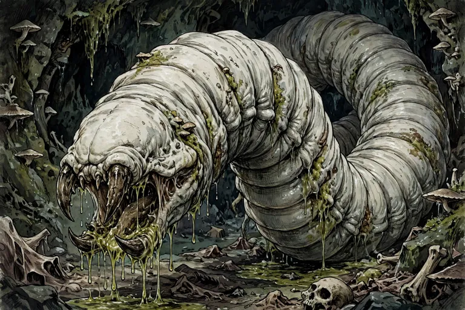

*Picture: GENERATED — generated from the published description (Libris Mortis: dead-white segmented worm, clacking mandibles, ichor)*

## 16. DIRE MAGGOT — Libris Mortis p.95, CR 2 — **[SCREENED: NOT UNDEAD]**
**Vermin** (Huge per index [DMREF]; the full-text mirror's stat line is internally garbled — "Small" with Huge size modifiers — *verify — web extraction*). HD 6d8+6 (33 hp), Init +2, Speed 40 ft./climb 40 ft., bite +3 (1d8+2 plus paralytic saliva — Paralytic Saliva (Ex): Fort DC 14 or paralyzed 1 round), CR 2, Environment underground, Organization solitary or slaughter (2–5).
> *A four-foot-long dead-white segmented worm heaves into view. Eyeless, drooling stinking ichor from its clacking mandibles, the monstrosity resembles nothing so much as a maggot grown orders of magnitude too large.*

## Dolomite — CR 15 — Monsternomicon Vol. 1


*Picture: APOC-VTT monster library art — Monsternomicon Vol. 1*

**Partial — fullest block on file:**

Type: Huge Aberration (Earth)
Challenge Rating: 15
Source book(s): Monsternomicon Vol. 1
Description: I must confess I find the dolomite, or slag hound as it is known in Rhul, to be a truly fascinating creature. These huge, jagged jumbles of rock and dirt are usually mistaken for a pile of rubble, though in reality they are slow moving, dim-witted creatures found in uninhabited rocky plains and low mountain foothills. The migration of the dolomite during its mating season once per decade is a wonder to behold (if you happen to have quite a bit of leisure time). Shambling bipedal hulks, they shuffle across the plains in slow intricate dances.
[Partial — fullest available from APOC-VTT registry record; no roster stat block found. No stat lines invented.]

## Doru, Infectious Blasheme — CR 9 — Libris Mortis

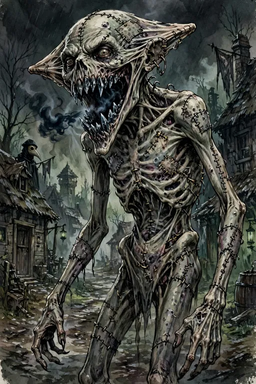

*Picture: GENERATED — generated from the published description (surgically modified corpse, wedge-shaped head, teeth like black steaming ice)*

### 3.5 DORU, INFECTIOUS BLASHEME — CR 9 (tactical E8, Church Understory, book p.42)

Doru is the son of the village priest Danovich, killed by Strahd as a trial run for the plague. Destroying Doru ends the village plague immediately (unless Strahd's goal is Undead Legions). Description (as published): a corpse surgically modified by a lunatic — skeletally thin, arms too long, head wide and wedge-shaped, a mouth that splits wider than a human's, teeth like shards of black steaming ice. The blaspheme's primary printing is Libris Mortis (Batch 1 cross-reference); Doru is the named, plague-carrying individual.
- NE Medium undead; **HP** 147; **Init** +1; **Senses** darkvision 60 ft., Listen +10, Spot +10
- **AC** 20, touch 11, flat-footed 19; **HD** 18; **DR** 5/slashing; undead immunities (incl. cold)
- **Fort** +6, **Ref** +7, **Will** +13; **Speed** 40 ft.; erratic charge
- **Melee** bite +18 (1d8+13 plus blasphemous bite plus disease); **Base Atk** +9; **Grp** +18
- **Abilities** Str 28, Dex 12, Con —, Int 5, Wis 15, Cha 10
- **Feats** Improved Natural Attack (bite), Improved Toughness‡ (Libris Mortis), Toughness (×4), Track
- **Skills** Listen +10, Spot +10, Survival +7
- **Blasphemous Bite (Su):** a living nonevil creature bitten is dazed 1 round and may contract the necromantic infection.
- **Disease (Su) — necromantic infection:** bite, Fort DC 22 negates (Cha-based, +3 circumstance bonus as the plague epicenter), instant incubation; the sickened victim who reaches −1 hp or dies rises as an infected zombie in 1d4+1 rounds unless treated (book p.29 sidebar).

## Draudnu — CR 10 — Monster Manual V


*Picture: Demons roster picture index: LIBRARY (tier 1)*

DRAUDNU — Monster Manual V, pp.24–26


- **Size/Type:** Medium Outsider (Chaotic, Evil, Extraplanar, **Obyrith**)
- **Hit Dice:** 14 HD (119 hp) (MM5 format prints hp and HD count; no dice formula published)
- **Initiative:** +4
- **Speed:** 50 ft. (10 squares)
- **Armor Class:** 21 (+4 Dex, +7 natural), touch 14, flat-footed 17
- **Base Attack/Grapple:** +14/+18
- **Attack:** Flesh hook +18 melee (2d6+4/19–20 plus immobilize)
- **Full Attack:** 3 flesh hooks +18 each (2d6+4/19–20 plus immobilize)
- **Space/Reach:** 5 ft./5 ft. (20 ft. with flesh hooks) — **Reach discrepancy resolved from the library copy and flagged:** the MM5 stat block (p.24) prints "Reach 5 ft. (20 ft. with flesh hooks)" and that block value stands as primary; the entry's own lore table (Draudnu Lore, DC 20, p.25) says a draudnu "can extend its hooks up to 15 feet" — both values are as published in the same entry; the stat block's 20 ft. governs, the lore line is retained here as the flagged variant. (Shaun rules if he wants the lore value instead.)
- **Special Attacks:** **Immobilize** (Ex; when a draudnu deals damage with a flesh hook, it can detach the end of that hook in the foe it struck, fastening that opponent to a surface such as a floor or wall — the hook end regrows immediately; that enemy must succeed on a DC 21 Reflex save or be immobilized; the ability doesn't work if the hook can't fasten a creature to a surface; an immobilized opponent can pull itself free with a move action and a DC 21 Strength check or Escape Artist check, but pulling free deals that foe 1d10 points of damage unless it or someone else takes a standard action and succeeds on a DC 21 Heal check to dislodge the hook first; save and check DCs Strength-based); **acid spray** (Ex; whenever a draudnu takes damage, it sprays acidic fluid from the sacs on its body, dealing 2d4 points of acid damage to all creatures in a 5-foot-radius burst, Reflex DC 21 half; save DC Constitution-based); aligned strike (chaotic, evil)
- **Special Qualities:** **Form of madness** (Su; aura, 60 ft. — when a draudnu comes within 60 feet of a creature, that creature must succeed on a DC 20 Will save or believe that something is growing inside it, becoming sickened; the sickened condition is permanent until the insanity is cured by greater restoration, heal, miracle, or wish; a creature that successfully saves cannot be affected again by that same draudnu's form for 24 hours, and a creature that fails can be affected only once until cured; chaotic evil outsiders are immune; mind-affecting; save DC Charisma-based); fast healing 5; DR 10/lawful; immune acid, mind-affecting spells and abilities, poison; resist cold 10, electricity 10, fire 10; SR 18; darkvision 60 ft.; true seeing; telepathy 100 ft.
- **Saves:** Fort +13, Ref +13, Will +12
- **Abilities:** Str 18, Dex 19, Con 18, Int 13, Wis 16, Cha 17
- **Skills:** Balance +30, Climb +21, Escape Artist +21, Jump +31, Knowledge (the planes) +10, Listen +20, Search +18, Spot +20, Survival +20 (+22 on other planes, +22 following tracks), Tumble +23, Use Rope +4 (+6 bindings) (draudnus have a +8 racial bonus on Balance and Jump checks)
- **Feats:** Combat Expertise, Combat Reflexes, Dodge, Improved Critical (flesh hooks), Mobility, Track (B)
- **Environment:** Infinite Layers of the Abyss (draudnus, also called Children of Pale Night, are native to the Infinite Layers of the Abyss; common on the 600th layer, enslaved to the Mother of Demons)
- **Organization:** Rarely encountered in groups of more than four members (A Hard Place, EL 12: a pack of three draudnus — MM5 p.25)
- **Challenge Rating:** 10
- **Treasure:** None (draudnus have no use for wealth, treasure, or anything of the kind — Typical Treasure, MM5 p.26)
- **Alignment:** Always chaotic evil
- **Advancement:** 19–36 HD (Medium); 37–54 HD (Large) (the secondary index's "runs to 54 HD" is confirmed by the book's own Advancement line)
- **Level Adjustment:** — (none published in Monster Manual V)
- **Description:** "A hairless creature about the size of a human surges forward on three muscular legs attached to its top. Swollen sacs of fluid bulge from its body. A single pulsing red eye stares out from a mass of featureless wrinkled flesh that must be the creature's head, but that mass is at the creature's bottom. From around its eye extend three arms, each ending in a hook of bone. Draudnus are ruthless killers created to rid the Abyss of non-obyriths. Draudnus stand 7 feet tall and weigh about 300 pounds. They have thick and rubbery skin, three powerful legs, and three arms, each ending in a hook of bone wrapped in hardened, scaly flesh. On its face, a draudnu has a bloody red eye where its mouth should be." 

**Nature/role:** Obyrith hunter-killer, one of the "Children of Pale Night," created by Pale Night to destroy all non-obyrith life.

## Draug — CR 4 — Tome of Horrors Revised (Necromancer Games


*Picture: Undead roster picture index: official book art — official book art — Tome of Horrors Revised (Necromancer Games)*

Draug


**Source:** Tome of Horrors Revised (Necromancer Games, 2005), p.174

```
DRAUG
                          Medium Undead (Aquatic)
                          Hit Dice:               6d12 (38 hp)
                          Initiative:             +2
                          Speed:                  30 ft. (6 squares), swim 30 ft.
                          Armor Class:            17 (+2 Dex, +5 natural), touch 12, flat-
                                                  footed 15
                          Base Attack/Grapple:    +3/+5
                          Attack:                 Cutlass +6 melee (1d6+2) or claw +5 me-
                                                  lee (1d4+2)
                          Full Attack:            Cutlass +6 melee (1d6+2) or 2 claws +5
                                                  melee (1d4+2)
                          Space/Reach:            5 ft./5 ft.
                          Special Attacks:        Call storm
                          Special Qualities:      Control ship, darkvision 60 ft., resis-
                                                  tance to fire 10, +2 turn resistance, undead
                                                  traits
                          Saves:                  Fort +4, Ref +4, Will +7
                          Abilities:              Str 14, Dex 15, Con —, Int 12, Wis 14, Cha
                                                  14
                          Skills:                 Balance +8, Climb +8 (+10 climbing ropes),
                                                  Escape Artist +6 (+8 rope bonds), Hide
                                                  +7, Profession (sailor) +7, Listen +6,
                                                  Move Silently +7, Spot +6, Survival +7,
                                                  Swim +10, Use Rope +7 (+9 bindings)
                          Feats:                  Alertness, Great Fortitude, Weapon Fo-
                                                  cus (cutlass)
                          Environment:            Any
                          Organization:           Solitary or crew (1 draug plus 6-11 brine
                                                  zombies and 1-4 mummies of the deep, 2-
                                                  8 lacedons, or 2-8 skeletons)
                          Challenge Rating:       4
                          Treasure:               Standard
                          Alignment:              Always chaotic evil                               Call Storm (Su): Once per day, a draug can summon
                          Advancement:            7-12 HD (Medium)                               inclement weather to harass its opponents. The effects
                          Level Adjustment:       —                                              are felt immediately (i.e., there is no gradual shift in the
                                                                                                 weather). Otherwise, this ability is identical to the
                             This ragged humanoid is lean and ravaged by decay with              control weather spell (caster level 6th).
                          bits of bone showing beneath waterlogged, blue-green rotting              Control Ship (Su): A draug has full control over its
                          flesh. Its clothes hang in tatters and its weapons are pitted and      vessel (wind notwithstanding) so long as it remains at
                          rusted.                                                                the wheel or within 20 feet of the helmsman. Should it
                             The draug is the vengeful spirit of a ship’s captain who            leave the area, its ship meanders in a random direction
                          died at sea, thus being denied a proper burial. If an entire           until the draug regains control. A draug also imbues its
                          ship sinks at sea with the loss of all hands, the ship itself          ship with special abilities (see Draug Ships, below).
                          and its entire crew may return as ghostly wanderers. The                  Skills: A draug has a +8 racial bonus on any Swim
                          captain usually rises as a draug and his crew rises as brine           check to perform some special action or avoid a hazard.
                          zombies (see that entry).                                              It can always choose to take 10 on a Swim check, even
                             A draug looks as it did in life, wearing the same clothes           if distracted or endangered. It can use the run action
                          and bearing the same possessions it held at the moment                 while swimming, provided it swims in a straight line.
                          of death. The arrival of a draug is often taken as a death                [BEGIN SIDEBOX]
                          portent, for even if it does not attack, some dire circum-
                          stance is likely to befall the witness. A draug often acts as          New Weapon
                          a death token, rising out of the sea and staring at or
                                                                                                   Cutlass: Martial weapon, one-handed melee weapon,
                          pointing a bony finger at a sailor fated to drown.
                                                                                                 cost 15 gp, damage 1d4 (S)/1d6 (M), critical 19-20/x2,
                                                                                                 weight 3 lb., slashing.
                          Combat
                                                                                                   [END SIDEBOX]
                             Draugs are jealous of the living and try to bring death and
                          misfortune to them at every opportunity. They have been                Draug Ships
                          known to suddenly appear in a sea mist and climb aboard
                                                                                                   When a ship sinks beneath the waves, it and its entire
                          the ships of the living. A draug’s favored form of attack is
                                                                                                 crew may return as ghostly wanderers, especially if the
                          with its cutlass, though if disarmed it uses its claws to
                                                                                                 captain and crew had a less than scrupulous profession
                          attempt to grapple an opponent, leaping back into the
                                                                                                 (as pirates, for example). A sunken ship of this nature
                          waves in an effort to drown the unfortunate victim.

                                                                                             174
                                                     the tome of horrors revised

               may undergo a transformation from the negative energy                   ship) and can even sail against gale-force winds. Strong
               and evil surrounding it. When this happens, the ship                    waves may toss the ship about, but will not capsize it as
               rises from the deep, piloted by a draug and manned by                   a result.
               skeletons, brine zombies, zombies, and lacedons. The                       Immunity to Fire (Ex): A draug ship is so water-
               ship appears as it did at the time of its demise. The sails             logged and infused with negative energy that it is
               are tattered and the decks covered with seaweed. When                   completely immune to all fire effects.
               a draug is at the helm, the “ghost ship” gains the                         Flight (Su): A draug can maneuver his ship to leave
               following powers:                                                       the waves and take to the air as long as the draug remains
                  Buoyancy (Su): Regardless of the condition of the                    on board. This functions as fly cast by a sorcerer with a
               hull, a draug-piloted ship remains afloat in any weather                caster level equal to the draug’s HD.
               conditions. It is not affected by wind of any type (though                 Copyright Notice
               the draug can still use the wind to maneuver and sail the

## Dread Guard — CR 2 — Monster Manual II


*Picture: Constructs roster picture index: Official book art — Monster Manual II, p. 87*

**Partial — fullest block on file:**

Type: Medium Construct
Challenge Rating: 2
Source book(s): Monster Manual II
Description: A dread guard appears to be an armored undead, still bearing the weapons and shield it carried in life. In fact, it is an animated suit of armor, little different from a golem. Those who create dread guards usually do so to obtain guardians for their strongholds—guardians that can never be bribed and rarely fooled.
[Partial — fullest available from APOC-VTT registry record; no roster stat block found. No stat lines invented.]

## Dream Vestige — CR 16 — Libris Mortis


*Picture: Undead roster picture index: official book art — official book art — Libris Mortis*

17. DREAM VESTIGE — Libris Mortis p.96, CR 16

**Huge Undead (Incorporeal)**
**Hit Dice:** 17d12 (110 hp) **Initiative:** +9 **Speed:** Fly 40 ft. (perfect) **Armor Class:** 31 (–2 size, +5 Dex, +18 deflection), touch 31, flat-footed 26 **Base Attack/Grapple:** +8/+16 **Attack:** Tendril +15 melee touch (3d6 plus form consumption) **Full Attack:** 4 tendrils +15 melee touch (3d6 plus form consumption) **Space/Reach:** 15 ft./20 ft. **Special Attacks:** Desecrating aura, form consumption, frightful presence **Special Qualities:** Blindsight 120 ft., damage reduction 10/—, darkvision 60 ft., deflective aura, dream travel, incorporeal traits, inescapable craving, self spawn, spell resistance 28, undead traits **Saves:** Fort +9, Ref +14, Will +19 **Abilities:** Str —, Dex 20, Con —, Int 18, Wis 20, Cha 20 **Skills:** Concentration +24, Diplomacy +6, Hide +16, Listen +25, Move Silently +24, Search +24, Sense Motive +25, Spellcraft +24, Spot +25, Survival +5 (+7 following tracks) **Feats:** Combat Reflexes, Great Fortitude, Iron Will, Improved Initiative, Lightning Reflexes, Weapon Finesse **Environment:** Any **Organization:** Solitary **Challenge Rating:** 16 **Treasure:** Standard **Alignment:** Always chaotic evil **Advancement:** 18–25 HD (Huge); 26–51 HD (Gargantuan) **Level Adjustment:** — — highest-CR creature in Ch.6.
> *A mighty river of fog streams forward like an evil waterfall, swollen with storm and spray. Accompanying the shape is a susurrus of dreamlike voices that murmur, cry, and rail against some terrible fate. Slender tendrils of mist extend from the mass, patting and feeling for sustenance.*
Flavor/combat prose (read in full): the original was born from the nightmares of an entire city whose citizens died in cursed sleep (a curse some attribute to Orcus); it incorporates other creatures, living or undead, mind and body, and knows the languages of all it has integrated. Form Consumption (Su): 1d4 Int drain per touch; a victim drained to Int 0 is engulfed and dissolved, leaving nothing. Desecrating Aura (Su): 20-ft. desecrate effect centered on itself as shrine. Frightful Presence (Su): Will DC 23, shaken. Deflective Aura (Su): +13 deflection included above. Self Spawn (Ex): splits in two after gaining temporary hp equal to its full total.
**Kit:** Published treasure is a line only — "Standard." A dream vestige holds no itemized gear (incorporeal); nothing invented.
**APOC Note:** **Dream Travel (Su) is flagged: as published it can cross planar borders — that function is INERT in APOC (planar travel severed).** Its in-world movement rate via dreaming (5 miles per minute) is a Shaun ruling, not assumed. Origin fits APOC grimly: a city that died in its sleep is exactly the APOC night at scale — flag as a candidate Kingdom of the Undead apex horror, though it preys on undead too and serves no one. Not to be confused with the Fog of Life: the vestige is a creature of mist-like form, touchable and hostile; the Fog is inert and untouchable. Barred from the Bastion by the Melairshield.

## Drowned — CR 9 — Monster Manual III


*Picture: Undead roster picture index: official book art — official book art — Monster Manual III*

DROWNED — Monster Manual III, p.46


- **Size/Type:** Medium Undead
- **Hit Dice:** 20d12+20 (150 hp)
- **Initiative:** +2
- **Speed:** 20 ft. (4 squares), swim 30 ft.
- **Armor Class:** 16 (+2 Dex, +4 natural), touch 12, flat-footed 14
- **Base Attack/Grapple:** +10/+16
- **Attack:** Slam +12 melee (1d6+6)
- **Full Attack:** 2 slams +12 melee (1d6+6)
- **Space/Reach:** 5 ft./5 ft.
- **Special Attacks:** Drowning aura
- **Special Qualities:** Darkvision 60 ft., undead traits, unholy toughness, water dependent
- **Saves:** Fort +6, Ref +9, Will +14
- **Abilities:** Str 22, Dex 14, Con —, Int 8, Wis 14, Cha 18
- **Skills:** Hide +12, Listen +14, Spot +14, Swim +14
- **Feats:** Alertness, Cleave, Great Cleave, Improved Bull Rush, Improved Initiative, Power Attack, Weapon Focus (slam)
- **Environment:** Any aquatic and underground
- **Organization:** Solitary, pair, or crew (3–12)
- **Challenge Rating:** 9 *(CR corrected to the entry's own stat block — the enumeration pass's scan had misattributed CR 5)*
- **Treasure:** Standard
- **Alignment:** Often chaotic evil
- **Advancement:** —
- **Level Adjustment:** —
- **Description:** "This animated corpse is sopping wet, as if it just crawled from the water. The air around it is thick and cloying, exuding the essences of the corpse's watery grave."

## Dry Lich — CR 18 — Sandstorm


*Picture: Roster picture file — undead roster pictures (filename match in the roster picture pool; see that roster's PICTURE-INDEX.md)*

DRY LICH (template) + SAMPLE DRY LICH — CR 18

*Source: Sandstorm, pp.155–157. Illus. by J. Nelson (p.156).*

Published description (verbatim): "A dry lich is an especially horrid sort of undead spellcaster, and the ultimate destiny of a walker in the waste (see page 89). A dry lich is not purposefully evil, but it is absorbed with its own agenda and has little regard for living things. It spends its unnatural existence continuing to spread the waste and preserve whatever it encounters as dry, mummified monuments. A dry lich is gaunt, skeletal, and usually humanoid (although some monstrous humanoids and aberrations occasionally follow the walker's path). Its flesh is parchment-dry and clings tightly to its bones, and a thick encrustation of glittering white salt covers its body. A weird green light lights its hollow eye sockets. It is garbed as it was in life, which is generally in a simple and practical costume rather than the ornate robes of typical liches. Dry lich clerics usually wear heavy armor, since walkers in the waste had immunity to dehydration and heat effects even before they became undead. The mysterious Dusty Conclave closely guards the secret of becoming a dry lich, and at least one other dry lich must participate in another's creation. A dry lich speaks any languages it knew in life."

**SAMPLE DRY LICH** — "This example uses an asherati cleric/walker in the waste as the base character."
Description (verbatim): "This salt-crusted, skeletal horror shines with a terrible inner light as it plunges through a sand dune. Its empty sockets glow green in dreadful contrast."
Dry Lich, Asherati Cleric 5/Walker in the Waste 10
Medium Undead (Augmented Humanoid)
Hit Dice: 15d12+15 (112 hp)
Initiative: +0
Speed: 20 ft. in full plate (4 squares), base speed 30 ft.
Armor Class: 29 (+8 natural, +11 +3 full plate), touch 10, flat-footed 29
Base Attack/Grapple: +8/+10
Attack: Touch +10 melee (5d6 dehydration plus Constitution drain) or +1 scorpion-tail whip +11 melee (1d4+3 nonlethal plus poison) or light crossbow +8 ranged (1d8/19–20)
Full Attack: Touch +10 melee (5d6 dehydration plus Constitution drain) or +1 scorpion-tail whip +11/+6 melee (1d4+3 nonlethal plus poison) or light crossbow +8 ranged (1d8/19–20)
Space/Reach: 5 ft./5 ft.
Special Attacks: Aura of despair, Constitution drain, desiccating touch 5d6, greater drought, pillar of salt 1/day, rebuke undead 4/day (+5, 2d6+6, 5th), the wasting 1/day
Special Qualities: +6 turn resistance, asherati traits, body lamp, create sand golem, create salt mummy, damage reduction 10/bludgeoning and magic, darkvision 60 ft., fast healing 2, immunity to dessication [sic — as printed], heat, polymorph, and mind-affecting spells and abilities, low-light vision, sandswim, undead traits, unholy toughness, water weakness, withered toughness
Saves: Fort +11, Ref +10, Will +20
Abilities: Str 14, Dex 10, Con —, Int 12, Wis 25, Cha 12
Skills: Concentration +12 (+16 casting defensively), Hide +5 (+7 sand), Intimidate +12, Knowledge (arcana) +6, Knowledge (geography) +6, Knowledge (nature) +6, Knowledge (religion) +7, Listen +15, Move Silently +5, Search +9, Spellcraft +13, Spot +15, Survival +15 (+17 to avoid becoming lost, aboveground)
Feats: Combat Casting, Heat Endurance†^B, Exotic Weapon Proficiency (scorpion-tail whip), Improved Heat Endurance†^B, Lightning Reflexes, Spell Penetration, Scorpion's Sense†, Track
Environment: Warm deserts
Organization: Solitary
Challenge Rating: 18
Treasure: Standard coins; standard goods; double items
Alignment: Neutral evil
Advancement: By character class
Level Adjustment: +5
† New feat described in Chapter 2.

Combat notes and abilities (as published): A dry lich's natural weapons are treated as magic weapons for the purpose of overcoming damage reduction. The Will save against this dry lich's aura of despair and Constitution drain has a DC of 18; the save DC is Charisma-based.
Asherati Traits: Asheratis are naturally dry, and are vulnerable to contact with water. If completely wet, an asherati takes a –1 penalty on attack rolls, ability checks, and skill checks. If submerged in water, an asherati cannot hold her breath and must immediately begin making Constitution checks to avoid drowning. Asheratis must still drink water to survive, but only one-quarter the amount per day that humanoids of their size must normally consume to avoid dehydration.
Body Lamp (Su): This dry lich can make its skin glow at will, shedding light to 60 feet and shadowy illumination to 120 feet. The light is sufficient for the lich to navigate by while sandswimming in loose sand, dust, or ash. Once per day as a free action, the dry lich can bring its skin up to full brilliance so rapidly it might dazzle creatures within 30 feet. A creature can make a DC 18 Fortitude save to negate the effect. The save DC is Charisma-based.
Create Sand Golem (Ex): This dry lich can create a sand golem (see page 182).
Create Salt Mummy (Su): Invested with the dark power of the waste, this dry lich is able to preserve and animate a corpse as a salt mummy (see page 94).
Desiccating Touch (Su): As a touch attack, this dry lich can drain moisture from a living creature. This attack deals 5d6 points of dessication damage, or 5d8 to plant creatures or elementals with the water subtype. The touched creature can make a DC 27 Fortitude save to reduce the damage to half.
Pillar of Salt (Sp): This dry lich can use flesh to salt once per day as a 10th-level spellcaster, duplicating the effects of the spell (see page 116), except that it transforms only one creature.
Greater Drought (Su): This dry lich can produce extreme desert conditions within a 100-foot-radius emanation with it at the center. The temperature band in that area rises by 2 steps or to severe heat, whichever produces the hotter result. See heat dangers and the effects of natural dehydration in Chapter 1. A dry lich can suppress this effect for 1 round as a free action, but it renews automatically the next round unless it consciously suppresses it again.
Immunity to Dessication (Ex): This dry lich has immunity to any spell or effect that deals magical dessication damage, as well as to any damage that results from failed Constitution checks to resist the effects of dehydration. This dry lich cannot become dehydrated (as the condition; see page 15).
Sandswim (Su): This dry lich gains a burrow speed equal to its base land speed while wearing light armor or carrying a light load and traveling through sand, ash, or other loose soil. This speed drops to 5 feet with a heavier load or if the lich tries to drag a Medium or larger creature along.
The Wasting (Su): This dry lich can transform a handful of dust or sand into a terrible disease. Once per day, it can blow the sand into the face of a living opponent with 20 feet. Doing so is a standard action that provokes attacks of opportunity. The lich can pick up dust from the ground as a move action or take it from a component pouch as a free action. The opponent is entitled to a DC 27 Reflex save to avoid inhaling the dust. On a success, the dust has no effect and drifts harmlessly to the ground. An opponent that fails its save contracts the wasting, a supernatural affliction that gradually mummifies its victims (see page 21).
Water Weakness: All water deals damage to this dry lich as if it were holy water.
Constitution Drain (Su) [template text]: Any living creature a dry lich hits with its touch attack must succeed on a Fortitude save or take 1d6 points of Constitution drain. With each successful drain, the dry lich gains 5 temporary hit points.
Cleric Spells Prepared (6/8/8/7/6/5/4/3; save DC 17 + spell level; caster level 13th): 0—detect magic (2), read magic (2), resistance (2); 1st—cause fear (3) (DC 18), command (2) (DC 18), divine favor (2), parching touch†^D (DC 18); 2nd—align weapon, eagle's splendor, silence, sound burst (2), desiccate†^D (4) (DC 19); 3rd—animate dead (caster level 14th) (2), dispel magic, haboob† (2), searing light, wither†^D; 4th—dismissal (DC 21), dispel water†^D (DC 21), divine power (2), giant vermin, greater magic weapon; 5th—dispel good^D (caster level 14th; DC 22), flame strike (2) (DC 22), slay living (DC 22), true seeing; 6th—create undead (caster level 14th), harm (2) (DC 23), mephit mob†^D; 7th—blasphemy^D (caster level 14th; DC 24), destruction (DC 24). † New spell described in Chapter 5. D: Domain spell. Domains: Evil (cast evil spells at +1 caster level), Thirst† (rebuke or command oozes 4/day [+1, 2d6+6, 5th]). † New domain described on page 108.

**Kit (Possessions, as published, p.157):** +3 full plate, +1 scorpion-tail whip†, masterwork light crossbow with 20 +1 bolts, periapt of Wisdom +4, cloak of resistance +4, 2 scrolls of horrid wilting, eye ointment (250 gp). † New weapon described on page 98.

**CREATING A DRY LICH (template, as published, p.157):** "Dry lich" is an acquired template that can be added to any living creature (referred to hereafter as the bas

## Eagle — CR 0.5 — Monster Manual I


*Picture: Monster library art — Monster Manual I*

**Partial — fullest block on file:**

Type: Small Animal
Challenge Rating: ½
Source book(s): Monster Manual I
Description: These birds of prey inhabit nearly every terrain and climate, though they all prefer high, secluded nesting spots. A typical eagle is about 3 feet long and has a wingspan of about 7 feet. The statistics presented here can describe any similar-sized, diurnal bird of prey.
[Partial — fullest available from APOC-VTT registry record; no roster stat block found. No stat lines invented.]

## Earth Weird — CR 12 — Monster Manual II


*Picture: APOC-VTT monster library art — Monster Manual II*

**Partial — fullest block on file:**

Type: Large Elemental (Earth)
Challenge Rating: 12
Source book(s): Monster Manual II
Description: Earth weirds are foretellers of death and doom. They can pronounce an individual’s impending fate or warn of a coming apocalypse. They are also prognosticators of wealth and fortune, foreseeing who shall succeed or fail in the pursuit of material possessions. An earth weird’s pool is often situated at the base of a mountain or deep underground. An earth weird’s upper body resembles that of a beautiful human woman. The creature has sparkling gemstones for eyes and hair the brown color of earth, streaked with veins of gold and silver.
[Partial — fullest available from APOC-VTT registry record; no roster stat block found. No stat lines invented.]

## Elder Spawn of Juiblex — CR 14 — Monster Manual V


*Picture: APOC-VTT monster library art — Monster Manual V*

**Partial — fullest block on file:**

Type: Always CE Gargantuan elemental (extraplanar, water)
Challenge Rating: 14
Source book(s): Monster Manual V
Description: A hulking mass of tarry, steaming ooze rears impossibly high. Convulsions wrack the surface of this enormous creature as it burbles and spits chunks of its own matter into the air. Three large red eyes are evenly set around its bulk, with dozens of smaller eyes spread across the creature's skin.
[Partial — fullest available from APOC-VTT registry record; no roster stat block found. No stat lines invented.]

## Elemental, Earth — CR 3 — Monster Manual I


*Picture: Monster library art — Monster Manual I*

**Partial — fullest block on file:**

Type: Medium Elemental (Earth, Extraplanar)
Challenge Rating: 3
Source book(s): Monster Manual I
Description: Elementals are incarnations of the elements that compose existence. When summoned to the Material Plane, an earth elemental consists of whatever types of dirt, stones, precious metals, and gems it was conjured from. Earth elementals speak Terran but rarely choose to do so.
[Partial — fullest available from APOC-VTT registry record; no roster stat block found. No stat lines invented.]

## Elf, Aquatic — CR 0.5 — Monster Manual I

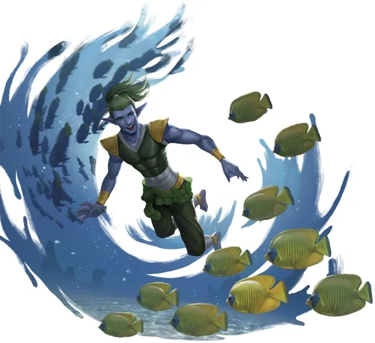

*Picture: Monster library art — Monster Manual I*

**Partial — fullest block on file:**

Type: Medium Humanoid (Elf)
Challenge Rating: 1/2
Source book(s): Monster Manual I
Description: Also called sea elves, these creatures are waterbreathing cousins to land-dwelling elves. Aquatic elves fight underwater with tridents, spears, and nets.
[Partial — fullest available from APOC-VTT registry record; no roster stat block found. No stat lines invented.]

## Elf, Gray — CR 0.5 — Monster Manual I


*Picture: Monster library art — Monster Manual I*

**Partial — fullest block on file:**

Type: Medium Humanoid (Elf)
Challenge Rating: 1/2
Source book(s): Monster Manual I
Description: Taller and grander in physical appearance than others of their race, gray elves have a reputation for being aloof and arrogant (even by elven standards). They have either silver hair and amber eyes or pale golden hair and violet eyes. They prefer clothing of white, silver, yellow, or gold, with cloaks of deep blue or purple.
[Partial — fullest available from APOC-VTT registry record; no roster stat block found. No stat lines invented.]

## Elite Demon War Mount — CR 16 — Monster Manual III


*Picture: APOC-VTT monster library art — Monster Manual III*

**Partial — fullest block on file:**

Type: Huge Magical Beast (Chaotic, Extraplanar)
Challenge Rating: 16
Source book(s): Monster Manual III
Description: Resembling a very large elephant crossed with a dog, this creature has a massive, oversized head with jutting, ragged teeth and loose skin on its jowls. The mivilorn thrives when fending for itself on the plane of Pandemonium, and it is also a favorite war mount of many demons. Mivilorns are very aggressive when encountered in the wild, and they hunt Medium and larger creatures for food.
[Partial — fullest available from APOC-VTT registry record; no roster stat block found. No stat lines invented.]

## Eloko — CR 9 — Encyclopedia of Demons & Devils Vol. 1


*Picture: Demons roster picture index: LIBRARY (tier 1)*

Eloko — CR 9 [3RD-PARTY — Publisher: Fast Forward Entertainment]


**Source:** *The Encyclopedia of Demons & Devils* Vol. 1, book p. 68 (PDF p. 69). "Book is 3.0-era d20 — reproduced as published."
**Classification evidence (verbatim from the page):** heading "Eloko (Tanar'ri)"; type line "Medium-size Outsider (Chaotic, Evil)"; "Challenge Rating: 9"; "Alignment: Always chaotic evil." A genuine demon entry in this book — rostered.

- **Eloko (Tanar'ri)**
- Medium-size Outsider (Chaotic, Evil)
- **Hit Dice:** 2d8 +2 (11 hp) *(space before "+2" as printed)*
- **Initiative:** +0
- **Speed:** 30 ft.
- **AC:** 16 (+6 natural)
- **Attacks:** Slam +3 melee, 2 Claws +3 melee
- **Damage:** Slam (1d6+1), Claw (1d4 +1)
- **Face/Reach:** 5 ft. by 5-ft./5 ft. *(as printed — "5-ft." in the second measure)*
- **Special Attacks:** Swallowing whole
- **Special Qualities:** Damage reduction 30/ +3, SR 28, special regenerative powers, tanar'ri qualities *(space in "30/ +3" as printed)*
- **Saves:** Fort +4, Ref +3, Will +4
- **Abilities:** Str 13, Dex 11, Con 13, Int 9, Wis13, Cha 15 *("Wis13" — no space — as printed)*
- **Skills:** Climb +4, Hide +4, Move Silently +4, Wilderness Lore +4
- **Feats:** Run
- **Climate/Terrain:** Any forest and underground
- **Organization:** Solitary
- **Challenge Rating:** 9
- **Treasure:** Standard
- **Alignment:** Always chaotic evil
- **Advancement Range:** None

**Description (verbatim, book p. 68):** "The Eloko demon is summoned by forest dwellers to attack and hurt human mortals who have entered the forest. It appears on the prime material plane as a hairless dwarf, and in seconds green grass grows on its hide and leaves fly from trees to cover its body in a patchwork pattern. It has a small humanoid face with a pig's snout, and its eyes are blazing flames. It has talons for hands and cloven hooves for feet. The demon commonly dens in hollow trees and has been known to pull children into these hollows and eat them as a late night snack. Such demons will always leap to the defense of a forest dweller against a human." / "The creature enjoys creating chaos among mortals who make their living from the wildlands. It will spring traps so hunters catch no animals. It will foul fishing nets left alone in the rivers and lakes of the wilds. Woodcutters are especially marked, and they will find their axes becoming blunt unusually quickly, and large tree limbs will mysteriously fall on them as they move through the forest."

**Combat (verbatim):** *(the book's Combat section opens directly with the Special Regeneration heading — no general combat paragraph is printed)*
**Special Regeneration (Su) (verbatim):** "The creature can take damage and seem to die. However, when moonlight falls on the demon, the creature comes back to life and is completely regenerated." / "The only way to permanently kill this sort of demon is to separate its head from its body; otherwise the creature will rise and attack mortals the next day."
**Magic Bells (Ex) (verbatim):** "The demon appears on the prime material plane with five magical bells. When the bells are played after sunset, they have the power to charm as the charm person spell any mortal who fails a Will check (DC 15)."
**Swallowing Attack (Su) (verbatim):** "The mouth of the Eloku demon is magical. After the creature has successfully damaged a mortal in combat, it has a 30% chance of biting and swallowing the victim whole." — ⚠ **PUBLISHED ERROR, reproduced as printed (verified at 300 dpi): "Eloku" here, against "Eloko" in the entry's heading, Description, and Totems text; each spelling is reproduced where the book prints it.** *(The stat block's Special Attacks line likewise prints the ability as "Swallowing whole," against this section's "Swallowing Attack" heading — both as printed.)*
**Fire Eyes (Su) (verbatim):** "The demon's fiery eyes see through any illusion or invisibility as a gem of true seeing. During the day the creature is able to separate its eyes from the rest of its body. These eyes are then able to fly hundreds of miles away from its body. They are used to see the encampments of mortals and spy out individuals who need to be attacked first during the nighttime activities of the demon."
**Eloko Totems (verbatim):** "These oak totems have three Eloko icons carved into them. They are left at the edges of the forests. When unknowing humans come into the forests, they often strike down or burn these totems, and this gives the totem the energy it needs to summon an Eloko demon to attack those mortals. In the rainforests of central Zaire, where legends of this demon originate, here are tales of foolish mortals who have brought these totems into their villages and cities. Totems that have been taken out of the forest have brought bad luck to the entire village. (All inhabitants have a -1 on all of their DC checks.)" *[sic — "here are tales" as printed, verified at 300 dpi; evidently the book's dropped "t" from "there," reproduced as published]* *(heading printed with no (Ex)/(Su)/(Sp) tag)*

**APOC NOTE (Shaun's canon — separate from the published text above):** Third-party reference only — the Encyclopedia's forest-demon lore (central Zaire legends, totems) is reference only, not FR canon. In APOC the eloko is mortal and trapped inside the scarred crystal sphere; planar travel is severed and summoning spells DON'T WORK, so no totem summons one; the Bastion's mythal bars demons absolutely.

---

## Ethergaunt, Black — CR 17 — Fiend Folio


*Picture: APOC-VTT monster library art — Fiend Folio*

**Partial — fullest block on file:**

Type: Medium-Size Aberration (Extraplanar)
Challenge Rating: 17
Source book(s): Fiend Folio
Description: Black ethergaunts stand at the pinnacle of khen-zai society. Honored as near-divine philosopher-scientists the black caste is credited with advancing ether-gaunt society to its present state of perfection. No lesser khen-zai questions the will of a black ethergaunt, for to do so is to question the pro gress of the entire race.
[Partial — fullest available from APOC-VTT registry record; no roster stat block found. No stat lines invented.]

## Ethon — CR 10 — Monsternomicon Vol. 2


*Picture: APOC-VTT monster library art — Monsternomicon Vol. 2*

**Partial — fullest block on file:**

Type: Huge Magical Beast
Challenge Rating: 10
Source book(s): Monsternomicon Vol. 2
Description: One never need look far while traveling the Stormlands to see it resembles no place in western Immoren (Morrow be praised). While our home surely has its deserts and bleak lands, the Stormlands feel all the rage nature can muster on a daily basis. Any life that would dare inhabit this cursed place the sky quickly blasts to ash with spears of wild blue lightning. Or so I thought.
[Partial — fullest available from APOC-VTT registry record; no roster stat block found. No stat lines invented.]

## Ettercap — CR 3 — Monster Manual I


*Picture: Monster library art — Monster Manual I*

**Partial — fullest block on file:**

Type: Medium Aberration
Challenge Rating: 3
Source book(s): Monster Manual I
Description: An ettercap is about 6 feet tall and weighs about 200 pounds. Ettercaps speak Common.
[Partial — fullest available from APOC-VTT registry record; no roster stat block found. No stat lines invented.]

## Famine Spirit — CR 19 — Monster Manual II


*Picture: Undead roster picture index: official book art — official book art — Monster Manual II*

FAMINE SPIRIT — Monster Manual II, p.96


- **Size/Type:** Medium-Size Undead
- **Hit Dice:** 32d12 (208 hp)
- **Initiative:** +4
- **Speed:** 60 ft.
- **Armor Class:** 18 (+8 natural), touch 10, flat-footed 18
- **Attacks:** Bite +19 melee and 2 claws +17 melee
- **Damage:** Bite 1d8+3/19–20/vorpal bite, claw 1d6+1
- **Face/Reach:** 5 ft. by 5 ft./5 ft.
- **Special Attacks:** Aura of pain, vorpal bite
- **Special Qualities:** Create spawn, ethereal jaunt, fast healing 10, scent, see invisibility, undead traits
- **Saves:** Fort +10, Ref +10, Will +20
- **Abilities:** Str 16, Dex 11, Con —, Int 14, Wis 15, Cha 15
- **Skills:** Listen +37, Search +36, Spot +37
- **Feats:** Cleave, Expertise, Great Cleave, Improved Bull Rush, Improved Critical (bite), Improved Initiative, Improved Trip, Multiattack, Power Attack, Sunder
- **Climate/Terrain:** Any land and underground
- **Organization:** Solitary, pair, brood (3–5), or band (2–5 plus 2–8 ghasts and 4–16 ghouls)
- **Challenge Rating:** 19
- **Treasure:** None
- **Alignment:** Always neutral evil
- **Advancement:** 33–64 HD (Medium-size)
- **Description:** "The famine spirit, also called a ravenous ghoul, is a corporeal undead motivated entirely by hunger. It seeks to consume in death all that it was denied in life…" *(fuller description as published in the entry text.)*

## Farrow — CR 1 — Monsternomicon Vol. 1


*Picture: APOC-VTT monster library art — Monsternomicon Vol. 1*

**Partial — fullest block on file:**

Type: Medium Humanoid (Farrow)
Challenge Rating: 1
Source book(s): Monsternomicon Vol. 1
Description: The farrow are half-man, half-boar creatures that have the intelligence and wit of a man and the ferocity and tenacity of a boar. A typical farrow stands at about the height of a man but walks with a stooped posture giving it a shorter appearance. Its body is covered with bristly dark hairs over similarly dark skin. Its arms end in mannish hands, and its feet end in the cloven hooves found among common barnyard swine. The face is a strange mockery of human and boar: two surprisingly human-looking eyes set behind a large pig snout and enormous tusks jutting from the thing's mouth.
[Partial — fullest available from APOC-VTT registry record; no roster stat block found. No stat lines invented.]

## Fiendish Cleric of Yeenoghu — CR 4 — Monster Manual IV


*Picture: APOC-VTT monster library art — Monster Manual IV*

**Partial — fullest block on file:**

Type: Medium Humanoid
Challenge Rating: 4
Source book(s): Monster Manual IV
Description: This hyena-headed being has darker fur than others of her kind, and her eyes smolder like red coals. She barks an order and begins to cast a spell.
[Partial — fullest available from APOC-VTT registry record; no roster stat block found. No stat lines invented.]

## Fiendish Symbiont, Fiendish Familiar — CR 0.125 — Fiend Folio


*Picture: APOC-VTT monster library art — Fiend Folio*

**Partial — fullest block on file:**

Type: Diminutive Outsider (Evil, Extraplanar, Symbiont)
Challenge Rating: 1/8
Source book(s): Fiend Folio
Description: A fiendish familiar is a small face with an evil expression that is grafted onto the shoulder, back, stomach, or hand of a character. It gives the most benefit to hosts who are arcane spellcasters. Fiendish familiars speak Common and Abyssal, and can communicate telepathically. Combat Fiendish familiars do not engage in combat, nor do they specifically aid their hosts in combat—although the enhancements they offer to spellcasting hosts can be significant in such situations.
[Partial — fullest available from APOC-VTT registry record; no roster stat block found. No stat lines invented.]

## Fire Bat — CR 3 — Monster Manual II


*Picture: APOC-VTT monster library art — Monster Manual II*

**Partial — fullest block on file:**

Type: Small Elemental (Fire)
Challenge Rating: 3
Source book(s): Monster Manual II
Description: Fire bats are native to the Elemental Plane of Fire, but unlike fire elementals, they are not composed solely of elemental material. They can fly through the flames and magma of the Elemental Plane of Fire as easily as normal bats fly through the air. They propel themselves by expelling heated gases from tubes within their bodies, flapping their wings only to steer during flight. A fire bat cannot enter water or any other nonflammable liquid. A body of water is an impassible barrier unless the fire bat can step, jump or fly over it.
[Partial — fullest available from APOC-VTT registry record; no roster stat block found. No stat lines invented.]

## Flameskull — CR 4 — Lost Empires of Faerûn


*Picture: Undead roster picture index: official book art — official book art — Lost Empires of Faerûn, p. 171 (art: Jim Pavelec)*

FLAMESKULL — CR 4

*Source: Lost Empires of Faerûn, p.171 (illustration p.171).*

*A human skull wreathed in evil green flame hovers in the air. Emerald gleams of malice dance in its eye sockets.*

Flameskulls are undead guardians created from the fresh skulls of humanoid spellcasters. Deathless, intelligent, and vigilant, these creatures are often found guarding hidden hoards and secret chambers centuries after the clerics or wizards who created them have died.

A flameskull resembles a human skull, complete with jawbone, surrounded by eerie green flames. Its fiery aura illuminates an area as well as a torch does, but the flameskull can voluntarily reduce its radiance to a barely visible, pale green flicker when it wishes to do so. Sometimes strange, sinister runes are etched into its bony surface.

A flameskull can be created from the corpse of a humanoid spellcaster by means of a *create undead* spell (caster level 14th).

Flameskulls speak Common, Draconic, Infernal, and one or two ancient languages no longer in common use, such as Loross or Thorass.

**Flameskull**
**Tiny Undead**
**Hit Dice:** 4d12 (26 hp)
**Initiative:** +8
**Speed:** Fly 50 ft. (good) (10 squares)
**Armor Class:** 19 (+2 size, +4 Dex, +3 natural), touch 16, flat-footed 15
**Base Attack/Grapple:** +2/−10
**Attack:** Fire ray +8 ranged touch (1d8 fire)
**Full Attack:** 2 fire rays +8 ranged touch (1d8 fire)
**Space/Reach:** 2-1/2 ft./0 ft.
**Special Attacks:** Fire ray, spell-like abilities
**Special Qualities:** Damage reduction 5/bludgeoning, darkvision 60 ft., fast healing 2, immunity to cold, fire, and electricity, rejuvenation, spell resistance 19, turn resistance +4, undead traits
**Saves:** Fort +1, Ref +5, Will +5
**Abilities:** Str 3, Dex 18, Con —, Int 11, Wis 12, Cha 14
**Skills:** Concentration +9, Hide +19, Listen +10, Spot +10
**Feats:** Alertness, Improved Initiative
**Environment:** Any
**Organization:** Solitary or company (3–12)
**Challenge Rating:** 4
**Treasure:** None
**Alignment:** Always lawful evil
**Advancement:** 5–8 HD (Tiny)

## Force Golem — CR 4 — Monster Manual V


*Picture: Constructs roster picture index: Official book art — Monster Manual V, p. 69 (captioned)*

**Partial — fullest block on file:**

FORCE GOLEM — CR 4

Usually N Large construct
**Init** +7; **Senses** darkvision 60 ft., low-light vision; Listen +2, Spot +3
**Languages** Common, Terran
**AC** 18, touch 16, flat-footed 15 (–1 size, +3 Dex, +4 deflection, +2 natural)
**hp** 52 (4 HD); **DR** 5/adamantine
**Immune** construct immunities, magic
**Resist** sonic 10
**Fort** +1, **Ref** +6, **Will** +1
**Weakness** force vulnerability
**Speed** 30 ft. (6 squares)
**Melee** 2 slams +6 each (1d8+4)
**Ranged** pulse +5 ranged touch (knock back)
**Space** 10 ft.; **Reach** 10 ft.
**Base Atk** +3; **Grp** +11
**Atk Options** Point Blank Shot
**Special Actions** force burst, force reactive
**Abilities** Str 19, Dex 16, Con —, Int 12, Wis 10, Cha 14
**SA** force burst, force reactive, pulse
**SQ** construct traits
**Feats** Improved Initiative, Point Blank Shot
**Skills** Balance +8, Jump +11, Listen +2, Spot +3, Tumble +9
**Advancement** 5–10 HD (Large); 11–15 HD (Huge)

**Immunity to Magic (Ex)** A force golem is immune to spells and spell-like abilities that allow spell resistance. This immunity does not extend to force effects.
**Force Vulnerability (Ex)** Force effects deal half again as much (+50%) damage to a force golem.
**Force Burst (Su)** Once every 3 rounds, a force golem can create a 30-foot-radius burst of force centered on itself. Creatures in the area take 2d6 points of damage and are knocked prone. Those who succeed on a DC 14 Reflex save take half damage and remain standing. Force golems are immune to this ability. The save DC is Charisma-based.
**Force Reactive (Su)** Whenever an opponent attacks and misses a force golem with a melee attack, the force golem can turn the kinetic energy of the attack back on the attacker as an immediate action. The attacker is pushed 5 feet into an empty square of the force golem's choice. This movement does not provoke attacks of opportunity.
**Pulse (Sp)** A force golem can target any corporeal opponent within 60 feet with a ranged touch attack. If the force golem hits, it and its target make opposed Strength checks. If the force golem wins the opposed check, the opponent is pushed 10 feet in a direction of the golem's choice and falls prone in the square it ends up in. This movement does not provoke attacks of opportunity. A force golem can push an opponent only in a straight line, and it cannot push an opponent closer to it than the square that foe started in. If an intervening obstacle prevents the opponent from being pushed 10 feet, the foe and the obstacle each take 1d6 points of damage. The opponent then falls prone in the square it was in before striking the obstacle. Any feat or special ability that grants a bonus on resisting bull rush attempts (such as a dwarf's stability) applies to this opposed Strength check.

Force golems are imbued with the power to manipulate kinetic energy and raw force. They can turn opponents' attacks back against them and knock foes flying with a thought.

## Forest Haunt — CR 10 — Monster Manual V


*Picture: Undead roster picture index: official book art — official book art — Monster Manual V*

FOREST HAUNT — Monster Manual V, p.80


- **Size/Type:** Usually NE Huge undead (incorporeal)
- **Hit Dice:** hp 78 (12 HD); DR 10/slashing; rejuvenation
- **Initiative:** Init +0; **Senses:** darkvision 60 ft., low-light vision; Listen +18, Spot +18; **Miss Chance:** 50% (incorporeal)
- **Languages:** Common, Sylvan, Treant
- **Armor Class:** AC 11, touch 11, flat-footed 11 (–2 size, +3 deflection)
- **Immune/Resist:** Immune undead immunities; Resist +2 turn resistance
- **Saves:** Fort +4, Ref +4, Will +13
- **Weakness:** vulnerability to fire
- **Speed:** fly 30 ft. (perfect) (6 squares)
- **Melee:** incorporeal touch +5 (1d4 Cha)
- **Space/Reach:** Space 15 ft.; Reach 15 ft.
- **Base Attack/Grapple:** Base Atk +6; Grp —
- **Special Actions:** arboreal vengeance, Daunting Presence (DC 19)
- **Abilities:** Str —, Dex 10, Con —, Int 12, Wis 16, Cha 16
- **Special Attacks:** SA arboreal vengeance
- **Special Qualities:** SQ incorporeal traits, undead traits
- **Feats:** Ability Focus (arboreal vengeance), Daunting Presence*, Iron Will, Track, Weapon Focus (incorporeal touch) (*feat from Dracnomicon, as printed)
- **Skills:** Hide +7, Listen +18, Move Silently +15, Spot +18, Survival +18
- **Advancement:** 13–30 HD (Huge)
- **Challenge Rating:** 10
- **Treasure (prose, p.81):** "Occasionally, forest haunts guard piles of gear stripped from victims. The scattered gear adds up to standard treasure for the creature's Challenge Rating." Treasure line stands as printed; no individual item is itemized in the book.
- **Alignment:** Usually neutral evil (prose: "Forest haunts are usually neutral evil, although a rare few might hold onto the goodness they had in life.")
- **Environment (prose, p.81):** "Forest haunts lurk in ancient groves. They also drift into logging camps, where they can slaughter those who defile the wild places."
- **Description:** "A shimmering form emerges from the woods, looking like a dead tree with purplish-green veins of sap winding across its surface. It crashes its way forward as if moving large obstacles from its path, but it glides through all such impediments as if they were mere illusions."

## Gadacro — CR 3 — Monster Manual V


*Picture: Roster picture file — demons roster pictures (filename match in the roster picture pool; see that roster's PICTURE-INDEX.md)*

GADACRO — Monster Manual V, pp.26–28


- **Size/Type:** Small Outsider (Chaotic, Evil, Extraplanar, Tanar'ri)
- **Hit Dice:** 4 HD (26 hp) (MM5 format prints hp and HD count; no dice formula published)
- **Initiative:** +4
- **Speed:** 20 ft. (4 squares), fly 40 ft. (perfect)
- **Armor Class:** 15 (+1 size, +4 Dex), touch 15, flat-footed 11
- **Base Attack/Grapple:** +4/−2
- **Attack:** Talon +9 melee (1d6−2/18–20/×3)
- **Full Attack:** Talon +9 melee (1d6−2/18–20/×3)
- **Space/Reach:** 5 ft./5 ft.
- **Special Attacks:** Sneak attack +1d6; **eyethief** (Ex; a gadacro can forgo its sneak attack damage or extra damage on a confirmed critical hit to instead blind its opponent for 5 rounds; a creature blinded in this way cannot be affected again until it has recovered from the current effect; creatures that lack eyes are immune); aligned strike (chaotic, evil); spell-like abilities (CL 4th; 1/day — earthbind [DC 13], mirror image)
- **Special Qualities:** Sudden escape (Ex; if a gadacro takes damage from a melee attack, it can, as an immediate action, disappear in a puff of smoke and brimstone and reappear in a square up to 20 feet away to which it has line of sight); superior low-light vision (Ex; sees four times as well as a human in shadowy illumination); summon tanar'ri (Sp; 35% chance to summon 1d2 gadacros, 1/day, caster level 4th, equivalent of a 2nd-level spell); DR 5/cold iron or good; immune electricity, poison; resist acid 10, cold 10, fire 10; darkvision 120 ft.; telepathy 100 ft.
- **Saves:** Fort +6, Ref +8, Will +4
- **Abilities:** Str 7, Dex 18, Con 15, Int 8, Wis 10, Cha 12
- **Skills:** Balance +11, Escape Artist +15, Hide +15, Listen +7, Move Silently +11, Search +6, Spot +11 (gadacros have a +4 racial bonus on Escape Artist and Spot checks)
- **Feats:** Flyby Attack, Weapon Finesse
- **Environment:** Infinite Layers of the Abyss (gadacros can be found anywhere in the Infinite Layers of the Abyss, though they are common in the Screaming Peaks of Yeenoghu's Realm on the 422nd layer)
- **Organization:** Clutch (2–6), or murder (7–12) (per Sample Encounter, MM5 p.27)
- **Challenge Rating:** 3 (as printed in the MM5 stat block, p.26 — the secondary index's CR 4 listing is superseded by the book's own block)
- **Treasure:** Standard (a gadacro has standard treasure for its Challenge Rating — Typical Treasure, MM5 p.28)
- **Alignment:** Always chaotic evil
- **Advancement:** 5–8 HD (Small); 9–12 HD (Medium)
- **Level Adjustment:** — (none published in Monster Manual V)
- **Description:** "A creature that looks like a bat-winged child with purple skin dives from the air, its black talons stretching out for your eyes. A necklace that appears to be fashioned from eyeballs dangles about its neck. A gadacro is a vicious lesser demon that torments its foes by blinding them. Gadacros are small, with cherubic features and purple scaled skin. Their large heads bear horns. A typical gadacro stands 4 feet tall and weighs 35 pounds." 

**Nature/role:** Carrion-crow harasser that follows larger demons and battlefield hosts, blinding the wounded.

## Gargoyle — CR 4 — Monster Manual I


*Picture: Monster library art — Monster Manual I*

**Partial — fullest block on file:**

Type: Medium Monstrous Humanoid (Earth)
Challenge Rating: 4
Source book(s): Monster Manual I
Description: Gargoyles often appear to be winged stone statues, for they can perch indefinitely without moving and use this disguise to surprise their foes. They require no food, water, or air, but often eat their fallen foes out of fondness for inflicting pain. Gargoyles speak Common and Terran.
[Partial — fullest available from APOC-VTT registry record; no roster stat block found. No stat lines invented.]

## Gargoyle, Kapoacinth — CR 4 — Monster Manual I


*Picture: GENERATED — monster library generated art — Monster Manual I*

**Partial — fullest block on file:**

Type: Medium Monstrous Humanoid (Aquatic)
Challenge Rating: 4
Source book(s): Monster Manual I
Description: These cousins of the gargoyle have the aquatic subtype. They have a base land speed of 40 feet and a swim speed of 60 feet (no fly speed) and are found only in aquatic environments.
[Partial — fullest available from APOC-VTT registry record; no roster stat block found. No stat lines invented.]

## Gear Wyrm — CR 6 — Monsternomicon Vol. 1


*Picture: APOC-VTT monster library art — Monsternomicon Vol. 1*

**Partial — fullest block on file:**

Type: Large Construct
Challenge Rating: 6
Source book(s): Monsternomicon Vol. 1
Description: My good friend, the wizard Thain Raleah, is a fearsome opponent when something raises his ire, and there's not much in this world from which he would shy. But when I went to him inquiring of a strange brand of constructs called animatons, his face went pale and his tone dropped immediately. As Thain explained to me, they are not living creatures nor creations of any intelligent being. They are strange constructs born of latent magical energy and are the ultimate bane of all who tamper with magic or wield enchanted devices.
[Partial — fullest available from APOC-VTT registry record; no roster stat block found. No stat lines invented.]

## Ghostly Sorcerer — CR 5 — Tome of Magic


*Picture: Undead roster picture index: GENERATED from the published description — GENERATED from the published description — Tome of Magic*

**Partial — fullest block on file:**

GHOSTLY SORCERER — CR 5 (ghost, Fark's Road)

*Source: Tome of Magic, p.179 — Shadow Magic adventure site "Fark's Road," area 8 (The Fork, EL 5). An instance of the MM ghost template (Batch 2). Area text as printed: "Where the road turns southwest, it leads to a few more shops and a small workhouse, and, farther on, a couple of homes. Where it turns northwest, a malevolent spirit, the remnants of a mad cultist killed by a group of adventurers, lairs here. During the day, this spirit poses no threat, but at night the ghostly sorcerer manifests, preying upon incautious travelers who get turned around in the street. The ghost has learned not to attack locals, only travelers." [Note: the tavern keeper Rubious Rallader, area 7, is a living human bard 5 — not this ghost; the two were conflated at contact-sheet scale during the screen and are corrected here.]*

**GHOSTLY SORCERER**
**CR 5**
**Male human ghost sorcerer 3**
**CN Medium undead (incorporeal)**
**Init** +5; **Senses** darkvision 60 ft.; Listen +7, Spot +7
**Languages** Common, Draconic
**AC** 16, touch 16, flat-footed 15
**hp** 22 (3 HD)
**Resist** +4 turn resistance
**Fort** +1, **Ref** +2, **Will** +2
**Speed** fly 30 ft. (perfect)
**Melee** incorporeal touch +2 or +1 against ethereal foes (1d6)
**Base Atk** +1; **Grp** +1
**Special Actions** corrupting touch, manifestation
**Sorcerer Spells Known (CL 3rd):** 1st (7/day)—*magic missile*, *obscuring mist*, *sleep* (DC 16); 0 (6/day)—*daze* (DC 15), *detect magic*, *flare* (DC 15), *light*, *read magic*
**Abilities** Str — (10 when manifested), Dex 13, Con —, Int 12, Wis 8, Cha 20
**SQ** familiar (none at present), incorporeal traits, rejuvenation, undead traits
**Feats** Combat Casting, Improved Initiative, Toughness
**Skills** Concentration +6, Hide +9, Knowledge (the planes) +4, Listen +7, Profession (scribe) +5, Search +9, Spellcraft +7, Spot +9
**Possessions** none

**Treasure (as published):** Possessions none (block line).

**APOC Note:** File under the MM Ghost entry at the merge as a printed instance. A mad cultist's remnant haunting one street junction, dangerous only to strangers and only at night — under the Fog of Life there is no true daylight to rest it, a table point, not this roster's ruling. Rejuvenation means killing it solves nothing; laying it means finding what the cultist left undone. Melairshield-barred.

---

## Ghoul-Stirge — CR 3 — Tome of Horrors Revised (Necromancer Games


*Picture: Undead roster picture index: official book art — official book art — Tome of Horrors Revised (Necromancer Games)*

Ghoul-Stirge


**Source:** Tome of Horrors Revised (Necromancer Games, 2005), p.213

```
GHOUL-STIRGE
               Medium Undead
               Hit Dice:               4d12 (26 hp)
               Initiative:             +3
               Speed:                  20 ft. (4 squares), fly 50 ft. (average)
               Armor Class:            15 (+3 Dex, +2 natural), touch 13, flat-
                                       footed 12
               Base Attack/Grapple:    +2/+2
               Attack:                 Bite +5 melee (1d6 plus paralysis)
               Full Attack:            Bite +5 melee (1d6 plus paralysis)
               Space/Reach:            5 ft./5 ft.
               Special Attacks:        Blood drain, paralysis
               Special Qualities:      Darkvision 60 ft., undead traits
               Saves:                  Fort +1, Ref +4, Will +6
               Abilities:              Str 10, Dex 17, Con —, Int 6, Wis
                                       14, Cha 12
               Skills:                 Hide +7, Listen +9, Spot +9
               Feats:                  Alertness, Weapon Finesse
               Environment:            Any
               Organization:           Solitary, gang (2-4), or flock (5-8)
               Challenge Rating:       3
               Treasure:               None
               Alignment:              Always chaotic evil
               Advancement:            5-9 HD (Medium); 10-12 HD (Large)
               Level Adjustment:       —


                                                                              213
                                                               the        tome          of      horrors            revised

                              This human-sized creature looks like a cross between a large bat       Opponents that resist its paralysis are attacked again,
                          and a giant mosquito. Its wings are leathery and gray and its skin         while paralyzed opponents are drained of their blood at
                          is drawn tight across its bones. The creature has eight pincer-like        the first opportunity. (A ghoul-stirge won’t ignore other
                          legs and a long needle-like snout. Its eyes glow pale blue.                foes to drain the blood from a paralyzed enemy.)
                              A ghoul-stirge resembles a large stirge with rotting                      Blood Drain (Ex): A ghoul-stirge can drain blood
                          flesh and broken wings. The origin of the ghoul-stirge                     from a living creature by making a successful grapple
                          has been lost, but it is believed to be the result of a failed             check. If it pins its foe, it drains blood, dealing 1d4
                          magical experiment conducted in ages past by a group of                    points of Constitution damage each round the pin is
                          evil and (thought to be) insane necromancers.                              maintained. Once the ghoul-stirge has dealt 4 points of
                              Though they can generally be encountered anywhere,                     Constitution damage, it flies off to digest its meal. If its
                          ghoul-stirges seem to favor desolate places such as ruins                  victim dies before the ghoul-stirge’s appetite has been
                          and caverns or dungeons deep underground. Being undead                     sated, the creature detaches and seeks a new target.
                          they do not have to eat, but seem to draw sustenance from                     The ghoul-stirge uses this attack against paralyzed
                          the blood of enemies (much like a vampire).                                foes; rarely, does it use it against a non-paralyzed crea-
                              A ghoul-stirge is about 5 feet long with a wingspan almost             ture.
                          twice its length. Ghoul-stirges seem to understand Com-                       Paralysis (Ex): Those hit by a ghoul-stirge’s bite
                          mon, but apparently cannot (or choose not to) speak it.                    attack must succeed on a DC 13 Fortitude save or be
                                                                                                     paralyzed for 1d6+2 minutes. The save DC is Charisma-
                          Combat                                                                     based.
                            A ghoul-stirge attacks by swooping down on its oppo-                        Copyright Notice
                          nent and attempting to paralyze it with its bite attack.                      Authors Scott Greene and Clark Peterson.
```

**Kit / Treasure (as published):** Treasure line: "None" — no itemized gear is published for this entry; none invented.

**APOC Note** *(Shaun's — separate from the published text above)*
- Counts toward the **Kingdom of the Undead** faction in the badlands war (2701 DR).
- **The Bastion's Melairshield bars undead** — it cannot enter the Bastion of Last Hope.
- **Raw magic blights** the land around the caster in APOC — necromancy worked through raw magic carries that cost; alchemy is the cornerstone inside the walls.

---

## Giant Bee — CR 1 — Monster Manual I

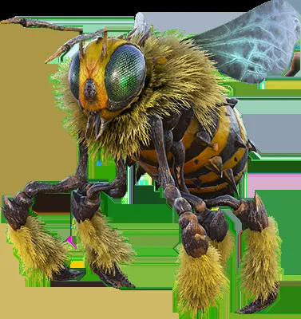

*Picture: Monster library art — Monster Manual I*

**Partial — fullest block on file:**

Type: Medium Vermin
Challenge Rating: 1
Source book(s): Monster Manual I
Description: Although many times larger, growing to a length of about 5 feet, giant bees behave generally the same as their smaller cousins. Giant bees are usually not aggressive except when defending themselves or their hive.
[Partial — fullest available from APOC-VTT registry record; no roster stat block found. No stat lines invented.]

## Giant Bombardier Beetle — CR 2 — Monster Manual I


*Picture: Monster library art — Monster Manual I*

**Partial — fullest block on file:**

Type: Medium Vermin
Challenge Rating: 2
Source book(s): Monster Manual I
Description: These creatures feed primarily on carrion and offal, gathering heaps of the stuff in which to build nests and lay eggs. A giant bombardier beetle is about 6 feet long. Giant bombardier beetles normally attack only to defend themselves, their nests, or their eggs.
[Partial — fullest available from APOC-VTT registry record; no roster stat block found. No stat lines invented.]

## Giant Fire Beetle — CR 0.333333 — Monster Manual I

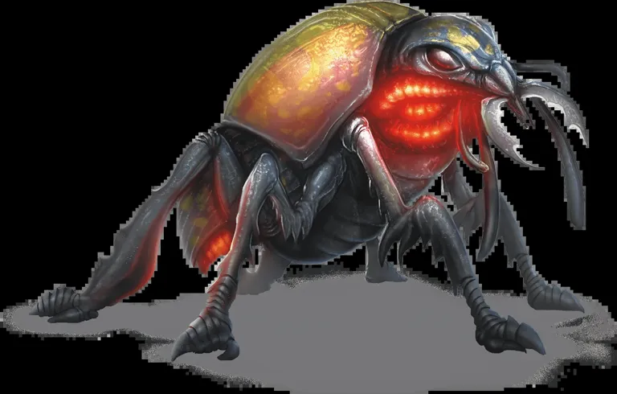

*Picture: Monster library art — Monster Manual I*

**Partial — fullest block on file:**

Type: Small Vermin
Challenge Rating: 1/3
Source book(s): Monster Manual I
Description: These luminous nocturnal insects are prized by miners and adventurers. They have two glands, one above each eye, that produce a red glow. The glands' luminosity persists for 1d6 days after removal from the beetle, illuminating a roughly circular area with a 10-foot radius. Giant fire beetles are about 2 feet long.
[Partial — fullest available from APOC-VTT registry record; no roster stat block found. No stat lines invented.]

## Giant Psurlon — CR 15 — Monster Manual II


*Picture: APOC-VTT monster library art — Monster Manual II*

**Partial — fullest block on file:**

Type: Large Aberration
Challenge Rating: 15
Source book(s): Monster Manual II
Description: Giant psurlons are bred for combat. Like all psurlons, however, their mental powers are more formidable than their physical abilities. A giant psurlon stands 12 feet tall and weighs about 600 pounds. Giant psurlons prefer to attack from afar. After softening up the opposition with mind fog, a giant psurlon follows up with disintegrate against the most dangerous opponent. Spell-Like Abilities: At will—detect thoughts, dominate person, hold monster, mass suggestion, mind fog, sleep; 1/day—disintegrate, stoneskin. Caster level 18th; save DC 13 + spell level.
[Partial — fullest available from APOC-VTT registry record; no roster stat block found. No stat lines invented.]

## Giant Stag Beetle — CR 4 — Monster Manual I, Monster Manual IV


*Picture: Monster library art — Monster Manual I, Monster Manual IV*

**Partial — fullest block on file:**

Type: Large Vermin
Challenge Rating: 4
Source book(s): Monster Manual I, Monster Manual IV
Description: These creatures are serious pests that greedily devour cultivated crops. A single beetle can strip an entire farm in short order. An adult giant stag beetle is about 10 feet long.
[Partial — fullest available from APOC-VTT registry record; no roster stat block found. No stat lines invented.]

## Giant Wasp — CR 3 — Monster Manual I, Monster Manual IV


*Picture: Monster library art — Monster Manual I, Monster Manual IV*

**Partial — fullest block on file:**

Type: Large Vermin
Challenge Rating: 3
Source book(s): Monster Manual I, Monster Manual IV
Description: Giant wasps attack when hungry or threatened, stinging their prey to death. They take dead or incapacitated opponents back to their lairs as food for their unhatched young.
[Partial — fullest available from APOC-VTT registry record; no roster stat block found. No stat lines invented.]

## Giant, Cloud — CR 11 — Monster Manual I


*Picture: Monster library art — Monster Manual I*

**Partial — fullest block on file:**

Type: Huge Giant (Air)
Challenge Rating: 11
Source book(s): Monster Manual I
Description: Cloud giants' skin ranges in color from milky white to light sky blue. Their hair is silvery white or brass, and their eyes are iridescent blue. Adult males are about 18 feet tall and weigh about 5,000 pounds. Females are slightly shorter and lighter. Cloud giants can live to be 400 years old. Cloud giants dress in the finest clothing available and wear jewelry. To many, appearance indicates station. The better the clothes and the finer the jewelry, the more important the wearer.
[Partial — fullest available from APOC-VTT registry record; no roster stat block found. No stat lines invented.]

## Giant, Death — CR 16 — Monster Manual III


*Picture: APOC-VTT monster library art — Monster Manual III*

SCARAB SWARM, DEATH — CR 7

*Source: Sandstorm, pp.184–185.*

Diminutive Undead (Swarm)
Hit Dice: 12d12+9 (87 hp)
Initiative: +6
Speed: 30 ft. (6 squares), climb 30 ft.
Armor Class: 20 (+4 size, +6 Dex), touch 20, flat-footed 14
Base Attack/Grapple: +6/—
Attack: Swarm (3d6)
Full Attack: Swarm (3d6)
Space/Reach: 10 ft./0 ft.
Special Attacks: Consumption, distraction [ability headed "Consume (Ex)" in the text — as published]
Special Qualities: Damage reduction 10/magic, darkvision 60 ft., hive mind, low-light vision, resistance to fire 10, swarm traits [undead traits not listed in the SQ line as printed — as published]
Saves: Fort +4, Ref +10, Will +9
Abilities: Str 1, Dex 23, Con —, Int 6, Wis 13, Cha 15
Skills: Climb +4, Hide +18, Listen +10, Spot +10
Feats: Alertness, Iron Will, Toughness (3)
Environment: Warm deserts
Organization: Solitary, dread (2–4 swarms), or horror (5–8 swarms)
Challenge Rating: 7
Treasure: None
Alignment: Always neutral
Advancement: None
Level Adjustment: —

Description (verbatim): "A black carpet of furiously vibrating carapaces surges forward. Every square inch of the ground is covered with hundreds of tiny, scrabbling scarabs."
"Death scarabs are vicious, undead beetles that reside in some desert tombs. A single death scarab resembles a round, night-black beetle 1-1/2 inches long. Death scarabs exhibit no fear, and when swarming, these creatures seem unstoppable. While living scarab beetle swarms are terrible to contend with, the tenacity of death scarab swarms is something living swarms cannot duplicate. Death scarab swarms are visually distinct from living beetles in that they are black all over, and an individual is slightly larger than its living counterpart."

Consume (Ex): A death scarab swarm can attempt to instantly consume prey by entering a creature directly through the skin or by crawling into its mouth and other orifices to eat the target both inside and out. If a scarab swarm successfully distracts a foe it surrounds, it takes advantage of the distraction, and the swarm enters the distracted prey's body. Once scarabs have entered a creature, the victim automatically takes 6d6 points of damage in each subsequent round. If the swarm slays the prey, it is considered completely consumed, leaving nothing behind but equipment. A remove disease or heal spell cast on a victim being consumed expels the invading scarabs (in that round, anyway; the swarm can attempt to consume again on the following round if all other conditions are met).
Distraction (Ex): Any living creature that begins its turn with a death scarab swarm in its space must succeed on a DC 18 Fortitude save or be nauseated for 1 round. The save DC is Charisma-based.
Hive Mind (Ex): Any death scarab swarm with at least 1 hit point per Hit Die (or 12 hit points, for a standard death scarab swarm) forms a hive mind, giving it an Intelligence of 6. When a death scarab swarm is reduced below this hit point threshold, it becomes mindless.
Skills: A death scarab swarm has a +8 racial bonus on Climb checks and can always take 10 on a Climb check, even if rushed or threatened.

**APOC Note:** Tomb-guardian swarms — badlands ruin hazards in APOC, and a Kingdom of the Undead area-denial tool. No planar or summoning dependency. Melairshield bars them from the Bastion.

## Giant, Eldritch — CR 15 — Monster Manual III


*Picture: APOC-VTT monster library art — Monster Manual III*

Eldritch

**Source:** Monsternomicon Vol. I (Privateer Press), p.62 [2005 v3.5 revision text; re-checked 2026-11-08 against the library copy (2002 original), edition differences flagged on the entry]

**2002-original check (2026-11-08, pp.62–64):** template confirmed as filed (CR same as character +4; abilities +10 Str/+6 Dex/+2 Int/+4 Cha; +6 racial skill bonuses; touch 2d4+6; darkvision 120 ft.; turn resistance +4; SR 11 + character level; weaknesses identical). Edition differences: the 2002 sample prints **CR 14** (filed 2005 sample: CR 13) and **AC 26** (its printed components — +3 Dex, +5 natural, +5 elven chain, +2 ring of protection — sum to 25; filed 2005 sample: AC 25), and the template's damage reduction prints **15/+1** in 2002 (filed 2005 text: 10/good and magic); the 2002 spell-like list names *change self* (2005 text: *disguise self*) and *contagion (age rot)* (2005 text: *contagion (mummy rot)*).

Template — verified: "Eldritch" is an acquired template (see below). Sample creature:

Eldritch, 9th-Level Iosan Fighter
Medium Undead (Augmented Humanoid)
Hit Dice: 9d12 (58 hp)
Initiative: +7
Speed: 30 ft. (6 squares)
AC: 25 (+3 Dex, +5 natural, +5 elven chain, +2 deflection), touch 15, flat-footed 22
Base Attack/Grapple: +9/+15
Attack: Touch +15 melee (2d4+6 negative energy plus ability score damage) or +2 longsword +18 melee (1d8+10/17–20) or masterwork shortbow +13 ranged (1d6/x3)
Full Attack: Touch +15 melee (2d4+6 negative energy plus ability score loss); or +2 longsword +18/+13 melee (1d8+10/17–20); or +1 dagger +16/+11 melee (1d4+7/19–20); or masterwork shortbow +13/+8 ranged (1d6/x3)
Space/Reach: 5 ft./5 ft.
Special Attacks: Create sythyss, dread touch, spell-like abilities
Special Qualities: +4 turn resistance, damage reduction 10/good and magic, darkvision 120 ft., elven traits, eldritch weaknesses, immunity to cold, electricity, and polymorph, spell resistance 20, undead traits
Saves: Fort +6, Ref +8, Will +5
Abilities: Str 23, Dex 17, Con —, Int 17, Wis 15, Cha 16
Skills: Bluff +9, Climb +8, Disguise +9, Handle Animal +8, Hide +14, Intimidate +7, Jump +8, Listen +12, Move Silently +9, Ride +8, Search +9, Sense Motive +9, Spot +14, Swim +4, Use Magical Device +10
Feats: AlertnessB, Blind-Fight, Combat CastingB, Combat Reflexes, Dodge, Improved Critical (longsword), Improved InitiativeB, Lightning ReflexesB, Mobility, Persuasive, Spring Attack, Weapon Focus (longsword), Weapon Specialization (longsword)
Environment: Any land and underground
Organization: Solitary
Challenge Rating: 13
Alignment: Neutral evil
Advancement: By character class
Level Adjustment: —
Magic Items: +1 dagger, +2 longsword, elven chain, ring of protection +2, cloak of elvenkind, brooch of shielding, bag of holding (type 2)

Description / Pendrake text (p.62): "The shrouded woods of Ios are a mysterious and secluded place holding many secrets yet to be discovered by the kingdoms of men. Not the least of those is the elves themselves, and my limited experience with them has led me across the path of many a mysterious and unexplained tale. One such legend was that of the eldritch, a legend that eluded me for many years though in time I would learn more of this one firsthand. My elven assistant Edrea had made elusive reference to the tale of Vyros Thossor, an elder who had succumbed to a dark temptation and become a horrid warped being. On one darkened night on the streets of Corvis, it was Vyros Thossor himself whom I stumbled across… or I should say, who stumbled across me. I'll not divulge the details of the encounter—I think I'm endangering myself enough just by including this entry—but I will impart a few details, should any of my readers stumble upon one of these vile abominations. Eldritch are elves who live in undeath. Though I've not discovered the reasons, there are many elder elves who show an intense fear of dying, and the eldritch is one result. These beings are seemingly approached by dark voices tempting them to commit a horrible rite against their brethren to live on eternally. Their bodies become warped, their skin shriveled and decayed, though in truth they are stronger and faster than they were in life. Smarter too, it seems, as eldritch are cunning creatures. They feed off the life essences of other living creatures and seem to be able to drain this energy in different fashions as suits their whims. They also gain an increased affinity for magic, and I have witnessed their natural powers myself. Lastly, eldritch are capable of creating undead minions that they call sythyss, which obey their master's will entirely. For all the mystery surrounding the eldritch and the land from which they come, know this: they are evil. Completely and entirely. An eldritch lives to hunt the living, and lest someone puts it down, it will go on doing just that… eternally."

Creating an Eldritch / Template rules (pp.62–64): "Eldritch" is an acquired template that can be added to any elven humanoid (referred to hereafter as the base creature). An eldritch uses all the base creature's statistics and special abilities except as noted here.
Size and Type: The creature's type changes to undead. Do not recalculate the creature's base attack bonus, saves, or skill points. Size is unchanged.
Hit Dice: All current and future Hit Dice become d12s. Speed: Same as base creature. AC: The base creature gains a natural armor bonus of +5.
Attack: An eldritch has a touch attack that it can use once per round. An eldritch armed with a weapon uses its touch or a weapon, as it desires.
Full Attack: An eldritch fighting without weapons uses its touch attack (see above). If armed with a weapon, it usually uses the weapon as its primary attack along with a touch as a natural secondary attack provided it has a way to make that attack (with a free hand).
Damage: Eldritch have a touch attack that uses negative energy to deal 2d4+6 points of damage to living creatures; a Will save (DC 10 + 1/2 eldritch's HD + eldritch's Cha modifier) halves the damage. Upon a successful touch attack the eldritch may also choose to use its dread touch ability as well.
Special Attacks: An eldritch retains all the base creature's special attacks and gains those described below. Save DCs are equal to 10 + 1/2 eldritch's HD + eldritch's Cha modifier unless otherwise noted.
Create Sythyss (Su): If the eldritch drains an elf's Constitution to 0 or lower with its dread touch ability, it may choose to immediately change the elf into a sythyss (see the Sythyss entry). The sythyss is under the command of the eldritch that created it and remains enslaved until its master is destroyed. At any given time an eldritch may have enslaved sythyss with Hit Dice totaling no more than twice its own Hit Dice. An eldritch may voluntarily destroy an enslaved sythyss in order to enslave a new sythyss.
Dread Touch (Su): An eldritch that hits with its touch attack deals 1d4+1 points of ability damage to any one ability score selected by the eldritch. A successful Fortitude save negates.
Spell-like Abilities (Sp): Eldritch gain the following spell-like abilities. At will—charm animal, charm person, chill touch, disguise self, dispel magic, expeditious retreat, protection from good; 3/day—alter self, charm monster, contagion (mummy rot), haste, hold person, invisibility, suggestion; 1/day—bestow curse, circle of death, dominate person, finger of death, hold monster. Caster level 14th or eldritch's HD, whichever is greater (save DC 10 + spell level + Charisma modifier).
Special Qualities: Eldritch have all the special qualities of the base creature, plus darkvision 120 ft. (which replaces their low-light vision). Eldritch are immune to cold, electricity, and polymorph effects. Eldritch also gain the following special qualities.
Damage Reduction (Ex): An eldritch has damage reduction 10/good and magic. Its natural weapons are treated as magic weapons for the purpose of overcoming damage reduction.
Spell Resistance (Ex): An eldritch gains spell resistance equal to the base creature's HD + 11.
Turn Resistance (Ex): An eldritch has +4 turn resistance.
Saves: Same as base creature. Abilities: Increase from base creature as follows: Str +10, Dex +6, Int +2, Cha +4. As an undead creature, an eldritch has no Constitution score.
Skills: Eldritch receive a +6 racial bonus to Bluff, Disguise, Hide, Listen, Move Silently, Search, Sense Motive, Spot, and Use Magic Device checks.
Feats: Eldritch gain Alertness, Combat Casting, Improved Initiative, and Lightning Reflexes as bonus feats, assuming that the base creature does not already have these feats.
Environment: Any land and underground. Organization: Solitary. Challenge Rating: Same as base creature +4. Alignment: Always neutral evil. Advancement: By character class. Level Adjustment: Same as base cr

## Gibborite — CR 3 — Anger of Angels


*Picture: Demons roster picture index: GENERATED (from the published description)*

### 2a. Gibborite — STANDALONE race entry (full stat lines as printed, book p.114)

Gibborite; Large Outsider (Native); Hit Dice: 3d8+6 (19 hp); Initiative: +0; Speed: 40 feet; AC: 14 (–1 size, +2 natural, +3 studded leather armor): touch 9, flat-footed 14; Base Attack/Grapple: +3/+11; Attack: Longsword +7 melee (1d8+4) or javelin +2 ranged (1d6+4); Full Attack: Longsword +7 melee (1d8+4) or javelin +2 ranged (1d6+4); Space/Reach: 10 feet/10 feet; Special Qualities: Darkvision 60 feet, descent into darkness, low-light vision, resistance to acid, cold, and electricity 5, SR 6; Saves: Fortitude +5, Reflex +3, Will +4; Abilities: Str 18, Dex 10, Con 14, Int 12, Wis 12, Cha 14; Skills: Concentration +8, Craft (alchemy) +7, Diplomacy +8, Knowledge (arcana) +7, Knowledge (local) +7, Knowledge (religion) +7, Use Magic Device +8, Spellcraft +7, Spot +7; Feat [as printed]: Power Attack, Weapon Focus (longsword); Environment: Any land; Organization: Solitary or squadron (one gibborite with 3d6 humanoid barbarians, fighters, or warriors of 1st to 3rd level); Challenge Rating: 3; Treasure: Standard; Alignment: Any nonevil; Advancement: By character class; Level Adjustment: +3.

Description (verbatim excerpts): "This large humanoid looks much like a tall human with a noble and wise demeanor. He is dressed in well-kept studded leather armor and carries a longsword." — "Gibborim are the sons and daughters of the grigori and mortals. Blessed with great size, strength, and wisdom, they are destined to be great heroes and doomed to become monsters." — "Gibborim (singular gibborite), meaning “giant heroes,” are the most benign of the nephilim. … they look like exceptionally large versions of their mortal parents." — "Gibborim speak Celestial and whatever languages their mortal parent speaks."

Descent Into Darkness (Ex) (verbatim): "The curse of the gibborim is that over time they become more brutal, destructive, and dangerous, eventually turning to evil. The first time a gibborite is wounded in a particular encounter it must attempt a Will saving throw (DC 20). Success means nothing happens. Failure means the gibborite immediately loses 1 point of Wisdom. When its Wisdom reaches 0 or if the gibborite's alignment ever changes to evil, the gibborite immediately gains one of the evil nephilim templates (avvim, emim, or raphaim), at which point its Wisdom returns to its original value. Once it has made this transformation, the gibborite cannot return to its former self without powerful magic (such as miracle or wish), and in any case most do not wish to do so."

Gibborite Characters (verbatim): "Gibborim favor the sorcerer class. Most become fighters, sorcerers, or wizards."

## Githyanki Captain — CR 10 — Monster Manual IV


*Picture: APOC-VTT monster library art — Monster Manual IV*

**Partial — fullest block on file:**

Type: Medium Humanoid (Extraplanar)
Challenge Rating: 10
Source book(s): Monster Manual IV
Description: This slim humanoid is as strong and lithe as a hunting cat. He wears a jet-black breastplate that resembles a skeletal torso with ribs outlined in burnished gold. He wields a massive silver sword and carries a composite bow.
[Partial — fullest available from APOC-VTT registry record; no roster stat block found. No stat lines invented.]

## Glaistig — CR 6 — Monster Manual III


*Picture: APOC-VTT monster library art — Monster Manual III*

**Partial — fullest block on file:**

Type: Medium Fey
Challenge Rating: 6
Source book(s): Monster Manual III
Description: A staggeringly beautiful maiden stands waist-deep in the water, swaying back and forth as she sings a haunting song. Beautiful and enchanting, glaistigs are fey that lurk in and around pools, lakes, and streams. They have an insatiable craving for the blood of mortals, beguiling victims to come close to their lair in order to drain them. They are commonly mistaken for vampires because of their bloodsucking technique, but they are not undead.
[Partial — fullest available from APOC-VTT registry record; no roster stat block found. No stat lines invented.]

## Gnoll — CR 1 — Monster Manual I


*Picture: Monster library art — Monster Manual I*

**Partial — fullest block on file:**

Type: Medium Humanoid (Gnoll)
Challenge Rating: 1
Source book(s): Monster Manual I
Description: Gnolls are hyena-headed, evil humanoids that wander in loose tribes. Most gnolls have dirty yellow or reddish-brown fur. A gnoll is a nocturnal carnivore, preferring intelligent creatures for food because they scream more. A gnoll is about 7½ feet tall and weighs 300 pounds. Gnolls speak Gnoll.
[Partial — fullest available from APOC-VTT registry record; no roster stat block found. No stat lines invented.]

## Gnome, Forest — CR 0.5 — Monster Manual I

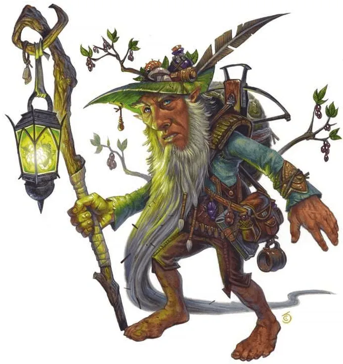

*Picture: Monster library art — Monster Manual I*

**Partial — fullest block on file:**

Type: Small Humanoid (Gnome)
Challenge Rating: ½
Source book(s): Monster Manual I
Description: They are the smallest of all the gnomes, averaging 2 to 2½ feet in height, but look just like regular gnomes except with bark-colored or gray-green skin, and eyes that can be brown or green as well as blue. A very long-lived people, forest gnomes have an average life expectancy of 500 years.
[Partial — fullest available from APOC-VTT registry record; no roster stat block found. No stat lines invented.]

## Golem, Brass — CR 10 — Monster Manual II


*Picture: Constructs roster picture index: Official book art — Monster Manual II, p. 117 — shared golem scene; brass figure cropped from the left; full scene also filed as golem-plate-mm2-p117.png*

**Partial — fullest block on file:**

Type: Large Construct
Challenge Rating: 10
Source book(s): Monster Manual II
Description: A brass golem exists to fulfill one goal, set at the time of its creation. It waits with absolute patience until activated, then it becomes a terrible instrument of destruction. If its goal becomes unattainable—for example, if it was created to guard a temple that no longer exists—the brass golem loses its enchantment entirely and becomes nothing more than a statue. A brass golem is most often forged to resemble a minotaur. Until activated, it appears as a large, brass statue armed with a gleaming greataxe.
[Partial — fullest available from APOC-VTT registry record; no roster stat block found. No stat lines invented.]

## Golem, Demonflesh — CR 18 — Fiend Folio


*Picture: Constructs roster picture index: Official book art — Fiend Folio, p. 87 — labeled shared plate; see Brain Golem note (minor flame overlap from the hellfire figure at the crop's lower edge)*

DEMONFLESH GOLEM [3.0-format as published]

**Huge Construct (Extraplanar)**
**Hit Dice:** 24d10+40 (172 hp)
**Initiative:** +3
**Speed:** 50 ft., fly 100 ft. (average)
**AC:** 33 (–2 size, –1 Dex, +26 natural), touch 7, flat-footed 33
**Base Attack/Grapple:** +18/+36
**Attack:** Slam +27 melee, or tail lash +27 melee
**Full Attack:** Slam +27 melee and claw +29 melee, or tail lash +27 melee
**Damage:** Slam 2d6+10, claw 2d6+12/19–20, tail lash 1d6+10 plus daze
**Face/Reach:** 15 ft./15 ft. (25 ft. with tail)
**Special Attacks:** Claw graft, fear gaze, spell-like abilities, whip tail graft
**Special Qualities:** Acid resistance 20, cold resistance 20, construct traits, DR 30/+3, electricity immunity, fast leg graft, fire resistance 20, immunity to magic, see invisibility
**Saves:** Fort +8, Ref +7, Will +9
**Abilities:** Str 31, Dex 8, Con —, Int 8, Wis 12, Cha 13
**Skills:** Climb +29, Jump +28
**Feats:** Cleave, Combat Reflexes, Great Cleave, Improved Critical (claw), Improved Initiative, Power Attack, Weapon Focus (claw), Weapon Focus (slam), Weapon Focus (tail lash)
**Climate/Terrain:** Any land and underground (the Abyss)
**Organization:** Solitary
**Challenge Rating:** 18
**Treasure:** —
**Alignment:** Always chaotic evil
**Advancement:** 25–36 HD (Huge); 37–72 HD (Gargantuan)

The ultimate example of fiendish grafting (see Appendix 2), the demonflesh golem is a collection of demonic body parts assembled into a truly vile whole.
A demonflesh golem bears a superficial resemblance to a flesh golem. Its overall form is humanoid, with the addition of a pair of membranous wings and a long, thin tail. Its left arm is muscular and sinewy, with a large, clawed hand, while its right arm is more slender and ends in a heavy, bony hand. Its right leg is long and agile, while its left is thicker and heavier. Despite having a pronounced limp, the creature moves quickly and can climb and jump with remarkable ease. One eye is bright red and has a black iris, while the other is yellow with no visible iris, but it has a pupil shaped like a cat's.
Unlike most golems, a demonflesh golem is reasonably intelligent, and it speaks and understands Abyssal.

## Golem, Iron — CR 13 — Monster Manual I


*Picture: Monster library art — Monster Manual I*

**Partial — fullest block on file:**

Type: Large Construct
Challenge Rating: 13
Source book(s): Monster Manual I
Description: This golem has a humanoid body made from iron. An iron golem can be fashioned in any manner, just like a stone golem (see below), although it almost always displays armor of some sort. Its features are much smoother than those of a stone golem. Iron golems sometimes carry a short sword in one hand. An iron golem is 12 feet tall and weighs about 5,000 pounds. An iron golem cannot speak or make any vocal noise, nor does it have any distinguishable odor. It moves with a ponderous but smooth gait. Each step causes the floor to tremble unless it is on a thick, solid foundation.
[Partial — fullest available from APOC-VTT registry record; no roster stat block found. No stat lines invented.]

## Golem, Stone — CR 11 — Monster Manual I


*Picture: Monster library art — Monster Manual I*

**Partial — fullest block on file:**

Type: Large Construct
Challenge Rating: 11
Source book(s): Monster Manual I
Description: This golem has a humanoid body made from stone. A stone golem is 9 feet tall and weighs around 2,000 pounds. Its body is frequently stylized to suit its creator. For example, it might look like it is wearing armor, with a particular symbol carved on the breastplate, or have designs worked into the stone of its limbs.
[Partial — fullest available from APOC-VTT registry record; no roster stat block found. No stat lines invented.]

## Gorgon — CR 8 — Monster Manual I


*Picture: Monster library art — Monster Manual I*

**Partial — fullest block on file:**

Type: Large Magical Beast
Challenge Rating: 8
Source book(s): Monster Manual I
Description: A typical gorgon stands over 6 feet tall at the shoulder and measures 8 feet from snout to tail. It weighs about 4,000 pounds. Gorgons are nothing if not aggressive. They attack intruders on sight, attempting to trample, gore, or petrify them. There is no way to calm these furious creatures, and they are impossible to domesticate.
[Partial — fullest available from APOC-VTT registry record; no roster stat block found. No stat lines invented.]

## Gravetouched Ghoul Harpy — CR 5 — Libris Mortis


*Picture: Undead roster picture index: GENERATED from the stat block — GENERATED from the stat block — Expedition to Castle Ravenloft*

**Partial — fullest block on file:**

3.10 GRAVETOUCHED GHOUL HARPY — CR 5 (Ghoul Grave, E9, book p.44)


The gravetouched ghoul template's primary printing is Libris Mortis (Batch 1 cross-reference); this is its EtCR application.
- CE Medium undead (augmented monstrous humanoid); **HP** 45; **Init** +4; **Senses** darkvision 60 ft., Listen +9, Spot +5
- **AC** 17, touch 14, flat-footed 13 (Dodge); **HD** 7; +2 turn resistance
- **Fort** +2, **Ref** +9, **Will** +8; **Speed** 20 ft., fly 80 ft. (average)
- **Melee** 2 claws +8 (1d4+1 plus paralysis) and bite +6 (1d6 plus disease plus paralysis); **Base Atk** +7; **Grp** +8
- **Special Attacks** captivating song (Su) — 300-ft. spread, Will DC 17 or captivated (sonic, mind-affecting charm)
- **Abilities** Str 12, Dex 19, Con —, Int 9, Wis 16, Cha 19
- **Feats** Dodge, Flyby Attack, Multiattack (B), Persuasive
- **Skills** Bluff +13, Intimidate +10, Listen +9, Perform (oratory) +6, Spot +5

**APOC Note (2701 DR):** A singing ghoul-harpy over a badlands grave-field is a Kingdom of the Undead lure — it draws the living out, which is the opposite of what the Bastion's outward-looking guard wants. Melairshield-barred.

## Gravorg — CR 8 — Monster Manual II


*Picture: APOC-VTT monster library art — Monster Manual II*

**Partial — fullest block on file:**

Type: Large Magical Beast
Challenge Rating: 8
Source book(s): Monster Manual II
Description: A gravorg is a carnivorous predator that lairs underground. These monsters are only rarely encountered in the wilderness; they tend to move from cave to cave or dungeon to dungeon in search of prey.
[Partial — fullest available from APOC-VTT registry record; no roster stat block found. No stat lines invented.]

## Greater Shadesteel Golem — CR 14 — Monster Manual III


*Picture: APOC-VTT monster library art — Monster Manual III*

**Partial — fullest block on file:**

Type: Large Construct (Extraplanar)
Challenge Rating: 14
Source book(s): Monster Manual III
Description: A greater shadesteel golem stands 11 feet tall and weighs about 4,000 pounds.
[Partial — fullest available from APOC-VTT registry record; no roster stat block found. No stat lines invented.]

## Greenspawn Leaper — CR 2 — Monster Manual IV


*Picture: APOC-VTT monster library art — Monster Manual IV*

**Partial — fullest block on file:**

Type: Medium magical beast (dragonblood)
Challenge Rating: 2
Source book(s): Monster Manual IV
Description: The sound of shaking branches and scrabbling claws grows near. Suddenly you spy a green-scaled, dragonlike creature climbing along the underside of a thick tree limb. About the size of a dwarf, it is clearly a predator built for life in the trees.
[Partial — fullest available from APOC-VTT registry record; no roster stat block found. No stat lines invented.]

## Greenspawn Razorfiend — CR 7 — Monster Manual IV


*Picture: APOC-VTT monster library art — Monster Manual IV*

**Partial — fullest block on file:**

Type: Large magical beast (dragonblood)
Challenge Rating: 7
Source book(s): Monster Manual IV
Description: A draconic shape leaps from the water, slashing with razor-tipped, clawed wings. A frill on its forehead and extending down its back suggests a green dragon was somehow involved in the creation of this beast.
[Partial — fullest available from APOC-VTT registry record; no roster stat block found. No stat lines invented.]

## Greenspawn Sneak Raid Leader — CR 7 — Monster Manual IV


*Picture: APOC-VTT monster library art — Monster Manual IV*

**Partial — fullest block on file:**

Type: Small monstrous humanoid (dragonblood)
Challenge Rating: 7
Source book(s): Monster Manual IV
Description: An arrow streaks toward you, and a blur of black leather and green scales tumbles in after it. You whirl to face the creature as it pops up behind you, already stabbing with a gleaming blade.
[Partial — fullest available from APOC-VTT registry record; no roster stat block found. No stat lines invented.]

## Grimweird — CR 11 — Monster Manual III


*Picture: Undead roster picture index: official book art — official book art — Monster Manual III*

GRIMWEIRD — Monster Manual III, p.75


- **Size/Type:** Medium Undead (Extraplanar)
- **Hit Dice:** 12d12 (78 hp)
- **Initiative:** +5
- **Speed:** 20 ft. (4 squares)
- **Armor Class:** 20 (+1 Dex, +9 natural), touch 11, flat-footed 19
- **Base Attack/Grapple:** +6/+6
- **Attack:** Slam +6 melee (1d6)
- **Full Attack:** Slam +6 melee (1d6)
- **Space/Reach:** 5 ft./5 ft.
- **Special Attacks:** Black bond, spell-like abilities, summon undead
- **Special Qualities:** Channel negative energy, darkvision 60 ft., resistance to fire 10, SR 21, undead traits
- **Saves:** Fort +4, Ref +5, Will +13
- **Abilities:** Str 10, Dex 13, Con —, Int 16, Wis 20, Cha 16
- **Skills:** Bluff +19, Concentration +19 (+23 when casting defensively), Diplomacy +25, Gather Information +17, Handle Animal +14, Intimidate +21, Knowledge (arcana) +18, Knowledge (the planes) +18, Sense Motive +14, Spellcraft +18
- **Feats:** Alertness, Empower Spell, Eschew Materials, Improved Initiative, Iron Will
- **Environment:** Negative Energy Plane *(as printed — see APOC Note)*
- **Organization:** Solitary, pair, or clique (3–9)
- **Challenge Rating:** 11
- **Treasure:** Standard
- **Alignment:** Always neutral evil
- **Advancement:** 13–24 HD (Medium)
- **Level Adjustment:** —
- **Description:** "This withered, aged human crackles with dark light—light that seems to be holding him together. His bones seem to have shrunk, like the muscles can't hold them up."

## Groaning Spirit — CR 7 — Tome of Horrors Revised (Necromancer Games


*Picture: Undead roster picture index: official book art — official book art — Tome of Horrors Revised (Necromancer Games)*

Groaning Spirit


**Source:** Tome of Horrors Revised (Necromancer Games, 2005), p.229

```
GROANING SPIRIT                                                        Advancement:             8-21 HD (Medium)
               Medium Undead (Incorporeal)
               Hit Dice:                7d12 (45 hp)                                  Level Adjustment:        —
               Initiative:              +7
               Speed:                   30 ft. (6 squares)                               This translucent figure resembles a beautiful elven female
               Armor Class:             17 (+3 Dex, +4 deflection), touch 17, flat-   with delicate features. Her eyes burn with a crimson flame
                                        footed 14                                     and her hair is a tangled mess of its former beauty.
               Base Attack/Grapple:     +3/—
               Attack:                  Incorporeal touch +6 melee (1d8 plus chill       The groaning spirit is the malevolent spirit of a female
                                        touch)                                        elf that is found haunting swamps, fens, moors, and
               Full Attack:             Incorporeal touch +6 melee (1d8 plus chill    other desolate places. Groaning spirits hate the living
                                        touch)                                        and seek to destroy whomever they meet. A groaning
               Space/Reach:             5 ft./5 ft.
               Special Attacks:         Chill touch, fear aura, keening
                                                                                      spirit appears as a translucent image of her former self.
               Special Qualities:       Darkvision 60 ft., immunity to cold and
                                        electricity, incorporeal traits, +4 turn      Combat
                                        resistance, sense living, SR 20, undead         A groaning spirit’s primary attack is her keening. If a
                                        traits, unnatural aura, vulnerability
               Saves:                   Fort +2, Ref +5, Will +8                      creature survives the keening attack, the groaning spirit
               Abilities:               Str –, Dex 17, Con –, Int 16, Wis 16, Cha     attacks with her incorporeal touch.
                                        18                                              Chill Touch (Su): Damage caused by the groaning
               Skills:                  Bluff +14, Hide +13, Intimidate +14, Listen
                                        +15, Search +13, Sense Motive +13, Spot       spirit’s touch attack is considered negative energy and
                                        +15                                           sends a chilling cold through an opponent’s body. Any
               Feats:                   Ability Focus (keening), AlertnessB, Blind-   creature touched must succeed on a DC 17 Fortitude
                                        Fight, Improved Initiative                    save or suffer 1 point of Strength drain.
               Environment:             Any
               Organization:            Solitary                                        Groaning spirits are the bane of other undead, and
               Challenge Rating:        7                                             any undead they touch (except other groaning spirits)
               Treasure:                Standard                                      must succeed on a DC 17 Will save or flee in fear for 2d6
               Alignment:               Always chaotic evil                           rounds. The save DCs are Charisma-based.

                                                                                  229
                                                         the        tome           of     horrors            revised

                             Fear Aura (Su): Anyone viewing a groaning spirit
                          must succeed on a DC 17 Will save or flee in terror for
                          1d6+4 rounds. Whether or not the save is successful,
                          a creature is immune to the fear aura of that
                          groaning spirit for one day.
                             Keening (Su): Once per day, at night only, a
                          groaning spirit can release a death wail audible to
                          a range of 1 mile. All creatures within 30 feet that
                          hear this must make a successful DC 19 Will save
                          or be affected as per the wail of the banshee spell.
                          Those that make their save still take 3d6+7 points
                          of damage. The save DC is Charisma-based and
                          includes a +2 bonus from the groaning spirit’s Abil-
                          ity Focus feat.
                             Sense Living (Su): A groaning spirit can sense all
                          living creatures up to 5 miles away.
                             Unnatural Aura (Su): Both wild and domesticated
                          animals can sense the unnatural presence of a groaning
                          spirit at a distance of 30 feet. They will not willingly
                          approach nearer than that and panic if forced to do so;
                          they remain panicked as long as they are within that
                          range.
                             Vulnerability (Ex): If a spellcaster uses dispel
                          evil (the second effect requiring a touch attack)
                          against a groaning spirit, the creature must suc-
                          ceed on a Will save (DC 15 + caster’s relevant
                          ability score modifier) or die immediately.
                             Credit
                             The Groaning Spirit originally appeared in the
                          First Edition Monster Manual (© TSR/Wizards of the
                          Coast, 1977) and is used by permission.
                             Copyright Notice
                             Authors Scott Greene and Clark Peterson, based on
                          original material by Gary Gygax.
```

**Kit / Treasure (as published):** Treasure line: "Standard                                      must succeed on a DC 17 Will save or flee in fear for 2d6" — no itemized gear is published for this entry; none invented.

**APOC Note** *(Shaun's — separate from the published text above)*
- Counts toward the **Kingdom of the Undead** faction in the badlands war (2701 DR).
- **Planar travel is severed** — any plane shift / Ethereal travel / manifestation in the published text does not function as written in APOC; this undead is bound to the Material Plane on Toril.
- **The Bastion's Melairshield bars undead** — it cannot enter the Bastion of Last Hope.
- **Raw magic blights** the land around the caster in APOC — necromancy worked through raw magic carries that cost; alchemy is the cornerstone inside the walls.

---

## Guttersnipe — CR 5 — Monster Manual II


*Picture: APOC-VTT monster library art — Monster Manual II*

**Partial — fullest block on file:**

Type: Medium Construct
Challenge Rating: 5
Source book(s): Monster Manual II
Description: Guttersnipes are most prevalent around settlements of dwarves, gnomes, and halflings. They form from worn-out and discarded adventuring and construction gear. A guttersnipe appears as a whirling mound of frayed rope, worn leather pieces, strings, belts, and swatches of cloth. Within this mass of material is a core made of small gems, bits of glass, and glitter. Guttersnipes are content to lie in wait for suitable hosts. They save their glitterdust ability to dazzle foes when they need to escape.
[Partial — fullest available from APOC-VTT registry record; no roster stat block found. No stat lines invented.]

## Hag, Annis — CR 6 — Monster Manual I


*Picture: Monster library art — Monster Manual I*

**Partial — fullest block on file:**

Type: Large Monstrous Humanoid
Challenge Rating: 6
Source book(s): Monster Manual I
Description: An annis commonly uses its disguise self ability to take the form of an exceptionally tall human, a fair giant, or an ogre. An annis stands some 8 feet tall and weighs about 325 pounds.
[Partial — fullest available from APOC-VTT registry record; no roster stat block found. No stat lines invented.]

## Harrier — CR 5 — Monsternomicon Vol. 2


*Picture: APOC-VTT monster library art — Monsternomicon Vol. 2*

**Partial — fullest block on file:**

Type: Small Magical Beast
Challenge Rating: 5
Source book(s): Monsternomicon Vol. 2
Description: Lynus’ description of the creatures he saw––eyeless, very draconic in appearance, with enormous fanged maws, black curved claws, and tails ending in barbed scythe-like tips––led me to classify them as dragonspawn. I have seen dragonspawn before, particularly their corpses, including those in the Wyrmwall Mountains I believe created by the blood of Blighterghast. The spawn I studied, however, were malformed and misshapen, like many things associated with dragonblight. No two had the same shape.
[Partial — fullest available from APOC-VTT registry record; no roster stat block found. No stat lines invented.]

## Harssaf — CR 5 — Monster Manual III


*Picture: APOC-VTT monster library art — Monster Manual III*

**Partial — fullest block on file:**

Type: Medium Monstrous Humanoid (Fire)
Challenge Rating: 5
Source book(s): Monster Manual III
Description: Armed with a pair of curved kukris, this armored humanoid's long-fingered hands and its vaguely reptilian face are the only parts of its body not covered in sand-colored desert clothes. Its reddish-brown skin is rough and grainy like sand, and its slitted eyes glow a fiery red. As harsh and unyielding as their desert homes, harssafs don't typically deal congenially with others. Harssafs live in and wander the great deserts and barren places of the world.
[Partial — fullest available from APOC-VTT registry record; no roster stat block found. No stat lines invented.]

## Haunt — CR 4 — Tome of Horrors Revised (Necromancer Games


*Picture: Undead roster picture index: official book art — official book art — Tome of Horrors Revised (Necromancer Games)*

Haunt


**Source:** Tome of Horrors Revised (Necromancer Games, 2005), p.233

```
HAUNT
               Medium Undead (Incorporeal)                                            Abilities:               Str —, Dex 15, Con —, Int —, Wis 14,
               Hit Dice:                5d12 (32 hp)                                                           Cha 14
               Initiative:              +6                                            Skills:                  —
               Speed:                   20 ft. (4 squares), fly 30 ft. (perfect)      Feats:                   Blind-FightB, Improved InitiativeB
               Armor Class:             14 (+2 Dex, +2 deflection), touch 14, flat-   Environment:             Any
                                        footed 12                                     Organization:            Solitary
               Base Attack/Grapple:     +2/—                                          Challenge Rating:        4
               Attack:                  Incorporeal touch +4 melee (1d4 plus 1d3      Treasure:                None
                                        Dex)                                          Alignment:               Any (usually evil)
               Full Attack:             Incorporeal touch +4 melee (1d4 plus 1d3      Advancement:             6-9 HD (Medium); 10-15 HD (Large)
                                        Dex)                                          Level Adjustment:        —
               Space/Reach:             5 ft./5 ft.
               Special Attacks:         Dexterity damage, malevolence, strangle         This entity appears as a translucent humanoid floating
               Special Qualities:       Alternate form, immunity to turning, in-      about a foot off the ground. Its eyes flash with pure hatred.
                                        corporeal traits, rejuvenation, undead
                                        traits, vulnerability                           The haunt is the spirit of a person who died before
               Saves:                   Fort +1, Ref +3, Will +6                      completing some vital task. A haunt inhabits an area

                                                                                  233
                                                           the      tome        of     horrors           revised

                          within 60 feet of where its body died and never leaves              Strangle (Su): If a creature possessed by a haunt has
                          this area. (Note—a haunt in possession of a material             an alignment opposite to that of the haunt, it attempts
                          body can in fact leave its area and must do so in order to       to strangle the host using its own hands (i.e., the hands
                          finish its task.) It desires but one thing: its final rest. To   of the host body). Unless precautions are taken to
                          accomplish this, it must possess a living creature and           restrain the possessed victim’s hands, they immediately
                          finish the task that prevents it from achieving everlast-        reach for the throat and begin strangling the haunt-
                          ing slumber. A haunt only attacks humanoid creatures.            possessed body. An opponent takes 1d4 points of damage
                                                                                           each round until its hands are forcibly restrained (op-
                          Combat                                                           posed Strength rolls to pry the host’s hands loose), the
                             A haunt attacks with its incorporeal touch. It con-           haunt is ejected from the body, or the victim dies.
                          centrates on a single foe, attempting to render it helpless         Alternate Form (Su): A haunt’s natural form is that
                          by draining its Dexterity. Once that victim reaches              of a translucent image appearing much as the person did
                          Dexterity 0, the haunt uses its malevolence ability to           in life. As a standard action, it can alter its form so as to
                          possess the body and then attempts to complete the task          appear as a floating, luminescent ball of light (possibly
                          that binds it to this plane. If the haunt is attacked while      being mistaken for a will-o’-wisp in this form). In this
                          possessing a body, it uses all the abilities of the host to      form, it cannot use its Dexterity damage attack or its
                          defend itself.                                                   malevolence attack. It retains its incorporeal form and
                             Dexterity Damage (Su): The touch of a haunt deals             can make an incorporeal touch attack that deals normal
                          1d3 points of Dexterity damage to a living foe. A                damage (but not Dex damage).
                          creature reduced to 0 Dexterity by a haunt is subjected             A haunt remains in one form or the other until it
                          to its malevolence ability. Dexterity damage dealt by a          chooses to assume a new one (as a standard action). A
                          haunt cannot be healed by any means while the haunt              change in form cannot be dispelled. A haunt cannot
                          possesses the host’s body.                                       change forms while using its malevolence attack (that
                             Malevolence (Su): Once per round, a haunt can                 is, while possessing a host).
                          merge its body with a creature on the                                         Rejuvenation (Su): In most cases, it’s diffi-
                          Material Plane whose Dexterity has been                                          cult to destroy a haunt through simple
                          reduced to 0 (either through the haunt’s                                                  combat. The “destroyed” spirit
                          touch or some other means). This                                                            will often restore itself in 1d4
                          ability is similar to a magic jar spell                                                       days. Even the most power-
                          (caster level 10th), except that it                                                              ful spells are usually only
                          does not require a receptacle.                                                                   temporary solutions. A
                          To use this ability, the                                                                        haunt that would other-
                          haunt must try to move                                                                          wise be destroyed returns
                          into the target’s space;                                                                        to its area with a successful
                          moving into the target’s                                                                       level check (1d20 + haunt’s
                          space to use the ma-                                                                           HD) against DC 16. The
                          levolence ability does                                                                        only way to get rid of a haunt
                          not provoke attacks of opportunity.                                                          for sure is to use dispel evil/
                          The target can resist the attack with a                                                    good/law/chaos (depending on
                          successful DC 17 Will save. A creature that                                                  the haunt’s alignment) or al-
                          successfully saves is immune to that same haunt’s                                              low it to finish the task that
                          malevolence for one day, and the haunt cannot                                                     holds it to the material
                          enter the target’s space. If the save fails, the haunt                                              world.
                          vanishes into the target’s body (whose Dexterity
                          temporarily returns to normal) and attempts to
                          complete its unfinished task.

## Hawk — CR 0.333333 — Monster Manual I


*Picture: Monster library art — Monster Manual I*

**Partial — fullest block on file:**

Type: Tiny Animal
Challenge Rating: 1/3
Source book(s): Monster Manual I
Description: These creatures are similar to eagles but slightly smaller: 1 to 2 feet long, with wingspans of 6 feet or less.
[Partial — fullest available from APOC-VTT registry record; no roster stat block found. No stat lines invented.]

## Hellfire Engine — CR 19 — Fiendish Codex II


*Picture: APOC-VTT monster library art — Fiendish Codex II*

**Partial — fullest block on file:**

Type: Huge construct
Challenge Rating: 19
Source book(s): Fiendish Codex II
Description: This automaton thunders forward, its metal plates shrieking with each step, looking like an armored giant. Through the gaps at its joints you can see the white-hot light of some inferno raging within. Its head is terrifying, wrought to appear like a bearded man with the horns of a stag, its mouth opened impossibly wide.
[Partial — fullest available from APOC-VTT registry record; no roster stat block found. No stat lines invented.]

## Hellfire Golem — CR 17 — Fiend Folio


*Picture: Constructs roster picture index: Official book art — Fiend Folio, p. 87 — labeled shared plate; see Brain Golem note*

HELLFIRE GOLEM [3.0-format as published]

**Large Construct (Extraplanar)**
**Hit Dice:** 20d10+30 (140 hp)
**Initiative:** +2
**Speed:** 40 ft.
**AC:** 27 (–1 size, +2 Dex, +16 natural), touch 11, flat-footed 25
**Base Attack/Grapple:** +15/+26
**Attack:** Slam +22 melee
**Full Attack:** 2 slams +22 melee
**Damage:** Slam 1d8+7/19–20 plus 2d6 hellfire
**Face/Reach:** 10 ft./10 ft.
**Special Attacks:** Hellfire, spell-like abilities
**Special Qualities:** Acid resistance 20, cold resistance 20, construct traits, DR 30/+3, fire immunity, immunity to magic
**Saves:** Fort +8, Ref +8, Will +7
**Abilities:** Str 25, Dex 14, Con —, Int 12, Wis 13, Cha 14
**Skills:** Climb +30, Jump +30, Spot +24
**Feats:** Cleave, Combat Reflexes, Great Fortitude, Great Cleave, Improved Critical (slam), Power Attack, Weapon Focus (slam)
**Climate/Terrain:** Any land and underground (Nine Hells)
**Organization:** Solitary
**Challenge Rating:** 17
**Treasure:** —
**Alignment:** Always lawful evil
**Advancement:** 21–30 HD (Large); 31–60 HD (Huge)

A hellfire golem is a construct from the infernal planes that is crafted by devils for sheer destructive and pyromaniac delight. It appears as a towering humanoid creature that seems to be formed of brilliant lava covered with a crumbling black crust. Flames leap out from the cracks in its crusty skin and wreathe its body in infernal fire.
Unlike most golems, a hellfire golem is reasonably intelligent, and it speaks and understands Infernal.

## Hoar Spirit — CR 3 — Tome of Horrors II


*Picture: Undead roster picture index: GENERATED from the published description — GENERATED from the published description — Tome of Horrors II*

HOAR SPIRIT — Tome of Horrors II, p. 94 — CR 3

[NOT LIBRARY-VERIFIED — web extraction]

**Medium Undead (Cold)**
**Hit Dice:** 5d12 (32 hp)
**Initiative:** +2
**Speed:** 30 ft. (6 squares)
**Armor Class:** 17 (+2 Dex, +5 natural), touch 12, flat-footed 15
**Base Attack/Grapple:** +2/+5
**Attack:** Claw +6 melee (1d4+3 plus 1d3 cold and glaciate)
**Full Attack:** 2 claws +6 melee (1d4+3 plus 1d3 cold and glaciate)
**Space/Reach:** 5 ft./5 ft.
**Special Attacks:** Cold, cone of cold, glaciation
**Special Qualities:** Cold subtype, darkvision 60 ft., sense heat, undead traits
**Saves:** Fort +1, Ref +3, Will +6
**Abilities:** Str 17, Dex 15, Con —, Int 10, Wis 15, Cha *verify — web extraction* (hosted text layer truncates the value; its Charisma-based DCs print as 14)
**Skills:** Balance +7, Climb +7, Hide +8, Listen +10, Move Silently +7, Spot +10
**Feats:** Alertness, Weapon Focus (claw)
**Environment:** Any cold land
**Organization:** Pack (2–5) or gang (6–11)
**Challenge Rating:** 3
**Treasure:** None
**Alignment:** Always chaotic evil
**Advancement:** 6–10 HD (Medium)
**Level Adjustment:** —

> This being is a gaunt humanoid dressed in tattered rags. Its skin is pale gray and ice crystals have formed on various parts of its body. Its hands end in claws, each with translucent icy blue nails. Its eyes are frozen and show no signs of life.

Believed to be the spirits of humanoids that freeze to death either because of their own mistakes or because of some ritualistic exile into the icy wastes by their culture, hoar spirits haunt the icy wastelands of the world seeking warm-blooded living creatures in which to share their icy hell. Hoar spirits are rarely encountered alone. Though they act independently and never communicate, something draws these creatures to each other. Perhaps some semblances of their former lives or maybe like-minded creatures that share the same fate are drawn together. Sages have speculated this for ages. Hoar spirits do not speak, and it is not known if they even understand any language at all. They have a distinctive low-pitched moan that sounds like a whistling wind blowing through ice and snow covered trees.

**Combat:** When confronted, a hoar spirit attacks with its claws attempting to freeze its foe. If facing multiple opponents, a hoar spirit blasts them with its cone of cold before engaging them with its claws. Creatures killed by a hoar spirit are dragged to its icy lair, kept on ice, and devoured at the monster's leisure.

**Cold (Ex):** Hoar spirits generate intense cold. Any melee hit deals cold damage. Creatures attacking the hoar spirit unarmed or with natural weapons suffer cold damage each time their attacks hit.

**Cone of Cold (Sp):** Once per day, a hoar spirit can produce an effect similar to a *cone of cold* spell. The cone is 30 feet long and deals 3d6 points of cold damage to creatures caught within the area. A successful DC 14 Reflex save halves the damage. The save DC is Charisma-based.

**Glaciation (Su):** A creature hit by a hoar spirit's claw must succeed on a DC 14 Fortitude save or be overcome with bone-numbing cold that paralyzes the opponent for 1d4+1 rounds and deals 1 point of Dexterity damage. The save DC is Charisma-based.

**Sense Heat (Su):** Hoar spirits can detect heat (such as that generated by living creatures) in a 60-foot radius. This includes the heat given off by invisible creatures. This ability can be stopped or started by the hoar spirit as a free action. This ability functions as a *detect evil* spell (caster level 7th) except there is no chance the hoar spirit is stunned and it is not blocked by stone, wood, or other material.

**Kit:** Published treasure: None. Nothing to itemize; nothing invented.

**APOC Note:** North of the Bastion, toward Silverymoon and the Spine of the World, the badlands run cold — and every exile, lost patrol, and frozen refugee the winters take becomes a hoar spirit that then hunts in packs. Sense heat sees through invisibility and stone, which makes them the Kingdom of the Undead's best perimeter pickets in the frozen reaches. No summoning or planar mechanics involved. The Melairshield bars them; the cold does the recruiting outside it.

---

## Howler Wasp Queen — CR 5 — Monster Manual IV


*Picture: APOC-VTT monster library art — Monster Manual IV*

**Partial — fullest block on file:**

Type: Large Aberration
Challenge Rating: 5
Source book(s): Monster Manual IV
Description: A bear-sized, wingless creature lies in the center of the hive. Its swollen shape combines features of baboons and hornets.
[Partial — fullest available from APOC-VTT registry record; no roster stat block found. No stat lines invented.]

## Incarnate Construct (sample) — CR 5 — Savage Species


*Picture: Constructs roster picture index: Official book art — Savage Species, p. 120*

## ENTRY 1 — INCARNATE CONSTRUCT (template)

**Source:** Savage Species, Ch. 10: Templates, pp. 120–121 (template, "Creating an Incarnate Construct," pp. 121; sample p. 120–121).
**Gate:** IN — the template exists to give a construct "actual life and a living body"; the result "has a mind and feelings like any true creature." The sample's published Int is 11.

> An incarnate construct is a construct creature that has been given actual life and a living body by the *incarnate construct* spell.
>
> Made of flesh and bone, it has a mind and feelings like any true creature; it is no longer the automaton it was created to be. An incarnate construct looks like a living version of its former self, having normal flesh instead of inanimate material and showing emotion instead of coldly programmed servitude. Any unusual limbs it had as a construct (such as arms that end in mallets instead of hands, but not wings or a tail) become normal humanlike limbs proportional to its size.
>
> An incarnate construct normally lives in service to the spellcaster that gave it true life. A few, however, wander the land trying to find their places in the world now that they can interact with normal people. Still others are orphans, hunting those that slew the person who gave them life.
>
> An incarnate construct speaks one language, usually the primary language of the being that crafted it. Occasionally, however, one awakens from its unliving state with knowledge of its liberator's language.

### Creating an Incarnate Construct

> "Incarnate construct" is an acquired template that can be applied to any construct creature with a generally humanoid form—two arms, two legs, one head (hereafter referred to as the base creature). An incarnate construct has all the base creature's characteristics except as noted here.
>
> **Size and Type:** The creature's type changes to humanoid if it is Medium-size or smaller, or giant if it is Large or larger.
> **Hit Dice:** The creature's Hit Die type changes to d8.
> **Speed:** If Small or smaller, land speed is 20 feet. If Medium-size, land speed is 30 feet. If Large or larger, land speed is 40 feet. If the base creature had wings and could fly, use the base creature's fly speed and maneuverability.
> **AC:** The base creature's natural armor bonus is reduced to a maximum of +3 if Medium-size or smaller, otherwise reduced to a maximum of +9.
> **Attacks:** An incarnate construct's base attack bonus is normal for a construct of its Hit Dice. An incarnate construct loses all its original attacks. It may attack with unarmed strikes in the manner of a creature similar to its size and shape.
> **Damage:** The damage from its unarmed strike is standard for its size. For example, a Medium-size incarnate construct can deal 1d3 points of subdual damage with an unarmed strike; a Large incarnate construct can deal 1d4 points.
> **Special Attacks:** The base creature loses all its special attacks.
> **Special Qualities:** The base creature loses all its special qualities.
> **Base Saves:** An incarnate construct's good saving throw is Fortitude. Its poor saving throws are Reflex and Will.
> **Abilities:** Any ability score lower than 3 is increased to 3, and nonabilities such as Constitution and Intelligence are rolled (4d6, drop lowest result).
> **Skills:** An incarnate construct gains no skill points for becoming a living creature, but if it gains levels, it acquires skill points normally.
> **Feats:** An incarnate construct has no feats when it becomes a living creature, but if it gains levels, it acquires feats normally.
> **Climate/Terrain:** Any land and underground.
> **Organization:** Solitary (alone or with its spellcaster liberator).
> **Challenge Rating:** Base creature's CR divided by 2.
> **Treasure:** Standard (initially none).
> **Alignment:** Usually neutral.
> **Advancement:** By character class.
> **Level Adjustment:** –2 (minimum 0).

### Sample Incarnate Construct — Incarnate Construct Stone Golem

*This example uses a stone golem as the base creature.* (Savage Species, pp. 120–121.)

**Size/Type:** Large Giant
**Hit Dice:** 14d8+28 (90 hp)
**Initiative:** –1
**Speed:** 40 ft.
**AC:** 17 (–1 size, –1 Dex, +9 natural), touch 8, flat-footed 17
**Attacks:** 2 unarmed strikes +23 melee
**Damage:** 2 unarmed strikes 1d4+9
**Face/Reach:** 10 ft./10 ft.
**Saves:** Fort +11, Ref +3, Will +4
**Abilities:** Str 29, Dex 9, Con 14, **Int 11**, Wis 11, Cha 3
**Climate/Terrain:** Any land and underground
**Organization:** Solitary (alone or with its spellcaster liberator)
**Challenge Rating:** 5
**Alignment:** Neutral
**Advancement:** By character class

*(The sample prints no Special Attacks, Special Qualities, Skills, or Feats lines — the template strips them all, as published.)*

### Incarnate Construct Characters

> Because they usually possess excellent physical ability scores, incarnate constructs usually become fighters or rangers. Their preferred class is fighter.

## Inevitable, Marut — CR 15 — Monster Manual I


*Picture: Monster library art — Monster Manual I*

3. MARUT (Inevitable)


**Source:** Monster Manual (3.5), pp. 159–160 (stat block and description p. 159, Combat p. 160; general inevitable text p. 158) — book copy in the local library (`MonsterManual1.pdf` / `MonsterManual1.txt`), verified against the rendered printed pages.

**Size/Type:** Large Construct (Extraplanar, Lawful)
**Hit Dice:** 15d10+30 (112 hp)
**Initiative:** +1
**Speed:** 30 ft. in full plate armor (6 squares); base speed 40 ft.
**Armor Class:** 34 (–1 size, +1 Dex, +16 natural, +8 full plate armor), touch 10, flat-footed 33
**Base Attack/Grapple:** +11/+27
**Attack:** Slam +22 melee (2d6+12 plus 3d6 sonic or 3d6 electricity)
**Full Attack:** 2 slams +22 melee (2d6+12 plus 3d6 sonic or 3d6 electricity)
**Space/Reach:** 10 ft./10 ft.
**Special Attacks:** Fists of thunder and lightning, spell-like abilities
**Special Qualities:** Construct traits, damage reduction 15/chaotic, darkvision 60 ft., fast healing 10, low-light vision, spell resistance 25
**Saves:** Fort +7, Ref +6, Will +8
**Abilities:** Str 35, Dex 13, Con —, Int 12, Wis 17, Cha 18
**Skills:** Concentration +13, Diplomacy +6, Knowledge (religion) +10, Listen +16, Search +10, Sense Motive +12, Spot +16, Survival +3 (+5 following tracks)
**Feats:** Ability Focus (fists), Awesome Blow, Combat Casting, Great Fortitude, Improved Bull Rush, Power Attack
**Environment:** Clockwork Nirvana of Mechanus
**Organization:** Solitary
**Challenge Rating:** 15
**Treasure:** None
**Alignment:** Always lawful neutral
**Advancement:** 16–28 HD (Large); 29–45 HD (Huge)
**Level Adjustment:** —

*This creature, outfitted in golden armor over an onyx-colored body, is humanoid in shape but much larger than a human and seems to be made of mechanical parts. It carries no weapons or other equipment.*

Maruts represent the inevitability of death. They confront those who would try to deny the grave itself.

Any who use unnatural means to extend their life span (such as a lich) could be targeted by a marut. Those who take extraordinary measures to cheat death in some other way (such as sacrificing hundreds of others to keep oneself safe from a plague) might be labeled transgressors as well. Those who use magic to reverse death (*raise dead* spells, for example) aren't worthy of a marut's attention unless they do so repeatedly or on a massive scale.

When a marut has identified its target, it walks surely and implacably toward the foe, never resting.

## Inevitable, Quarut — CR 17 — Fiend Folio


*Picture: APOC-VTT monster library art — Fiend Folio*

QUARUT [3.0-format as published]

**Medium-Size Construct (Extraplanar, Lawful)**
**Hit Dice:** 18d10+20 (119 hp)
**Initiative:** +5
**Speed:** 50 ft.
**AC:** 31 (+1 Dex, +7 half-plate, +13 natural), touch 11, flat-footed 30
**Base Attack/Grapple:** +13/+18
**Attack:** Slam +18 melee
**Full Attack:** 2 slams +18 melee
**Damage:** Slam 3d6+5
**Face/Reach:** 5 ft./5 ft.
**Special Attacks:** Spell-like abilities
**Special Qualities:** Construct traits, DR 40/+4, fast healing 15, SR 28
**Saves:** Fort +6, Ref +7, Will +9
**Abilities:** Str 20, Dex 13, Con —, Int 14, Wis 17, Cha 20
**Skills:** Knowledge (arcana) +26, Listen +26, Spellcraft +28, Spot +26
**Feats:** Alertness, Blind-Fight, Combat Casting, Combat Reflexes, Improved Initiative, Skill Focus (Knowledge [arcana]), Skill Focus (Spellcraft)
**Climate/Terrain:** Any land and underground (Mechanus)
**Organization:** Solitary
**Challenge Rating:** 17
**Treasure:** —
**Alignment:** Always lawful neutral
**Advancement:** 19–24 HD (Medium-size); 25–54 HD (Large)
**Kit (published, integral to the creature):** the +7 half-plate in its AC line is worn armor, part of the creature as presented; the block's Treasure line is "—".

Quaruts are among the most powerful of inevitables in existence. They protect two of the most precious and tenuous things of all: time and space. They use their uncanny sense of both temporal and spatial awareness to know when transgressions that disrupt the time–space continuum are taking place, and then they hunt down the perpetrators.
A quarut appears humanoid in form, though that is where the resemblance ends. Typical of most inevitables, a quarut has a clockwork body, complete with gears and pistons. Numerous small timepieces and hourglasses function within its body. A quarut wears extremely fine half-plate armor that is etched with various symbols involving time. In place of a head, it has a continually flowing hourglass. Sometimes the sand inside the hourglass seems to be flowing up; no quarut has ever explained why this is so.
Quaruts are concerned about spellcasters who use such powerful magic as *limited wish*, *miracle*, *temporal stasis*, *time stop*, and *wish*. In the eyes of a quarut, the use of these spells plays havoc with the universe and risks all beings. However, despite their displeasure with spellcasters that use these spells and abilities, quaruts employ most of these spells with impunity.

## Inevitable, Zelekhut — CR 9 — Monster Manual I


*Picture: GENERATED — monster library generated art — Monster Manual I*

1. ZELEKHUT (Inevitable)


**Source:** Monster Manual (3.5), p. 160 (stat block, description, Combat); general inevitable text p. 158 — book copy in the local library (`MonsterManual1.pdf` / `MonsterManual1.txt`), verified against the rendered printed page.

**Size/Type:** Large Construct (Extraplanar, Lawful)
**Hit Dice:** 8d10+30 (74 hp)
**Initiative:** +0
**Speed:** 35 ft. in plate barding (7 squares), fly 40 ft. (average) in plate barding (8 squares); base speed 50 ft., fly 60 ft. (average)
**Armor Class:** 27 (–1 size, +10 natural, +8 plate barding), touch 9, flat-footed 27
**Base Attack/Grapple:** +6/+15
**Attack:** Spiked chain +10 melee (2d6+5 plus 1d6 electricity)
**Full Attack:** 2 spiked chains +10 melee (2d6+5 plus 1d6 electricity)
**Space/Reach:** 10 ft./10 ft.
**Special Attacks:** Spell-like abilities
**Special Qualities:** Construct traits, damage reduction 10/chaotic, darkvision 60 ft., fast healing 5, low-light vision, spell resistance 20
**Saves:** Fort +4, Ref +2, Will +5
**Abilities:** Str 21, Dex 11, Con —, Int 10, Wis 17, Cha 15
**Skills:** Diplomacy +4, Listen +9, Search +9, Sense Motive +12, Spot +9, Survival +3 (+5 following tracks)
**Feats:** Great Fortitude, Ride-By Attack, Spirited Charge
**Environment:** Clockwork Nirvana of Mechanus
**Organization:** Solitary
**Challenge Rating:** 9
**Treasure:** None
**Alignment:** Always lawful neutral
**Advancement:** 9–16 HD (Large); 17–24 HD (Huge)
**Level Adjustment:** +7

*This clockwork creature resembles a centaur in shape. It wears ornate golden armor over alabaster skin. It carries no weapons or other equipment.*

Zelekhuts are charged with hunting down those who would deny justice—especially those who flee to escape punishment. Expert trackers, they use a combination of natural skill and magic to find fugitives wherever they may hide.

A zelekhut may initially appear rather nonthreatening—but when it is about to enter combat, it can cause two spiked chains to spring forth from its forearms as a free action. In similar fashion, it can cause a pair of golden metallic wings to emerge from its back. Retracting the chains or the wings is also a free action.

## Infernal Soul Stalker — CR 12 — Monsternomicon Vol. 1


*Picture: APOC-VTT monster library art — Monsternomicon Vol. 1*

**Partial — fullest block on file:**

Type: Large Outsider (Infernal Myrmidon)
Challenge Rating: 12
Source book(s): Monsternomicon Vol. 1
Description: These infernal hounds are some of the most horrifying beasts I've ever had the displeasure of meeting. I've done a bit of research in the time that has passed since that dreadful day and found that these beasts are called soul stalkers. Infernals use the stalkers to collect souls marked and barred from the afterlife. I don't know the exact nature of their comings and goings, but given that Infernals must be summoned to this realm, I can only infer that they are somehow included in the minutiae of some infernal contracts.
[Partial — fullest available from APOC-VTT registry record; no roster stat block found. No stat lines invented.]

## Infernal, Quelvitar — CR 9 — Monsternomicon Vol. 2


*Picture: APOC-VTT monster library art — Monsternomicon Vol. 2*

**Partial — fullest block on file:**

Type: Large Outsider (Infernal Conscriptus)
Challenge Rating: 9
Source book(s): Monsternomicon Vol. 2
Description: As she described these horrifying creatures, Sybeth went to great pains to caution me against ever feeling confident in my appraisal of an infernal. The curators and executors work souls like clay and can mold conscriptus into any form with any powers the creators can conceive. Thus conscriptus are weapons more so than any natural creature. By way of example she described the Quelvitar, or “soul gnawer”.
[Partial — fullest available from APOC-VTT registry record; no roster stat block found. No stat lines invented.]

## Iron Maiden — CR 8 — Monsternomicon Vol. 1


*Picture: Constructs roster picture index: Official book art — Monsternomicon Vol. I (2002 original), printed p. 118 (entry pp. 118–119)*

ENTRY 8 — IRON MAIDEN


**Source:** Monsternomicon Vol. I (2002), pp. 118–119. (2005 revision: CR 8 per the VTT roster data — variant flagged, not merged.)
**Gate:** IN — published **Int 10**, with skills and feats, and the text is explicit: the iron maiden is a construct body built around the bound spirit of a dead woman warrior — "the enslaved spirit of a great warrior of the fairer sex" — a thinking person in an iron shell.

**Size/Type:** Medium-size Construct
**Hit Dice:** 10d10 (55 hp)
**Initiative:** +4 (+4 Improved Initiative)
**Speed:** 30 ft.
**AC:** 24 (+14 natural)
**Attacks:** 2 slams +12 melee; or 2 claws +12 melee
**Damage:** Slam 1d6+5; or claw 2d4+5
**Face/Reach:** 5 ft. by 5 ft./5 ft.
**Special Attacks:** Improved grab, impale, berserk
**Special Qualities:** Spikeskin, construct, damage reduction 15/+1
**Saves:** Fort +3, Ref +3, Will +4
**Abilities:** Str 20, Dex 11, Con —, **Int 10**, Wis 13, Cha 4
**Skills:** Balance +7, Climb +7, Hide +7, Listen +3, Move Silently +7, Sense Motive +3, Spot +3
**Feats:** Improved Initiative, Lightning Reflexes, Run, Track
**Climate/Terrain:** Any land and underground
**Organization:** Solitary
**Challenge Rating:** 7
**Alignment:** Always neutral
**Advancement:** 11–16 HD (Medium-size)

> The iron maiden is both an incredible creation and a travesty of the soul. On one hand, it is a construct of unsurpassed loyalty and wit, and on the other it is the enslaved spirit of a great warrior of the fairer sex. This construct is created by practitioners of the arcane as a means of self-preservation, or it is created for others in positions of wealth or authority for that same reason; the iron maiden is an effective bodyguard if ever there was one.
>
> This construct, at first glance, appears to be a shapely woman, hooded and cloaked, as if engaged in some manner of skullduggery. Looking closer, one notices the distinct shine of metal hither and thither and a somewhat rigid gait and bearing. Whenever the maiden or its master are threatened the construct reveals its true nature—hundreds of razor-sharp spikes and barbs spring from every portion of its body, ready to rend and kill at the drop of a coin.
>
> "The metallic body is formed from the finest and purest iron to be found in the kingdoms; purity of the iron must be ensured to withhold the powerful and fierce spirit to be contained inside. Only the most excellent artificers are allowed to take part in the creation of an iron maiden, and once the body is fashioned the wizard who is the binder inspects the work of the artificer. If it is to his or her liking, they summon the spirit of a female warrior from the lands of the dead and encase the spirit in the still-cooling iron body. The bound spirit soon finds it has very little control over her new body and little way of exercising her will on the world around this form. Often, this moment of truth is enough to forever bind the spirit to eternal servitude, but even so the newly made maiden tends to eventually lose her sense of self; in due time, the more sexless 'she' feels, and the more construct 'it' then becomes.
>
> "In the weeks to follow its birth, a maiden must be taught its new nature and the purpose for which it was created—as bodyguard and assassin. The magics inherent in the creation of an iron maiden give it the abilities required to carry out these tasks: the ability to move with a measure of silence, to skulk about in the shadows, and the hidden weaponry to dispatch its target. Ironically, it is the spirit that gives the construct its gift for learning and intuitive-ness that may—in the direst of circumstances—has been known to cause it to break free of its master's will and wreak havoc on its surroundings. The iron maiden, because it has no apparatus created for the purpose, cannot speak or create any auditory emissions. If the spirit in life had the ability to write, then the maiden may do so, if it has the presence of mind and the permission of its master."
>
> The mistake has been made in the past of allowing an iron maiden to express itself in writing, and, somehow rediscovering its former passions, the construct brought the master's house down around him, proceeding to tear through several boroughs of Corvis before finally being dismantled by an immense show of force by the city watch. Unfortunately for him, the incautious master had been slain by the maiden, a testament indeed that the spirit of the iron maiden is unpredictable at best.

## Isitwalangcengce — CR 21 — Encyclopedia of Demons & Devils Vol. 1


*Picture: Demons roster picture index: LIBRARY (tier 1)*

Isitwalangcengce — CR 21 [3RD-PARTY — Publisher: Fast Forward Entertainment]


**Source:** *The Encyclopedia of Demons & Devils* Vol. 1, book pp. 96–97 (PDF pp. 97–98). "Book is 3.0-era d20 — reproduced as published."
**Classification evidence (verbatim from the page):** heading "Isitwalangcengce (Tanar'ri)"; type line "Huge Outsider (Chaotic, Evil)"; "Challenge Rating: 21"; "Alignment: Always chaotic evil." A genuine demon entry in this book — rostered.

- **Isitwalangcengce (Tanar'ri)**
- Huge Outsider (Chaotic, Evil)
- **Hit Dice:** 20d8 +120 (210 hp) *(space before "+120" as printed)*
- **Initiative:** +1 (Dex)
- **Speed:** 90 ft.
- **AC:** 22 (–2 size, +1 Dex, +13 natural)
- **Attacks:** Huge Log or Bite +31 melee
- **Damage:** Log 4d6 +19 or Bite 3d6 +19
- **Face/Reach:** 15 ft. by 15 ft./15 ft.
- **Special Attacks:** Spell-like abilities
- **Special Qualities:** Damage reduction 30/ +3, SR 28, tanar'ri qualities *(space in "30/ +3" as printed)*
- **Saves:** Fort +18, Ref +13, Will +17
- **Abilities:** Str 37, Dex 12, Con 23, Int 21, Wis 20, Cha 18
- **Skills:** Bluff +27, Climb +21, concentration +29, Knowledge (religion) +28, Listen +30Sense Motive +28, Spot +30 *(lowercase "concentration" as printed; see the PUBLISHED ERROR flag below on "+30Sense")*
- **Feats:** Alertness, Blind-Fight, Cleave, Expertise, Great Cleave, Power Attack
- **Climate/Terrain:** Any land and underground
- **Organization:** Solitary
- **Challenge Rating:** 21
- **Treasure:** Double Standard
- **Alignment:** Always chaotic evil
- **Advancement Range:** None

⚠ **PUBLISHED ERROR:** the Skills line prints "Listen +30Sense Motive +28" — there is no comma or space between "+30" and "Sense" (verified at 300 dpi). Reproduced as printed, not fixed.

**Description (verbatim, book pp. 96–97):** "When first summoned to the prime material plane, the Isitwalangcengce, or "Basket Bearer" of Zulu tales, appears as a huge, titan-like monster with a rotting log in one hand. As the demon begins the quest assigned by its summoner, it turns into its favorite form, which is a huge hyena with a giant bony basket on top of its skull. During this quest, it enjoys eating peasant villagers. It carries them away in its basket and "tenderizes" them against a mountainside, trying to break all of their bones as it throws them down cliffs and onto rocks. When facing foes that have the chance of doing it serious harm, the demon transforms back into its huge humanoid form and fights with its rotting log. / The Isitwalangcengce loves to enter a city or village, posing as an engineer. In this disguise, it offers to help build a bridge or dam that the city can use to grow larger. The demon will work with the inhabitants and do an amazing job on the structure. When it's all finished, however, the demon will cause an earthquake to destroy the structure at the worst possible time. / Well-built buildings, bridges, and other structures enrage this demon. If its usual earthquake attacks don't bring down a targeted building, the Isitwalangcengce could spend years secretly trying to make the structure fall. Legends tell of the huge challenge to the demon that a particularly well-built pyramid once posed. The demon tried everything it could think of to destroy the temple, and nothing worked. After centuries of efforts, in the end, all it could think of was to talk the people of the land into taking the stones for building materials in other large structures. This clever act finally defaced the temple pyramid so that in future ages no one could tell what the structure originally was. / The hyena is the favored animal of the demon. It delights in taking a giant hyena form sometimes when it commits its acts of destruction. Hyenas are not generally favored by mankind, and often they are the subject of hunts because one of them has dragged off a child or killed cattle. Whenever mankind throws a spear into a hyena or hunts down a pack and begins killing its members, the attention of Isitwalangcengce is drawn to that area. There is a 10 percent chance per killed hyena that the demon will appear to protect the remainder of the pack and destroy the foolish humans who have attacked its favored children. If the hyenas are being trapped for sport, there is a 50 percent chance that the demon will appear in giant hyena form and race to kidnap and kill every family member of the warriors who trapped its hyenas. Legends tell of entire cities being destroyed because the people there wanted to destroy all hyenas in the area. One such legend talks about the "Time of Tears," when Isitwalangcengce came to the prime material plane because a hyena pup was killed by the arrow of a warrior. Isitwalangcengce killed the man's wife and four sons, and the warrior struck back by killing a pack of 20 hyenas. This sent Isitwalangcengce into such a rage that he killed all the people of the large island civilization and sank the island when it was through, so that no one would remember these hyena-killing people."

**Combat (verbatim):** "In its hyena form, the demon tries to subdue foes and throw them into its bony basket atop to its head. The victims are then thrown off cliffs or dashed onto rocky mountainsides before the demon eats them." *[sic — "atop to its head" as printed]*

**Spell-Like Abilities (verbatim):** "At will—alter self, bless, charm person, commune with nature, cure light wounds, eyebite, fire storm, halt undead, hold monster, invisibility, levitate, pass without trace, remove curse, remove fear, speak with plants, astral projection, and etherealness."

**Rotting Log Weapon (verbatim, book p. 96):** "This weapon has several harmful effects."

**Frightful Presence (Su) (verbatim):** "When the demon uses this huge rotting log as a weapon, it inspires terror. Affected creatures must succeed at a Will save (DC 26) or become shaken, remaining shaken until they leave the area of effect."

**Unnatural Aura (Su) (verbatim):** "The log generates an unnatural aura that affects wild and domesticated animals. They can sense the log and its user at a distance of 30 feet. They do not willingly approach nearer than that and panic if forced to do so. They remain panicked as long as they are within that range."

**Stunning Shock (Su) (verbatim):** "Once per round, the log unleashes a cloud of fungi and affects all those within five feet. This attack deals 2d8 points of subdual damage to living opponents (Reflex half DC 12)."

**Isitwalangcengce as a Deity (verbatim, begun book p. 96 and completed book p. 97 — the paragraph breaks across the page turn):** "This deity walks the earth bent on destroying everything. It's fed by anger of any type, and fear and rage strengthens it as it roams. Its followers pay homage to the deity out of fear and the faint hope that if they pray and tithe to the demon, it won't harm them." *("strengthens" as printed)*

**Deity block (verbatim, book p. 97):**
- **Deity:** Isitwalangcengce, Vengeful God
- **Alignment:** Chaotic Evil
- **Domains:** Air, Chaos, Death, Destruction, Earth, Evil
- **Typical Worshipers:** Evil Spell Casters and Warriors *(label spelled "Worshipers" and "Spell Casters" in two words, as printed)*

**Isitwalangcengce Temples (verbatim, book p. 97):** "There are no official temples to the deity. Several times in the past, clerics have tried to raise icons of the demon and create temples. Each time, a huge earthquake has come and destroyed the structure when it was half built. There are, therefore, several different types of shrines where one can worship the demon. / **Caved-in Mine:** The side of a caved-in mine has great power for the cult. Many times, the demon has come to working mines and wrecked them for the shear joy of destruction. Those ruined mines are all places to more easily contact the deity. / **Burned-out Villages:** These places are all centers of great holy power for the deity and its clerics. When clerics of the faith are standing in such ruined areas, they cast spells at one level higher. / **Acts of Random Destruction and the Breaking of Arms:** Acts of destruction call to the deity, especially when a cleric or spell caster of the faith breaks someone's arm. That action is an instant call to the deity." *[sic — "shear joy" as printed, for "sheer joy"]*

**Isitwalangcengce Cult (verbatim, book p. 97):** "The Isitwalangcengce cult members worship destruction in all its forms. People cannot join the belief unless they have done

## Jarilith — CR 13 — Monster Manual II


*Picture: Demons roster picture index: LIBRARY (tier 1)*

JARILITH — Monster Manual II, pp.60–61


- **Size/Type:** Large Outsider (Chaotic, Evil, Extraplanar, Tanar'ri)
- **Hit Dice:** 10d8+80 (125 hp)
- **Initiative:** +9
- **Speed:** 60 ft.
- **Armor Class:** 32 (−1 size, +9 Dex, +14 natural), touch 18, flat-footed 23
- **Base Attack/Grapple:** — (not published in Monster Manual II's 3.0 stat format)
- **Attack:** Claw +22 melee
- **Full Attack:** 2 claws +22 melee and bite +19 melee
- **Damage:** Claw 2d6+12/18–20×3; bite 2d8+6/18–20×3
- **Space/Reach:** 10 ft. by 5 ft./5 ft. (3.0 Face/Reach form, per MM2 spread)
- **Special Attacks:** Frightful presence (DC 17), improved grab, pounce, rake (2d6+6/18–20), spell-like abilities (at will: clairaudience/clairvoyance, darkness, detect good, detect thoughts, doom; CL 12)
- **Special Qualities:** Augmented critical (claws and bite threaten 18–20 and deal ×3); DR 15/good (3.5 form; **as printed in MM2: DR 30/+3**); SR 25; summon tanar'ri (35%, another jarilith)
- **Saves:** Fort +15, Ref +16, Will +8
- **Abilities:** Str 35, Dex 29, Con 27, Int 8, Wis 12, Cha 14
- **Skills:** Balance +14, Climb +14, Concentration +21, Hide +22*, Jump +14, Listen +12, Move Silently +25, Search +4, Spot +12 (a jarilith receives a +4 racial bonus on Balance, Hide, and Move Silently checks; *in areas of tall grass or heavy undergrowth, its Hide bonus improves to +12)
- **Feats:** Multiattack, Power Attack, Weapon Focus (claw)
- **Environment:** Any land and underground (Climate/Terrain line as printed)
- **Organization:** Solitary, pair, or pride (6–10)
- **Challenge Rating:** 13
- **Treasure:** Standard
- **Alignment:** Always chaotic evil
- **Advancement:** 11–23 HD (Large); 24–30 HD (Huge)
- **Level Adjustment:** — (none published in Monster Manual II)
- **Description:** "Jariliths, the elite hunting beasts of the Abyss, are terrifying feline creatures conjured up from the nightmares of a thousand generations of mortals. They prefer demonic flesh and are comfortable hunting their favorite prey in desert, jungle, waste, or forest. A jarilith resembles a slightly larger than average male lion, complete with a glorious mane. Long teeth extend from its jaws, and its claws are longer still. The creature's blood-red coat reveals its origin, but it strikes so fast that the only clue most victims get to its presence is a slight reek of brimstone. Jariliths do not speak, but they understand Abyssal. They communicate silently with one another through telepathy." 

**Nature/role:** A lion-like tanar'ri killing machine — low cunning, extreme lethality; CR 13 on only 10 HD.

## Kaorti — CR 1 — Fiend Folio


*Picture: APOC-VTT monster library art — Fiend Folio*

**Partial — fullest block on file:**

Type: Medium-Size Outsider (Evil, Extraplanar)
Challenge Rating: 1
Source book(s): Fiend Folio
Description: Ages ago, a group of curious wizards sought to pierce the boundaries of known existence and penetrate to a distan dimension on the other side of reality. This region, known to scholars as the Far Realm, is a realm of madness and nightmare. The explorers felt confident of their abilities and only intended to stay for a few hours. Unfortunately their confidence was misplaced.
[Partial — fullest available from APOC-VTT registry record; no roster stat block found. No stat lines invented.]

## Kappa — CR 9 — Encyclopedia of Demons & Devils Vol. 1


*Picture: Demons roster picture index: LIBRARY (tier 1)*

Kappa — CR 9 [3RD-PARTY — Publisher: Fast Forward Entertainment]


**Source:** *The Encyclopedia of Demons & Devils* Vol. 1, book pp. 102–103 (PDF pp. 103–104). "Book is 3.0-era d20 — reproduced as published."
**Classification evidence (verbatim from the page):** heading "Kappa (Tanar'ri)"; type line "Large Outsider (Chaotic, Evil)"; "Challenge Rating: 9"; "Alignment: Always chaotic evil." A genuine demon entry in this book — rostered.

- **Kappa (Tanar'ri)**
- Large Outsider (Chaotic, Evil)
- **Hit Dice:** 12d12 + 60 (138 hp) *(spaces around "+ 60" as printed)*
- **Initiative:** +0
- **Speed:** 30 ft., swimming 30 ft.
- **AC:** 26(-2 size, +18 natural) *(no space before the parenthesis as printed)*
- **Attacks:** Bite +18 melee, 2 claws +13 melee
- **Damage:** Bite 4d6 +8, claw 2d8 +4
- **Face/Reach:** 30 ft. by 40 ft./15ft. *(as printed — a 30 ft. by 40 ft. face for a Large creature, and "15ft." with no space; reproduced as published)*
- **Special Attacks:** Breathe weapon, capsize, snatch, summon tanar'ri *("Breathe weapon" as printed)*
- **Special Qualities:** Damage reduction 30/ +3, fire immunity, SR 28, tanar'ri qualities *(space in "30/ +3" as printed)*
- **Saves:** Fort +13, Ref +8, Will +9
- **Abilities:** Str 27, Dex 10, Con 21, Int 12, Wis13, Cha 12 *(no space in "Wis13" as printed)*
- **Skills:** Hide +7, Intimidate +16, Intuit Direction +10, Listen +18, Search +16, Spot +18
- **Feats:** Alertness, Blind-Fight, Cleave, Power Attack
- **Climate/Terrain:** Aquatic
- **Organization:** Solitary
- **Challenge Rating:** 9
- **Treasure:** Triple standard (only jewels and gems)
- **Alignment:** Always chaotic evil
- **Advancement Range:** None

**Description (verbatim, book p. 102):** "The summoning of the Kappa requires the spell caster's weight in pearls, so it doesn't happen often. The quest for which the Kappa is summoned must take place on a large body of water, or the demon won't even consider coming to the prime material plane. The Kappa is a life-sucking amphibian living in water bodies. It has webbed hands and feet, a tortoise shell covering its back, and the face of a monkey, with a long beaky nose. It has a distinctive odor that can be smelled for miles." / "Japanese legends describe the Kappa as being notoriously courteous. It must bow whenever its victims bow before it." / "The creature loves cucumbers, eggplants, and melon. When those plants are signed with a victim or family name on them and thrown into the waters of a Kappa area, the demon will often leave that family alone when they enter the water for any reason."

**Combat (verbatim):** *(the book prints no general Combat paragraph for Kappa — the Combat heading is followed directly by the Breath Weapon, Snatch, Capsize, and Summon Tanar'ri sections below)*
**Breath Weapon (Su) (verbatim):** "Lightning 90 feet long and 20 feet wide, every 1d4 rounds; damage 20d6, Reflex half (DC 21), effective both on the surface and underwater."
**Snatch (Ex) (verbatim):** "The demon hits with its bite attack, attempting to start a grapple as a free action, without provoking an attack of opportunity. If it gets a hold on a creature three or more sizes smaller, it seizes the creature with its mouth and automatically deals bite damage each round. If it does not move and takes no other action in combat, it deals double bite damage to the victim."
**Capsize (Ex) (verbatim):** "A submerged Kappa that surfaces under a boat or ship less than 20 feet long capsizes the vessel. It has a 50% chance to capsize a vessel from 20 to 60 feet long and a 25% chance to capsize one over 60 feet long."
**Summon Tanar'ri (Sp) (verbatim):** "Once per day, a kappa can attempt to summon 4d20 dretch with a 95% chance of success." *(lowercase "kappa" and singular "dretch" as printed; the 4d20 figure is as printed, verified at 300 dpi)*

**Kappa as a Deity (verbatim, book p. 102):** "The Kappa deity favors all things from the sea and is a beloved patron of sailors of every race. The Kappa is aware of every storm at sea and will gladly protect a crew of the faithful from storm damage. It spends a great deal of its time being accidentally summoned to the prime material plane to help a ship in danger of sinking. All it asks for in return is one of the crew as a tasty snack, and its cult worshipers agree that's a small price to pay for safe passage. This feature of the deity does force ship crews to be a little larger than is normal for any ship owned by a cult member."

**Deity block (verbatim, book p. 103):**
- **Deity:** Kappa, Sea Demon God
- **Alignment:** Chaotic Evil
- **Domains:** Chaos, Evil, Healing, Luck, Sun, Water, *(trailing comma as printed)*
- **Typical Worshipers:** Sailors, intelligent underwater creatures

**Kappa Temples (verbatim, book pp. 102–103):** "Kappa temples are always built half in the sea and half on beaches. A large, underground coral cave opening provides enough space for the demon to enter his own temple. The walls of the temple are made with stone and coral. The temple chambers are shaped like the inside of sea shells, and the largest chamber has an altar made from several giant pearls the demon gifts to its temple in order to better communicate with its followers." / "The underwater temples of the demon are always guarded by intelligent undersea folk such sea elves and merfolk." *[sic — "such sea elves" as printed, verified at 300 dpi; the book omits "as"]* "This portion of the temple is an amazing magical structure formed by making water as hard as steel. These temples are made of joined tall, thin towers. Each tower serves a different intelligent race. Many of these temples are between the lands of bitter underwater enemies. In the temples, the opposing races aren't allowed to fight, however, so worship of Kappa has settled many an age-old dispute." / "The above-water portions of a temple have little in the way of treasure, and all the items and real valuables are always transported to the deepest sea temples where they are protected from mortal acts of thievery."

**Grotto Cave Shrines (verbatim, book p. 103):** "Every cave that is cleared of water at low tide has the potential to become a Kappa shrine. Often times, mortal clerics and merfolk clerics will work together to make these special shrines important points of power. In the past, such shrines have been guarded by cloud giants who have become members of the demonic cult. Followers of the faith can come to such shrines and receive the protection of their giant guardians. All a follower must do is show their trident or seashell holy symbol to be admitted to the grotto. Inside the grotto, they will find specially prepared pools of fish to eat. There are also waterproof closets with equipment for travelers in need of aid. When taking such materials, a tithe of pearls is the standard offering."

**Kappa Cult (verbatim, book p. 103):** "Cult members must love the water and work in some part with the oceans and lakes of the world. The swimming skill is necessary for all mortal followers. The demon's favor is asked in all occupations working on the water, and the Kappa often shows itself and grants the wishes of its followers." / "Cultists who work with fresh water favor light blue clothing, and the clerics always wear blue tunics and carry a medallion with water from their lakes around their necks. Cultists who work with seawater favor light green clothing, and the clerics wear a medallion with seawater." / "Clerics of the 5th level are given water breathing as the spell once per day. Clerics of the 6th level and higher can summon water elementals. Clerics of the 9th level or higher acquire one language proficiency in an intelligent water race of their choice for every level they go over 8th. The trident and the net are both favored weapons." / "The cult has secret armor- and weapon-making techniques that were given to them by Kappa. The armor they make looks as if it was made out of turtle shell and coral. It is actually as light as a feather and as strong as steel when used in water. The armor has to be specially built to the frame of the warrior using it, however, and another fighter can't effectively wear the armor after capturing it. There are also secret traps built into every shield and breastplate to release a deadly poison (dragon bile, contact DC 26, Initial Damage 3d6 Strength, Secondary Damage 0) that springs out in a tiny blade that will activate if the armor or the shield are

## Karina — CR 5 — Encyclopedia of Demons & Devils Vol. 1


*Picture: Demons roster picture index: LIBRARY (tier 1)*

Karina — CR 5 [3RD-PARTY — Publisher: Fast Forward Entertainment]


**Source:** *The Encyclopedia of Demons & Devils* Vol. 1, book p. 104 (PDF p. 105). "Book is 3.0-era d20 — reproduced as published."
**Classification evidence (verbatim from the page):** heading "Karina (Tanar'ri)"; type line "Medium-size Outsider (Chaotic, Evil)"; "Challenge Rating: 5"; "Alignment: Always chaotic evil." A genuine demon entry in this book — rostered.

- **Karina (Tanar'ri)**
- Medium-size Outsider (Chaotic, Evil)
- **Hit Dice:** 2d8 +2 (11 hp) *(space before "+2" as printed)*
- **Initiative:** +1 (Dex)
- **Speed:** 20 ft.
- **AC:** 20 (+1 Dex, +9 Natural) *(capital N as printed)*
- **Attacks:** Bite plus poison +3 melee or 2 claws +3 melee
- **Damage:** Bite 1d6 +3 plus poison (as giant wasp poison), claw 1d4 +3
- **Face/Reach:** 5 ft. by 5 ft. / 10 ft.
- **Special Attacks:** None
- **Special Qualities:** Damage reduction 30/ +3, SR 28, polymorph self three times a day, tanar'ri qualities *(space in "30/ +3" as printed)*
- **Saves:** Fort +4, Ref +4, Will +7
- **Abilities:** Str 13, Dex 13, Con 13, Int 17, Wis 19, Cha 17
- **Skills:** Concentration +9, Hide +3, Spot +4
- **Feats:** Alertness, Blind-fight *(lowercase "f" as printed)*
- **Climate/Terrain:** Desert or underground
- **Organization:** Solitary, gang (2-6)
- **Challenge Rating:** 5
- **Treasure:** None
- **Alignment:** Always chaotic evil
- **Advancement Range:** 3-9 HD (Large)

**Description (verbatim, book p. 104):** "When Karina is summoned to the prime material plane, she appears as a lovely Nubian female. This lesser demon is always summoned to attack females, using its shape-changing abilities. In demon form, it stands seven feet tall, with the head of a cobra. Often, women will call out the demon's name in a rage, and this alone will summon the creature to the plane." / "The long-lived demon may take years to finish a quest. First a Karina will change itself into a house pet or a songbird and study its victim to learn all of her habits. During this time, a Karina will often begin killing the friends and relatives of its target to discover how she reacts to their death. The second step is to use its knowledge of the household to become friends with the intended victim. While studying her target, the Karina establishes herself in rich surroundings. Often, the demon will take a rich human male as a husband, and even establish a home close to the intended victim. Each Karina delights in joining with human males and making half-demons. Such offspring always become bards and always work great evil in the world around them." / "Once a Karina has killed both its victim and its summoner, the creature wanders the prime material plane seeking out the rich. Its intent is to seduce wealthy males and take their riches, in order to supply its half-demon off spring with resources, so that they can grow stronger." *[sic — "off spring" as two words as printed in this sentence; the preceding paragraph prints "offspring" as one word — each reproduced as published]*

**Combat (verbatim):** "The final attack on the quest victim has the Karina approach the target as a friend. The demon wants to lure the victim into going on a long trip. Sometimes the trip is presented as a helpful favor to the Karina, and other times it is devised as an important quest for the village or city the pair lives in at the time. During the trip, when the target is alone and without family or friends around her, the demon strikes. The Karina then turns from the attractive female it has been disguised as, into a human with a fanged cobra head that injects poison into the throat of its victim. The Karina then likes to return to the victim's home, to help the grieving relatives, as the demon works out how it can find and kill whoever summoned it to the prime material plane. The death of the summoner is a ritual the Karina performs in the exact same manner every time." / "As a rich patron, the Karina uses gold to establish or help grow a local lawful good temple. Once the temple has been greatly enlarged through the donations of the Karina, and the demon has gained the same knowledge of the summoner as of its previous victim, the creature strikes. It intends to despoil the altar of the new lawful temple with the dead body of its summoner."
*(The book prints no separate special-ability sections for Karina — the entry ends with the Combat text above.)*

**APOC NOTE (Shaun's canon — separate from the published text above):** Third-party lore is reference only, not FR canon. In APOC the karina is mortal and trapped inside the scarred crystal sphere; planar travel is severed and summoning spells DON'T WORK, so no rage-spoken name or rite calls her to anyone; the Bastion's mythal bars demons absolutely.

---

## Kastighur — CR 11 — Monster Manual IV


*Picture: Demons roster picture index: LIBRARY (tier 1)*

KASTIGHUR — Monster Manual IV, p.42 (entry pp.42–43)


- **Size/Type:** Huge Outsider (Chaotic, Evil, Extraplanar, Tanar'ri)
- **Hit Dice:** 15 HD (172 hp) (MM4 format prints hp and HD count; no dice formula published)
- **Initiative:** −1
- **Speed:** 30 ft. (6 squares) in breastplate; base speed 40 ft.
- **Armor Class:** 23 (−2 size, −1 Dex, +7 armor, +9 natural), touch 7, flat-footed 23 (wears a +2 breastplate — Possessions line, below)
- **Base Attack/Grapple:** +15/+31
- **Attack:** Gore +21 melee (2d6+8)
- **Full Attack:** Gore +21 melee (2d6+8) and 2 slams +19 each (1d8+4)
- **Space/Reach:** 15 ft./15 ft.
- **Special Attacks:** Frightful presence (Su; on charging or attacking, creatures within 60 ft. must succeed on a DC 18 Will save or become shaken, remaining in that condition as long as they remain within 60 ft. of the kastighur; save DC Charisma-based and includes the bonus from Ability Focus); stunning charge (Ex; single gore attack at a +23 attack bonus dealing 5d6+12 damage; the struck creature must succeed on a DC 25 Fortitude save or be stunned for 1 round; save DC Strength-based); fear bolstered (Ex; +2 bonus on attack rolls against shaken, frightened, or panicked creatures); aligned strike (chaotic, evil)
- **Special Qualities:** Tanar'ri traits; spell-like abilities (CL 18th; at will — feather fall, teleport [self only]); immune acid, electricity, poison; resist cold 10, fire 10; SR 17; DR 10/cold iron or good; darkvision 60 ft.; scent; telepathy 100 ft.; **lacks** summon tanar'ri and greater teleport — unusual for a tanar'ri of its power (its teleport is the standard spell-like ability above; per the entry's tactics and lore, kastighurs are loath to teleport great distances and can teleport as a swift action via Quicken Spell-Like Ability)
- **Saves:** Fort +16, Ref +8, Will +10
- **Abilities:** Str 27, Dex 8, Con 25, Int 8, Wis 12, Cha 8
- **Skills:** Concentration +15, Diplomacy +1, Intimidate +17, Knowledge (dungeoneering) +4, Knowledge (nature) +6, Knowledge (the planes) +5, Listen +19, Search +8, Sense Motive +13, Spellcraft +8, Spot +19, Survival +19 (+21 on other planes, +21 following tracks, +21 in aboveground environments, +21 underground)
- **Feats:** Ability Focus (frightful presence), Improved Bull Rush, Improved Overrun, Multiattack, Power Attack, Powerful Charge, Quicken Spell-Like Ability (teleport), Track (B)
- **Environment:** Infinite Layers of the Abyss (kastighurs live in the Infinite Layers of the Abyss; in Faerûn they make their home on the Barrens of Doom and Despair — MM4 p.43)
- **Organization:** Solitary or pair (Fox Hunt, EL 16: two kastighurs — MM4 p.43; kastighurs typically serve more intelligent and powerful demons as hunters and jailers)
- **Challenge Rating:** 11
- **Treasure:** Half standard for a creature of its Challenge Rating, usually in the form of the magic breastplate bolted to its body (Typical Treasure, MM4 p.43); Possessions: +2 breastplate
- **Alignment:** Always chaotic evil
- **Advancement:** 16–30 HD (Huge); 31–45 HD (Gargantuan)
- **Level Adjustment:** — (none published in Monster Manual IV)
- **Description:** "This hideous demon's body ripples with muscle. Its massive head is heavy with long horns while its powerful legs end in cloven hooves. Most of its head is hidden by an enormous steel helm that has been bolted to the creature's neck. A breastplate fastened onto its body provides additional protection for its already tough hide. Cruel and sadistic, the brutish kastighurs act as hunters and prison wardens among the tanar'ri. Kastighurs stand anywhere from 15 feet to 20 feet tall, and can weigh as much as 10,000 pounds." 

**Nature/role:** Hunter and prison warden of demonkind — the thing demon lords send to drag escapees back.

## Ken-Kuni — CR 8 — Monster Manual V


*Picture: APOC-VTT monster library art — Monster Manual V*

**Partial — fullest block on file:**

Type: Large Giant (Earth)
Challenge Rating: 8
Source book(s): Monster Manual V
Description: The ground splits in front of you, and rocks tumble down into your path. Sliding down in a shower of dust and pebbles comes a horned giant clad in banded armor, carrying an enormous sword in its hand. “Trespassers!” it intones in a voice that shakes the earth beneath your feet. Ken-kunis are three-horned, ogrelike giants of great strength and martial prowess.
[Partial — fullest available from APOC-VTT registry record; no roster stat block found. No stat lines invented.]

## Ken-Li — CR 10 — Monster Manual V


*Picture: APOC-VTT monster library art — Monster Manual V*

**Partial — fullest block on file:**

Type: Large Giant (Fire)
Challenge Rating: 10
Source book(s): Monster Manual V
Description: A wave of heat presages the arrival of this towering, horned giant. Smoke flows from the creature's mouth and spirals around its body as it laughs, long and deep, at the sight of you. Firelight gleams from its bronzed flesh. Raising its sword, it inhales deeply, and flame quickens in its gaping mouth. Ken-lis are two-horned, ogrelike giants of keen insight and malicious temperament.
[Partial — fullest available from APOC-VTT registry record; no roster stat block found. No stat lines invented.]

## Kenku — CR 0.5 — Monster Manual III


*Picture: APOC-VTT monster library art — Monster Manual III*

**Partial — fullest block on file:**

Type: Medium Humanoid (Kenku)
Challenge Rating: 1/2
Source book(s): Monster Manual III
Description: A cloaked humanoid clings to the shadows. It has birdlike talons instead of hands and feet, and beneath the cowl of its robe you can discern avian features—beady black eyes, a black beak, and russet-brown feathers. Kenkus evolved from avians, although they no longer possess wings or the ability to fly. Soft, dark feathers cover a kenku's head and torso, although its scrawny arms and legs remain bare. Selfish and secretive in their dealings, kenkus gather in large cities, lurk in dark alleys, and hoard purloined gold.
[Partial — fullest available from APOC-VTT registry record; no roster stat block found. No stat lines invented.]

## Kobold — CR 0.25 — Monster Manual I


*Picture: Monster library art — Monster Manual I*

**Partial — fullest block on file:**

Type: Small Humanoid (Reptilian)
Challenge Rating: ¼
Source book(s): Monster Manual I
Description: Kobolds are short, reptilian humanoids with cowardly and sadistic tendencies. A kobold’s scaly skin ranges from dark rusty brown to a rusty black color. It has glowing red eyes. Its tail is nonprehensile. Kobolds wear ragged clothing, favoring red and orange. A kobold is 2 to 2½ feet tall and weighs 35 to 45 pounds. Kobolds speak Draconic with a voice that sounds like that of a yapping dog.
[Partial — fullest available from APOC-VTT registry record; no roster stat block found. No stat lines invented.]

## Kobold Wraith — CR 5 — Savage Species


*Picture: Roster picture file — undead roster pictures (filename match in the roster picture pool; see that roster's PICTURE-INDEX.md)*

2.12 SAMPLE — Kobold Wraith (p.138)


"This example uses a 1st-level kobold warrior as the base creature."
**Kobold Wraith** — Small Undead
- **Hit Dice:** 1d12 (3 hp) — as printed (a 1 HD wraith is genuinely this fragile; confirmed in the book, not an extraction error)
- **Initiative:** +8; **Speed:** Fly 60 ft. (perfect)
- **AC:** 17 (+1 size, +4 Dexterity, +2 deflection), touch 17, flat-footed 13
- **Attacks:** Incorporeal touch +5 melee; **Damage:** Incorporeal touch 1d3 plus 1d6 Constitution drain
- **Face/Reach:** 5 ft./5 ft.
- **Special Attacks:** Constitution drain
- **Special Qualities:** Create spawn, incorporeal subtype, sunlight powerlessness, turn resistance +2, undead traits, unnatural aura
- **Saves:** Fort +0, Ref +4, Will +4
- **Abilities:** Str —, Dex 19, Con —, Int 14, Wis 14, Cha 14
- **Skills:** Printed twice in the book (base kobold line, then template-adjusted line): Craft (trapmaking) +2, Hide +8, Listen +3, Move Silently +4, Profession (mining) +2, Search +2, Spot +3 — and: Craft (trapmaking) +6, Hide +11, Listen +4, Move Silently +7, Search +4, Spot +4
- **Feats:** Alertness; also printed: Alertness, Improved Initiative (B)
- **Climate/Terrain:** Any land and underground. **Organization:** Solitary, pair, gang (3–5), or pack (6–11).
- **Challenge Rating:** 5. **Treasure:** None. **Alignment:** Always lawful evil. **Advancement:** By character class.
- Combat (as printed): Constitution drain Fortitude DC 12; treated as a 2 HD undead for turning; the sample text calls the sunlight quality "Daylight Powerlessness." Kobold wraiths attack with overwhelming odds (at least two to one) or trickery, flee if the odds drop, but attack gnomes on sight at equal numbers.

**APOC Note (2701 DR):** Proof the wraith template keeps a small creature dangerous — a kobold wraith is a Kingdom of the Undead scout/assassin in APOC terms. Barred from the Bastion by the Melairshield like all undead.

## Kopru — CR 6 — Monster Manual II


*Picture: APOC-VTT monster library art — Monster Manual II*

**Partial — fullest block on file:**

Type: Medium Monstrous Humanoid (Aquatic)
Challenge Rating: 6
Source book(s): Monster Manual II
Description: Many generations ago, the koprus built a large and mysterious civilization under the sea. For unknown reasons their society declined, becoming ever more decrepit and degenerate, until now almost none of its former glory remains. A kopru resembles no known creature, but it combines several familiar features into one monstrous whole. Its body is vaguely eellike but ends in three long, flexible, barbed tails. Its chest is nearly human, and the hands on its two arms end in vicious webbed claws. Its head grows directly from its trunk, like a fish’s, and has large, unblinking eyes.
[Partial — fullest available from APOC-VTT registry record; no roster stat block found. No stat lines invented.]

## Krenshar — CR 1 — Monster Manual I


*Picture: Monster library art — Monster Manual I*

**Partial — fullest block on file:**

Type: Medium Magical Beast
Challenge Rating: 1
Source book(s): Monster Manual I
Description: The krenshar is a strange, catlike carnivore with extremely flexible skin on its head. A typical krenshar measures 4 or 5 feet in length with a long, narrow head. It weighs about 175 pounds.
[Partial — fullest available from APOC-VTT registry record; no roster stat block found. No stat lines invented.]

## Kumbhakarna — CR 20 — Encyclopedia of Demons & Devils Vol. 1


*Picture: Demons roster picture index: LIBRARY (tier 1)*

Kumbhakarna — CR 20 [3RD-PARTY — Publisher: Fast Forward Entertainment]


**Source:** *The Encyclopedia of Demons & Devils* Vol. 1, book p. 121 (PDF p. 122). "Book is 3.0-era d20 — reproduced as published."
**Classification evidence (verbatim from the page):** heading "Kumbhakarna (Tanar'ri)"; type line "Colossal (Tall) Outsider (Chaotic, Evil)"; "Challenge Rating: 20"; "Alignment: Always chaotic evil". A genuine demon entry in this book — rostered.

- **Kumbhakarna (Tanar'ri)**
- Colossal (Tall) Outsider (Chaotic, Evil)
- **Hit Dice:** 64d8+576 (864 hp)
- **Initiative:** +1 (–3 Dex, +4 Improved Initiative)
- **Speed:** 20 ft.
- **AC:** 39 (–8 size, –3 Dex, +10 Golden Coat, +30 natural)
- **Attacks:** Crimson Flower +75/+70/+65/+60/+55 melee, or 2 claws +70 melee, bite +68 melee
- **Damage:** Crimson Flower 8d8+18, claw 2d8+13, bite 4d6+13
- **Face/Reach:** 60 ft. by 60 ft./30 ft. (150 ft. with longspear)
- **Special Attacks:** Frightful presence, summon tanar'ri, trample
- **Special Qualities:** Damage reduction 25/+4, fast healing 20, SR 30, tanar'ri qualities
- **Saves:** Fort +23, Ref +11, Will +19
- **Abilities:** Str 37, Dex 5, Con 29, Int 10, Wis 20, Cha 16
- **Skills:** Intimidate +131, Listen +133, Spot +133, Swim +141 *(three-digit skill bonuses as printed, verified at 300 dpi; reproduced as published)*
- **Feats:** Alertness, Blind-Fight, Cleave, Endurance, Great Cleave, Great Fortitude, Improved Critical (Longspear), Improved Initiative, Iron Will, Lightning Reflexes, Multiattack, Power Attack, Quick Draw, Sunder, Weapon Focus (Bite), Weapon Focus (Claws), Weapon Focus (Longspear)
- **Climate/Terrain:** Any land or underground
- **Organization:** Unique
- **Challenge Rating:** 20
- **Treasure:** None
- **Alignment:** Always chaotic evil
- **Advancement Range:** None

**Description (verbatim, book p. 121):** "Among the largest of all demons in the Abyss, the enormous Kumbhakarna of Hindu tales stands just under 200 feet tall and is awe-inspiring, dressed in his glimmering chain mail and wielding his flaming spear. He is roughly humanoid, with fur covering his body and bestial features." / "Kumbhakarna is a force of chaos, a being that exists only to destroy everything it encounters. Long ago, after large sections of the Abyss were laid waste and Kumbhakarna showed no signs of stopping his rampage, several of the most powerful demon lords contrived to put a curse on the mighty destroyer. Even with all of their considerable power, the demon lords were able only to put Kumbhakarna to sleep. His mighty will is always focused on resisting this curse, however, and every 180 days Kumbhakarna overcomes it and awakens. Though mighty, even his will has limits, and after a single day he falls into slumber again and the cycle begins anew."

**Combat (verbatim):** "Kumbhakarna is anything but subtle in combat. He wades in with his longspear, Crimson Flower, counting on his considerable protections to keep him safe as he lays waste to all he sees. Any who get too close are crushed beneath his enormous feet or torn apart by his claws."
**Spell-Like Abilities (verbatim):** "At will—detect magic, greater dispelling, see invisibility; 1/day—storm of vengeance, word of chaos. These abilities are as the spells cast by a 25th-level sorcerer (save DC 16 + spell level)."
**Crimson Flower (Su) (verbatim):** "Kumbhakarna's preferred weapon is a longspear he calls Crimson Flower. It is 200 feet long and requires a Strength of 35 and a size of Colossal to be used in combat. A +5 weapon, Crimson Flower also possesses the flaming burst and chaotic magical abilities. Due to its size, the longspear's reach is increased to 150 feet; opponents closer than 50 feet cannot be attacked with Crimson Flower."
**Golden Coat (Su) (verbatim):** "The Colossal demon wears an enormous suit of chainmail he calls Golden Coat. The armor is +5 and has blinding and moderate fortification abilities as well."
**Frightful Presence (Su) (verbatim):** "If Kumbhakarna is awake and in motion, he inspires terror in all who see him. Anyone looking at the demon while he is active must make a Will save (DC 26) or become shaken, remaining shaken until outside the area of effect."
**Trample (Ex) (verbatim):** "Kumbhakarna can trample Gargantuan-size or smaller opponents for 8d8+13 points of damage. Opponents who do not make attacks of opportunity against the demon can attempt a Reflex save (DC 26) to halve the damage."
**Summon Tanar'ri (Sp) (verbatim):** "Once per day Kumbhakarna, can automatically summon 4d12 dretches." — ⚠ **PUBLISHED ERROR, reproduced as printed: the stray comma after "Kumbhakarna" stands in the book (verified at 300 dpi); not silently removed.**

**APOC NOTE (Shaun's canon — separate from the published text above):** Third-party lore is reference only, not FR canon — the Hindu-tales treatment is the book's mythology, not Forgotten Realms canon. In APOC Kumbhakarna is mortal and trapped inside the scarred crystal sphere; planar travel is severed and summoning spells DON'T WORK, so his summon tanar'ri calls nothing; the Bastion's mythal bars demons absolutely.

---

## Leechwalker — CR 10 — Monster Manual II


*Picture: APOC-VTT monster library art — Monster Manual II*

**Partial — fullest block on file:**

Type: Medium Vermin
Challenge Rating: 10
Source book(s): Monster Manual II
Description: The leechwalker is a thirsty vermin that can drain a creature of all its blood in a matter of moments. It usually lurks in swamps or damp underground areas. A leechwalker appears to be a massive, 6-foot-tall humanoid covered with thousands of dark, writhing leeches. Though it has a head, it possessses no recognizable facial features. Its body is slick, as if coated with a thin layer of clear slime, and it has an impossibly bloated stomach.
[Partial — fullest available from APOC-VTT registry record; no roster stat block found. No stat lines invented.]

## Legendary Snake — CR 8 — Monster Manual II


*Picture: APOC-VTT monster library art — Monster Manual II*

**Partial — fullest block on file:**

Type: Large Animal
Challenge Rating: 8
Source book(s): Monster Manual II
Description: A strong constrictor with a potent venomous bite, the legendary snake is found in underwater lakes, rivers, and streams. It attacks only when threatened.
[Partial — fullest available from APOC-VTT registry record; no roster stat block found. No stat lines invented.]

## Leopard — CR 2 — Monster Manual I


*Picture: Monster library art — Monster Manual I*

**Partial — fullest block on file:**

Type: Medium Animal
Challenge Rating: 2
Source book(s): Monster Manual I
Description: These jungle cats are about 4 feet long and weigh about 120 pounds. They usually hunt at night. The statistics presented here can describe any feline of similar size, such as jaguars, panthers, and mountain lions.
[Partial — fullest available from APOC-VTT registry record; no roster stat block found. No stat lines invented.]

## Lesser Spawn of Juiblex — CR 6 — Monster Manual V


*Picture: APOC-VTT monster library art — Monster Manual V*

**Partial — fullest block on file:**

Type: Always CE Large elemental (extraplanar, water)
Challenge Rating: 6
Source book(s): Monster Manual V
Description: A giant mass of dark liquid rears upward, its surface heaving as it spatters the area around it with globs of slime. Dozens of small red eyes dot the creature's surface, glaring at you like beacons of hunger and hate.
[Partial — fullest available from APOC-VTT registry record; no roster stat block found. No stat lines invented.]

## Lifespark Construct — CR 18 — Advanced Bestiary

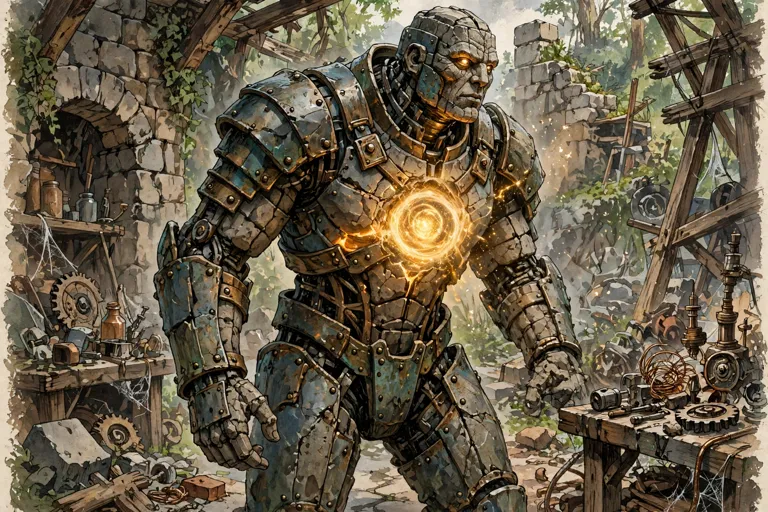

*Picture: GENERATED — generated from the published template description (Advanced Bestiary: a construct awakened by a spark of life)*

## 12. LIFESPARK CONSTRUCT (template) — CR: none printed (sample CR 18) [WEB-ONLY]

**Source:** *Advanced Bestiary* (Green Ronin Publishing, 2004; GRR1601), by Matthew Sernett, pp. 159–160. Read in full from a web-hosted copy of the book (URL in the sweep notes); the book is not in the local library.

**Gate:** This is the roster's clearest sentience-granting template: it exists to give a mindless construct "an intelligence and will of their own." IN as a template entry; its published sample is filed with it.

### Published text (verbatim excerpts + full mechanics)

"All those knowledgeable in the creation and use of constructs know that such creatures obey the commands of their creators. Constructs without instructions are no more than mindless hulks, following their last commands to the best of their feeble ability or awaiting commands until their parts begin to decay. Thus, it comes as a shock to most when an object still moves after the duration of the spell that gave it the semblance of life ends. Even more shocking is the rare instance when a created construct goes rogue. Few understand why such events occur, since most creators who discover that their constructs have a free will destroy them immediately. Some constructs, however, imbued with an intelligence and will of their own by some spark of life, escape or overcome their creators to pursue whatever ends suit their developing minds and souls."

**Creating a Lifespark Construct:** "Lifespark" is a template that can be added to any nonintelligent construct (referred to hereafter as the base creature). At the GM's option, intelligent golems that go berserk might instead gain the lifespark template. A lifespark construct uses all the base creature's statistics and special abilities except as noted below.
**Size and Type:** Size and type are unchanged, but some features of the construct type no longer apply, as noted in the following sections.
**Special Qualities:** The lifespark construct retains all the base creature's special qualities and gains those described here.
- **Open Mind (Ex):** Unlike normal constructs, the lifespark construct is not immune to mind-affecting effects. In fact, perhaps because of its past need for commands, its mind is especially vulnerable to magical compulsion. A lifespark construct takes a –2 penalty on saving throws against mind-affecting effects. Golems are still immune to magic, as described in the MM.
- **Spirit Within (Ex):** Though the lifespark construct is not a living creature, a "spirit" still resides within it. Unlike most constructs, the lifespark construct is not immune to all necromantic effects. Certain spells that rely on the existence of a creature's soul (not "life force") — namely *astral projection*, *clone*, *magic jar*, and *soul bind* — can affect lifespark constructs. No other necromantic effects affect lifespark constructs, and they are still immune to death effects. Though they cannot be raised or resurrected, lifespark constructs can be reincarnated as described by the *reincarnate* spell. Golems are still immune to magic as described in the MM.
**Feats:** The lifespark construct retains the base creature's bonus feats, but it loses all other feats that the base creature had. Recalculate the number of feat slots the lifespark construct has based on its character level (racial and class HD) and assign feats as desired, giving preference to the feats that the base creature originally possessed. The lifespark construct must still meet any prerequisites for feats chosen to fill vacant feat slots.
**Abilities:** Replace the base creature's Intelligence, Wisdom, and Charisma scores with new ones between 3 and 18. Determine each one by rolling 3d6. All the creature's other ability scores remain the same.
**Skills:** Because of its recently awakened intelligence, a lifespark construct gains a number of skill points equal to (2 + Int modifier, minimum 1) × (HD + 3). A lifespark construct has a number of class skills equal to one-half of its Intelligence score; all other skills are considered cross-class skills. A lifespark construct typically devotes skill points to whatever Craft skill is appropriate for repairing damage it sustains (see the base creature's description for details), and several other skills favored by its creator.
**Languages:** A lifespark construct can speak even without a mouth. It can automatically speak the language of its creator and chooses its bonus languages from among those its creator knows.
**Treasure:** Standard items. A lifespark construct collects items it finds useful. Potions and other items useless to it are discarded in favor of other items. A lifespark construct that takes a class usually carries items appropriate to that class.
**Alignment:** Usually neutral. "Lifespark constructs can have any alignment, but most tend not to care about law, chaos, good, or evil. They generally seek to know more of the world around them while plumbing the mystery of their own awakened intelligence. Even so, some lifespark constructs seem to be possessed of great evil or great good from the moment they first refuse their masters' commands."
**Advancement:** By character class.
**Challenge Rating:** *No Challenge Rating line is printed in the template text* (verified across the full template, pp. 159–160 — the mechanics run Size and Type / Special Qualities / Feats / Abilities / Skills / Languages / Treasure / Alignment / Advancement, with no CR adjustment given). The published sample below is the only CR the book assigns.
**Lifespark Construct Characters (sidebar, gist):** The template gives players the option of playing constructs; "the template has no level adjustment," though GMs are warned about constructs' natural immunities and hidden benefits and penalties (immunity to fatigue; no natural healing; immunity to normal healing magic).

### Published sample — LIFESPARK IRON GOLEM SORCERER 7 — CR 18

Large Construct
Hit Dice: 18d10+7d4 (116 hp) *(as printed)*
Initiative: +4
Speed: 20 ft. (4 squares)
Armor Class: 31 (–1 size, +22 natural), touch 9, flat-footed 31
Base Attack/Grapple: +15/+31
Attack: Slam +26 melee (2d10+11)
Full Attack: 2 slams +26 melee (2d10+11)
Space/Reach: 10 ft./10 ft.
Special Attacks: Breath weapon, spells
Special Qualities: Construct traits, damage reduction 15/adamantine, darkvision 60 ft., immunity to magic, low-light vision, open mind, spirit within
Saves: Fort +8, Ref +10, Will +11
Abilities: Str 33, Dex 10, Con —, Int 12, Wis 11, Cha 15
Skills: Concentration +21, Craft (armorsmithing) +20, Knowledge (arcana) +20, Listen +14, Spellcraft +20, Spot +14
Feats: Cleave, Craft Magic Arms and Armor, Craft Wand, Empower Spell, Improved Initiative, Lightning Reflexes, Power Attack, Silent Spell, Spell Focus (evocation)
Environment: Any land
Organization: Solitary
Challenge Rating: 18
Treasure: Standard items (see Possessions)
Alignment: Neutral evil
Advancement: By character class

**Kit (Possessions, as published):** bead of force, eyes of the eagle, necklace of fireballs (Type II), wand of burning hands.
**Sorcerer Spells Known (6/7/7/4 per day, DC 12 + spell level):** 0 — daze, ghost sound, flare, light, mending, open/close, ray of frost; 1st — burning hands, cause fear, charm person, grease, unseen servant; 2nd — flaming sphere, web, glitterdust; 3rd — dispel magic, fireball.
**Breath Weapon (Su):** As a free action every 1d4+1 rounds, a lifespark iron golem can breathe a cloud of poisonous gas that fills a 10-foot cube. The gas persists for 1 round. The poison's initial damage is 1d4 Con, and its secondary damage is 3d4 Con (Fortitude DC 19 negates). The save DC is Constitution-based.
**Immunity to Magic (Ex):** As the MM iron golem (electricity slows, fire breaks slow and heals, rust attacks normal) — full text in the work files.
*Editorial note (roster standard — published inconsistency flagged, not fixed): the sample's Construct Traits paragraph lists immunity to mind-affecting effects, while the template's Open Mind quality expressly removes that immunity; both are reproduced as published.*

Description (verbatim): "A lifespark iron golem looks like any other iron golem, except no one commands its actions, and it occasionally carries items." — Combat: "Freed of the commands of its master, the lifespark iron golem is busy pursuing goals of its own. It realizes that it's more powerful than most other creatures, and it knows its own vulnerabilities. Thus, it casts fire-based spells in combat to harm its enemies while removing any slow effects on itself and healing its own damage."

## Lion — CR 3 — Monster Manual I


*Picture: Monster library art — Monster Manual I*

**Partial — fullest block on file:**

Type: Large Animal
Challenge Rating: 3
Source book(s): Monster Manual I
Description: The statistics presented here describe a male African lion, which is 5 to 8 feet long and weighs 330 to 550 pounds. Females are slightly smaller but use the same statistics.
[Partial — fullest available from APOC-VTT registry record; no roster stat block found. No stat lines invented.]

## Lolth-Touched Monstrous Hunting Spider — CR 3 — Monster Manual IV


*Picture: APOC-VTT monster library art — Monster Manual IV*

**Partial — fullest block on file:**

Type: Large Vermin
Challenge Rating: 3
Source book(s): Monster Manual IV
Description: An enormous, dusky spider looms ahead. Its swollen body, marked by a faint emblem, arches up on powerful legs as it lunges.
[Partial — fullest available from APOC-VTT registry record; no roster stat block found. No stat lines invented.]

## Lucent Worm — CR 17 — Fiend Folio


*Picture: APOC-VTT monster library art — Fiend Folio*

**Partial — fullest block on file:**

Type: Gargantuan Magical Beast
Challenge Rating: 17
Source book(s): Fiend Folio
Description: Those who encounter a lucent worm often do so before they know the creature is near. Although massive in size, a lucent worm is adept at hiding itself. This, combined with its versatile means of locomotion, ensures that the lucent worm rarely goes hungry. An adult lucent worm measures 5 feet in diameter and almost 100 feet long, weighing in at 55,000 to 60,000 pounds.
[Partial — fullest available from APOC-VTT registry record; no roster stat block found. No stat lines invented.]

## Lumi — CR 2 — Monster Manual III


*Picture: APOC-VTT monster library art — Monster Manual III*

**Partial — fullest block on file:**

Type: Medium Outsider (Extraplanar)
Challenge Rating: 2
Source book(s): Monster Manual III
Description: A solemn and dignified head floats about six inches above the shoulders of the otherwise headless body of this stocky humanoid creature. The being's skin softly glows, and white light peeks between the cracks of its armor. The lumi are a race of warriors and healers who live on the Positive Energy Plane. There they build towering cities of glass and light that are protected from intruders simply by virtue of the plane's dangers to nonnative life. The power of unchecked positive energy keeps all but the most curious from even reaching their doorstep.
[Partial — fullest available from APOC-VTT registry record; no roster stat block found. No stat lines invented.]

## Lurking Strangler — CR 2 — Monster Manual III


*Picture: APOC-VTT monster library art — Monster Manual III*

**Partial — fullest block on file:**

Type: Tiny Aberration
Challenge Rating: 2
Source book(s): Monster Manual III
Description: A 3-foot-long strand of striated muscle connects two floating eyeballs. The strand flexes and twists. Many species enjoy pets that resemble themselves. Some humans keep monkeys as companions and some rakshasas keep house cats. Gauths and beholders enjoy lurking stranglers. This lesser creature acts as a companion, pet, and occasional spy for them. Lurking stranglers are 3 feet long from eyeball to eyeball. They weigh 5 pounds. Lurking stranglers understand Beholder and Common. They have neither a mouth nor any means of speaking. They communicate by twisting their bodies.
[Partial — fullest available from APOC-VTT registry record; no roster stat block found. No stat lines invented.]

## Malachi Vane — CR 2 — NPCs — ALL-150 (Shaun's cast)


*Picture: Roster picture file (npc roster pictures; named in the creature's roster entry)*

9. Malachi Vane — Human Sorcerer 2


**Alignment:** Neutral Evil | **Faction:** Demon enclave (cult acolyte) | **Role:** Villain/Caster

**Abilities:** Str 8 (−1), Dex 14 (+2), Con 13 (+1), Int 12 (+1), Wis 10 (+0), Cha 15 (+2)
**HD:** 2d4+2; **hp** 8 (4+1, 2+1) | **Init** +2 | **Speed** 30 ft.
**AC** 12 (+2 Dex), touch 12, flat-footed 10
**BAB** +1; **Grapple** +0
**Attack:** Dagger +0 melee (1d4−1, 19–20/×2) or +3 ranged (1d4−1, 10 ft.)
**Space/Reach:** 5 ft./5 ft.
**Special Qualities:** No familiar — the cult teaches its acolytes to sever attachments; Malachi drove his own raven familiar away with stones the night he swore his oath.
**Saves:** Fort +1 (+0 base, +1 Con), Ref +2 (+0 base, +2 Dex), Will +3 (+3 base, +0 Wis)
**Skills:** Bluff +7 (5 ranks, +2 Cha), Concentration +6 (5 ranks, +1 Con), Knowledge (arcana) +6 (5 ranks, +1 Int), Spellcraft +6 (5 ranks, +1 Int)
*Skill budget: sorcerer 2 + Int 1 + human 1 = 4/level; 16 at 1st + 4 = 20 ranks: four skills at 5 ranks.*
**Feats:** Spell Focus (Necromancy) (human bonus), Combat Casting (level 1)
**Spells Known (Sorcerer 2; 6/5 per day incl. Cha bonus; DC 12 + spell level, Necromancy DC 13 + level):** 0—*daze, detect magic, ghost sound, mage hand, ray of frost*; 1st—*cause fear, ray of enfeeblement*.
**APOC Note:** *Ray of frost* is elemental: Malachi casts it through a cult-issue cryo-coil bracer fed with alchemical brine. His masters do not care about the blight-scars his casting leaves; he has started carving small spirals into them, "so the land remembers who signed it."
**Equipment:** Dagger (2 gp), cryo-coil bracer (alchemical apparatus, 60 gp), scholar's robe over travel clothes, spell component pouch (5 gp), backpack, scroll of *mage armor* (25 gp), scroll of *shield* (25 gp), potion of *cure light wounds* (50 gp), 2 vials of alchemist's frost (cult-made variant of alchemist's fire, 40 gp), unholy symbol of a minor demon lord (obsidian spiral, 25 gp), false Alchemists' Guild credentials (forged, 100 gp). ~330 gp spent; ~1,670 gp in cult funds he is not supposed to touch and has already begun to.

**Appearance:** A handsome, hollow-cheeked young man with ink-dark hair, ink-dark eyes, and a spiral tattoo that starts at his left wrist and is slowly, session by session, climbing his arm. He dresses like a Guild scholar — deliberately.
**Steampunk aesthetic:** Enclave furnace-craft turned cold: his cryo-coil bracer is blued copper with a frost-rimed pressure gauge, and his brine vials ride in a belt of little brass tubes under a grey-green scholar's robe. His obsidian spiral clasp is set in blackened iron, leather reagent straps cross his chest, and his hems carry the smell of coal-smoke and chilled alchemy wherever he goes.
**Traits:** Charming, patient, utterly without pity. Views other people as instruments with opinions.
**Mannerism/Voice Hook:** Smiles with his mouth only, and prefaces cruelty with courtesy. Smooth voice: "Forgive me — this is going to frighten you. That's rather the point."
**Motivation:** Rise in the enclave's cult hierarchy by delivering the Bastion's alchemical supply routes to his masters — and by being the one holding the knife when the moment comes.
**Secret/Flaw:** He is skimming cult funds to buy his younger sister out of the Bastion entirely. If his masters learn of it, both of them die. It is the only unselfish thing in him, and therefore the most dangerous.
**Background:** A Bastion scholarship boy — the Guild paid for his letters because his bloodline tested strong for sorcery. A cult recruiter found him in a library carrel and offered him the one thing the Guild wouldn't: reverence. By day he clerks for a reagent importer; by night he reports its shipments, guard rotations, and customers to the enclave.
**DM Use Hook:** A slow-burn infiltrator villain: he can befriend a party caster, sell them discounted reagents, and feed their movements to the enclave — or crack, if the party learns about his sister before his masters do.

---

## Marilith — CR 17 — Monster Manual I


*Picture: Demons roster picture index: WEB-SOURCED (credited; see entry)*

CR 17 — Marilith

**Description (MM/SRD, verbatim):** "A marilith usually holds a longsword in each of its six hands and wears many bangles and jewels. A marilith stands about 9 feet tall and measures about 20 feet from head to tip of tail. It weighs about 4,000 pounds."
- Size/Type: Large Outsider (Chaotic, Extraplanar, Evil)
- Hit Dice: 16d8+144 (216 hp)
- Initiative: +4
- Speed: 40 ft. (8 squares)
- Armor Class: 29 (–1 size, +4 Dex, +16 natural), touch 13, flat-footed 25
- Base Attack/Grapple: +16/+29
- Attack: Longsword +25 melee (2d6+9/19–20) or slam +24 melee (1d8+9) or tail slap +24 melee (4d6+9)
- Full Attack: Primary longsword +25/+20/+15/+10 melee (2d6+9/19–20) and 5 longswords +25 melee (2d6+4/19–20) and tail slap +22 melee (4d6+4); or 6 slams +24 melee (1d8+9) and tail slap +22 melee (4d6+4)
- Space/Reach: 10 ft./10 ft.
- Special Attacks: Constrict 4d6+13, improved grab, spell-like abilities, summon demon
- Special Qualities: Damage reduction 10/good and cold iron, darkvision 60 ft., immunity to electricity and poison, resistance to acid 10, cold 10, and fire 10, spell resistance 25, telepathy 100 ft.
- Saves: Fort +19, Ref +14, Will +14
- Abilities: Str 29, Dex 19, Con 29, Int 18, Wis 18, Cha 24
- Skills: Bluff +26, Concentration +28, Diplomacy +30, Disguise +7 (+9 acting), Hide +19, Intimidate +28, Listen +31, Move Silently +23, Search +23, Sense Motive +23, Spellcraft +23 (+25 scrolls), Spot +31, Survival +4 (+6 following tracks), Use Magic Device +26 (+28 scrolls)
- Feats: Combat Expertise, Combat Reflexes, Multiattack, Multiweapon Fighting, Power Attack, Weapon Focus (longsword)
- Environment: A chaotic evil-aligned plane
- Organization: Solitary or pair
- Challenge Rating: 17
- Treasure: Standard coins; double goods; standard items, plus 1d4 magic weapons
- Alignment: Always chaotic evil
- Advancement: 17–20 HD (Large); 21–48 HD (Huge)
- Level Adjustment: —
- **Constrict (Ex):** A marilith deals 4d6+13 points of damage with a successful grapple check. The constricted creature must succeed on a DC 27 Fortitude save or lose consciousness for as long as it remains in the coils and for 2d4 rounds thereafter. The save DC is Strength-based.
- **Improved Grab (Ex):** To use this ability, a marilith must hit with its tail slap attack. It can then attempt to start a grapple as a free action without provoking an attack of opportunity. If it succeeds on the grapple check, it can constrict.
- **Spell-Like Abilities:** At will—align weapon, blade barrier (DC 23), magic weapon, project image (DC 23), see invisibility, telekinesis (DC 22), greater teleport (self plus 50 pounds of objects only), unholy aura (DC 25). Caster level 16th. The save DCs are Charisma-based.
- **Summon Demon (Sp):** Once per day a marilith can attempt to summon 4d10 dretches, 1d4 hezrou, or one nalfeshnee with a 50% chance of success, or one glabrezu or another marilith with a 20% chance of success. This ability is the equivalent of a 5th-level spell.
- **True Seeing (Su):** Mariliths continuously use this ability, as the spell (caster level 16th).
- **Skills (entry note):** Mariliths have a +8 racial bonus on Listen and Spot checks.
- **Feats (entry note):** In combination with its natural abilities, a marilith's Multiweapon Fighting feat allows it to attack with all its arms at no penalty.
- Picture: marilith.jpg — see PICTURE-INDEX.md — library / web / GENERATED, none picture-less
- Source: Monster Manual p.44 / d20 SRD
- **APOC Note:** Summon Demon — [APOC: inert — no summoning / severed planes]

## Marraenoloth — CR 10 — Monster Manual II


*Picture: APOC-VTT monster library art — Monster Manual II*

**Partial — fullest block on file:**

Type: Medium Outsider (Evil)
Challenge Rating: 10
Source book(s): Monster Manual II
Description: The marraenoloths serve a specialized function, possibly the most specialized of any of the yugoloths. They are the ferrymen on the River Styx, somberly poling their ghastly crafts along that sepulchral river and through all the horrid planes it visits. These pallid humanoids are little more than skeletons clothed in rotted robes and grave wrappings. Only their red-glowing eyes show signs of life. Like all natives of Gehenna, they are pitiless and mercenary. They can speak any language, but they communicate with other marraenoloths telepathically.
[Partial — fullest available from APOC-VTT registry record; no roster stat block found. No stat lines invented.]

## Mastodon — CR 9 — Monster Manual III


*Picture: APOC-VTT monster library art — Monster Manual III*

**Partial — fullest block on file:**

Type: Huge Animal
Challenge Rating: 9
Source book(s): Monster Manual III
Description: A gigantic elephantlike creature towers before you, with an extremely long pair of tusks that are nearly as long as it is. More vicious and territorial than their more domesticated cousins, mastodons are ancient creatures related to elephants. Mastodons usually live in isolated forests, jungles, or tropical islands. In colder climates, they grow thick coats of fur, making them look very shaggy. A few species, especially those that live in snow regions, lack the extended tusks of the mastodon described here. A mastodon stands 10 feet high at the shoulder and weighs over 4,000 pounds.
[Partial — fullest available from APOC-VTT registry record; no roster stat block found. No stat lines invented.]

## Maug — CR 3 — Fiend Folio


*Picture: Constructs roster picture index: Official book art — Fiend Folio, p. 122 (captioned)*

MAUG [3.0-format as published]

**Large Construct (Extraplanar)**
**Hit Dice:** 2d10+30 (41 hp)
**Initiative:** +2
**Speed:** 40 ft. (can't run)
**AC:** 25 (–1 size, +1 Dex, +8 masterwork full plate armor, +7 natural), touch 10, flat-footed 24
**Base Attack/Grapple:** +1/+10
**Attack:** Masterwork two-bladed sword +5 melee, or slam +6 melee
**Full Attack:** Masterwork two-bladed sword +5 melee and +5 melee, or slam +6 melee
**Damage:** Masterwork two-bladed sword 2d6+5/19–20 and 2d6+2/19–20, slam 1d8+7
**Face/Reach:** 10 ft./10 ft.
**Special Attacks:** Pulverize
**Special Qualities:** Construct traits, grafts, rapid repair, SR 14
**Saves:** Fort +0, Ref +2, Will +0
**Abilities:** Str 20, Dex 15, Con —, Int 13, Wis 11, Cha 12
**Skills:** Craft (blacksmithing) +6, Craft (stonemasonry) +10*, Intimidate +6, Knowledge (architecture and engineering) +10*, Listen +7, Profession (siege engineer) +5, Profession (soldier) +5, Spot +7, Survival +5
**Feats:** Alertness (B), Two-Weapon Fighting
**Climate/Terrain:** Any land and underground (Acheron)
**Organization:** Solitary, squad (4–7), warband (2–4 maugs plus 4–9 hobgoblins), or company (10–40 maugs plus 1 sergeant of 1st or 2nd level per 5 maugs, 2–4 lieutenants of 3rd–6th level, 1 leader of 7th–10th level, and 20–50 hobgoblins)
**Challenge Rating:** 3
**Treasure:** Half standard
**Alignment:** Usually lawful neutral
**Advancement:** By character class
**Level Adjustment:** +3
**Kit (published, standard issue):** masterwork full plate armor and a masterwork Huge two-bladed sword, both carried in the block above; treasure is "half standard" as published. Maug grafts (below) are additional published equipment, priced per graft in the book's Appendix 2.

Maugs are tireless soldiers in search of battle. These constructs from Acheron are used on battlefields across the planes as perfect mercenaries, since they remain unflinchingly loyal to their employer and are fearless in battle. Maugs serve any master willing to meet their price, and they do not trouble themselves with questions of right and wrong.
Maugs are hulking constructs of stone standing more than 9 feet tall and weighing almost 1,500 pounds. Their steel-gray bodies are cut from the pitiless stone of Acheron into massive, humanoid forms. Most maugs carry Huge two-bladed swords forged in the harsh foundries of their home plane and wear heavy iron breastplates of the same origin. A number of maugs are modified with grafts of stone and metal.
Scholars of planar matters suspect that maugs first served as shock troops in an ancient war between two long-lost empires. In the end, one empire or both discovered some means of transporting the maugs to Thuldanin, the second layer of Acheron and a junkyard of debris from all wars. Initially transported to Thuldanin as prisoners, the maugs ended up changing the layer into their fortress. The first maugs banished there used knowledge stolen from their creators to craft more maugs. These ancient maugs are known by their fellows as the Thulkarr, and they rule the maugs to this day. The Thulkarr and other maug spellcasters have the ability to travel to other planes, and they sometimes use *plane shift* or *gate* to call up squads and platoons of maugs to fight in conflicts across the multiverse.
Since maugs are nonliving constructs and do not die unless destroyed in combat, many of these mercenaries remain on the Material Plane for centuries, seeking out wars to give meaning to their existence.
Maugs speak Common, Draconic, and Giant.

**Sidebar (p. 121, published):** "MAUGS AND TOME AND BLOOD — *Tome and Blood* introduces several sorcerer/wizard spells that maugs should make use of: *repair minor damage*, *repair light damage*, *repair moderate damage*, *repair serious damage*, and *repair critical damage*. These spells work like the corresponding *cure* spells, except that they are arcane spells that repair damage only to a construct that has at least 1 hit point remaining. If you use *Tome and Blood* in your campaign, there is no reason that maug spellcasters shouldn't create potions or wands with *repair* spells to facilitate their recovery from damage."

## Mechagargoyle — CR 6 — Monsternomicon Vol. 1


*Picture: Constructs roster picture index: Official book art — Monsternomicon Vol. I (2002 original), printed p. 124 (entry pp. 124–125)*

ENTRY 9 — MECHAGARGOYLE


**Source:** Monsternomicon Vol. I (2002), pp. 124–125.
**Gate:** IN — published **Int 10**; the text states the shell is animated by a resident spirit and says outright, "Although intelligent, they are completely incapable of communication."

**Size/Type:** Small Construct
**Hit Dice:** 5d10 (28 hp)
**Initiative:** +5 (+5 Dex)
**Speed:** 20 ft.
**AC:** 31 (+1 size, +5 Dex, +15 natural)
**Attacks:** 2 claws +7 melee, bite +5 melee
**Damage:** Claw 1d4+3, bite 1d2+1
**Face/Reach:** 5 ft. by 5 ft./5 ft.
**Special Attacks:** Spell-like abilities, stunning strike 1d6+1
**Special Qualities:** Construct, damage reduction 20/+1, regeneration, vigilance
**Saves:** Fort +1, Ref +6, Will +1
**Abilities:** Str 17, Dex 20, Con —, **Int 10**, Wis 14, Cha 12
**Skills:** Balance +8, Climb +7, Intuit Direction +5, Listen +8, Spot +10
**Feats:** Flyby Attack, Multiattack
**Climate/Terrain:** Urban
**Organization:** Solitary or band (2–5)
**Challenge Rating:** 6
**Alignment:** Always neutral
**Advancement:** 2–4 HD (Tiny); 6–10 HD (Medium-size); 10–15 HD (Large)

> …the strange thing about these constructs that distinguishes them so much is that their internal drive comes from a spirit that takes residence inside the shell of the construct, which is itself quite mundane. Only the most finely constructed forms will attract an animating spirit, and once one has taken up residence it will never leave its metal body. Constructing a shell is a rare art, and even the best craftsmen often find their works spurned by the fickle spirits.
>
> Simplicity seems to be their nature of the mechagargoyle. They are universal in their purpose, which is to protect an occupied building in just about any urban city. They are very patient creatures, and despite the residing spirit, I've never witnessed one bearing any personality. The only thing they require of the tenants whose buildings they guard is a regular supply of processed iron, preferably in bars. Those who fail to provide for their gargoyles soon find them gone.
>
> Mechagargoyles come in all varieties (from animal shapes, to humanoids, to even stranger things), although most are about 3 or 4 feet in height or length. The craftsmanship required to construct one is the highest, and those that bear fine and intricate ornamentation seem to have a better success rate in the creation process. For a construct, they are surprisingly nimble, and they are quite vigilant in their guard duties. The magic that binds them together also enables them to fly, as well as exercise a few other abilities. Although intelligent, they are completely incapable of communication (so you had better know what to do when one lands on your stoop).

## Megalodon — CR 11 — Monster Manual II


*Picture: APOC-VTT monster library art — Monster Manual II*

**Partial — fullest block on file:**

Type: Gargantuan Beast (Aquatic)
Challenge Rating: 11
Source book(s): Monster Manual II
Description: One of the largest predators in the world, a megalodon defers to dragons and little else. Large enough to devour an entire whale, the megalodon gives even hardened sailors nightmares. A megalodon is normally 55 to 65 feet long, and it weighs between 10 to 60 tons. Rumors of individual megalodons reaching a length of 80 to 90 feet cannot be confirmed.
[Partial — fullest available from APOC-VTT registry record; no roster stat block found. No stat lines invented.]

## Merchurion — CR 17 — Fiend Folio


*Picture: Constructs roster picture index: Official book art — Monster Manual V, p. 103 (captioned; the entry text is p. 102, the illustration faces it on p. 103)*

**Partial — fullest block on file:**

MERCHURION — CR 17

Usually CE Huge construct (living construct)
**Init** +7; **Senses** darkvision 60 ft., low-light vision; Listen +10, Spot +10
**Languages** Common, Giant, Terran
**AC** 31, touch 15, flat-footed 24; Dodge, Mobility (–2 size, +7 Dex, +16 natural)
**hp** 319 (22 HD); **DR** 10/magic and silver
**Immune** fire, living construct immunities
**Weakness** vulnerability to sonic
**Fort** +16, **Ref** +14, **Will** +11
**Speed** 60 ft. (12 squares); Spring Attack
**Melee** +3 silvered battleaxe +28/+23/+18/+13 (3d6+12) [generated weapon]
**Space** 15 ft.; **Reach** 15 ft.
**Base Atk** +16; **Grp** +33
**Atk Options** Awesome Blow, Cleave, Improved Bull Rush, Power Attack, absorb properties, magic strike
**Special Actions** generate weapon
**Abilities** Str 28, Dex 25, Con 28, Int 10, Wis 14, Cha 17
**SA** absorb properties, generate weapons, magic strike
**SQ** living construct traits
**Feats** Awesome Blow, Cleave, Dodge, Greater Weapon Focus (generated weapon)ᴮ, Improved Bull Rush, Iron Will, Mobility, Power Attack, Spring Attack, Weapon Focus (generated weapon)ᴮ
**Skills** Climb +17, Intimidate +12, Jump +29, Listen +10, Spot +10, Survival +11
**Advancement** 23–26 HD (Huge); 27–34 HD (Gargantuan)

**Absorb Properties (Ex)** If a merchurion is successfully struck by a magic weapon, all that weapon's properties are absorbed by the merchurion for 1 hour. The weapon loses its properties during that time (or until the merchurion is slain). The merchurion can manifest any of these absorbed properties in its generated weapon.
A merchurion can absorb and manifest weapon properties totaling a +5 enhancement bonus (see page 211 of the Dungeon Master's Guide) or with a market value of up to 50,000 gp. Properties beyond these limits are not absorbed. If a weapon has properties in excess of these limits, properties are absorbed weakest first. As an immediate action, a merchurion can choose to give up absorbed properties in order to absorb new properties. If it does so, the properties it gives up are restored to the weapon they were absorbed from.
Manifested weapon properties must be suitable for the type of weapon a merchurion generates. Properties that are unsuitable can be absorbed and count toward the total limit even if they cannot be manifested. For instance, a merchurion could absorb the disruption property from a *mace of disruption*, but it could not manifest that property in a battleaxe.
A merchurion does not absorb the enhancement bonus of a weapon whose properties it absorbs. Such weapons that lose properties continue to function with their magical enhancement bonus, as normal.
**Generate Weapon (Su)** A merchurion can spontaneously create a single weapon from its flowing metal form. Such weapons have a +3 enhancement bonus and are treated as silvered weapons for the purpose of overcoming damage reduction. If a generated weapon ever leaves the merchurion's hand, that weapon immediately melts into a pool of harmless silver liquid.
A merchurion is proficient with any weapon it generates using this ability, even an exotic one.
**Magic Strike:** no separate ability text is printed in the entry (pp. 102–103 read in full); the ability appears only in the block's Atk Options and SA lines above. The block's generated weapon is the +3 silvered battleaxe in the Melee line.

**Origin (p. 102):** Merchurions are what became of an ancient race of fire giants, transformed — "emerging instead as construct creatures of living quicksilver." A transformed people, not a device.
**Death (p. 103):** When a merchurion is slain, it collapses to a pool of silver liquid that evaporates harmlessly after 24 hours. Any weapon dipped into this pool undergoes a permanent change, becoming silvered and striking as a magic weapon (if not already magic) for the purpose of overcoming damage reduction.
**In Eberron (p. 103, published setting sidebar — reproduced because it names an individual):** "The merchurions of Eberron are an ancient race whose origins are shrouded in mystery, but which is no doubt connected to the ancient creation forges of Xen'drik. Merchurions have ranged far from the shattered land in the countless centuries since their creation, and one extended tribe now serves a powerful silver dragon named Azraxror-Shien on Argonnessen. A neutral good merchurion named Silverfist resides in Thrane. The creature converted to the faith of the Silver Flame and is recognized as an icon by some clergy. His place in the church remains a source of debate." *[Sidebar prose as published; the Eberron setting content is stripped for APOC per the standing rule — the mechanics and the existence of named individuals are what carry over. The "Merchurions in Faerûn" sidebar begins at the foot of p. 103.]*
**Level Adjustment:** none printed — the MM V entry (pp. 102–103, read in full from the folio-verified pages) carries no Level Adjustment line anywhere, in the block, the Ecology, or the For Player Characters text. A +5 figure carried in an earlier draft of this entry is not in the book and is removed.

**Treasure (as published):** no Treasure line is printed in the compact MM V block.

**APOC Note:** Merchurions are not built — they are a *people transformed*, fire giants remade as living quicksilver, with their own tribes, faiths, and named individuals (the book itself prints one, Silverfist, holding a religion and a public reputation). Of everything in this batch, the merchurion is the entry where "construct" is a body, not a status: in the APOC they are citizens in the same fight as the Warforged — created-into-a-new-shape, second-class, "toi" spat at them just the same — except they remember being giants. The absorb-properties power makes every merchurion a walking arsenal dispute: a weapon it takes properties from is restored when it gives them up or dies, which in Bastion law is a property case, not a monster trait. Eberron sidebar content above stays stripped for play; the personhood does not.
**Picture (final, at merge):** `pictures/merchurion-mm5-p103.png` — OFFICIAL BOOK ART (Monster Manual V, p. 103)

---

## Mimic — CR 4 — Monster Manual I

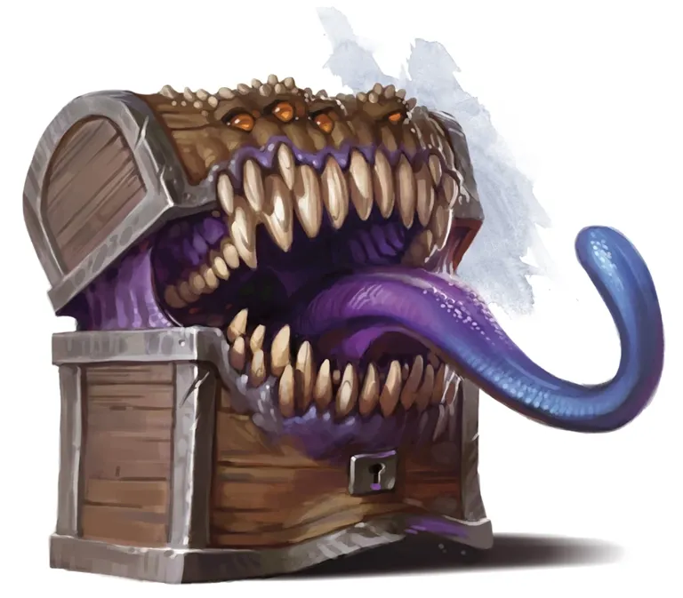

*Picture: Monster library art — Monster Manual I*

**Partial — fullest block on file:**

Type: Large Aberration (Shapechanger)
Challenge Rating: 4
Source book(s): Monster Manual I
Description: A mimic can have almost any dimensions, but usually is not more than 10 feet long. A typical mimic has a volume of 150 cubic feet (5 feet by 5 feet by 6 feet) and weighs about 4,500 pounds. Mimics speak Common.
[Partial — fullest available from APOC-VTT registry record; no roster stat block found. No stat lines invented.]

## Mind Flayer — CR 8 — Monster Manual I


*Picture: Monster library art — Monster Manual I*

**Partial — fullest block on file:**

Type: Medium Aberration
Challenge Rating: 8
Source book(s): Monster Manual I
Description: In terms of height, weight, and build, mind flayers were roughly comparable to thin humans, but it was at this point that any external comparison to humanoids ended. An illithid's bulging, ridged, elongated head was reminiscent of an octopus, with a cluster of four flexible, unsegmented, extendable, purplish-black tentacles surrounding their mouths.
[Partial — fullest available from APOC-VTT registry record; no roster stat block found. No stat lines invented.]

## Mindshredder Zenthal — CR 8 — Monster Manual III


*Picture: APOC-VTT monster library art — Monster Manual III*

**Partial — fullest block on file:**

Type: Medium Aberration
Challenge Rating: 8
Source book(s): Monster Manual III
Description: The strange-looking creature resembles a gaunt, fleshy spider with only four thin legs. Two tentacles protrude from its shoulders, swinging over the creature's head and dripping a toxic-looking slime. The creature's skin has a faint bluish glow, and it is clear that some strange mystical energy surrounds it. The final and most powerful life stage of the strange creatures known as mindshredders, the mindshredder zenthal combines powerful spell-like abilities with the Wisdom-damaging attacks that all mindshredders share.
[Partial — fullest available from APOC-VTT registry record; no roster stat block found. No stat lines invented.]

## Mob of Zombies — CR 8 — Exemplars of Evil


*Picture: Undead roster picture index: GENERATED from the stat block — GENERATED from the stat block — Dungeonscape*

**Partial — fullest block on file:**

MOB OF ZOMBIES — CR 8

*Source: Exemplars of Evil, Ch. 8 (Bleak Hold), p.137. Mob template (DMG II) presentation.*

**Mob of Zombies — CR 8**
hp 198 (30 HD); DR 5/slashing
NE Gargantuan undead (extraplanar) (mob^DMG2 of 48 Medium undead)
Init +0; Senses darkvision 60 ft.; Listen –2, Spot +2
AC 13, touch 6, flat-footed 13 (–4 size, +5 armor, +2 natural)
Immune undead immunities
Resist +4 turn resistance
Fort +11, Ref +11, Will +19
Weakness undead vulnerabilities
Speed 10 ft. (2 squares) in breastplate, base speed 20 ft.; cannot run
Melee mob (5d6)
Space 20 ft.; Reach 0 ft.
Base Atk +15; Grp +31
Atk Options expert grappler, trample 2d6+3
Abilities Str 15, Dex 11, Con —, Int —, Wis 10, Cha 8
SQ mob anatomy, single actions only, undead traits
Feats Improved Bull Rush^B, Improved Overrun^B, Toughness^B
Skills Listen –2, Spot +2
Possessions breastplate, various weapons (individuals only)

Mob: A mob attacks like a swarm, dealing damage to any creature whose space it occupies at the end of its move. A mob's attacks ignore concealment and cover.
Expert Grappler (Ex): A mob can maintain a grapple without penalty and still make attacks against other creatures. A mob is never considered flat-footed while grappling.
Trample (Ex): A mob that moves over a creature and does not end its movement while that creature is in one of its occupied squares can trample the creature, dealing 2d6+3 points of damage. A trampled victim can make an attack of opportunity against the mob or attempt a DC 27 Reflex save for half damage.
Mob Anatomy (Ex): The mob consists of 48 Medium undead. For each individual creature that is slain, disabled, or otherwise incapacitated by spells or effects that target specific creatures, the mob gains two negative levels (an exception to the rule that undead do not gain negative levels). If the mob's negative levels equal its Hit Dice, it is destroyed. A mob takes half again as much damage (+50%) from spells or effects that affect an area, such as splash weapons or evocation spells.
Single Actions Only (Ex): A zombie can perform only a single action each round, a standard action or a move action.

Published context: Bleak Hold holds seven such mobs ("prepare to make their stand… until all seven mobs are [destroyed]"), p.137.

**APOC Note:** A 48-zombie mob in breastplate is a Kingdom of the Undead street-level asset — exactly the kind of mass the Kingdom fields in the badlands. Inside the Bastion it cannot exist: the Melairshield bars undead. No planar or summoning dependency.

## Mohrg — CR 8 — Monster Manual I


*Picture: Undead roster picture index: official book art — official book art — Monster Manual I*

7. MOHRG


**Source:** Monster Manual (3.5), p. 189 — extracted from the local library copy (`MonsterManual1.pdf` / `MonsterManual1.txt`). SRD cross-check: https://dnd-wiki.org/wiki/SRD:Mohrg
**SRD status:** In the SRD (Open Game Content) — see the correction in the enumeration file. Book and SRD agree except the flat-footed value flagged below.

**Size/Type:** Medium Undead
**Hit Dice:** 14d12 (91 hp)
**Initiative:** +9
**Speed:** 30 ft. (6 squares)
**Armor Class:** 23 (+4 Dex, +9 natural), touch 14, flat-footed 14 [*as printed in the book — verified in the local text layer. The printed value duplicates the touch AC and breaks the usual arithmetic (+9 natural armor alone would give flat-footed 19); d20srd.org prints 19. Book value kept, anomaly flagged, not silently corrected.*]
**Base Attack/Grapple:** +7/+12
**Attack:** Slam +12 melee (1d6+7) or tongue +12 melee touch (paralysis)
**Full Attack:** Slam +12 melee (1d6+7) and tongue +12 melee touch (paralysis)
**Space/Reach:** 5 ft./5 ft.
**Special Attacks:** Improved grab, paralyzing touch, create spawn
**Special Qualities:** Darkvision 60 ft., undead traits
**Saves:** Fort +4, Ref +10, Will +9
**Abilities:** Str 21, Dex 19, Con —, Int 11, Wis 10, Cha 10
**Skills:** Climb +13, Hide +21, Listen +11, Move Silently +21, Spot +15, Swim +9
**Feats:** Alertness, Dodge, Improved Initiative, Lightning Reflexes, Mobility
**Environment:** Any
**Organization:** Solitary, gang (2–4), or mob (2–4 plus 5–10 zombies)
**Challenge Rating:** 8
**Treasure:** None
**Alignment:** Always chaotic evil
**Advancement:** 15–21 HD (Medium); 22–28 HD (Large)
**Level Adjustment:** —

*This creature looks like a gaunt, nearly skeletal corpse, its rib cage filled with horrid, writhing viscera. The creature's tongue is its most noteworthy feature — long, cartilaginous, and clawed.*
*(Book flavor line; the SRD omits it.)*

Mohrgs are the animated corpses of mass murderers or similar villains who died without atoning for their crimes. Tortured by an all-consuming hatred of living things, they long to live again.
*(Second sentence is book text; the SRD omits it.)*

Most mohrgs are 5 to 6 feet tall and weigh about 120 pounds.

## Monstrous Centipede — CR 2 — Monster Manual I


*Picture: Monster library art — Monster Manual I*

**Partial — fullest block on file:**

Type: Huge Vermin
Challenge Rating: 2
Source book(s): Monster Manual I
Description: Monstrous centipedes tend to attack anything that resembles food, biting with their jaws and injecting their poison.
[Partial — fullest available from APOC-VTT registry record; no roster stat block found. No stat lines invented.]

## Monstrous Scorpion — CR 3 — Monster Manual I


*Picture: Monster library art — Monster Manual I*

**Partial — fullest block on file:**

Type: Large Vermin
Challenge Rating: 3
Source book(s): Monster Manual I
Description: Monstrous scorpions are likely to attack any creature that approaches, and they usually charge when attacking prey.
[Partial — fullest available from APOC-VTT registry record; no roster stat block found. No stat lines invented.]

## Moonrat — CR 0.25 — Monster Manual II


*Picture: APOC-VTT monster library art — Monster Manual II*

**Partial — fullest block on file:**

Type: Tiny Magical Beast
Challenge Rating: 1/4
Source book(s): Monster Manual II
Description: Moonrats are indistinguishable from normal rats except in moonlight.
[Partial — fullest available from APOC-VTT registry record; no roster stat block found. No stat lines invented.]

## Moonwing — CR 1 — Monsternomicon Vol. 1


*Picture: APOC-VTT monster library art — Monsternomicon Vol. 1*

**Partial — fullest block on file:**

Type: Small Vermin
Challenge Rating: 1
Source book(s): Monsternomicon Vol. 1
Description: I've witnessed many a strange beast in my travels of this world, but there are few that I'd venture to call beautiful or even pleasant to look upon. Most of the denizens of the Iron Kingdoms are fierce, with an appearance to match. However, there is one I'd have to call an exception to that, and it would be the fluttering moonwing. I remember one fine evening while camping in the Scarsfell Forest, our campsite was graced by a brood of these creatures. As they flocked to our campfire their white bodies lit up with a gentle luminescence that was a sight to behold.
[Partial — fullest available from APOC-VTT registry record; no roster stat block found. No stat lines invented.]

## Mud Golem — CR 11 — Monster Manual III


*Picture: APOC-VTT monster library art — Monster Manual III*

**Partial — fullest block on file:**

Type: Large Construct
Challenge Rating: 11
Source book(s): Monster Manual III
Description: This humanoid mass of mud stands twice the height of a normal human. Mud golems are large, anthropomorphic creatures composed entirely out of slippery mud. They are hulking figures with crudely shaped but strong limbs. Their faces are just as rough, with a mouth and two eye sockets that are just scooped-out holes with dim glowing red spheres burning in the depressions. A mud golem stands about 10 feet tall and weighs 600 pounds. Mud golems cannot speak, other than to utter groans and moans.
[Partial — fullest available from APOC-VTT registry record; no roster stat block found. No stat lines invented.]

## Mudmaw — CR 7 — Monster Manual II


*Picture: APOC-VTT monster library art — Monster Manual II*

**Partial — fullest block on file:**

Type: Large Magical Beast
Challenge Rating: 7
Source book(s): Monster Manual II
Description: Mudmaws wait just below the surface of the water in swamps, slow rivers, and lakes for potential prey to come down to the water and drink. In this state, this carnivorous ambush predator resembles a floating log—a fact that many an unwary adventurer has discovered. This fearsome swamp predator resembles a crocodile with a rubbery green tentacle growing from each corner of its mouth. Its immense maw is filled with needlesharp teeth. Mudmaws are intensely territorial; they have been known to attack even other mudmaws that intrude on the areas they claim.
[Partial — fullest available from APOC-VTT registry record; no roster stat block found. No stat lines invented.]

## Mule — CR 1 — Monster Manual I


*Picture: Monster library art — Monster Manual I*

**Partial — fullest block on file:**

Type: Large Animal
Challenge Rating: 1
Source book(s): Monster Manual I
Description: Mules are sterile crossbreeds of donkeys and horses. A mule is similar to a light horse, but slightly stronger and more agile.
[Partial — fullest available from APOC-VTT registry record; no roster stat block found. No stat lines invented.]

## Mummy — CR 5 — Monster Manual I


*Picture: Undead roster picture index: official book art — official book art — Monster Manual I*

Mummy


**Size/Type:** Medium Undead
**Hit Dice:** 8d12+3 (55 hp)
**Initiative:** +0
**Speed:** 20 ft. (4 squares)
**Armor Class:** 20 (+10 natural), touch 10, flat-footed 20
**Base Attack/Grapple:** +4/+11
**Attack:** Slam +11 melee (1d6+10 plus mummy rot)
**Full Attack:** Slam +11 melee (1d6+10 plus mummy rot)
**Space/Reach:** 5 ft./5 ft.
**Special Attacks:** Despair, mummy rot
**Special Qualities:** Damage reduction 5/–, darkvision 60 ft., undead traits, vulnerability to fire
**Saves:** Fort +4, Ref +2, Will +8
**Abilities:** Str 24, Dex 10, Con —, Int 6, Wis 14, Cha 15
**Skills:** Hide +7, Listen +8, Move Silently +7, Spot +8
**Feats:** Alertness, Great Fortitude, Toughness
**Environment:** Any
**Organization:** Solitary, warden squad (2–4), or guardian detail (6–10)
**Challenge Rating:** 5
**Treasure:** Standard
**Alignment:** Usually lawful evil
**Advancement:** 9–16 HD (Medium); 17–24 HD (Large)
**Level Adjustment:** —

*This creature looks like a withered and desiccated corpse, with features hidden beneath centuries-old funereal wrappings. It moves with a slow, shambling gait and groans with the weight of the ages.*

Mummies are preserved corpses animated through the auspices of dark desert gods best forgotten. They usually inhabit great tombs or temple complexes, maintaining a timeless vigil and destroying would-be grave robbers.

These horrid creatures are often marked with symbols of the dire gods they serve. While other undead often stink of carrion, the herbs and powders used to create a mummy give off a sharp, pungent odor like that of a spice cabinet.

Mummies attack intruders without pause or mercy. They never attempt to communicate with their enemies and never retreat. An encounter with a mummy can end only with the destruction of one combatant or the other (unless the mummy's foe elects to retreat).

Most mummies are 5 to 6 feet tall and weigh about 120 pounds.

Mummies can speak Common, but seldom bother to do so.

## Mummy Administrator — CR 6 — Sandstorm


*Picture: Undead roster picture index: GENERATED from the stat block — GENERATED from the stat block — Sandstorm*

**Partial — fullest block on file:**

MUMMY ADMINISTRATOR — CR 6

*Source: Sandstorm, p.214. Mummy with aristocrat 2 levels (built on the MM mummy).*

Mummy Administrator: Aristocrat 2; CR 6; Medium undead; HD 8d12+6 plus 2d8; hp 67; Init +0; Spd [20 ft. *verify — clipped*]; AC 20, touch 10, flat-footed 20; Base Atk +5; [Grp +12 *verify*]; Atk or Full Atk +12 melee (1d6+7/18–20, scimitar) or +12 melee (1d6+10 plus mummy rot, slam); SA despair, mummy rot; SQ damage reduction 5/—, darkvision 60 ft., undead traits, vulnerability to fire; AL [LE *verify*]; SV Fort +4, Ref +2, Will +11; Str 24, Dex 10, Con —, Int 6 *verify*, Wis 14, Cha 15.
Skills and Feats: Appraise –1, Climb +8, Di[plomacy +4 *verify*], Hide +7, Knowledge (nobility and royalty) –1, [Listen +8 *verify*], Move Silently +7, Spot +8; Alertness, Great Fo[rtitude], Toughness (2).
Language: Common.
A mummy administrator's despair and mummy rot special attacks have a save DC of 16.
Possessions: scimitar.

**APOC Note:** Harrax's undead bureaucracy — in APOC, the Kingdom of the Undead runs on exactly this: dead administrators who never sleep. No planar or summoning dependency. Melairshield bars it from the Bastion.

## Mummy of the Deep — CR 4 — Tome of Horrors Revised (Necromancer Games


*Picture: Undead roster picture index: official book art — official book art — Tome of Horrors Revised (Necromancer Games)*

## Mummy of the Deep

**Source:** Tome of Horrors Revised (Necromancer Games, 2005), p.273

```
MUMMY OF THE DEEP
               Medium Undead (Aquatic)
               Hit Dice:               6d12+3 (42 hp)
               Initiative:             +0
               Speed:                  20 ft. (4 squares), swim 20 ft.
               Armor Class:            20 (+10 natural), touch 10, flat-footed 20
               Base Attack/Grapple:    +3/+6
               Attack:                 Slam +6 melee (1d6+4 plus curse of the
                                       deep)
               Full Attack:            Slam +6 melee (1d6+4 plus curse of the
                                       deep)
               Space/Reach:            5 ft./5 ft.
               Special Attacks:        Curse of the deep, despair, improved grab
               Special Qualities:      Control water, damage reduction 5/—,
                                       darkvision 60 ft., resistance to fire 10,
                                       undead traits
               Saves:                  Fort +4, Ref +2, Will +7
               Abilities:              Str 17, Dex 10, Con —, Int 6, Wis 14, Cha
                                       15
               Skills:                 Listen +10, Move Silently +6, Spot +10,
                                       Swim +11
               Feats:                  Alertness, Great Fortitude, Toughness
               Environment:            Any aquatic
               Organization:           Solitary or gang (2-4)
               Challenge Rating:       4
               Treasure:               Standard
               Alignment:              Always neutral evil
               Advancement:            7-18 HD (Medium)
               Level Adjustment:       —


                                                                                273
                                                           the        tome           of     horrors            revised

                             This rotting and bandaged humanoid slides with a slight                Holding one’s breath does not prevent drowning
                          gait as it moves. Its body is covered in tattered and torn             (water is already in the lungs). A remove curse, heal spell,
                          bandages. Seaweed hangs from its unloving form and water               or successful DC 20 Heal check halts the damage if
                          drips in a constant state from its desiccated form.                    applied before the creature reaches 0 or less hit points.
                             A mummy of the deep is an undead creature that lairs                   Despair (Su): At the mere sight of a mummy of the
                          in the depths of the sea. It is the result of an evil creature         deep, the viewer must succeed on a DC 15 Will save or
                          that was buried at sea for its sins in life. The wickedness            be paralyzed with fear for 1d4 rounds. Whether or not
                          permeating the former life has managed to cling even                   the save is successful, that creature cannot be affected
                          into unlife and revive the soul as a mummy of the deep.                again by that mummy of the deep’s despair ability for
                                                                                                 one day. The save DC is Charisma-based.
                          Combat                                                                    Improved Grab (Ex): To use this ability, a mummy of
                             A mummy of the deep attacks with its slam attack,                   the deep must hit an opponent up to its size or smaller
                          attempting to grapple an opponent and use its curse of                 with its slam attack. It can then attempt to start a
                          the deep ability.                                                      grapple as a free action without provoking an attack of
                             Curse of the Deep (Su): On a successful grapple                     opportunity. If it wins the grapple check, the mummy of
                          check against a creature up to its size, a mummy of the                the deep establishes a hold and can use its curse of the
                          deep presses its lips against an opponent’s and regurgi-               deep ability.
                          tates sea water into the opponent’s lungs.                                Control Water (Su): Once per day, a mummy of the
                             Each round thereafter, for the next 10 rounds, the                  deep can control water (as the spell, caster level 8th).
                          victim must make a DC 15 Fortitude save or take 1d4                       Skills: A mummy of the deep has a +8 racial bonus on
                          points of damage that round. Three consecutive suc-                    any Swim check to perform some special action or avoid
                          cessful saves means the character has coughed up enough                a hazard. It can always choose to take 10 on a Swim
                          water to shake the effects of this attack and takes no                 check, even if distracted or endangered. It can use the
                          further damage. An affected creature can take no ac-                   run action while swimming, provided it swims in a
                          tions other than to defend itself in any round it takes                straight line.
                          damage from this ability. At 0 or less hit points, the                    Copyright Notice
                          victim falls unconscious. In the next round, he drowns.                   Author Scott Greene.
                          The save DC is Charisma-based.
```

**Kit / Treasure (as published):** Treasure line: "Standard" — no itemized gear is published for this entry; none invented.

## Myconid Guard — CR 4 — Monster Manual II


*Picture: APOC-VTT monster library art — Monster Manual II*

**Partial — fullest block on file:**

Type: Medium Plant
Challenge Rating: 4
Source book(s): Monster Manual II
Description: These myconids are sixteen to twenty years old. They are charged with the defense of the circle. Guards are fairly aggressive in combat, at least by myconid standards. Their preferred attack is their pacification spores, though they can use their slam attacks if forced into melee.
[Partial — fullest available from APOC-VTT registry record; no roster stat block found. No stat lines invented.]

## Naga, Water — CR 7 — Monster Manual I


*Picture: Monster library art — Monster Manual I*

**Partial — fullest block on file:**

Type: Large Aberration (Aquatic)
Challenge Rating: 7
Source book(s): Monster Manual I
Description: All nagas have long, snakelike bodies covered with glistening scales, and more or less human faces. They range in length from 10 to 20 feet and weigh from 200 to 500 pounds. The eyes of a naga are bright and intelligent, burning with an almost hypnotic inner light.
[Partial — fullest available from APOC-VTT registry record; no roster stat block found. No stat lines invented.]

## Nagatha — CR 4 — Monster Manual IV


*Picture: APOC-VTT monster library art — Monster Manual IV*

**Partial — fullest block on file:**

Type: Medium Monstrous Humanoid
Challenge Rating: 4
Source book(s): Monster Manual IV
Description: This creature has the lower body of a worm, the head of a snake with milky white eyes, and two long arms that terminate in enormous bone claws. It holds its body at about the height of a human as it rises to attack.
[Partial — fullest available from APOC-VTT registry record; no roster stat block found. No stat lines invented.]

## Nerra, Varoot — CR 1 — Fiend Folio


*Picture: APOC-VTT monster library art — Fiend Folio*

**Partial — fullest block on file:**

Type: Medium-Size Outsider (Extraplanar)
Challenge Rating: 1
Source book(s): Fiend Folio
Description: Varoots are the most common nerras to be found both on the Plane of Mirrors and the Material Plane. They are experts at spying, infiltration, and subterfuge. In their natural form, varoots have a basic humanoid shape that is covered with a mirrorlike sheen that reflects everything around them. Their facial features are smooth and rather indistinct.
[Partial — fullest available from APOC-VTT registry record; no roster stat block found. No stat lines invented.]

## Nightmare — CR 5 — Monster Manual I


*Picture: Monster library art — Monster Manual I*

**Partial — fullest block on file:**

Type: Large Outsider (Evil, Extraplanar)
Challenge Rating: 5
Source book(s): Monster Manual I
Description: A nightmare is about the size of a light war horse.
[Partial — fullest available from APOC-VTT registry record; no roster stat block found. No stat lines invented.]

## Ocean Strider — CR 18 — Monster Manual II


*Picture: APOC-VTT monster library art — Monster Manual II*

**Partial — fullest block on file:**

Type: Huge Fey (Aquatic)
Challenge Rating: 18
Source book(s): Monster Manual II
Description: Ocean striders live to protect the seas and oceans from those who sail upon them. These immense fey consider themselves defenders of natural waterways, and they dislike anyone who would plunder the depths for personal gain. An ocean strider resembles a 20-foot-tall cross between an elf and a killer whale. Like an orca, it has a mouth full of pointed teeth, rubbery skin, black and white markings on its body, and a stubby, fluked tail. Like an elf, it has two arms, two legs, and a humanoid face.
[Partial — fullest available from APOC-VTT registry record; no roster stat block found. No stat lines invented.]

## Octopus — CR 1 — Monster Manual I


*Picture: Monster library art — Monster Manual I*

**Partial — fullest block on file:**

Type: Small Animal (Aquatic)
Challenge Rating: 1
Source book(s): Monster Manual I
Description: These bottom-dwelling sea creatures are dangerous only to their prey. If disturbed, they usually try to escape.
[Partial — fullest available from APOC-VTT registry record; no roster stat block found. No stat lines invented.]

## Octopus Tree — CR 12 — Fiend Folio


*Picture: APOC-VTT monster library art — Fiend Folio*

**Partial — fullest block on file:**

Type: Huge Plant
Challenge Rating: 12
Source book(s): Fiend Folio
Description: Sailors sometimes tell stories of strange and terrible forests of trees in the middle of the ocean; most of these forests most likely had their genesis at the bottom of a mug of grog, but a few certainly come from close encounters with octopus trees. An octopus tree is a rubbery, black-barked tree that roots near shore and stands upright or floats with the currents on the surface of the sea.
[Partial — fullest available from APOC-VTT registry record; no roster stat block found. No stat lines invented.]

## Octopus, Giant — CR 8 — Monster Manual I

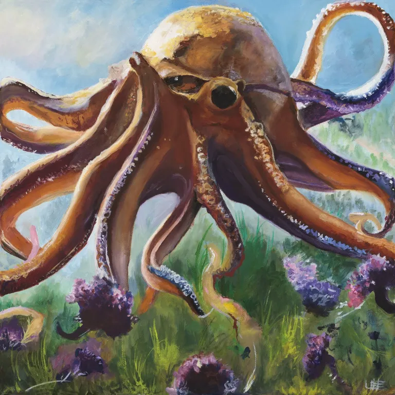

*Picture: Monster library art — Monster Manual I*

**Partial — fullest block on file:**

Type: Large Animal (Aquatic)
Challenge Rating: 8
Source book(s): Monster Manual I
Description: These creatures are aggressive and territorial hunters, with arms reaching 10 feet or more in length. Their tentacles are studded with barbs and sharp-edged suckers.
[Partial — fullest available from APOC-VTT registry record; no roster stat block found. No stat lines invented.]

## Ooze, Elder Black Pudding — CR 12 — Monster Manual I


*Picture: Monster library art — Monster Manual I*

Ooze, Undead


**Source:** Tome of Horrors Revised (Necromancer Games, 2005), p.287

```
OOZE, UNDEAD
               Huge Undead                                                             Combat
               Hit Dice:               6d12 (39 hp)
               Initiative:             -5                                                 The undead ooze has an advantage over any other
               Speed:                  20 ft. (4 squares), climb 20 ft.                ooze: intelligence. It uses this new gift to its fullest in
               Armor Class:            3 (-2 size, -5 Dex), touch 3, flat-footed 3     combat by attacking from surprise or by stalking its prey
               Base Attack/Grapple:    +3/+12                                          and attacking when the opportunity presents itself. The
               Attack:                 Slam +2 melee (2d4+1 plus 1d6 cold)             undead ooze attacks by slamming its body into its prey.
               Full Attack:            Slam +2 melee (2d4+1 plus 1d6 cold)
                                                                                       It usually engulfs its foes or expels its skeleton allies to
               Space/Reach:            15 ft./10 ft.
               Special Attacks:        Cold, engulf, skeletons                         contend with its enemies.
               Special Qualities:      Blindsight 60 ft., ooze traits, undead traits      Cold (Ex): The undead ooze constantly emits an aura
               Saves:                  Fort +2, Ref -3, Will +6                        of cold around it. Any melee hit deals cold damage.
               Abilities:              Str 12, Dex 1, Con —, Int 10, Wis 12, Cha          Engulf (Ex): Although it moves slowly, an undead
                                       10
               Skills:                 Climb +9                                        ooze can simply mow down Large or smaller creatures as
               Feats:                  —                                               a standard action. It cannot make a slam attack during
               Environment:            Underground                                     a round in which it engulfs. The undead ooze merely has
               Organization:           Solitary                                        to move over the opponents, affecting as many as it can
               Challenge Rating:       6                                               cover. Opponents can make opportunity attacks against
               Treasure:               None                                            the ooze, but if they do so they are not entitled to a
               Alignment:              Always chaotic evil
                                                                                       saving throw. Those who do not attempt attacks of
               Advancement:            7-12 HD (Huge); 13-18 HD (Gargantuan)
               Level Adjustment:       —                                               opportunity must succeed on a DC 15 Reflex save or be
                                                                                       engulfed; on a success, they are pushed back or aside
                 This creature appears as a large, undulating mass of black            (opponent’s choice) as the ooze moves forward. En-
               goo from which rotted and broken bones protrude.                        gulfed creatures are subject to the ooze’s cold damage,
                 When an ooze moves across the grave of a restless and                 and are considered to be grappled and trapped within its
               evil soul, a transformation takes place. The malevolent                 body. The save DC is Strength-based and includes a +1
               spirit, still tied to the rotting flesh consumed by the                 racial bonus.
               ooze, melds with the ooze. The result is a creature filled                 Skeletons (Su): As a full-round action, an undead
               with hatred of the living and an intelligence and                       ooze can expel 1d6 skeletons from its mass. Skeletons
               cunningness not normally known among its kind.                          can act in the round they are expelled, and each skel-
                                                                                       eton conforms to the basic statistics for its size (see the

                                                                                   287
                                                           the        tome           of     horrors            revised


                                                                                                                                                       morph,
                                                                                                                                                   and stun-
                                                                                                                                              n i n g .
                                                                                                                                            Because it has
                                                                                                                                         no clear front or
                                                                                                                                     back, it is not sub-
                                                                                                                                  ject to flanking or
                                                                                                                               critical hits. Further, be-
                                                                                                                            cause it is blind, it is immune
                                                                                                                          to gaze attacks, visual effects,
                                                                                                                        illusions, and other attack forms
                                                                                                                       that rely on sight.
                                                                                                                         Skills: Undead oozes have a +8
                          MM). Slain skeletons are engulfed by the undead ooze                   racial bonus on Climb checks and can always choose to
                          and can be reanimated and expelled again in 1d2 hours.                 take 10 on a Clbim check, even if rushed or threatened.
                            A Huge undead ooze’s form holds up to 10 skeletons;                    Credit
                          a Gargantuan undead ooze holds a maximum of 20                           The Undead Ooze originally appeared in Sword &
                          skeletons.                                                             Sorcery Studios’ Creature Collection (© Sword & Sor-
                            Blindsight (Ex): The undead ooze’s entire body is a                  cery Studios, 2000) and is used by permission. It has
                          primitive sensory organ that can ascertain prey by scent,              been modified from the original.
                          heat, and vibration within 60 feet.                                      Copyright Notice
                            Ooze Traits (Ex): Because of its oozy form, an undead                  Author Scott Greene, based on original material by
                          ooze is immune to poison, sleep effects, paralysis, poly-              Sword & Sorcery Studios.
```

**Kit / Treasure (as published):** Treasure line: "None                                            the ooze, but if they do so they are not entitled to a" — no itemized gear is published for this entry; none invented.

**APOC Note** *(Shaun's — separate from the published text above)*
- Counts toward the **Kingdom of the Undead** faction in the badlands war (2701 DR).
- **The Bastion's Melairshield bars undead** — it cannot enter the Bastion of Last Hope.
- **Raw magic blights** the land around the caster in APOC — necromancy worked through raw magic carries that cost; alchemy is the cornerstone inside the walls.

---

## Orc Battle Priest — CR 1 — Monster Manual IV


*Picture: APOC-VTT monster library art — Monster Manual IV*

**Partial — fullest block on file:**

Type: Medium humanoid
Challenge Rating: 1
Source book(s): Monster Manual IV
Description: This shamanistic figure is tattooed with blood-red symbols, dominated by the eye of Gruumsh. Bone fetishes and feathers dangle from his hair and clothing. He shouts a guttural, savage prayer.
[Partial — fullest available from APOC-VTT registry record; no roster stat block found. No stat lines invented.]

## Orc Berserker — CR 4 — Monster Manual IV


*Picture: APOC-VTT monster library art — Monster Manual IV*

**Partial — fullest block on file:**

Type: Medium humanoid
Challenge Rating: 4
Source book(s): Monster Manual IV
Description: A brutish, battle-scarred orc charges toward you, his jagged greataxe held high.
[Partial — fullest available from APOC-VTT registry record; no roster stat block found. No stat lines invented.]

## Orc Plague Speaker — CR 7 — Monster Manual IV


*Picture: APOC-VTT monster library art — Monster Manual IV*

**Partial — fullest block on file:**

Type: Medium outsider (augmented humanoid, evil, native)
Challenge Rating: 7
Source book(s): Monster Manual IV
Description: A pallid, scrawny orc wearing full plate points a bony claw toward you, muttering terrible words of death and disease.
[Partial — fullest available from APOC-VTT registry record; no roster stat block found. No stat lines invented.]

## Ormyrr — CR 6 — Monster Manual II


*Picture: APOC-VTT monster library art — Monster Manual II*

**Partial — fullest block on file:**

Type: Huge Monstrous Humanoid
Challenge Rating: 6
Source book(s): Monster Manual II
Description: Ormyrrs are intelligent, seminomadic creatures that live in small settlements along muddy river banks and lake shores. For the most part, they keep to themselves, except while hunting or feeding their passion for acquiring magic items. An ormyrr has an enormous, grublike body that can measure as much as 25 feet long. At the top of the body is a froglike head that appears impossibly large and heavy. Below the head, four short but powerful arms extend out from the body. Thick, bony ridges above the eyes and a wide mouth filled with serrated teeth complete the beast’s monstrous appearance.
[Partial — fullest available from APOC-VTT registry record; no roster stat block found. No stat lines invented.]

## Owl, Giant — CR 3 — Monster Manual I


*Picture: Monster library art — Monster Manual I*

**Partial — fullest block on file:**

Type: Large Magical Beast
Challenge Rating: 3
Source book(s): Monster Manual I
Description: Giant owls are nocturnal birds of prey, feared for their ability to hunt and attack in near silence. They are intelligent, and though naturally suspicious, sometimes associate with good creatures. A typical giant owl stands about 9 feet tall, has a wingspan of up to 20 feet, and resembles its smaller cousins in nearly every way except size. Giant owls speak Common and Sylvan.
[Partial — fullest available from APOC-VTT registry record; no roster stat block found. No stat lines invented.]

## Owlbear — CR 4 — Monster Manual I


*Picture: Monster library art — Monster Manual I*

**Partial — fullest block on file:**

Type: Large Magical Beast
Challenge Rating: 4
Source book(s): Monster Manual I
Description: An owlbear’s coat ranges in color from brown-black to yellowish brown; its beak is a dull ivory color. A full-grown male can stand as tall as 8 feet and weigh up to 1,500 pounds. Adventurers who have survived encounters with the creature often speak of the bestial madness they glimpsed in its red-rimmed eyes.
[Partial — fullest available from APOC-VTT registry record; no roster stat block found. No stat lines invented.]

## Painspeaker — CR 4 — Tome of Magic


*Picture: Undead roster picture index: official book art — official book art — Tome of Magic, p. 269 (art: Daarken)*

PAINSPEAKER — CR 4

*Source: Tome of Magic, pp.269–270 (illustration p.269). Truename chapter. [Correction of record: this entry replaces the batch's first-pass Painspeaker text wholesale — the first pass did not match the printed book. Everything below is transcribed from the printed pages. See the screening section.]*

*This twisted creature appears almost skeletal, so tight is its grayish flesh drawn across its bones. More striking than its physical appearance, however, is its voice, as it gibbers and coos in the ancient rhythms of some forgotten tongue. Each syllable is a visceral touch of unfettered evil, a reminder of pain long forgotten.*

Painspeakers are twisted undead creatures with sickening gray flesh drawn tight over their bones. They were once humanoids who died with some important message left unsaid, whether a courier who failed to deliver an entreaty for peace, a hopeful lover who failed to speak her heart, or a witness who failed to step forth and speak the truth. For these creatures, death and the failure to speak were the same anguish. Having risen because of the tortured words that they failed to utter, painspeakers now give voice to their pain in Truespeech, blighting the lives of others with the power of the spoken word.

A painspeaker resembles the person it had been when alive. Someone who knew the painspeaker before its death might recognize it with a DC 20 Spot check.

A painspeaker speaks the languages it knew when alive.

**Painspeaker**
**Medium Undead**
**Hit Dice:** 6d12 (39 hp)
**Initiative:** +3
**Speed:** 30 ft. (6 squares)
**Armor Class:** 20 (+3 Dex, +7 natural), touch 13, flat-footed 17
**Base Attack/Grapple:** +4/+7
**Attack:** Slam +7 melee 1d8+3 [parentheses omitted as printed]
**Full Attack:** Slam +7 melee 1d8+3
**Space/Reach:** 5 ft./5 ft.
**Special Attacks:** Utterance of pain
**Special Qualities:** Darkvision 60 ft., undead traits
**Saves:** Fort +2, Ref +5, Will +7
**Abilities:** Str 16, Dex 16, Con —, Int 6, Wis 14, Cha 15
**Skills:** Spot +11, Truespeak +17
**Feats:** Cleave, Improved Natural Attack (slam), Power Attack, Recitation of the Fortified State^B
**Environment:** Any
**Organization:** Solitary or cabal (2–6)
**Challenge Rating:** 4
**Treasure:** Standard
**Alignment:** Always neutral evil
**Advancement:** 7–12 HD (Medium); 13–18 HD (Large)
**Level Adjustment:** —

## Pistol Wraith — CR 9 — Monsternomicon Vol. I


*Picture: Undead roster picture index: GENERATED from the published description — generated from the Monsternomicon Vol. I published description (via the APOC-VTT monster build)*

Pistol Wraith

**Source:** Monsternomicon Vol. I (Privateer Press), p.140 [2005 v3.5 revision text; re-checked 2026-11-08 against the library copy (2002 original), edition differences flagged on the entry]

**2002-original check (2026-11-08, pp.140–141):** CR 9, AC 20, turn resistance +7, Advancement 8–15 HD, Treasure and Legends & Lore confirmed as filed. Edition differences: the 2002 stat table prints '**7d12 (84 hp)**' — an arithmetic error in the 2002 printing (the filed 2005 text prints 46 hp); the 2002 original prints **Wis 7, Ref +11, Will +2** (filed 2005 text: Wis 12, Ref +9, Will +9); Bullets of the Grave makes the pistol a **+3** military pistol of wounding in 2002 (filed 2005 text: +1); and the Energy Drain negative level is removed on a Fortitude save **DC 17** in 2002 (filed 2005 text: DC 18).

Medium Undead (Incorporeal)
Hit Dice: 7d12 (46 hp)
Initiative: +10*
Speed: Fly 40 ft. (good) (8 squares)
Armor Class: 20 (+6 Dex, +4 deflection), touch 20, flat-footed 14
Base Attack/Grapple: +3/—
Attack: +3 military pistol of wounding +13 ranged (2d6+5/19–20/x3 plus energy drain)
Full Attack: +3 military pistol of wounding +13 ranged (2d6+5/19–20/x3 plus energy drain)
Space/Reach: 5 ft./5 ft.
Special Attacks: Gun of the grave, energy drain
Special Qualities: +6 turn resistance, darkvision 60 ft., dueling instinct, incorporeal traits, lightning reload, undead traits
Saves: Fort +2, Ref +8, Will +6
Abilities: Str —, Dex 22, Con —, Int 14, Wis 14, Cha 18
Skills: Bluff +14, Craft (small arms) +12, Diplomacy + 8, Intimidate +14, Knowledge (firearms) +12, Listen +7, Sense Motive +12, Spot +7
Feats: Dodge, Exotic Weapon Proficiency (small arms), Improved Initiative, Point Blank ShotB, Quick DrawB, Shot on the RunB, Weapon Focus (small arms)B, Weapon Specialization (small arms)B
Environment: Any
Organization: Solitary
Challenge Rating: 9
Alignment: Always lawful evil
Advancement: 8–15 HD (Medium)
Level Adjustment: —

Description / Pendrake text (p.140): "There are many tales across the Iron Kingdoms of restless spirits, however, one of the most compelling is the tale of Lach Bradig. Bradig was a regular in the Cygnaran military, and because of his exceptional skill he had been assigned to a corps of riflemen. Bradig's troops won many victories, although by circumstance these were all minor skirmishes. This didn't satisfy Bradig at all. He was a glory hound and, obsessed with his own marksmanship, had to prove his skill to the entire world. Eventually his surliness got out of hand, and he was dishonorably discharged from the service. This only made things worse. Bradig lost himself to anger and plotted to avenge himself by methodically killing every member of his former troupe in a marksman's duel. And this is just what he did. Bradig, a Khadoran by ancestry, enacted a form of duel called 'kilbricht.' This was a ritualized form of archer's duel that was performed by a small number of isolated tribes in northern Khador in days of old. It was always performed close to midnight on the eve of a full moon in an isolated area. I don't know how Bradig enticed or (more likely) forced all of his former comrades into such a duel, but he shot down every one of them. Eventually an unknown gunman killed Bradig, but that wasn't the end for him. He arose from the grave, a spectral shadow of his former self. He now stalks all of the Iron Kingdoms challenging well-known marksmen to kilbricht duels. Those that accept never make it back alive; those that refuse are gunned down as cowards. What's worse is that it seems that some of Bradig's victims have arisen as undead pistol wraiths as well. They too are now stalking the Iron Kingdoms, bringing death to pistoleers and sometimes even other innocents across the land. I'm only glad that my skills with a pistol were never much to speak of, as I'd surely hate to face a mad spirit such as this one."
Combat: Pistol wraiths will always seek opponents out and challenge them to a kilbricht-style duel. Those that accept participate in a fairly traditional duel, despite the unusual setting. The wraiths will attempt to use their lightning draw ability to shoot their opponent down quickly. If they miss they will keep reloading as per lightning reload until they shoot them dead. Those who refuse to duel are typically gunned down in a public place. Do note that on rare occasions pistol wraiths have been known to target other seemingly innocent victims as well, though the reasons are unknown; regardless, all are still challenged to enter a duel.
Energy Drain (Su): Living creatures struck by a bullet from the gun of the grave gain a negative level. The DC is 17 for the Fortitude save to remove a negative level. The save is Charisma-based. Those who are killed by this attack while fleeing rise as pistol wraiths. Those who stand their ground and follow through with the duel are granted the peace of death.
Gun of the Grave (Su): The pistol wraith's gun is a +3 military pistol of wounding. Its supply of powder and ammunition is endless, though the wraith must still load the pistol after each firing. The bullets fired from the gun of the grave manifest in the material world once discharged. The gun of the grave and its bandolier are part of the pistol wraith's being and cannot be removed from it by any means.
Dueling Instinct (Ex): *When formally engaged in a duel, a pistol wraith is treated as having rolled a 20 on its initiative once the duel begins.
Lightning Reload (Ex): Though the pistol wraith needs to reload his gun of the grave between shots, doing so only requires a move action.
Treasure: A pistol wraith carries no treasure. However, any bullet fired by a wraith remains in perfect condition and may be reused by another marksman as a normal bullet (powder and such still required). The bullets bear a +3 enchantment bonus; they also add one extra damage die and increase the critical multiplier by one.
Legends & Lore — Common: Those who fancy themselves to be deadly pistoleers may be sought out by a restless spirit. A number of them stalk the land, challenging skilled marksmen to ill-fated duels. Uncommon: There are a number of restless pistol wraiths, but the original was a gunman named Lach Bradig. Some of those he slays become spirits themselves, though Bradig is the most powerful of his kind. Rare: Those who accept these duels seldom live, yet those who refuse are gunned down as well. What's more, those who die fleeing are cursed to rise up as a pistol wraith as well. Obscure: The man who shot Bradig down was none other than Corvis's Julian Helstrom, and Bradig is intensely afraid of him. Those aware of this speculate that only a bullet from Helstrom's pistol will put Bradig to rest for good. What happens to the rest of the pistol wraiths after Bradig dies is anyone's guess.

---

**Kit / Treasure (as published):** Treasure (from the entry above): "A pistol wraith carries no treasure. However, any bullet fired by a wraith remains in perfect condition and may be reused by another marksman as a normal bullet (powder and such still required). The bullets bear a +3 enchantment bonus; they also add one extra damage die and increase the critical multiplier by one." — where the entry publishes no itemized gear list, none is invented.

**APOC Note** *(Shaun's — separate from the published text above)*
- Counts toward the **Kingdom of the Undead** faction in the badlands war (2701 DR).
- **Planar travel is severed** — any plane shift / Ethereal travel / manifestation in the published text does not function as written in APOC; this undead is bound to the Material Plane on Toril.
- **The Bastion's Melairshield bars undead** — it cannot enter the Bastion of Last Hope.
- **Raw magic blights** the land around the caster in APOC — necromancy worked through raw magic carries that cost; alchemy is the cornerstone inside the walls.

---

## Prismatic Golem — CR 18 — Monster Manual III


*Picture: APOC-VTT monster library art — Monster Manual III*

**Partial — fullest block on file:**

Type: Large Construct (Extraplanar, Good, Incorporeal)
Challenge Rating: 18
Source book(s): Monster Manual III
Description: A 10-foot-diameter sphere of scintillating, multicolored light glides silently toward you. A prismatic golem is a construct of pure light gathered from the luminescence of the plane of Elysium. Celestial spellcasters, always endeavoring to achieve the art of perfection, find that light compacted to its essence makes for a radiant servant. A prismatic golem has no weight and cannot speak, although it nods to acknowledge a valid command.
[Partial — fullest available from APOC-VTT registry record; no roster stat block found. No stat lines invented.]

## Pyre Troll — CR 8 — Monsternomicon Vol. 2


*Picture: APOC-VTT monster library art — Monsternomicon Vol. 2*

**Partial — fullest block on file:**

Type: Large Monstrous Humanoid (Fire)
Challenge Rating: 8
Source book(s): Monsternomicon Vol. 2
Description: Ihave described many troll varieties in earlier works (cursorily in Monsternomicon: Denizens of the Iron Kingdoms and more exhaustively in Genera and Species of Southern Trolls). I feel that two of the more unusual troll subspecies, the pyre and slag troll, deserve some examination especially in light of current events.
[Partial — fullest available from APOC-VTT registry record; no roster stat block found. No stat lines invented.]

## Ragewind — CR 19 — Monster Manual II


*Picture: Undead roster picture index: official book art — official book art — Monster Manual II*

RAGEWIND — Monster Manual II, p.173


- **Size/Type:** Large Undead
- **Hit Dice:** 31d12 (201 hp)
- **Initiative:** +5
- **Speed:** Fly 120 ft. (perfect)
- **Armor Class:** 22 (–1 size, +5 Dex, +8 deflection), touch 22, flat-footed 17
- **Attacks:** 6 longswords +17/+12/+7 melee
- **Damage:** Longsword 1d8+3/19–20
- **Face/Reach:** 5 ft. by 5 ft./10 ft.
- **Special Attacks:** Blade fury, whirlwind
- **Special Qualities:** DR 20/+3, invisibility, see invisibility, SR 30, superior multiweapon fighting, undead traits, weapon proficiency
- **Saves:** Fort +10, Ref +15, Will +18
- **Abilities:** Str 17, Dex 20, Con —, Int 13, Wis 13, Cha 12
- **Skills:** Balance +7, Hide +16, Intuit Direction +6, Jump +5, Listen +21, Search +22, Spot +22, Tumble +20
- **Feats:** Blind-Fight, Combat Reflexes, Dodge, Expertise, Flyby Attack, Improved Disarm, Mobility, Spring Attack, Whirlwind Attack
- **Climate/Terrain:** Any land and underground
- **Organization:** Solitary, pair, or cluster (3–5)
- **Challenge Rating:** 19
- **Treasure:** None *(but see below — as printed)*
- **Alignment:** Usually chaotic evil
- **Advancement:** 32–48 HD (Large); 49–64 HD (Huge)
- **Description:** "Also called sword spirits, ragewinds are the embodied wrath of dead warriors who perished…" *(as published.)* The entry adds: "Its true form is a vaguely humanoid, semisolid cloud of white or gray fog. It has no treasure other than the weapons it carries."

## Raggamoffyn — CR 1 — Monster Manual II


*Picture: Constructs roster picture index: Official book art — Monster Manual II, p. 176 (labeled group plate: Common, Shrapnyl, Guttersnipe, Tatterdemanimal)*

## 5. RAGGAMOFFYN — CR 1 / 3 / 5 / 7 (IN)

**Source:** Monster Manual II, pp. 174–176. **Edition:** 3.0 as published.
**Sentience basis:** Int 10 in all four forms; written as scheming agents that take hosts "to further their agendas." One entry covering all four published blocks.

### Stat blocks (as published)

**Tatterdemanimal** — Small Construct
- Hit Dice: 1d10 (5 hp)
- Initiative: +5
- Speed: 40 ft., fly 40 ft. (clumsy)
- AC: 16 (+1 size, +5 Dex), touch 16, flat-footed 11
- Attacks: Slam +1 melee
- Damage: Slam 1d4
- Face/Reach: 5 ft. by 5 ft./5 ft.
- Special Attacks: Control host, improved grab, wrap
- Special Qualities: Construct traits, immunity to blunt weapons
- Saves: Fort +0, Ref +5, Will +4
- Abilities: Str 10, Dex 21, Con —, Int 10, Wis 19, Cha 15
- Climate/Terrain: Any
- Organization: Solitary, pair, or gang (3–6)
- Challenge Rating: 1
- Treasure: None
- Alignment: Usually chaotic neutral
- Advancement: 2–3 HD (Small)

**Common Raggamoffyn** — Medium-Size Construct
- Hit Dice: 3d10 (16 hp)
- Initiative: +2
- Speed: 30 ft., fly 30 ft. (clumsy)
- AC: 17 (+2 Dex, +5 natural), touch 12, flat-footed 15
- Attacks: Slam +4 melee
- Damage: Slam 1d6+3
- Face/Reach: 5 ft. by 5 ft./5 ft.
- Special Attacks: Control host, improved grab, suffocate, wrap
- Special Qualities: Construct traits
- Saves: Fort +1, Ref +3, Will +3
- Abilities: Str 14, Dex 15, Con —, Int 10, Wis 15, Cha 17
- Climate/Terrain: Any
- Organization: Solitary, pair, or gang (3–4)
- Challenge Rating: 3
- Treasure: None
- Alignment: Always neutral
- Advancement: 4 HD (Medium-size); 5–9 HD (Large)

**Guttersnipe** — Medium-Size Construct
- Hit Dice: 8d10 (44 hp)
- Initiative: +1
- Speed: 20 ft., fly 20 ft. (clumsy)
- AC: 21 (+1 Dex, +10 natural), touch 11, flat-footed 20
- Attacks: Slam +7 melee
- Damage: Slam 1d6+1
- Face/Reach: 5 ft. by 5 ft./5 ft.
- Special Attacks: Control host, glitterdust, improved grab, wrap
- Special Qualities: Construct traits, immunities
- Saves: Fort +2, Ref +3, Will +5
- Abilities: Str 13, Dex 13, Con —, Int 10, Wis 16, Cha 17
- Climate/Terrain: Any
- Organization: Solitary, pair, or gang (3–4)
- Challenge Rating: 5
- Treasure: None
- Alignment: Always neutral
- Advancement: 9–16 HD (Medium-size); 17–24 HD (Large)

**Shrapnyl** — Large Construct
- Hit Dice: 12d10 (66 hp)
- Initiative: +0
- Speed: 20 ft., fly 10 ft. (clumsy)
- AC: 24 (–1 size, +15 natural), touch 9, flat-footed 24
- Attacks: Slam +12 melee, or gore +12 melee
- Damage: Slam 1d8+4, gore 1d8+4
- Face/Reach: 5 ft. by 5 ft./10 ft.
- Special Attacks: Cloud of steel, control host, improved grab, wrap
- Special Qualities: Construct traits, vulnerability to shatter
- Saves: Fort +4, Ref +4, Will +8
- Abilities: Str 18, Dex 11, Con —, Int 10, Wis 19, Cha 17
- Climate/Terrain: Any
- Organization: Solitary or pair
- Challenge Rating: 7
- Treasure: None
- Alignment: Always neutral
- Advancement: 13–18 HD (Large); 19–36 HD (Huge)

### Description (verbatim)

Raggamoffyns are mysterious constructs composed of animated scraps and bits of cloth, metal, or other refuse from civilized societies—particularly those where magic is common. Raggamoffyns tend to cluster together, operating as much in secret as possible, taking control of hosts to further their agendas.

Unlike other constructs, a raggamoffyn is not the result of any deliberate act of creation. Rather, it is formed when leftover magical energy interacts with inanimate objects. The exact process is not well understood, but it always results in one of four types of raggamoffyn.

A raggamoffyn appears as an animated, ragtag assortment of odds and ends, roughly humanoid in shape. The four types differ both in the kinds of refuse that form their bodies and the powers they possess.

### Combat (verbatim, general)

Above all, a raggamoffyn seeks to acquire a host that it can dominate. The creatures refrain from harming potential hosts as long as possible, so they work quickly by rushing in with touch attacks. A foe that is successfully dominated is wrapped by the raggamoffyn, which then uses its host to defend itself and other raggamoffyns. Raggamoffyns unleash their full melee attack capabilities against foes that are resistant to their mind controlling powers, fearing rightfully that an escaped foe will warn others of the raggamoffyn's existence.

**Control Host (Su):** A raggamoffyn can attempt to take control of any creature it has wrapped (see below). This ability functions like the *dominate monster* spell (caster level 18th; save DC varies; see individual descriptions). As a free action, the monster may relinquish control over its host by physically and mentally disengaging itself from the latter's body. Use the captured one template (see the appendix) for a creature under the control of a raggamoffyn.

**Improved Grab (Ex):** If a raggamoffyn hits an opponent that is its own size or smaller with a slam attack, it deals normal damage and attempts to start a grapple as a free action without provoking an attack of opportunity (grapple bonus varies; see individual descriptions). If it gets a hold, it can attempt to wrap (see below) in the next round. Alternatively, the raggamoffyn has the option to conduct the grapple normally, or simply use its appendage to hold the opponent (–20 penalty on grapple check, but the raggamoffyn is not considered grappled). In either case, each successful grapple check it makes during successive rounds automatically deals slam damage.

**Wrap (Ex):** With a successful grapple check, a raggamoffyn can wrap itself around any foe it has already grabbed with another successful grapple check. The monster forms a skintight layer around the wrapped creature, covering it from head to toe but leaving enough space for the creature to breathe through its mouth and nose. Attacks on such a target deal half their damage to the monster and half to the wrapped creature. An affected creature can extract itself by making a successful grapple check. Once it has wrapped a creature, the raggamoffyn can attempt to control it on its next action.

**Construct Traits:** A raggamoffyn is immune to mind-affecting effects, poison, sleep, paralysis, stunning, disease, death effects, necromantic effects, and any effect that requires a Fortitude save unless it also works on objects. The creature is not subject to critical hits, subdual damage, ability damage, ability drain, energy drain, or death from massive damage. It cannot heal itself but can be healed through repair. It cannot be raised or resurrected. A raggamoffyn has darkvision (60-foot range).

### The four types (verbatim)

**Tatterdemanimal** — Tatterdemanimals are the least powerful of the raggamoffyns. They often lurk around rubbish mounds and other places where refuse is heaped. A tatterdemanimal appears as a swirling heap of small, dirty, tattered rags and other scraps of cloth. *Combat:* Tatterdemanimals often take animals as hosts because they are the easier to capture. Control Host (Su): The tatterdemanimal's control host ability has a Will save DC of 12. Improved Grab (Ex): A tatterdemanimal's grapple bonus is +1. **Immunity to Blunt Weapons (Ex):** A tatterdemanimal takes no damage from bludgeoning weapons.

**Common Raggamoffyn** — Scholars theorize that common raggamoffyns form from enchanted gloves, robes, hats, and other magic clothing that was lost or discarded by its owners. They are usually found near cemeteries and places where magical battles have recently transpired. A common raggamoffyn looks like a suit of mismatched clothing with no wearer. The clothing appears to be in good repair, and it would probably still be usable if it could be separated from the construct. *Combat:* A common raggamoffyn directs its host creature in combat. It suffocates the host when it has either lost control over the creature or has no further use for it. Control Host (Su): The common raggamoffyn's control host ability has a Will save DC of 14. Improved Grab (Ex): A common raggamoffyn's grapple bonus is +4. **Suffocate (Ex):** A common raggamoffyn can asphyxiate a wrapped creature by drawing the air from its lungs. This attack automatically deals 1d4 points of damage per round.

**Guttersnipe** — Guttersnipes are most prevalent around settlements of dwarves, gnomes, and halflings. They form from worn-out and discarded adventuring and construction gear. A guttersnipe appears as a whirling mound of frayed rope, worn leather pieces, strings, belts, and swatches of cloth. Within this mass of material is a core made of small gems, bits of glass, and glitter. *Combat:* Guttersnipes are content to lie in wait for suitable hosts. They save their *glitterdust* ability to dazzle foes when they need to escape. Control Host (Su): The guttersnipe's control host ability has a Will save DC of 17. **Glitterdust (Sp):** Once per day, a guttersnipe can use *glitterdust* (caster level 5th; save DC 15). Improved Grab (Ex): A guttersnipe's grapple bonus is +7. **Immunities (Ex):** Guttersnipes are immune to spell effects that produce light or darkness.

**Shrapnyl** — Shrapnyls are the only raggamoffyns made entirely of metal. They lurk near battlegrounds as well as forges. A shrapnyl consists of bits of metal in every size. Its appearance can vary greatly—one might consist of swords, shields, and cooking gear, while another could contain a helm, coins, chains, and keys. *Combat:* Shrapnyls are the most aggressive of the raggamoffyns. They do not hesitate to use their cloud of steel attack when faced with an overwhelming situation. **Cloud of Steel (Ex):** Once per day, a shrapnyl can explode into a deadly cloud of flying, sharp debris. Every creature within a 10-foot spread centered on the shrapnyl takes 4d10 points of damage (Reflex DC 16 half). This attack instantly frees a creature wrapped by the shrapnyl from its control, and the wrapped creature takes no damage from that cloud of steel attack. Control Host (Su): A shrapnyl's control host ability has a Will save DC of 19. Improved Grab (Ex): A shrapnyl's grapple bonus is +17. **Vulnerability to Shatter:** The *shatter* spell deals 3d6 points of damage to a shrapnyl.

## Raiment — CR 1 — Libris Mortis


*Picture: Undead roster picture index: official book art — official book art — Libris Mortis*

34. RAIMENT — Libris Mortis p.117, CR 1

**Small Undead**
**Hit Dice:** 3d8 (13 hp) [as printed in the mirror — undead with d8 HD is anomalous; *verify — web extraction*] **Initiative:** +2 **Speed:** 20 ft. (4 squares) **Armor Class:** 14 (+1 size, +2 Dex, +1 natural), touch 13, flat-footed 12 **Base Attack/Grapple:** +1/+5 **Attack:** Coat sleeve +6 melee (1d2+3) **Full Attack:** 2 coat sleeves +6 melee (1d2+3) **Space/Reach:** 5 ft./5 ft. **Special Attacks:** Constrict, improved grab **Special Qualities:** Blindsight 60 ft., damage reduction 5/magic, darkvision 60 ft., mindless, undead traits **Saves:** Fort +1, Ref +3, Will +4 **Abilities:** Str 16, Dex 14, Con —, Int —, Wis 13, Cha 7 **Skills:** — **Feats:** — **Environment:** Any **Organization:** Solitary **Challenge Rating:** 1 **Treasure:** None **Alignment:** Usually chaotic evil **Advancement:** 4–6 HD (Small) **Level Adjustment:** —
> *An empty set of clothing, dingy and stained, flings itself forward, seemingly eager to reach you.*
Flavor/combat prose (read in full): the clothing of an atrocity victim, animated by the victim's vengeful spirit, mindlessly strangling with its sleeves; 10–20 lb.; does not speak. Constrict (Ex): 1d2+3 on a grapple against Large or smaller, and the victim cannot speak or cast verbally while held. Improved Grab (Ex): +4 grapple bonus included. Mindless (Ex).
**Kit:** Mindless monster; published treasure: **None** — it *is* clothing; the description notes raiments sometimes retain their owners' other belongings, but no gear is published in the entry. Nothing invented.
**APOC Note:** The pettiest undead in the book and pure APOC texture: in a world where most of a city's population died badly in a day, raiments are what the Kingdom of the Undead's recruiters find hanging in a million closets. No faction value beyond terror; no planar/summoning mechanics. Barred from the Bastion by the Melairshield.

## Raven — CR 0.166667 — Monster Manual I


*Picture: Monster library art — Monster Manual I*

**Partial — fullest block on file:**

Type: Tiny Animal
Challenge Rating: 1/6
Source book(s): Monster Manual I
Description: These glossy black birds are about 2 feet long and have wingspans of about 4 feet. They combine both claws into a single attack. The statistics presented here can describe most nonpredatory birds of similar size.
[Partial — fullest available from APOC-VTT registry record; no roster stat block found. No stat lines invented.]

## Redspawn Arcaniss — CR 6 — Monster Manual IV


*Picture: APOC-VTT monster library art — Monster Manual IV*

**Partial — fullest block on file:**

Type: Medium monstrous humanoid (dragonblood, fire)
Challenge Rating: 6
Source book(s): Monster Manual IV
Description: A humanoid, covered in red scales with yellow and orange flamelike markings, leaps at you. It wears studded leather armor and carries a buckler, and it spits harsh sounds as its empty hand reaches into a spell component pouch.
[Partial — fullest available from APOC-VTT registry record; no roster stat block found. No stat lines invented.]

## Rip Cutter — CR 8 — Monsternomicon Vol. 1


*Picture: APOC-VTT monster library art — Monsternomicon Vol. 1*

**Partial — fullest block on file:**

Type: Medium Construct
Challenge Rating: 8
Source book(s): Monsternomicon Vol. 1
Description: My good friend, the wizard Thain Raleah, is a fearsome opponent when something raises his ire, and there's not much in this world from which he would shy. But when I went to him inquiring of a strange brand of constructs called animatons, his face went pale and his tone dropped immediately. As Thain explained to me, they are not living creatures nor creations of any intelligent being. They are strange constructs born of latent magical energy and are the ultimate bane of all who tamper with magic or wield enchanted devices.
[Partial — fullest available from APOC-VTT registry record; no roster stat block found. No stat lines invented.]

## Riven — CR 13 — Monsternomicon Vol. II


*Picture: Undead roster picture index: official book art — official book art — Monsternomicon Vol. II (Privateer Press)*

Riven


**Source:** Monsternomicon Vol. II: The Iron Kingdoms and Beyond (Privateer Press), p.136

*Method: de-columnized from the library PDF text layer, as above.*

```
Riven
CE Medium Undead (Incorporeal) CR 13
Hit Dice:            17d12 (110 hp)
Immunities/Resist:   Incorporeal traits, undead traits
Senses:              Darkvision 60 ft., Listen +17, Spot + 18
Initiative:          +14
Speed:               30 ft. (6 squares)
Armor Class:         25, touch 25, flat-footed 15 (+10 Dex,
+5 deflection)
Base Attack/Grapple: +8/—
Attack:              Incorporeal touch +18 melee (1d8 plus
1d6 Wisdom drain)
Full Attack:         Incorporeal touch +18 melee (1d8 plus
1d6 Wisdom drain)
Special Attacks:     Spirit bind, Wisdom drain
Space/Reach:         5 ft./5 ft.
Special Qualities:   Futile fatality, incorporeal traits, spe
abilities, telepathy 100 ft., undead tra
unwelcomed

M               y assistant Edrea Lloryrr encountered a riven
while traveling near her homelands recently. She
related the intriguing and harrowing tale to me
as a warning.
With equal amounts of pity and abhorrence, she con-
fessed to me that long ago some Iosan priests went mad from
a tragedy that Edrea would not elaborate upon. Whatever the

cause, their violent madness drove them to com-
mit bloody atrocities among their people. At
the time their people most needed them,
they turned on their
own with savage
depravity.
As penance
for their violent crimes,
Edrea explained, these riven
lost access to the afterlife, cursed to
wander the earth with the necklace
containing their symbol of office as
a burning noose around their necks. Even
the souls they wronged in life sleep lightly. Edrea painted
a vivid image of the riven’s apparition locked in an eternal
scream, the grasping hands of its victims’ spirits constantly
pulling it earthward.
Most disturbing, however, is the manner in which these
poor wretches seek to free themselves. Here Edrea made clear

that these creatures truly threaten men, not Iosans. The guilt


Saves:                    Fort +5, Ref +15, Will +16
Abilities:                Str —, Dex 30, Con —,
Int 17, Wis 22, Cha 21
Skills:                   Bluff +24, Hide +22, Intimidate +19,
Knowledge (arcana) +10, Knowledge
(history) +22, Knowledge (religion) +22,
Listen +17, Sense Motive +14,
Spellcraft +14, Spot +18
Feats:                    Combat Reflexes, Dodge, Mobility,
Improved Initiative, Improved Natural
Attack (incorporeal touch), Spring Attack
Environment:              Any
Organization:             Solitary
Advancement:              17–28 (Medium)

ll-like
its,

ridden riven do not desire more Iosan victims. Instead they
seek out mortal humans whose souls travel to Urcaen; possess-
ing a soul pure of heart, they bring about its death in a futile
attempt to follow it into the afterlife.
To my relief, she gave some hint of how to avoid these
creatures. She suspects that these Iosan ghosts may not leave
Ios except when asked, though the asker may not suspect him-
self the ghost’s next victim. According to her lore,
a border or threshold can contain these terrors.
To invite one across such a barrier is to invite
death, however.
Let us hope
few of these
creatures
have escaped from
the sleeping woods of
Ios and into the world at large.
As one last note, I can’t help but think that
Edrea knows more than she says about these ghosts,
and that the tragedy of their origin runs deeper than she
will express. If my suspicions are correct then they are but a
symptom of some larger malady that plagues the elven-kind.

Combat
The riven are the crazed, tortured spirits of elven priests who
suffered and died during the Rivening. During this time, the
 136 

connection between the deities of the Divine Court—with the
exception of Scyrah and Nyssor—and their worshippers broke.
Many of the most pious Iosans, wracked by fundamental loss
(and, some say, tormented divine screams), lost their minds and
committed atrocities against their terrified people. Their crimes
bind these insane apparitions to Caen, each sin manifested as the
spirit of one they wronged. They bear their former holy symbols
as painful brands.

 137
Riven
The riven believe that if they inhabit a body as it dies
they might tether themselves to the passing soul and pass into
Urcaen. They believe their chances are best if following the
soul of a non-elf, given the uncertain fate of their own people,
and to this end they seek out mortals of pure soul to possess
and then kill. In this they delude themselves. The deaths they
provoke can never bring them release.
Spirit Bind (Ex): Once per round, a riven can merge its
body with a living creature, as a magic jar spell except that it
does not require a receptacle. To use this ability, the riven must
try to move into its target’s space, which provokes attacks of
opportunity. The target can resist the attack with a successful
Will save (DC 23). A creature that saves is immune to that
same riven’s spirit bind for 24 hours, and the riven cannot
enter the target’s space. The save DC is Charisma-based. Elves
receive a +4 bonus on Will saves to resist spirit bind.
If the save fails, the riven possess the target. The target may
make another Will save every round for the next 5 rounds to
expel the riven. If all the saves fail, the riven possesses the tar-
get for the rest of the day. Every day thereafter, the target can
attempt another save to regain control of its body.
Wisdom Drain (Su): Living creatures hit by a riven’s
incorporeal touch attack must pass a Fortitude save (DC
23) or take 1d6 points of Wisdom drain. The save DC is
Charisma-based.
Futile Fatality (Su): If the body a riven inhabits is
reduced to –10 hit points by others, an energy draining wave
affects the surrounding area as the spirit attempts to force its
way into Urcaen, killing plants and draining away life. All crea-
tures within 15 feet of the body must make a Fortitude save
(DC 23) or take 1d6 points of Constitution damage. The save
DC is Charisma-based. After this blast, the riven is shunted
from the creature it possessed into the square where the body
last stood. For 1d4 rounds after being forced from a creature a
riven is dazed and loses its turn resistance.
Unwelcomed: Riven cannot pass through any border or
threshold without receiving permission or an invitation. This
includes anything from the national border of Ios to a
doorway. If a riven possessing a body passed a border,
the riven is immediately shunted from its possessed
body and dazed for 1d4 rounds.
Spell-like Abilities: 3/day— bane (DC
16), doom (DC 16), deeper darkness, suggestion
(DC 18). 1/day—crushing despair (DC
19). Caster level 16th. The save DCs
are Charisma-based.


```

**Kit / Treasure (as published):** an incorporeal spirit — no gear and no treasure line is published for it; none invented.

**APOC Note** *(Shaun's — separate from the published text above)*
- Counts toward the **Kingdom of the Undead** faction in the badlands war (2701 DR).
- **Planar travel is severed** — any plane shift / Ethereal travel / manifestation in the published text does not function as written in APOC; this undead is bound to the Material Plane on Toril.
- **The Bastion's Melairshield bars undead** — it cannot enter the Bastion of Last Hope.
- **Raw magic blights** the land around the caster in APOC — necromancy worked through raw magic carries that cost; alchemy is the cornerstone inside the walls.

---

## Rogue Eidolon — CR 9 — Monster Manual II


*Picture: Constructs roster picture index: Official book art — Monster Manual II, p. 180*

**Partial — fullest block on file:**

Type: Large Construct
Challenge Rating: 9
Source book(s): Monster Manual II
Description: Many centuries ago, hidden cults of various dark gods created large statues in the images of their leaders. The faces of these statues were left blank, except for the symbols of their deities, to indicate each god’s mastery over its followers. These statues were placed at honored locations in temples where they presided over countless sacrifices. A dark deity that was especially pleased with a particular cult cell sometimes sent the tiniest shred of its power across the dimensions to infuse that cult’s statue, granting it minimal sentience.
[Partial — fullest available from APOC-VTT registry record; no roster stat block found. No stat lines invented.]

## Roper — CR 12 — Monster Manual I


*Picture: Monster library art — Monster Manual I*

**Partial — fullest block on file:**

Type: Large Magical Beast
Challenge Rating: 12
Source book(s): Monster Manual I
Description: A roper stands some 9 feet tall and tapers from 3 or 4 feet in diameter at the base to 1 foot across at the top. It weighs 2,200 pounds. A roper's coloration and temperature change to match the features of the surrounding cave. Ropers speak Terran and Undercommon.
[Partial — fullest available from APOC-VTT registry record; no roster stat block found. No stat lines invented.]

## Ruin Elemental — CR 10 — Monster Manual V


*Picture: APOC-VTT monster library art — Monster Manual V*

**Partial — fullest block on file:**

Type: Usually N Large elemental (earth)
Challenge Rating: 10
Source book(s): Monster Manual V
Description: What appeared at first to be the debris of a fallen wall or crumbling building suddenly lurches to its feet. Composed entirely of rubble, this immense hunchbacked biped rumbles quickly toward you, its rocky fists raised.
[Partial — fullest available from APOC-VTT registry record; no roster stat block found. No stat lines invented.]

## Runic Guardian — CR 10 — Monster Manual II


*Picture: APOC-VTT monster library art — Monster Manual II*

**Partial — fullest block on file:**

Type: Large Construct
Challenge Rating: 10
Source book(s): Monster Manual II
Description: Runic guardians are constructs similar to shield guardians (see the Monster Manual), but with far superior physical and magical capabilities.
[Partial — fullest available from APOC-VTT registry record; no roster stat block found. No stat lines invented.]

## Rutterkin — CR 3 — Fiendish Codex I, Book of Vile Darkness


*Picture: Demons roster picture index: WEB-SOURCED (credited; see entry)*

CR 3 — Rutterkin

**Description (FC1 p.51, verbatim):** "This hunched and misshapen figure stands 6 feet tall. Its features are asymmetrical and deformed, and its mottled green and violet skin is hairless except for one or two uncomfortable looking patches of wiry bristles. The fiend has an elongated head with tiny red eyes that swell with hate."
- Rutterkin — CR 3
- Alignment: Always CE
- Size/Type: Medium outsider (chaotic, evil, extraplanar, tanar'ri)
- Init: +2
- Senses: darkvision 60 ft.; Listen +9, Spot +9
- Languages: Abyssal; telepathy 100 ft.
- AC: 18, touch 12, flat-footed 16 (+2 Dex, +6 natural)
- hp: 37 (5 HD)
- DR: 5/cold iron or good
- Immune: electricity, poison
- Resist: acid 10, cold 10, fire 10
- SR: 14
- Saves: Fort +7, Ref +6, Will +5
- Speed: 20 ft. (4 squares)
- Melee: mwk snap-tong +8 (1d10+3) or 2 claws +7 (1d6+2)
- Ranged: tri-blade +7 (2d4+2)
- Space: 5 ft.; Reach: 5 ft.
- Base Atk: +5; Grp: +7
- Atk Options: snap-tong grapple
- Special Actions: summon tanar'ri
- Spell-Like Abilities (CL 6th): At will—darkness, cause fear (DC 11); 1/day—desecrate
- Abilities: Str 14, Dex 15, Con 17, Int 9, Wis 12, Cha 10
- SQ: tanar'ri traits (FC1 p.28)
- Feats: Exotic Weapon Proficiency (snap-tong), Exotic Weapon Proficiency (tri-blade)
- Skills: Balance +4, Climb +10, Intimidate +8, Jump +12, Listen +9, Move Silently +10, Spot +9, Tumble +12
- Possessions: masterwork snap-tong, 5 tri-blades
- Advancement: 6–10 HD (Medium); 11–15 HD (Large)
- **Summon Tanar'ri (Sp):** Once per day, a rutterkin can attempt to summon 1 rutterkin or 1d6 dretch with a 35% chance of success. This ability is the equivalent of a 3rd-level spell (CL 5th).
- Environment (entry prose): Rampaging, undisciplined rutterkins can be found anywhere in the Abyss unclaimed by more powerful demons.
- Organization (entry prose): usually encountered in gangs of three or more when not part of a standing army.
- Treasure (entry prose): Aside from their masterwork snap-tongs and tri-blades, most rutterkins don't carry anything more than 3d10 gp worth of minor baubles as treasure.
- Picture: rutterkin.jpg — see PICTURE-INDEX.md — library / web / GENERATED, none picture-less
- Source: Fiendish Codex I p.51
- **APOC Note:** Summon Tanar'ri — [APOC: inert — no summoning / severed planes]

## Rylkar Harridan — CR 9 — Monster Manual V


*Picture: APOC-VTT monster library art — Monster Manual V*

**Partial — fullest block on file:**

Type: Always NE Huge magical beast
Challenge Rating: 9
Source book(s): Monster Manual V
Description: Vile odors hang heavy in the air even before you spot their source. A massive hulk of matted fur and flesh shudders to life, rolling in its own waste as it fixes you with an eyeless face. What appears to be an enormous, bloated rat rises before you, its tongue flicking from its gaping jaws.
[Partial — fullest available from APOC-VTT registry record; no roster stat block found. No stat lines invented.]

## Sahuagin — CR 2 — Monster Manual I


*Picture: Monster library art — Monster Manual I*

**Partial — fullest block on file:**

Type: Medium Monstrous Humanoid (Aquatic)
Challenge Rating: 2
Source book(s): Monster Manual I
Description: Most sahuagin feature green coloration, darker along the back and lighter on the belly. Many have dark stripes, bands, or spots, but these tend to fade with age. An adult male sahuagin stands roughly 6 feet tall and weighs about 200 pounds.
[Partial — fullest available from APOC-VTT registry record; no roster stat block found. No stat lines invented.]

## Sahuagin, Malenti — CR 2 — Monster Manual I


*Picture: GENERATED — monster library generated art — Monster Manual I*

**Partial — fullest block on file:**

Type: Medium Monstrous Humanoid (Aquatic)
Challenge Rating: 2
Source book(s): Monster Manual I
Description: If a community of aquatic elves is located within 100 miles of a sahuagin community, about one in one hundred sahuagin looks just like an aquatic elf. These creatures, called malenti, have a swim speed of 40 feet, can remain out of water for 1 hour per point of Constitution, and have freshwater sensitivity and light sensitivity (dazzled in bright light). Malenti have no natural attacks. They are otherwise identical with sahuagin.
[Partial — fullest available from APOC-VTT registry record; no roster stat block found. No stat lines invented.]

## Saint James — CR 15 — Shaun canon / NPCs #150 — Saint James file

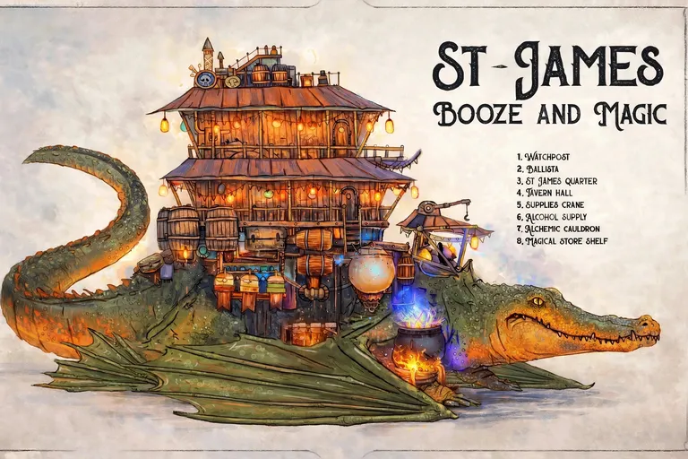

*Picture: Shaun's established Saint James picture — approved winged version (WINGED14), from his Saint James file*

**Partial — fullest block on file:**

# SAINT JAMES — Blendcrafter Build

*APOC Survival (D&D 3.5). Built 2026-11-05 from Shaun's dictation on the live voice call (human; 15th level; 84-point spread, Dexterity and Charisma on top; gun and cutlass, all magical; fully kitted). Saved to the Blendcrafter group shelf — shelf row id `8688df31-808f-401c-91b6-f6909e3be41f`, verified by read-back: the shelf returns the row with name "Saint James". Open Blendcrafter → Characters → Group shelf to load him. His tracker character and this build are the same character. Updated 2026-11-05 ~21:52 under Shaun's revolver ruling (FLAGS #3): the shelf row was re-verified after the update — 75 inventory entries, Revolver +3 equipped as a magic item, Bullets +1 (50) aboard, mundane gun and bullets gone.*

## The Man

- **Race:** Human
- **Classes:** Rogue 1 / Swashbuckler 4 / Dread Pirate 10 — character level 15 (see FLAGS #1 for why the entry mix is Rogue 1 / Swashbuckler 4 rather than Swashbuckler 5)
- **Alignment:** Chaotic Neutral (Dread Pirate requires nonlawful)

**Ability scores (84 points, final):** Str 14 (+2), Dex 18 (+4), Con 14 (+2), Int 12 (+1), Wis 10 (+0), Cha 16 (+3)

## Combat Numbers

*As Blendcrafter's engine derives them (what the app shows):*

- **BAB +14** — melee +16, ranged +18, grapple +16
- **Saves:** Fortitude +9, Reflex +14, Will +4
- **Hit points:** 96 (engine figure)
- **Initiative:** +4
- **Armor class (engine):** 14 (touch 14, flat-footed 10)

*Counting the worn magic items' printed effects, which several catalog records don't feed into the engine (FLAGS #4):*

- **Armor class:** 23 (10 + Dex 5 with the gloves + Mithralmist Shirt +5 armor + Ring of Protection +2 deflection + Amulet of Natural Armor +1) — touch 17, flat-footed 18
- **Saves with the Cloak of Resistance +2:** Fortitude +11, Reflex +17, Will +6
- **Initiative +5** (Dexterity 20 with the gloves)

## Feats (7 of 7 slots — human bonus included)

| Slot | Feat |
|---|---|
| 1st level | Two-Weapon Fighting |
| Human bonus | Quick Draw *(Dread Pirate prerequisite)* |
| 3rd level | Weapon Finesse *(Dread Pirate prerequisite; also granted as a Swashbuckler class feature — see FLAGS #2)* |
| 6th level | Leadership *(his crew)* |
| 9th level | Improved Two-Weapon Fighting |
| 12th level | Improved Critical (cutlass) |
| 15th level | Dodge |

Class features of note: sneak attack +1d6 and trapfinding (Rogue), Grace +1 and Insightful Strike (Swashbuckler), and the full Dread Pirate line — two-weapon fighting style, fearsome reputation (+6), acrobatic charge, skill mastery. At Dread Pirate 3rd the class splits honorable (rally the crew) vs. dishonorable (sneak attack); the build format doesn't encode the path — Shaun picks it in play (FLAGS #8).

## Skills (144 of 144 points spent; totals include ability modifiers)

- **Profession (sailor) 18 ranks → +18** *(rides on the catalog's single "Profession" skill — FLAGS #6)*
- **Appraise 18 ranks → +19**
- **Intimidate 18 ranks → +21**
- **Bluff 13 ranks → +16**
- **Sense Motive 13 ranks → +13**
- Diplomacy 8 ranks → +11
- Balance 8 ranks → +12
- Tumble 8 ranks → +12
- Use Rope 8 ranks → +12
- Climb 6 ranks → +8
- Swim 6 ranks → +8
- Listen 6 ranks → +6
- Spot 6 ranks → +6
- Gather Information 4 ranks → +7
- Knowledge (geography) 4 ranks → +5

The Circlet of Persuasion's +3 competence bonus on Charisma-based checks (Intimidate +24, Bluff +19, Diplomacy +14, Gather Information +10 while worn) is printed on the item but not fed into the engine totals above.

## Gear — fully kitted (total 75,656.6 gp; 75 inventory entries)

### Weapons

- **Cutlass of Surety** — 18,310 gp *(magic item; equipped. The catalog's genuine magical cutlass — it never slips from its wielder's grip)*
- **Revolver +3** — 18,800 gp *(magic item; equipped. The Sorcery & Steam percussion cap revolver — 1d10, crit ×3, range 50 ft. — with a +3 enhancement bonus to attack and damage, priced by the standard magic weapon creation rules: 500 gp base + 300 gp masterwork + 18,000 gp for +3. Per Shaun's ruling (2026-11-05): a firearm takes magic like any other weapon — see FLAGS #3, resolved. With BAB +14 and Dexterity 20 in the gloves, he shoots it at **+22 to hit**.)*
- **Bullets +1 (50)** — 2,350 gp *(magic ammunition, one lot of fifty, priced by the standard creation rules: 50 gp base + 300 gp masterwork + 2,000 gp for +1. Shaun ordered magical ammunition without naming a grade; +1 is the assumed grade — see FLAGS #10.)*
- Black powder (dose) ×10 — 10 gp each; Powder horn — 3 gp
- Dagger ×2 — 2 gp each

### Worn magic

- **Mithralmist Shirt** — 3,400 gp *(+1 mithral chain shirt, +5 armor total; seven times a day it fills his space with concealing silver mist)*
- **Ring of Protection +2** — 8,000 gp
- **Cloak of Resistance +2** — 4,000 gp
- **Amulet of Natural Armor +1** — 2,000 gp
- **Circlet of Persuasion** — 4,500 gp *(+3 competence on Charisma-based checks — the shakedown circlet)*
- **Gloves of Dexterity +2** — 4,000 gp
- **Boots of Striding and Springing** — 5,500 gp

### Healing (magic-item potions — in APOC they work immediately)

- Potion of Cure Serious Wounds ×4 — 750 gp each
- Potion of Cure Moderate Wounds ×4 — 300 gp each
- Potion of Cure Light Wounds ×2 — 50 gp each

### Badlands self-sufficiency (for him and the crew)

Backpack (2 gp); Bedroll ×2 (1 sp each); Rope, silk (50 ft.) ×2 (10 gp each); Grappling hook (1 gp); Lantern, bullseye (12 gp); Oil, 1-pint flask ×4 (1 sp each); Waterskin ×4 (1 gp each); Trail rations ×10 days (5 sp each); Healer's kit ×2 (50 gp each); Crowbar (2 gp); Sunrod ×4 (2 gp each); Tindertwig ×5 (1 gp each); Antitoxin ×2 (50 gp each); Spyglass, collapsing (35 gp); Compass (75 gp); Tent, four-person (20 gp).

**APOC screening:** no extra-dimensional storage (no bag of holding, no handy haversack), no summoning items, no planar or teleport items — all deliberately left out.

## Who He Is (Shaun's canon, carried in the build's personality fields)

Saint James is a pirate who lives out in the badlands aboard **ST-JAMES — Booze and Magic**, a multi-story tavern-house carried on the back of a giant four-winged lizard, with his crew. The tavern is **not a fixed place** — nobody travels to it. The lizard flies, and it **lands** in the badlands near adventurers: the flying tavern coming down is how the party generally meets him. Then his rule applies: spend money at the tavern and he doesn't bother you; otherwise he extorts coin or gear. He has a knack for finding adventurers out in the badlands to land on. He has to be able to take care of himself and his whole crew out there — hence the healing, the stores, and Leadership.

## FLAGS — assumptions and adjustments, all flagged per Shaun's rule

1. **Entry mix adjusted (the big one).** Shaun approved the frame "Swashbuckler 5 / Dread Pirate 10," but a straight Swashbuckler 5 **cannot legally enter Dread Pirate in this catalog**: the prestige class requires Appraise 8 ranks, and Appraise is not a Swashbuckler class skill (cross-class ranks cap at 4 by 5th level). Minimal fix applied: **Rogue 1 / Swashbuckler 4 / Dread Pirate 10** — total still 15, Dread Pirate still 10, entry BAB still exactly +4, Appraise 8 legally bought with Rogue levels, and every other prerequisite met by 5th level (Profession (sailor) 8, Swim 4, Use Rope 4, Quick Draw, Weapon Finesse). Blendcrafter's own prerequisite gate evaluates the finished build as **selectable: yes, every entry met**. The one Rogue level also brings sneak attack +1d6 and trapfinding, which suit him.
2. **Weapon Finesse takes a general feat slot** in Blendcrafter's accounting (its Dread Pirate gate reads taken feats from the character's feat list), even though Swashbuckler also grants it as a class feature. Combat Reflexes was the flavor feat cut to fit — the build sits at exactly 7 of 7 slots with zero validation warnings.
3. **The gun question — RESOLVED by Shaun's ruling (2026-11-05 ~21:52, via the AI DM).** As first built, the gun was the mundane Sorcery & Steam revolver record because no complete magical firearm record existed in the catalog. Shaun ruled: *"It's just like any magical creation rules set — give it a plus three to hit and he uses magical ammunition."* Applied the same night: two creation-rules records were added to the catalog (Blendcrafter v20.53) — **Revolver +3** at 18,800 gp and **Bullets +1 (50)** at 2,350 gp — and the shelf build was updated to carry them in place of the mundane gun and bullet lots, verified by read-back. The revolver is no longer the non-magical exception; every weapon he carries is magical now.
4. **Engine vs. printed item effects.** Several worn records (Mithralmist Shirt, Ring of Protection +2, Amulet of Natural Armor +1, Cloak of Resistance +2, Circlet of Persuasion, Gloves of Dexterity +2) carry their effects in their text but no engine modifiers, so the app's derived AC and saves read low. Both sets of numbers are given above; the "printed effects" set is the honest one at the table.
5. **The ship prerequisite is certified in the

## Salamander — CR 3 — Monster Manual I


*Picture: Monster library art — Monster Manual I*

**Partial — fullest block on file:**

Type: Small Outsider (Extraplanar, Fire)
Challenge Rating: 3
Source book(s): Monster Manual I
Description: Salamanders speak Ignan. Some average salamanders and all nobles also speak Common.
[Partial — fullest available from APOC-VTT registry record; no roster stat block found. No stat lines invented.]

## Sample 15th-Level NPC Artificer (Warforged) — CR 15 — Sharn: City of Towers

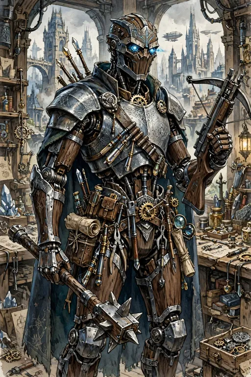

*Picture: GENERATED — generated from the published stat block (warforged artificer 15, heavy mace, light crossbow, Mithral Body)*

## 5B-7. SAMPLE 15TH-LEVEL NPC ARTIFICER (WARFORGED) — CR 15 — Sharn, pp. 173–175

Same NPC Artificer presentation, high-level sample; block spans pp. 173–175. The section's shared lines: *Starting Ability Scores: Str 10, Dex 12, Con 13, Int 14, Wis 8, Cha 15. Increased Ability Scores: 4th, Cha 16; 8th, Cha 17; 9th, Int 14 (16); 12th, Int 14 (18), Cha 18; 15th, Cha 18 (20); 16th, Cha 19 (21); 20th, Int 14 (20), Cha 20 (22).*

> **Sample 15th-Level NPC Artificer:** Warforged artificer 15; CR 15; Medium living construct; HD 15d6+30; hp 85; Init +1; Spd 30 ft.; AC 24, touch 12, flat-footed 23; Base Atk +11; Grp +11; Atk +13 melee (1d8+2, +2 heavy mace) or +15 ranged (1d8+3/19–20, +3 light crossbow); Full Atk +14/+9/+4 melee (1d8+3, +2 heavy mace) or +16/+11/+6 ranged (1d8+4/19–20, +3 light crossbow); SQ artisan bonus, disable trap, infusions, item creation, light fortification (25%), metamagic spell completion, metamagic spell trigger, retain essence, skill mastery, warforged traits; AL N; SV Fort +10, Ref +9, Will +10; Str 10, Dex 12, Con 15, Int 18, Wis 6, Cha 18.
> *Skills and Feats:* Disable Device +20, Knowledge (arcana) +20, Open Lock +19, Search +20, Spellcraft +22, Use Magic Device +25; Attune Magic Weapon, Brew Potion, Craft Homunculus, Craft Magic Arms and Armor, Craft Rod, Craft Staff, Craft Wand, Craft Wondrous Item, Exceptional Artisan, Forge Ring, Magical Aptitude, Mithral Body, Scribe Scroll, Skill Focus (Use Magic Device), Wand Mastery.
> *Warforged Traits:* Immune to poison, sleep effects, paralysis, disease, fatigue, exhaustion, effects that cause the sickened condition, and energy drain. Half effect from spells of the healing subschool.
> *Infusions per Day:* 5/5/4/4/3/2; save DC 14 + infusion level.
> *Possessions:* +3 composite plating (mithral), +3 light steel shield, +2 heavy mace, +3 light crossbow, cloak of resistance +3, headband of intellect +4, ring of protection +1, pink and green ioun stone, wand of magic missile (9th level), wand of mirror image.

## Sand Dervish — CR 10 — Monsternomicon Vol. II


*Picture: Undead roster picture index: official book art — official book art — Monsternomicon Vol. II (Privateer Press)*

Sand Dervish


**Source:** Monsternomicon Vol. II: The Iron Kingdoms and Beyond (Privateer Press), p.138

*Method: de-columnized from the library PDF text layer, as above.*

```
Sand Dervish
Usually LN Medium Undead (Incorporeal) CR 10
Hit Dice:            12d12 (78 hp)
Immunities/Resist:   Damage reduction 10/magic, incorporeal
traits, spell resistance 21, undead traits
Senses:              Darkvision, 60 ft., Listen +0, Spot +0
Initiative:          +7
Speed:               20 ft. (4 squares); wind walking
Armor Class:         15, touch 15, flat-footed 12 (+3 Dex
+2 deflection)
Base Attack/Grapple: +6/+12
Attack:              +2 longsword +12 melee
(1d8+12/17–20)
Full Attack:         +2 longsword +12/+7 melee
(1d8+12/17–20) and +2 longsword
+12/+7 melee (1d8+12/17–20)
Special Attacks:     Blinding sand, fighter training, perfect two-
weapon fighting, shredding sand
Space/Reach:         5 ft./5 ft.
Special Qualities:   Body of sand, fast healing 5, rejuvenation,
+4 turn resistance, wind walking

I      have not yet had the good fortune of seeing a sand der-
vish, but Quimut, my guide in the Bloodstone Marches,
encountered one once. He told me the story.
Small, swirling sandstorms at sunset or sunrise com-
monly occur there. Occasionally witnesses report seeing more
than one of these, and tales speak of canyons and passes where
many of them whirl. Such a gathering is always taken as a sign

of ill omen. A younger and more foolish Quimut (his words
not mine) sought one out.
He moved into a
pass called Cleft Canyon,
somewhere in the vicin-
ity of the Rotterhorn, as
the sun set and cast long
shadows across the sand.
Many small sandstorms
moved about. The young
Quimut made a sign
against evil, and his
courage deserted him.
He turned and found a
whirlwind blocking his
path not twenty feet
away. The whirling sand
took on a shape, and
 138

Saves:                   Fort +4, Ref +7, Will +8
Abilities:               Str 22, Dex 17, Con –,
Int 10, Wis 11, Cha 14
Skills:                  Bluff +17, Knowledge (any two) +15,
Sense Motive +15
Feats:                   Ability Focus (shredding sand), Dodge,
Greater Weapon Focus (longsword)B,
Greater Weapon Specialization
(longsword)B, Improved Critical
(longsword)B, Improved Initiative,
Improved Two-Weapon FightingB, Mobility,
Spring Attack, Two-Weapon FightingB,
Weapon Focus (longsword)B, Weapon
Specialization (longsword)B
Environment:             Warm desert
Organization:            Solitary
Advancement:             13–28 HD (Medium, advancement as
fighter for feats and prerequisites)

Quimut found himself staring at a man made of the red sands.
The creature’s feet trailed away into the desert ground, and it
held two swords of trickling sand.
The apparition pointed one sword at Quimut and said
something incomprehensible in some ancient form of Idrian,
but clearly a challenge. Its swords dropped into a ready stance.
Quimut tells me with no shame that he fled into the
mountains.
I have since learned through researching various Idrian
folk tales that these sand dervishes, appear to be the spirits
of mighty warriors who
perish before fulfill-
ing a promise or quest.
One elderly barbarian
chief of the Idrian
nomads found east of
the Rotterhorn told me
these lingering spirits
desire death through
honorable combat, and
will fight fairly if their
opponent does the
same.



Combat
When a sand dervish encounters a group, it hails them, singles

out one creature, and challenges it to single combat. If the

challenged creature duels it singly and honorably, the

dervish returns the favor and does not use its offen-

sive supernatural abilities. However, if other

characters attack it or if its opponents

fight unfairly, the angry dervish

brings all its abilities into play.

Sand Step (Su): As often

as it likes, a sand dervish

may, as a move action,

collapse and rise again

from the sandy ground

in a different location

within 400 feet plus 40

feet per hit die.

Shredding Sand

(Su): Once per day, as

a standard action,

the sand dervish

may create a 60 ft.

cone of sand fly-

ing hard enough to

scour flesh from

bones. This attack

does 12d6 points

of slashing damage,

Reflex save (DC 20)

for half damage.

Blinding Sand

(Su): Up to three

times each day, as a

standard action, a sand

dervish may envelop a

target in a whirl of blowing
sand. The target suffers blindness
for a number of rounds equal to half the dervish’s hit dice,
Reflex save (DC 18) to negate.

Perfect Two-Weapon Fighting (Ex): With this ability
and its Two-Weapon Fighting and Improved Two-Weapon
Fighting feats, a sand dervish can attack with both its long-
swords at its full base attack bonus with no penalty on the
attack rolls and adds its full Strength bonus on damage rolls
with both swords.
Body of Sand (Su): Sand dervishes create bodies out of
sand. This provides both damage reduction and fast healing
but makes the dervish susceptible to spells that effect sand,
earth, or stone. Stone to flesh cast on it removes the sand dervish’s
damage resistance. Transform rock to mud prevents it from using

 139
Sand Dervish

wind walking, shredding sand, and blinding sand. The dervish’s
weapons, also made of sand, function as +2 longswords that
cannot be sundered, disarmed, or destroyed and disintegrate

when the creature is destroyed.

Wind Walking (Sp): A sand

dervish can

take the

form of a

small sand

whirlwind

at will. Treat

this ability

like wind walk

but it only affects

the dervish who

appears as a swirl

of sand and dust

instead of a cloudlike

vapor. In this form it

is not affected by wind

like a gaseous form and

it is always likely to be

mistaken for a natural

whirlwind.

Rejuvenation (Su):

If a sand dervish’s body is

destroyed or dispersed (by reach-

ing 0 hit points) its spirit survives

and may create a new body in 1d4

days. The only way to get rid of a sand

dervish is to determine the reason for

its existence and set right whatever pre-

vents it from resting. Most find their final

rest when challenged and defeated in single

and honorable combat, while a few might

have more obscure requirements.

Legends & Lore (Idrian)
Common: None.

Uncommon: Sand storms in the Bloodstone Marches some-
times bring the additional danger of sand dervishes. Their
bodies are made of sand, so therefore difficult to destroy.
Rare: Powerful spells that effect earth and stone can hamper
these creatures, though only single combat will truly destroy
them. Defeating a sand dervish quickly gains you renown
among the nomadic Idrians.
Obscure: Sand dervishes are warriors who died in the desert
before completing a task or oath. Completing the oath can give
them final rest.


Satyr
N Large Monstrous Humanoid CR 9
Hit Dice:            16d8+80 (152 hp)
Senses:              Darkvision 60 ft., Listen +7, Spot +6,
scent
Initiative:          +3
Speed:               50 ft. (10 squares)
Armor Class:         22, touch 12, flat-footed 19 (–1 size,
+3 Dex, +20 natural)
Base Attack/Grapple: +16/+28
Attack:              Ram +23 melee (3d6+8)
Full Attack:         Ram +23 melee (3d6+8) and
2 slams +21 melee (2d8+4)
Special Attacks:     Musk, powerful charge, powerful ram

T            he nature of our respective professions has some-
times strained my long-standing friendship with
Alten Ashley. His thrill at slaying rare creatures
sometimes frustrating. His zeal for the kill, howe
lead me to the elusive mountain creatures I’ve named satyrs, in
preference to Alten’s appellation, “giant, reeking goat-man”.
Alten visited me at the university shortly after my return

from the east, and I found his obvious relief at finding
me safe touching. He followed this greeting by hefting a
blood-soaked oiled sack and transferring the grisly remains
of a massive horned head, gathering flies and smell-
ing of rot, from it to my work table. After a
few choice invectives I began to clean the
skull and make an examination, and
quickly deduced that I had never
seen this creature before. I put
aside my obligations and immedi-
ately ventured with Alten into the
Wyrmwall Mountains to find
this creature.
After a few weeks of care-
ful hiking, including fighting
off a tribe of ornery bogrin,
Alten and I reached the lonely
heights. Alten tired of the expedition
and decided to hunt on his own after I
insisted he keep his ridiculous rifle on his
back. I had not come for trophies.
Left to myself I made a thor-
ough study of these tremen-
dously powerful, bipedal
omnivores in their element.


Space/Reach:               10 ft./10 ft.
Special Qualities:         Rock walking, shrug off blows
Saves:                     Fort +15, Ref +13, Will +7
Abilities:                 Str 26, Dex 16, Con 20,
Int 6, Wis 14, Cha 10
Skills:                    Listen +7, Spot +6, Survival +12
Feats:                     Imp

## Sarkrith, Spelleater — CR 13 — Fiend Folio


*Picture: APOC-VTT monster library art — Fiend Folio*

**Partial — fullest block on file:**

Type: Large Monstrous Humanoid
Challenge Rating: 13
Source book(s): Fiend Folio
Description: The heart of the sarkrith race, spelleaters drive the sarkrith’s hatred of magic and its effects. Spelleaters rarely travel without a squad of thanes for protection.
[Partial — fullest available from APOC-VTT registry record; no roster stat block found. No stat lines invented.]

## Schir — CR 4 — Book of Fiends


*Picture: Demons roster picture index: GENERATED (from the published description)*

CR 4 — Schir

- [3RD-PARTY — Publisher: Green Ronin Publishing] Source: *Armies of the Abyss* (Book of Fiends Vol. Two), book p.50 (description continues book p.51)
- Picture: `book-of-fiends-schir.jpg` — **GENERATED (from the description in Armies of the Abyss, Green Ronin Publishing)**. Verified JPEG, 556,094 bytes, on disk 2026-11-06. Form generated from the book's own description text (human/goat offspring, backward-curving horns, two-kneed cloven-hoofed legs, chest symbols, halberd); grey sky, no sun, no stars.
- **EXTRACTED from *Armies of the Abyss* 2026-11-06** (book p.50; bonus note `library/armies-transcriptions/range-C-pp51-61.md`): **CR 4** — "Schir (Tanar'ri), Medium-Size Outsider (Chaotic, Evil), Hit Dice: 6d8+12 (39 hp), Initiative: +2 (Dex), Speed: 30 ft., AC: 19 (+2 Dex, +7 natural), AC (Flat-Footed): 17, AC (vs. Touch Attacks): 12, Attacks: Halberd +10/+5 melee; or gore +9 melee, Damage: Halberd 1d10+4 and disease; gore 1d6+4, Face/Reach: 5 ft. by 5 ft./5 ft., Special Attacks: Charge 3d6+3, disease, spell-like abilities, summon tanar'ri, Special Qualities: Tanar'ri qualities, damage reduction 5/+1, SR 7, disease immunity, Saves: Fort +7, Ref +7, Will +3, Abilities: Str 17, Dex 14, Con 14, Int 8, Wis 6, Cha 6, Skills: Climb +12, Intimidate +7, Jump +12, Spot +15, Wilderness Lore +4, Feats: Run, Weapon Focus (halberd), Climate/Terrain: Any land and underground, Organization: Solitary or pack (3–8), Challenge Rating: 4, Treasure: Standard, Alignment: Always chaotic evil, Advancement: 7–12 HD (Medium-size); 13–18 HD (Large)."
- Special ability names listed / detailed (book p.51): Charge (Ex); Disease (Su) — *Demon Fever*; Spell-Like Abilities; Summon Tanar'ri (Su); Disease Immunity (Ex); Skills (note: +8 racial bonus on Spot checks)
- Description (verbatim, book pp.50–51): "The goat-headed schirim pervade the Material Plane, primarily because they can be summoned by magics easily accessible to spellcasters with very little skill. Clumsy covens fumbling with half-understood scrolls frequently bring a schir from the Abyss, and many credulous cultists believe all demons look like the bestial schirim. / The goat demons revel in their reception on the Prime, seldom speaking of their station at home. In the Abyss, schirim are little more than soldiers or guardians, expected to follow the orders of their betters at all times. Dull-witted and slow to learn, they nonetheless make superlative sentries, thanks to their spell-like abilities and otherworldly sense of focus. / A schir looks like the bastard offspring of human and goat. Its long, muscular neck supports a bestial head topped with two backward-curving horns. The creature's nauseating yellowed teeth reek of decayed meat and human waste, and its beady eyes burn with an amber rage. A tangled, food-encrusted beard dangles from the demon's chin. Coarse hair covers a schir from head to toe, growing especially thick at the legs and shoulders. Its legs feature two knees, the lower set of which bend backwards just above cloven-hoofed feet. / Schirim carve or brand a number of mystical symbols upon their chests. These markings represent clan affiliations, and some schirim refuse to work with members of other clans; such refusals occasionally break out into open battle between the schirim serving allied demon lords. To a schir, clan allegiance is paramount to all other concerns, and no task is too important to get in the way of eons-old internecine struggle. / Though all schirim pay lip service to their creator, the demon prince Azazel, not all serve the progenitor of their race. Perhaps due to their incredible fecundity, schirim have spread to nearly every inhabitable layer of the Abyss, and rare is the demon noble who does not employ at least a pack of the creatures somewhere in its vast retinue. / Schirim speak Abyssal, relying upon their *tongues* ability to communicate with mortals." (Plural printed "schirim" in the book text, as reproduced.)
- Nature/role: goat-demon soldier/guardian, the common summoned-demon stereotype of the book's lore. APOC Note: third-party reference only; mortal and trapped — in APOC it cannot be summoned at all (summoning spells don't work, whatever the book says about easy summoning magics); Bastion-barred.

## Scouring Slinger — CR 18 — Monster Manual V


*Picture: APOC-VTT monster library art — Monster Manual V*

**Partial — fullest block on file:**

Type: Always N Huge construct
Challenge Rating: 18
Source book(s): Monster Manual V
Description: This massive tangle of branches and roots is surrounded by a swarming mass of insects. It rises up and extrudes six arms from its central mass, each holding what appears to be a construct scorpion some 4 feet long.
[Partial — fullest available from APOC-VTT registry record; no roster stat block found. No stat lines invented.]

## Scylla Flock — CR 8 — Monsternomicon Vol. II


*Picture: Undead roster picture index: official book art — official book art — Monsternomicon Vol. II (Privateer Press)*

Scylla Flock


**Source:** Monsternomicon Vol. II: The Iron Kingdoms and Beyond (Privateer Press), p.142

*Method: de-columnized from the library PDF text layer, as above.*

```
Scylla Flock
Usually NE Tiny Undead (Swarm) CR 8
Hit Dice:            12d12 (78 hp)
Immunities/Resist:   Undead and swarm traits
Senses:              Darkvision 60 ft., Listen +22, Spot +22
Initiative:          +6
Speed:               10 ft. (2 squares), Fly 40 ft. (poor)
Armor Class:         22, touch 14, flat-footed 20 (+2 size,
+2 Dex, +8 natural)
Base Attack/Grapple: +6/–
Attack:              Swarm (3d6 plus disease)
Full Attack:         Swarm (3d6 plus disease)
Special Attacks:     Disease (DC 16), distraction (DC 18)

N            othing in Cryx escapes the sick taint of Toruk’s
dragonblight, not even the land itself or any once
ordinary and innocent creatures of nature. Sailors
who have risked selling their pirated goods in
Blackwater tell tales of skies dark with blighted carrion birds
hungry for flesh, living or dead. While many a sailor tells a
dark tale, I have seen the truth of this one.

During my exploration of Cullenrock Island I came
across a wrecked ship, likely a pirate vessel from the lack of
markings or discernable flag. There I disturbed a flock of
birds feasting on the dead, and something in their behavior
seemed awry. I crept slowly closer, not eager to smell again

the familiar carrion stench of rotted flesh. I saw to my hor-
ror that the birds too rotted. Bones showed between dirty
patches of feathers. One looked at me with empty eye sock-
ets. I had heard tales of such flocks, but thought these
undead confined to the deeper isles of Cryx near the
necrotite upon which their power thrives.
I thought they might fly at me,
eager for living flesh, but perhaps
they had consumed their fill.
As I moved to leave, how-
ever, one of the
birds spoke

 142

Space/Reach:              10 ft./0 ft.
Special Qualities:        Dead memory, necrotic healing, swarm
traits, undead traits
Saves:                    Fort +4, Ref +6, Will +11
Abilities:                Str 4, Dex 14, Con –,
Int 4, Wis 16, Cha 10
Skills:                   Hide +25, Knowledge (any two) +12,
Listen +22, Move Silently +17, Spot +22
Feats:                    Ability Focus (distraction), Alertness,
Dodge, Mobility, Improved Initiative
Environment:              Any land
Organization:             Solitary, flight (2–4), or colony (5–10)

to me in the Scharde dialect with all the inflection and color-
ful vocabulary of a sailor. I scrambled back and prompting
more of the birds to follow with grim and cruel laughter as
they delighted in my confusion. I believe they had absorbed
some portion of cunning and intelligence from those upon
whom they feasted. I suffered nightmares for weeks thereafter
at the thought that sharp probing beaks would steal my own
lore and parrot it back from the treetops.

Combat
Dead Memory (Su): A scylla flock’s most notable ability is the
fact that it gains a portion of the memories of creatures it con-
sumes. This ability has the following effects:
• If a scylla flock consumes the body of an intelligent crea-
ture, it gains its memories for 1 week. Characters can
access the spirit of the dead by conversing with the
flock through a speak with dead spell. Of course, doing
so requires that the flock have a positive disposition
toward the character.
• The flock can speak with the voices of any
intelligent creatures it has consumed in the past
week. The flock adopts aspects of the creatures’
mannerisms and personalities as well.
Usually, the flock chatters pointlessly in these creatures’
voices, sometimes repeating words or phrases important to
the individuals in life. Characters may use social skills like
Diplomacy to negotiate with the flock in a language it knows
(or rather of a creature it has consumed in the past week).
• The scylla flock gathers and retains skill knowledge from
creatures it consumes. Thus, it gains skill points as if it had
an Intelligence of 14. All skills are considered class skills for a
scylla flock; those presented above are simply the most likely.


• The scylla flock also retains some special mental abili-
ties of creatures that it has consumed recently. A GM should
choose one ability below for each flock based on its recent meal:
Spellcasting: The flock has consumed an arcane spellcaster
and retains a limited amount of the creature’s spellcasting abil-
ity. Roll 2d4–2 (minimum 1). The result is the highest level
spell the flock can cast. Each day, it can cast one particular
spell of that level, and one spell of each level lower.
Choose spells as appropriate. The flock casts as
a sorcerer of its hit dice and follows all the
normal rules for spellcasting, except that
it does not need to provide somatic or
material components costing less
than 100 gp. (It provides
the verbal components by
speaking in the deceased’s
voice.)

Combat Knowledge: The flock has consumed a fighter or
other martial expert and retains a portion of his expertise. The
flock deals 5d6 points of damage with its swarm attack, rather
than 3d6.
Skill Expertise: The flock has an additional four skills, each
with 12 ranks. Choose skills as appropriate.
Feat Expertise: The flock has an additional three feats.
Choose feats as appropriate.
Other Class Feature: The flock retains a single non-spell like,
non-supernatural class ability: evasion, favored enemy, rage,
trap sense +4, uncanny dodge.

 143
Scylla Flock

Disease (Ex): Filth fever
— swarm attack, Fortitude
DC 16, incubation period
1d3 days, damage 1d3 Dex
and 1d3 Con. The save DC is
Constitution-based.
Distraction (Ex): Any
living creature that begins its
turn with a scylla flock in its
square must make a Fortitude
save (DC 18) or be nause-
ated for 1 round. The save DC is
Constitution-based.
Necrotic Healing (Su): While
within 60 feet of a scylla nest with a source of necrotite or in
a blighted area, a scylla flock has fast healing 6.

Legends & Lore
Common: Flocks of deadly undead birds gather in Cryx.
Uncommon: These creatures are called scylla flocks, and
they can live outside of Cryx if there is a source of blight or
necrotite. They corrupt dead trees with necrotite and turn
them into nests. They are weakest when driven from this nest.
Rare: They are intelligent undead and Cryxian necroman-
cers use scylla flocks to secure information from the dead of
battlefields. Flocks might also serve as scouts and spies for the
armies of Cryx.
Obscure: Scylla flocks also retain some of the knowledge and
abilities of people they consume. Some can even cast the spells
of their victims.


```

**Kit / Treasure (as published):** a swarm of undead birds — no gear and no treasure line is published for it; none invented.

**APOC Note** *(Shaun's — separate from the published text above)*
- Counts toward the **Kingdom of the Undead** faction in the badlands war (2701 DR).
- **The Bastion's Melairshield bars undead** — it cannot enter the Bastion of Last Hope.
- **Raw magic blights** the land around the caster in APOC — necromancy worked through raw magic carries that cost; alchemy is the cornerstone inside the walls.

---

## Scyther of Thoon — CR 6 — Monster Manual V


*Picture: APOC-VTT monster library art — Monster Manual V*

**Partial — fullest block on file:**

Type: Always N Medium construct
Challenge Rating: 6
Source book(s): Monster Manual V
Description: Before you is a silvery automaton with four arms, perfectly constructed to wield the two wicked-looking scythes it carries. Its eyes glow as they cast forth beams of illumination. It crouches as if preparing to attack.
[Partial — fullest available from APOC-VTT registry record; no roster stat block found. No stat lines invented.]

## Sea Cat — CR 4 — Monster Manual I


*Picture: Monster library art — Monster Manual I*

**Partial — fullest block on file:**

Type: Large Magical Beast
Challenge Rating: 4
Source book(s): Monster Manual I
Description: A typical sea cat is 12 feet long and weighs 800 pounds.
[Partial — fullest available from APOC-VTT registry record; no roster stat block found. No stat lines invented.]

## Sea Tiger — CR 6 — Monster Manual III


*Picture: APOC-VTT monster library art — Monster Manual III*

**Partial — fullest block on file:**

Type: Huge Animal
Challenge Rating: 6
Source book(s): Monster Manual III
Description: This long, streamlined creature has a striped, leathery hide with a dorsal fin like a killer whale or a dolphin. Unlike a fish, it has four muscular legs ending in webbed claws. Long fangs jut from between rows of sharp teeth. Sea tigers are aquatic mammals similar to sea lions and walruses. They hunt anything they can catch, including fish, birds, and animals foolish enough to stray too close to the shore. Sea tigers can often be seen on rocky shorelines, sunning themselves in large family groups. Sea tigers have the intelligence of dogs and wolves, and they can be trained much the same way.
[Partial — fullest available from APOC-VTT registry record; no roster stat block found. No stat lines invented.]

## Selkie — CR 1 — Fiend Folio


*Picture: APOC-VTT monster library art — Fiend Folio*

**Partial — fullest block on file:**

Type: Medium-Size Humanoid (Aquatic, Shapechanger)
Challenge Rating: 1
Source book(s): Fiend Folio
Description: Appearing as humanoids when on land and seals in the sea, selkies are shapechangers with purported fey ancestry whose dealings with nonfey are often tinged with tragedy. In seal form, a selkie looks just like a normal seal, though its eyes usually betray a hint of its intelligence. In humanoid form, selkies resemble very attractive humans, usually with gray hair and eyes and very pale skin.
[Partial — fullest available from APOC-VTT registry record; no roster stat block found. No stat lines invented.]

## Selune-Marra Vael — CR 5 — NPCs — ALL-150 (Shaun's cast)


*Picture: Roster picture file (npc roster pictures; named in the creature's roster entry)*

91. Selune-Marra Vael — Human Wizard 14 / Loremaster 5


**Alignment:** NG · **Faction:** Bastion — Font of Knowledge, heroic legend
**Abilities:** Str 8 (−1), Dex 14 (+2), Con 16 (+3, 12 base + *amulet of health +4*), Int 27 (+8, 15 base +4 level [4/8/12/16] + *headband of intellect +6* + *tome of clear thought +2* inherent), Wis 14 (+2), Cha 12 (+1)
**HD/HP:** 19d4; 4 + (18 × 2.5) + 57 = **106 hp** · **Init:** +6 · **Speed:** 30 ft.
**AC:** 21, touch 15, flat-footed 19 (+2 Dex, +6 *bracers of armour +6*, +3 *ring of protection +3*)
**BAB/Grapple:** +9 / +8 · **Attack:** masterwork dagger +9 melee (1d4−1) or masterwork light crossbow +12 ranged (1d8)
**Full Attack:** +9/+4 · **Space/Reach:** 5 ft./5 ft.
**Special Attacks:** spells · **Special Qualities:** Loremaster secrets (instant mastery, secret health, secrets of inner strength, lore of true stamina, secret knowledge of avoidance — +2 Ref, included), lore +24, greater lore, true lore 1/day, familiar (owl, real, aged)
**Saves:** Fort +11 (base 5 +3 Con +3 *cloak of resistance +3*), Ref +12 (base 5 +2 Dex +3 +2 secret), Will +18 (base 13 +2 Wis +3)
**Skills:** Concentration +25 (22), Decipher Script +30 (22), Knowledge (arcana) +30 (22), Knowledge (history) +30 (22), Knowledge (religion) +26 (18), Knowledge (the planes) +26 (18, theory only), Spellcraft +32 (22 +2 synergy), Spot +13 (11 cc)
**Feats:** Scribe Scroll (Wizard bonus), Spell Focus (abjuration) (1), Craft Wondrous Item (3), Extend Spell (Wizard 5), Greater Spell Focus (abjuration) (6), Craft Staff (9), Skill Focus (Knowledge (arcana)) (12, Loremaster prerequisite), Quicken Spell (Wizard 10), Spell Penetration (15), Greater Spell Penetration (18).
**Kit (170,000 gp):** *headband of intellect +6* (36,000), *bracers of armour +6* (36,000), *tome of clear thought +2* (55,000), *ring of protection +3* (18,000), *amulet of health +4* (16,000), *cloak of resistance +3* (9,000). Her spellbooks, alchemical focus, masterwork dagger and masterwork light crossbow are class property of the Font, carried in mundane oilskin cases.
**Spells Prepared (Wizard caster level 19; 4/6/6/6/6/6/5/5/5/4; DC 18 + level, +2 abjuration):** 0—*detect magic, light, mending, read magic*; 1st—*alarm, feather fall, grease, identify, mage armour, shield, true strike*; 2nd—*arcane lock, fox's cunning, invisibility, knock, resist energy, scorching ray (aug.), see invisibility*; 3rd—*dispel magic, fireball (aug.), fly, haste, protection from energy, tongues*; 4th—*enervation, greater invisibility, ice storm (aug.), scrying, stoneskin, wall of fire (aug.)*; 5th—*break enchantment, cone of cold (aug.), dominate person, hold monster, telepathic bond, wall of force*; 6th—*antimagic field, chain lightning (aug.), disintegrate, greater dispel magic, legend lore, true seeing*; 7th—*finger of death, forcecage, greater scrying, prismatic spray (aug.), spell turning*; 8th—*horrid wilting, irresistible dance, moment of prescience, protection from spells, sunburst*; 9th—*foresight, meteor swarm (aug.), time stop, wish* (unprepared; see Secret).
**Steampunk aesthetic:** A scholar's grey robes with copper-buckled book straps, a brass magnifying lens on a gear-link ring, a clockwork page-holder and amber reading lamp among her oilskin cases, and ink-stained cuffs over fine riveted leather gloves.
**Appearance:** Silver-streaked black hair in a scholar's knot, ink on her cuffs, a magnifying lens set into a ring. **Traits:** Warm, curious, annotates people aloud ("Vael, footnote: he is lying"). **Voice hook:** Bright, quick; "Wait — say that again, slower. History is listening." **Motivation:** Nothing true will be lost again. The calamity burned the libraries; she is the library now. **Secret/Flaw:** Her memory is failing — early, slowly. Her familiar and her loremaster apprentices are quietly becoming her external memory, and she has told none of them. **Background:** Loremaster who walked out of the burning Institute with the Severance Treatise in her arms and a class of children behind her. **DM Use:** Lore oracle, research quests, and a heartbreaking ticking clock the party can help with — if they ever notice.

---

## Shadar-Kai — CR 1 — Fiend Folio


*Picture: APOC-VTT monster library art — Fiend Folio*

**Partial — fullest block on file:**

Type: Medium-Size Fey (Extraplanar)
Challenge Rating: 1
Source book(s): Fiend Folio
Description: The shadar-kai, or shadow fey, are a race of bitter, determined folk whose souls are poisoned by shadow. Gray skinned and dark-eyed, the slender shadar-kai stand slightly taller than average humans, and their soft movements exude grace and uncanny stealth. Shadow follows the shadar-kai wherever they go.
[Partial — fullest available from APOC-VTT registry record; no roster stat block found. No stat lines invented.]

## Shadesteel Golem — CR 11 — Monster Manual III


*Picture: APOC-VTT monster library art — Monster Manual III*

**Partial — fullest block on file:**

Type: Medium Construct (Extraplanar)
Challenge Rating: 11
Source book(s): Monster Manual III
Description: This 7-foot-tall shadowy automaton is crafted from a matte black metal that seems to absorb light. A mist fills the hollow spaces between its skeletal frame, and its two long arms end in sharp metal claws. A dour, skull-shaped head surmounts its broad torso, but the construct has no neck to speak of. It moves slowly but silently, hovering slightly above the ground and disturbing nothing as it passes. Crafted from metal mined and forged entirely on the Plane of Shadow, shadesteel golems are silent and powerful guardians.
[Partial — fullest available from APOC-VTT registry record; no roster stat block found. No stat lines invented.]

## Shadow Demon — CR 8 — Book of Vile Darkness


*Picture: Demons roster picture index: LIBRARY (tier 1)*

SHADOW DEMON — Book of Vile Darkness, pp.172–174 — **PAGE PINNED by library extraction** (stat table p.172, description p.173, special abilities pp.173–174; the book's contents list the entry at p.173)


- **Size/Type:** Medium Outsider (Chaotic, Evil, **Incorporeal**)
- **Hit Dice:** 10d8 (45 hp)
- **Initiative:** +11 (+7 Dex, +4 Improved Initiative)
- **Speed:** Fly 40 ft. (perfect)
- **Armor Class:** 22 (+7 Dex, +5 deflection), touch 22, flat-footed 15
- **Base Attack/Grapple:** — (no Base Attack/Grapple line in BoVD's 3.0 table format; the Improved Grab text, p.174, gives grapple bonus +17)
- **Attack:** Claw +17 melee touch
- **Full Attack:** 2 claws +17 melee touch
- **Damage:** Claw 1d6 **vile** damage
- **Space/Reach:** 5 ft. by 5 ft./5 ft. [BoVD Face/Reach line]
- **Special Attacks:** Improved grab, pounce, rake; spell-like abilities (at will: darkness; 1/day: deeper darkness, damning darkness; 1/week: magic jar; CL 10th; save DC 15 + spell level)
- **Special Qualities:** Darkness enhancement (+4 enhancement bonus to AC, attack rolls, damage rolls, saves, and skill and ability checks in total darkness); flesh-ripping claws (claws become corporeal on touching flesh; claw/rake attacks are touch attacks; all claw damage is vile damage); incorporeal subtype; light powerlessness (–4 penalty to AC, attack rolls, damage rolls, saves, and skill and ability checks in bright light); outsider traits; **Immunities (Su, verbatim BoVD p.174):** immune to fire, cold, and electricity as well as mind-affecting effects, poison, sleep, paralysis, stunning, and disease; not subject to critical hits, subdual damage, ability damage, energy drain, or death from massive damage
- **Saves:** Fort +7, Ref +16, Will +10
- **Abilities:** Str — (incorporeal), Dex 24, Con 10, Int 17, Wis 17, Cha 20
- **Skills:** Bluff +15, Concentration +10, Diplomacy +12, Hide +30*, Intimidate +7, Knowledge (arcana) +16, Knowledge (the planes) +11, Listen +16, Move Silently +20, Search +16, Spot +15 (*+10 racial bonus on Hide checks)
- **Feats:** Expertise, Improved Initiative, Lightning Reflexes
- **Environment:** Any land and underground [BoVD Climate/Terrain line]
- **Organization:** Solitary
- **Challenge Rating:** 8 (BoVD and FC1 agree)
- **Treasure:** None
- **Alignment:** Always chaotic evil
- **Advancement:** 11–15 HD (Medium-size); 16–20 HD (Large)
- **Level Adjustment:** — (no Level Adjustment line published in Book of Vile Darkness)
- **Description (verbatim, BoVD p.173):** "Shadow demons are denizens of the Abyss without corporeal forms, formed from the very essence of evil on that plane. They skitter and flit about with great speed and a supernatural nimbleness, often mistaken for undead shadows. They resemble gaunt, angular, shadowy humanoids with batlike wings. Shadow demons, like night hags and a few other creatures that inhabit the Lower Planes, trade in souls. They use their magic jar ability to trap souls and sell or trade them to more powerful fiends."

**Nature/role:** A demon made of living shadow that rips flesh despite having no body, deepens darkness around itself, and — once a week — tries to steal a body outright with magic jar.

## Shaft Wight — CR 5 — Monsternomicon Vol. I


*Picture: Undead roster picture index: GENERATED from the published description — generated from the Monsternomicon Vol. I published description (via the APOC-VTT monster build)*

Shaft Wight

**Source:** Monsternomicon Vol. I (Privateer Press), p.154 [2005 v3.5 revision text; re-checked 2026-11-08 against the library copy (2002 original), edition differences flagged on the entry]

**2002-original check (2026-11-08, pp.154–155):** CR 5, HD 5d12 (32 hp), AC 18, turn resistance +2, Treasure and Legends & Lore confirmed as filed. Edition differences: the 2002 table prints the mining-pick attack as **+1/+1 melee** (an apparent print error; the filed 2005 text prints +5/+5); Gravel Vomit in 2002 is usable **twice per hour**, a **5-foot spray** dealing **2d8 damage, Reflex DC 14** for half (filed 2005 text: once per hour, 10-foot cone, 2d6, DC 13); and the 2002 Constitution Drain is a *temporary* loss of 2 points (the filed 2005 text makes it permanent drain).

Medium Undead
Hit Dice: 5d12 (32 hp)
Initiative: +2
Speed: 30 ft. (6 squares), burrow 5 ft.
Armor Class: 18 (+2 Dex, +2 natural, +4 chain shirt), touch 12, flat-footed 16
Base Attack/Grapple: +2/+5
Attack: Heavy pick +6 melee (1d6+3/x4) or claw +5 melee (1d4+3 plus 2 Constitution damage)
Full Attack: Heavy pick +6 melee (1d6+3/x4) and claw +0 melee (1d4+3 plus 2 Constitution damage); or 2 claws +5 melee (1d4+3 plus 2 Constitution damage)
Space/Reach: 5 ft./5 ft.
Special Attacks: Constitution damage, gravel vomit
Special Qualities: +2 turn resistance, create spawn, darkvision 60 ft., undead traits
Saves: Fort +1, Ref +3, Will +5
Abilities: Str 16, Dex 15, Con —, Int 13, Wis 13, Cha 15
Skills: Climb +7, Craft (blacksmith) +5, Hide +10, Jump +11, Listen +9, Move Silently +10, Profession (miner) +9, Tumble +4
Feats: Ability Focus (gravel vomit)B, Power Attack, Weapon Focus (heavy pick)
Environment: Cold underground
Organization: Solitary or small band (2–6)
Challenge Rating: 5
Alignment: Usually chaotic evil
Advancement: 6–10 HD (Medium)
Level Adjustment: —

Description / Pendrake text (p.154, condensed as extracted): "Shaft wights are dangerous restless dead, jealous of all life and hateful towards those who walk the tunnels where they met their doom. They arise from miners who have been buried alive, trapped under the weight of stone, suffocating on gravel and sand." Pendrake investigated an abandoned mine shaft in the Cardare Mountains for the Divided Peak Mining Guild; the wights' skin "is unnaturally pale and emits a bitter chill. Their arms and legs show signs of broken bones, but this does not inhibit their movements. Their lidless eyes are pitch-black, like holes, and their mouths hang open, allowing sand to drool from their lips. They wear tunics of crude metal links, shaped in undying patience from scraps. Those without picks attack with long, grimy, black-nailed fingers, and their touch saps the health of those they claw, making breathing labored. Worst of all is the ability to vomit a stream of gravel. I have no doubt that they use this to suffocate victims in a horrible parody of their own deaths. We observed with interest that these undead miners had continued in their work, burrowing tunnels, and mining ore."
Combat: Shaft wights are skilled at stealth, preferring to strike those who are alone. They frequently wield wicked mining picks (identical to heavy picks), but they are just as dangerous with their claws.
Constitution Damage (Su): Each successful claw attack inflicts 2 points of Constitution damage. Victims reduced to 0 Constitution die immediately.
Gravel Vomit (Su): Twice per hour, a shaft wight can spray a foul mixture of gravel, sand, and brackish liquid from its mouth. 5-ft. line, damage 2d8, Reflex half DC 14. The save DC is Constitution-based.
Create Spawn (Su): Any humanoid slain by a shaft wight via its Constitution damage or gravel vomit special attacks becomes a shaft wight in twelve hours unless attended by a cleric who must cleanse the body with holy water. Spawn are under the command of the shaft wight that created them and remain enslaved until its death. They do not possess any of the abilities they had in life.
Skills (Ex): Shaft wights have a +8 racial bonus to Move Silently checks.
Treasure: Shaft wights hoard valuables they take from their victims and also keep ore and precious metals from their mining. Use standard treasure values, 80% of which will be in the form of raw ore or ingots instead of coin. They show some crude ability to shape metal, sometimes crafting armor or bracelets and rings, repairing their mining picks, and so on.
Legends & Lore — Common: Shaft wights are undead created when miners suffocate to death after tunnels collapse upon them. It is rumored they can be heard mining deep in abandoned shafts and will attack anyone who ventures too close. Uncommon: Shaft wights can vomit gravel on a person, causing injury and potentially suffocating the victim. They also have a touch that drains health. Rare: Those who die with their mouths filled with gravel from a shaft wight will arise as one themselves within approximately 12 hours unless attended to by a cleric with holy water. Obscure: Shaft wights are working toward some common goal, perhaps attempting to unify their tunnels and create their own unliving society beneath the earth. The more shaft wights who gather in one place, the more organized and cunning they become.

---

**Kit / Treasure (as published):** Treasure (from the entry above): "Shaft wights hoard valuables they take from their victims and also keep ore and precious metals from their mining. Use standard treasure values, 80% of which will be in the form of raw ore or ingots instead of coin. They show some crude ability to shape metal, sometimes crafting armor or bracelets and rings, repairing their mining picks, and so on." — where the entry publishes no itemized gear list, none is invented.

**APOC Note** *(Shaun's — separate from the published text above)*
- Counts toward the **Kingdom of the Undead** faction in the badlands war (2701 DR).
- Its create spawn still makes more of its kind from Toril's dead — creation on Toril, not summoning — and feeds the Kingdom of the Undead's numbers.
- **The Bastion's Melairshield bars undead** — it cannot enter the Bastion of Last Hope.
- **Raw magic blights** the land around the caster in APOC — necromancy worked through raw magic carries that cost; alchemy is the cornerstone inside the walls.

---

## Shetan — CR 8 — Encyclopedia of Demons & Devils Vol. 1


*Picture: Demons roster picture index: LIBRARY (tier 1)*

Shetan — CR 8 [3RD-PARTY — Publisher: Fast Forward Entertainment]


**Source:** *The Encyclopedia of Demons & Devils* Vol. 1, book p. 177 (PDF p. 178). Book is 3.0-era d20 — reproduced as published.
**Classification evidence (verbatim from the page):** heading "Shetan (Tanar'ri)"; type line "Medium-size Outsider (Chaotic, Evil)"; "Challenge Rating: 8"; "Alignment: Always chaotic evil." A genuine demon entry in this book — rostered.

- **Shetan (Tanar'ri)**
- Medium-size Outsider (Chaotic, Evil)
- **Hit Dice:** 2d8 +2 (11 hp) *(space before "+2" as printed)*
- **Initiative:** +0
- **Speed:** 30 ft.
- **AC:** 16 (+6 Natural) *(capital N as printed)*
- **Attacks:** 2 Claws +3 melee or Bite +3 melee
- **Damage:** Claw 1d6 +3, Bite 1d4 +3
- **Face/Reach:** 10 ft. by 10 ft. / 15 ft. *(as printed — the book gives this Medium-size demon a 10 ft. face and 15 ft. reach; reproduced as published, not "corrected")*
- **Special Attacks:** Summon tanar'ri
- **Special Qualities:** Damage reduction 30/ +3, SR 28, tanar'ri qualities *(space in "30/ +3" as printed)*
- **Saves:** Fort +4, Ref +3, Will –1 *(negative Will save as printed)*
- **Abilities:** Str 13, Dex 11, Con 12, Int 10, Wis 2, Cha 10 *(Wis 2 as printed)*
- **Skills:** Listen +9, Spot +7
- **Feats:** Alertness
- **Climate/Terrain:** Any land and underground
- **Organization:** Solitary, gang (2-6)
- **Challenge Rating:** 8
- **Treasure:** None
- **Alignment:** Always chaotic evil
- **Advancement Range:** None

**Description (verbatim, book p. 177):** "These lesser demons are humanoids with long arms reaching down to their feet, taloned claws instead of hands, and a goat head with massive horns. Their eyes are made of fire. Only a quest of jealousy or greed can purposely summon this demon to the prime material plane. Lore of India says that the demon is only too happy to aid a summoner, but the actions of the demon always cause disharmony and ruin for whoever brought the creature to the earth." / "Legions of these demons serve other more powerful demons on the outer planes. Because of this fact, in failed summonings, often this demon appears anyway, having been sent to teach the summoner a lesson. When summoning preparations are wrong or the quest the demon is summoned to perform isn't proper for the demon's type, a shetan demon will be sent by its irritated demonic master. If the summoning spell caster is seen as weak, the shetan immediately tries to kill the caster for his presumption. If the spell caster is powerful, the shetan pretends it is under complete control of the summoner and tries to subvert and ruin any plans the caster might have for the demon."

**Combat (verbatim):** "The demon lives for hand-to-hand combat. It's happiest when its fangs are ripping into flesh and its talons are rending arms and legs. It is not a clever fighter, however, and it simply rushes into a conflict and fights until it is dead or its enemies are finished."
**Spells (verbatim):** "Shedim cast spells as a 6th-level sorcerer. Once per day—alter self, antimagic field, bestow curse, blink, cloak of chaos, create undead, gaseous form, and obscuring mist." — ⚠ **PUBLISHED ERROR, reproduced as printed (verified at 300 dpi): the Shetan entry's spell paragraph names "Shedim," not Shetan — the book carried the neighbouring Shedim entry's name into this text (see also Fire Eyes below). The paragraph stands in the Shetan entry, between its Combat text and its Fire Eyes text, and is reproduced where the book prints it; the name is NOT silently changed.**
**Fire Eyes (Su) (verbatim):** "The eyes of a shedim have several different abilities, depending on the need of the demon. When the shedim attempts to convince a mortal of something, the flames act as a suggestion spell. When the demon is attacked by enemies, the flaming eyes will do five points of fire damage to whoever successfully strikes the demon with any weapon. When the demon searches for something, the heat from its flaming eyes acts as a detect magic spell. These flames can also reach out and set afire any combustible material. If the demon wishes, the flames of its eyes will turn blue when a lie is told to the demon." — ⚠ **"shedim" (lowercase, twice) as printed — same published error as above, reproduced as published.**
**Goat Horns (Su) (verbatim):** "The horns of the Shetan are capable of massive structural damage. When the horns are rammed into a door or side of a castle or other structure, they do 20 points of structural damage. Whenever they hit a locked or blocked door they act as a knock spell. Occasionally one of the horns of the demon will break off in combat. The demon ignores its cast off horn. When such an object falls into the hands of a necromancer, that magic user can blow the horn and summon 1d6 skeletons once a month. These skeletons are intelligent and obey the commands of the summoner, but often they deliberately try to twist their orders to cause him chaos and ruin."
**Summon Tanar'ri (Sp) (verbatim):** "Once per day, Shetan can attempt to summon a single dretch with a 30% chance of success."

**APOC NOTE (Shaun's canon — separate from the published text above):** Third-party reference only — the Encyclopedia's mythology lore (Lore of India, quests of jealousy or greed) is reference only, not FR canon. In APOC the shetan is mortal and trapped in the scarred sphere; summoning spells DON'T WORK, so nothing "sends" a shetan to anyone and its summon tanar'ri calls nothing; the Bastion's mythal bars it absolutely.

---

## Shrapnyl — CR 7 — Monster Manual II


*Picture: APOC-VTT monster library art — Monster Manual II*

**Partial — fullest block on file:**

Type: Large Construct
Challenge Rating: 7
Source book(s): Monster Manual II
Description: Shrapnyls are the only raggamoffyns made entirely of metal. They lurk near battlegrounds as well as forges. A shrapnyl consists of bits of metal in every size. Its appearance can vary greatly—one might consist of swords, shields, and cooking gear, while another could contain a helm, coins, chains, and keys.
[Partial — fullest available from APOC-VTT registry record; no roster stat block found. No stat lines invented.]

## Sickening Sleep — CR 2 — Monster Manual III


*Picture: APOC-VTT monster library art — Monster Manual III*

**Partial — fullest block on file:**

Type: Medium Ooze
Challenge Rating: 2
Source book(s): Monster Manual III
Description: A gray swirling mist hangs thick in the air. The living spell sickening sleep combines sleep and ray of enfeeblement to debilitating effect.
[Partial — fullest available from APOC-VTT registry record; no roster stat block found. No stat lines invented.]

## Siege Beetle — CR 16 — Monster Manual V


*Picture: APOC-VTT monster library art — Monster Manual V*

**Partial — fullest block on file:**

Type: Always N Gargantuan vermin (extraplanar)
Challenge Rating: 16
Source book(s): Monster Manual V
Description: The loud buzz of whipping wings fills the air as a tremendous insect swoops down upon you. Its massive forelegs violently flail and its great, curved mandibles glisten with a strange liquid.
[Partial — fullest available from APOC-VTT registry record; no roster stat block found. No stat lines invented.]

## Skeleton Warrior — CR 14 — Tome of Horrors Revised (Necromancer Games


*Picture: Roster picture file — undead roster pictures (filename match in the roster picture pool; see that roster's PICTURE-INDEX.md)*

Skeleton Warrior (template + sample)


**Source:** Tome of Horrors Revised (Necromancer Games, 2005), p.392

```
SKELETON WARRIOR
                             The skeleton warrior is a lich-like undead that was once                Special Attacks: A skeleton warrior retains all the
                          a powerful fighter of at least 8th level. Legend says that the          character’s special attacks and also gains those listed
                          skeleton warriors were forced into their undead state by a              below. Saves have a DC of 10 + 1/2 the skeleton
                          powerful demon prince who trapped each of their souls in                warrior’s HD + the skeleton warrior’s Charisma modi-
                          a golden circlet. A skeleton warrior’s only purpose is to               fier, unless noted otherwise.
                          search for and regain the circlet containing its soul.                     Fear Aura (Su): Skeleton warriors are shrouded in an
                             A skeleton warrior appears as a lich-like creature                   aura of fear. Creatures with less than 5 HD and in a 30-
                          dressed in the same type of armor and clothes worn                      foot radius must succeed on a Will save or be affected as
                          during life. Its clothes and armor usually show                                                           though by fear cast by a
                          signs of wear and age. A skeleton warrior                                                                 sorcerer of the skeleton
                          speaks Common and any other lan-                                                                         warrior’s level.
                          guages it knew in life.                                                                            Find Target (Sp): A skeleton war-
                                                                                                                     rior can track and find the possessor of
                          Creating a Skeleton                                                                       its circlet unerringly, as though guided
                          Warrior                                                                         by discern location. Using this ability, it can also
                              “Skeleton Warrior” is                                                       find the last person to possess its circlet.
                          an acquired template that can                                                     Special Qualities: A skeleton warrior retains all
                          be added to any humanoid crea-                                                 the character’s special qualities and gains those
                          ture (referred to hereafter as the base                                       listed below.
                          creature). A skeleton warrior has all the                                           Damage Reduction: Skeleton warriors have
                          character’s statistics and special abilities ex-                                             damage reduction 10/magic and blud-
                          cept as noted here.                                                                                  geoning.
                             Size and Type: The creature’s type changes                                                          A skeleton warrior’s natural
                          to undead. Do not recalculate its base attack                                                        weapons are treated as magic
                          bonus, saves, or skill points. Size is unchanged.                                                   weapons for the purpose of over-
                             Hit Dice: Increase all current and future Hit                                                    coming damage reduction.
                          Dice to d12s.                                                                                       Darkvision (Ex): Skeleton war-
                             Armor Class: A skeleton warrior has a +4                                                 riors have darkvision to a range of 60
                          natural armor or the base creature’s natural                                             feet.
                          armor bonus, whichever is better.                                                           Turning Immunity (Ex): Skeleton war-
                             Attack: A skeleton warrior retains the abil-                                          riors cannot be turned or controlled by
                          ity to use weapons. A creature with natural                                              clerics of any level or alignment.
                          weapons retains the use of those natural weap-                                             Spell Resistance (Su): Skeleton warriors
                          ons.                                                                                    have spell resistance 15 + HD (maximum
                             Full Attack: A skeleton warrior retains the                                          35).
                          ability to use weapons. A creature with natural                                            Abilities: Increase from the base crea-
                          weapons retains the use of those natural weap-                                          ture as follows: Str +4, Wis +2, and Cha
                          ons.
                                                                                              392
                                                         appendix a: templates


                                                           The Skeleton Warrior’s Circlet
                     The transformation into a skeleton warrior traps the character’s soul in a golden circlet. Anyone
                  possessing one of these circlets may exude control over the skeleton warrior (whose soul is trapped therein).
                     In order to establish or maintain control, the controller must be within 300 feet of the skeleton warrior
                  and must wear the circlet on his head and spend one full round concentrating on the skeleton warrior. If
                  the controller is interrupted during this time, he must succeed on a DC 20 Concentration check to establish
                  control. If the check fails, the controller can try again. While wearing the circlet, the controller cannot
                  wear any other item on his head. Doing so causes the circlet to cease functioning until the other headgear
                  is removed. (A skeleton warrior can still detect the location of its circlet even if the controller wears
                  something on his head to nullify the circlet’s powers.)
                     While wearing the circlet and within 300 feet of the skeleton warrior, the controller can see through the
                  skeleton warrior’s eyes and force it to act (attack, search, and so forth). This is called “active” mode. While
                  the skeleton warrior is in active mode, the controller himself cannot take any action other than a 5-foot
                  step.
                     Alternately, the controller can place the skeleton warrior in “passive” mode. In this mode, the skeleton
                  warrior stands motionless and inert. The controller cannot see through the skeleton warrior’s eyes but he
                  himself is free to act. If the controller moves more than 300 feet away from the skeleton warrior or if the
                  circlet is removed from the controller’s head, the skeleton warrior automatically enters passive mode.
                     The controller can switch the skeleton warrior between active and passive mode as a free action. Should
                  the controller ever lose the circlet (through accident, theft, or simply by discarding it), the skeleton warrior
                  instantly stops what it is doing and moves as quickly as possible toward the former controller and attempts
                  to destroy him (or her). If a skeleton warrior ever gains control of the circlet that contains its soul, it places
                  the circlet on its head and “dies”, vanishing in a flash of light. The circlet falls to the ground and crumbles
                  to dust.


               +2. Being undead, a skeleton warrior has no Constitu-                  Alignment: Any evil.
               tion score.                                                            Ad

## Skin Kite — CR 3 — Libris Mortis


*Picture: Undead roster picture index: official book art — official book art — Libris Mortis*

36. SKIN KITE — Libris Mortis p.119, CR 3

**Small Undead**
**Hit Dice:** 4d12 (24 hp) [mirror prints "(24 hp)" against a 26 hp average for 4d12 — reproduced as printed, *verify — web extraction*] **Initiative:** +4 **Speed:** 10 ft. (2 squares), fly 40 ft. (average) **Armor Class:** 15 (+1 size, +4 Dex), touch 15, flat-footed 11 **Base Attack/Grapple:** +2/–4 (+8 when attached) **Attack:** Touch +8 melee (1d4) **Full Attack:** Touch +8 melee (1d4) **Space/Reach:** 2½ ft./0 ft. **Special Attacks:** Meld, steal skin **Special Qualities:** Darkvision 60 ft., diet dependent, launch kite, undead traits **Saves:** Fort +1, Ref +5, Will +5 **Abilities:** Str 10, Dex 19, Con —, Int 4, Wis 12, Cha 6 **Skills:** Hide +7, Listen +5, Spot +5 **Feats:** Alertness, Weapon Finesse **Environment:** Cold hills **Organization:** Solitary, pair, or flock (5–8) **Challenge Rating:** 3 **Treasure:** None **Alignment:** Always neutral evil **Advancement:** — **Level Adjustment:** —
> *A knot of flaccidly flapping membranes kites through the air, now drifting with the currents, now stooping swiftly through the air toward you.*
Flavor/combat prose (verbatim, Libris Mortis pp.119–120): Skin kites are undead creatures made up of the stolen skin of past victims. They feed on the skin of living beings, replenishing their own constantly rotting skin, as well as using new skin as spawning material for new skin kites. No two skin kites appear the same. They display a range of different colors, depending on the creatures from which they were harvested. Many skin kites have rotting clumps of hair or fur, unintended additional trophies from past victims. A skin kite has no body, only a wingspan, which is about 5 feet. It weighs about 5 pounds. COMBAT: A skin kite attacks by landing on a victim and melding a portion of its undead membrane with its victim's skin. Diet Dependent: A skin kite is diet dependent (see the Undead Metabolism section in Chapter 1) upon skin, which it acquires by using its steal skin ability. Launch Kite (Ex): When a skin kite has absorbed 4 points of Charisma (through its steal skin ability; see below), it attempts to retreat to a safe place where it can take a full-round action to spawn a new skin kite with the stolen skin. A freshly launched skin kite has a number of hit points equal to the original's current total (its full normal hit points are equal to the original's full normal total, even if its current hit points are lower than that). Meld (Ex): If a skin kite hits a Small or larger creature with a melee touch attack, it melds with the opponent's body. An attached skin kite is effectively grappling its prey. The skin kite loses its Dexterity bonus to AC, but while melded, it is hard to remove. Skin kites have a +12 racial bonus on grapple checks (figured into the statistics above). A melded skin kite can be struck with a weapon or grappled itself. To remove a melded skin kite by grappling, the opponent must achieve a pin against the skin kite, which forcefully peels the creature off and also deals 1d6 points of damage. Steal Skin (Ex): A skin kite steals portions of its foe's skin, absorbing them directly into itself, dealing 1d4 points of Charisma damage in each round when it remains melded. Once it has dealt 4 points of Charisma damage, it detaches and flies off to launch a kite. If its victim reaches Charisma 0 before a skin kite has dealt 4 points of Charisma damage, the skin kite unmelds and seeks a new target.
**Kit:** Published treasure: **None.**
**APOC Note:** A self-spawning flier — spawn-by-theft stands in APOC (creation on Toril, not summoning). Skin kites are the forsaken shell's aerial cousins and fill the same Kingdom of the Undead terror niche over badlands battlefields. Barred from the Bastion by the Melairshield.

## Skindancer — CR 11 — Monster Manual III


*Picture: APOC-VTT monster library art — Monster Manual III*

**Partial — fullest block on file:**

Type: Large Monstrous Humanoid
Challenge Rating: 11
Source book(s): Monster Manual III
Description: This powerful humanoid stands over 9 feet tall and has a bestial face vaguely reminiscent of a lizard's. Its skin is covered with patches of a strangely morphic carapace—a constantly moving and faintly iridescent shell that covers its shoulders, torso, and upper thighs. The creature has thick forelimbs that curve slightly away from its body. The creature looks like a cross between a giant, a lizard, and an ape. Born of arcane experiments into the changeable nature of life, the skindancer perpetuates a perversion of eldritch magic.
[Partial — fullest available from APOC-VTT registry record; no roster stat block found. No stat lines invented.]

## Skorne — CR 1 — Monsternomicon Vol. 1


*Picture: APOC-VTT monster library art — Monsternomicon Vol. 1*

**Partial — fullest block on file:**

Type: Medium Humanoid
Challenge Rating: 1
Source book(s): Monsternomicon Vol. 1
Description: The Iron Kingdoms only recently became aware of the threat known as the skorne when Vinter Raelthorne IV came to Corvis accompanied by them in his recent assault. The skorne are very similar to men, though there are legends that their ancient history is tied with that of the elves. In general, the skorne are stronger, taller, and slimmer than the typical Caspian but differ little otherwise anatomically. In appearance, though, they are quite savage, sporting rugged features, tattoos, and bald heads.
[Partial — fullest available from APOC-VTT registry record; no roster stat block found. No stat lines invented.]

## Skulleton — CR 3 — Tome of Horrors Revised (Necromancer Games


*Picture: Undead roster picture index: official book art — official book art — Tome of Horrors Revised (Necromancer Games)*

Skulleton


**Source:** Tome of Horrors Revised (Necromancer Games, 2005), p.317

```
SKULLETON
               Tiny Undead
               Hit Dice:                4d12 (26 hp)
               Initiative:              +0
               Speed:                   Fly 10 ft. (perfect) (2 squares)
               Armor Class:             14 (+2 size, +2 natural), touch 12, flat-
                                        footed 14
               Base Attack/Grapple:     +2/-8
               Attack:                  Bite +4 melee (1d3-2 plus disease)
               Full Attack:             Bite +4 melee (1d3-2 plus disease)
               Space/Reach:             2-1/2 ft./0 ft.
               Special Attacks:         Disease, dust
               Special Qualities:       Darkvision 60 ft., undead traits
               Saves:                   Fort +1, Ref +1, Will +5
               Abilities:               Str 6, Dex 10, Con –, Int 10, Wis 12, Cha
                                        10
               Skills:                  Hide +6, Listen +8, Move Silently +6,
                                        Search +6, Spot +8
               Feats:                   Alertness, Weapon Finesse
               Environment:             Underground
               Organization:            Solitary
               Challenge Rating:        3
               Treasure:                Standard
               Alignment:               Any evil
               Advancement:             5-12 HD (Tiny)
               Level Adjustment:        —

                 This being looks like a humanoid skull with several small
               gems inset in its eye sockets and mouth.
                 Skulletons are undead creatures believed to have
               been created by a lich or demilich, for the creature
               greatly resembles the latter in that it is nothing more
               than a pile of dust, a skull, and a collection of bones. The
               gemstones inset in its eye sockets and in place of its teeth
               are not gemstones at all, but painted glass (worthless).
                 The skulleton is thought to have been created to
               detour would-be tomb plunders in to thinking they had
               desecrated the lair of a demilich.

               Combat
                 A skulleton lies in wait for its prey. When a living               1d3 Constitution (see Disease, in the DMG). The save
               creature touches a skulleton, it rises 6 feet in the air and         DC is Charisma-based.
               uses its dust attack (doing its best imitation of a demilich,           Dust (Ex): The skulleton can use its crumbled re-
               even pivoting to face its foes). Once it uses its dust               mains to attack any creature that comes within 10 feet.
               attack to incapacitate its opponents, the skulleton moves            As a standard action, it can billow forth a cloud of dust
               to bite with its gem-encrusted teeth.                                that covers a 10-foot area in front of it. Creatures caught
                 Disease (Ex): Filth fever—bite, Fortitude DC 12,                   within the area must succeed on a DC 12 Fortitude save
               incubation period 1d3 days; damage 1d3 Dexterity and                 or be affected as if by a stinking cloud (caster level 6th) for


                                                                                317
                                                                the        tome          of     horrors            revised

                          6 rounds. The dust cloud remains for 2 rounds and can                      — A few bones from a humanoid or monstrous hu-
                          be affected by wind. The save DC is Charisma-based.                            manoid.
                             A skulleton can use this ability twice per day.                         — A small quantity (at least 1 pint) of earth (dirt).
                                                                                                       Powder the bones (but not the skull) and mix with the
                          Creating a Skulleton                                                       earth or dirt in an iron bowl. Pour the powdered mixture
                            To create a skulleton, the creator must be at least 9th                  over the skull. Cast the following spells in this order:
                          level. The following ingredients are required.                             contagion, fly, stinking cloud, and animate dead. Within 1
                          — The skull of a humanoid or monstrous humanoid.                           hour, the skulleton animates and comes to “life.”
                                                                                                       Copyright Notice
                                                                                                       Author Scott Greene.
```

**Kit / Treasure (as published):** Treasure line: "Standard" — no itemized gear is published for this entry; none invented.

**APOC Note** *(Shaun's — separate from the published text above)*
- Counts toward the **Kingdom of the Undead** faction in the badlands war (2701 DR).
- **The Bastion's Melairshield bars undead** — it cannot enter the Bastion of Last Hope.
- **Raw magic blights** the land around the caster in APOC — necromancy worked through raw magic carries that cost; alchemy is the cornerstone inside the walls.

---

## Slaughter Wight — CR 8 — Libris Mortis


*Picture: Undead roster picture index: official book art — official book art — Libris Mortis*

39. SLAUGHTER WIGHT — Libris Mortis p.121, CR 8

**Medium Undead**
**Hit Dice:** 18d12+18 (135 hp) **Initiative:** +9 **Speed:** 30 ft. (6 squares) **Armor Class:** 19 (+5 Dex, +4 natural), touch 15, flat-footed 14 **Base Attack/Grapple:** +9/+16 **Attack:** Slam +11 melee (1d8+15/17–20 plus energy drain)* **Full Attack:** Slam +11 melee (1d8+15/17–20 plus energy drain)* **Space/Reach:** 5 ft./5 ft. **Special Attacks:** Create spawn, energy drain **Special Qualities:** Augmented critical, darkvision 60 ft., inescapable craving, undead traits, vicious slammer **Saves:** Fort +6, Ref +11, Will +11 **Abilities:** Str 24, Dex 21, Con —, Int 11, Wis 10, Cha 16 **Skills:** Climb +17, Hide +22, Listen +15, Move Silently +22, Spot +19, Swim +13 **Feats:** Daunting Presence†, Death Master†, Eviscerator†, Improved Critical, Improved Initiative, Improved Toughness†, Power Attack **Environment:** Any **Organization:** Solitary, gang (2–4), or death squad (5–10) **Challenge Rating:** 8 **Treasure:** Standard **Alignment:** Always chaotic evil **Advancement:** 15–21 HD (Medium); 22–28 HD (Large) [as printed in the mirror, below its own 18 HD start — *verify — web extraction*] **Level Adjustment:** — *Includes adjustments for Power Attack feat. †Feats from Chapter 2.
> *A slender, wiry corpse moves toward you, supernatural agility obvious in its motions. Its leathery, desiccated flesh ripples across its body, tolerant of the creature's quick movements despite being lifeless parchment.*
Flavor/combat prose (verbatim, Libris Mortis pp.121–122): Slaughter wights are undead that have been specially touched by dark gods, endowing them with a vicious hatred of life that goes beyond that of simple walking dead. A slaughter wight's appearance is an exaggerated and horrifying effigy of the form it had in life. Though sometimes found lurking in barrows, more often slaughter wights skulk through the nighttime streets of large cities seeking to fulfill an order or contract on a living human target. After all, slaughter wights make exceptional assassins. A slaughter wight is about the height and weight of a human. Slaughter wights speak Common. COMBAT: Slaughter wights are deadly combatants, not only because of their supernaturally strong blows and ability to drain life from their foes, but also because of their special knowledge that allows them to deal and master death (see feats). A slaughter wight normally attacks using its Power Attack feat, taking a –5 penalty on its attack rolls and gaining a +5 bonus on damage rolls. Augmented Critical (Ex): A slaughter wight is so practiced at dealing death that it has learned the trick of better aiming its blows to deal maximum damage. Coupled with its Improved Critical feat, a slaughter wight's threat range for its slam attack is 17–20. Create Spawn (Su): Any humanoid slain by a slaughter wight becomes a normal wight in 1d4 rounds. Spawn created by a slaughter wight are under its command and remain enslaved until their master's destruction. They have the statistics of normal wights (see Monster Manual, page 255) and do not retain any of the abilities they had in life. Sometimes a newly created spawn becomes a slaughter wight instead of a mere wight, though the wiles of the dark gods determine such instances (that is, the DM decides when this occurs). Energy Drain (Su): A living creature hit by a slaughter wight's slam attack gains one negative level. Removing the negative level requires a DC 21 Fortitude save. The save DC is Charisma-based. When a slaughter wight bestows a negative level on a victim, it gains 5 temporary hit points (10 on a critical hit). These temporary hit points last for up to 1 hour. Inescapable Craving: A slaughter wight has an inescapable craving (see the Undead Metabolism section in Chapter 1) for life force, which it satisfies by using its energy drain attack. Vicious Slammer: named in the Special Qualities line above, but the book publishes no write-up for this ability anywhere in the entry (settled against the book's full text layer) — no published mechanics exist to reproduce.
**Kit:** Published treasure is a line only — "Standard." No itemized gear published for this intelligent undead; nothing invented.
**APOC Note:** Contract killers are a Kingdom of the Undead export — death squads for hire in the badlands war, and the thing Life-faction leaders fear in their own streets. Its spawn-making stands. The "dark gods" who touch slaughter wights have no channel through the scarred sphere; in APOC a slaughter wight is a wight that rose *specially vicious*, origin unexplained. Barred from the Bastion by the Melairshield — the Bastion's own street-assassination problem stops at its walls and the Watch.

## Slaughterstone Eviscerator — CR 12 — Monster Manual III


*Picture: APOC-VTT monster library art — Monster Manual III*

**Partial — fullest block on file:**

Type: Large Construct (Earth)
Challenge Rating: 12
Source book(s): Monster Manual III
Description: Six squat, powerful legs support this stone automaton's thick, insectoid body, which is wider and lower to the ground than a horse's. The creature's stable bulk supports four serrated blade-arms that whirl around with vicious speed. Slaughterstoneevisceratorswereoriginallybuilt by dwarves to defend their strongholds; now, other underground races have started to build their own versions of this deadly construct. Made for war, a slaughterstone eviscerator has powerful blade-arms capable of tearing through hordes of foes.
[Partial — fullest available from APOC-VTT registry record; no roster stat block found. No stat lines invented.]

## Spectral Steed — CR 3 — Ghostwalk


*Picture: Undead roster picture index: official book art — official book art — Ghostwalk*

19. SPECTRAL STEED — CR 3

*Source: Ghostwalk, pp. 169–170. Picture: spectral-steed.jpg — official illustration extracted from the book's p. 169.*

> SPECTRAL STEED
> Large Undead (Incorporeal)
> Hit Dice: 4d12 (26 hp)
> Initiative: +1 (Dex)
> Speed: 60 ft., fly 100 ft. (good)
> Armor Class: *[total *verify — library extraction*]* (–1 size, +1 Dex, +1 deflection) or 11 (–1 size, +1 Dex, +1 natural) *[dual corporeal/incorporeal AC lines as printed in this book's format; first total clipped in the column]*
> Attacks: 2 incorporeal hoof touches +2 melee touch, incorporeal bite touch +0 melee touch; or 2 [hoof touch]es +1 melee, bite –1 melee *[as read from the column; wording *verify*]*
> Damage: Incorporeal touch 1d4 cold, incorporeal [bite] 1d6 cold plus energy drain, hoof 1d4 cold, bite 1d6 cold plus energy drain *[as read; *verify*]*
> Face/Reach: 5 ft. by 10 ft./5 ft.
> Special Attacks: Energy drain, soul charge
> Special Qualities: Incorporeal, scent, sunlight [powerlessness], turn resistance +2, undead traits
> Saves: Fort +1, Ref +4, Will +6
> Abilities: Str —, Dex 13, Con —, Int 5, Wis 14, Cha 10 *[last score as read; *verify*]*
> Skills: Hide +4, Listen +7, Spot +9
> Feats: Lightning Reflexes
> Climate/Terrain: Any land and underground
> Organization: Solitary or herd (2–12)
> Challenge Rating: 3
> Treasure: None
> Alignment: Usually neutral evil
> Advancement: 5–8 HD (Large)

Description (verbatim): "Spectral steeds are incorporeal undead horses, often [ridden] into battle by other incorporeal undead. Skit[tish] without riders, they are fierce combatants when [under] the direction of a strong master." "Spectral steeds are thought to arise on the rare occasions when an energy draining incorporeal undead, such as a spectre, slays a horse or similar animal. They appear as intangible black, gray, or white skeletal horses, sometimes with skeletal wings." "A cleric of at least 14th level can create a spec[tral steed]" *[tail *verify*]*.

**APOC Note:** The incorporeal cavalry mount — where the dread ram (entry 13) ferries corporeal undead, the spectral steed ferries ghosts and wraiths, and a herd (2–12) with riders is a Kingdom of the Undead flying column that crosses badlands walls and rivers without touching them. It still cannot cross the Melairshield. Treasure: None stands.

## Spectral Troll — CR 7 — Tome of Horrors Revised (Necromancer Games


*Picture: Roster picture file — undead roster pictures (filename match in the roster picture pool; see that roster's PICTURE-INDEX.md)*

Spectral Troll (template + sample)


**Source:** Tome of Horrors Revised (Necromancer Games, 2005), p.396

```
SPECTRAL TROLL
                            Spectral trolls resemble normal trolls but are jet-black   The spectral troll also gains a manifestation ability and
                          in color. They are undead and detest all living creatures,   corrupting touch.
                          including other trolls.                                         Corrupting Touch (Su): A spectral troll that hits a
                                                                                       living target with its incorporeal bite or an incorporeal
                          Creating a Spectral Troll                                    claw attack deals 1d6 points of damage. Against ethe-
                              “Spectral troll” is an inherited template that can be    real opponents, it adds its Strength modifier to attack
                          added to any troll (hereafter referred to as the “base       and damage rolls. Against non-ethereal opponents, it
                          creature”). It uses all the base creature’s statistics and   adds its Dexterity modifier to attack rolls only.
                          special abilities except as noted here.                         Create Spawn (Su): Any humanoid killed by a spectral
                             Size and Type: The creature’s type changes to undead.     troll rises 1d3 days later as a free-willed spectre unless a
                          Do not recalculate the creature’s base attack bonus,         cleric of the victim’s religion casts bless on the corpse
                          saves, or skill points. It gains the incorporeal subtype.    before such time.
                          Size is unchanged.                                              Manifestation (Su): Every spectral troll has this abil-
                             Hit Dice: All current and future Hit Dice become          ity. A spectral troll dwells on the Ethereal Plane and, as
                          d12s.                                                        an ethereal creature, it cannot affect or be affected by
                             Speed: Spectral trolls have a fly speed of 30 feet,       anything in the material world. When a spectral troll
                          unless the base creature has a higher fly speed, with        manifests, it partly enters the Material Plane and be-
                          perfect maneuverability.                                     comes visible but incorporeal on the Material Plane. A
                             Armor Class: Natural armor is the same as the
                          base creature but applies only to ethereal en-
                          counters. When the spectral troll manifests
                          (see below), its natural armor bonus is +0, but
                          it gains a deflection bonus equal to its
                          Charisma modifier or +1, which-
                          ever is higher.
                             Attack: A spectral troll re-
                          tains all the attacks of the
                          base creature, although
                          those relying on physical
                          contact do not affect
                          creatures that are not
                          ethereal.
                             Full Attack: A spec-
                          tral troll retains all the
                          attacks of the base crea-
                          ture, although those
                          relying on physical contact
                          do not affect creatures that are not
                          ethereal.
                             Damage: Against ethereal creatures,
                          a spectral troll uses the base creature’s
                          damage ratings. Against non-ethereal
                          creatures, the spectral troll usually can-
                          not deal physical damage at all but can
                          use its special attacks, if any, when it
                          manifests (see below).
                             Special Attacks: A spectral
                          troll retains all the special
                          attacks of the base crea-
                          ture, although attacks
                          relying on physical con-
                          tact do not affect
                          non-ethereal creatures.


                                                                                   396
                                                           appendix a: templates

               manifested spectral troll can be harmed only by other                  rid of a spectral troll for sure is to determine the reason for
               incorporeal creatures, magic weapons, or spells, with a                its existence and set right whatever prevents it from
               50% chance to ignore any damage from a corporeal                       resting in peace. The exact means varies with each spirit
               source. A manifested spectral troll can pass through                   and may require a good deal of research.
               solid objects at will, and its own attacks pass through                   Turn Resistance (Ex): A spectral troll has +4 turn
               armor. A manifested spectral troll always moves si-                    resistance.
               lently. A manifested spectral troll can strike with its                   Vanish (Su): Spectral trolls vanish in direct sunlight.
               incorporeal attacks or with a ghost touch weapon. A                    They are not harmed by it, nor does it cause them any
               manifested spectral troll remains partially on the Ethe-               discomfort: they simply do not appear in sunlight.
               real Plane, where is it not incorporeal. A manifested                  Spectral trolls that are held, restrained, confined, or
               spectral troll can be attacked by opponents on either the              imprisoned (including magical means such as temporal
               Material Plane or the Ethereal Plane. The spectral                     stasis) vanish in direct sunlight. Once night has fallen,
               troll’s incorporeality helps protect it from foes on the               a spectral troll reappears. (If the spectral troll was
               Material Plane, but not from foes on the Ethereal Plane.               magically held or restrained, the magic does not resume
                  When a spellcasting spectral troll is not manifested and            when it reappears.)
               is on the Ethereal Plane, its spells cannot affect targets on             Abilities: Same as the base creature, except that the
               the Material Plane, but they work normally against                     spectral troll has no Constitution score, and its Cha-
               ethereal targets. When a spellcasting spectral troll mani-             risma score increases by +4.
               fests, its spells continue to affect ethereal targets and can             Skills: Spectral trolls have a +8 racial bonus on Hide,
               affect targets on the Material Plane normally unless the               Listen, Search, and Spot checks. Otherwise same as the
               spells rely on touch. A manifested spectral troll’s touch              base creature.
               spells don’t work on non-ethereal targets.
                                                                                         Environment: Any.
                  A spectral troll has two home planes, the Material
                                                                                         Challenge Rating: Same as base creature +2.
               Plane and the Ethereal Plane. It is not considered
               extraplanar when on either of these planes.                               Advancement: Spectral trolls can advance to three
                                                                                      times its Hit Dice.
                  Special Qualities: A spectral troll has all the special
               abilities of the base creature, except regeneration, as                   Level Adjustment: Same as the base creature +3.
               well as those described below.                                            Credit
                  Rejuvenation (Su): In most cases, it’s difficult to destroy            The Spectral Troll originally appeared in the Second
               a spectral troll through simple combat: The “destroyed”                Edition Monstrous Manual (© TSR/Wizards of the Coast,

## Squid — CR 1 — Monster Manual I


*Picture: Monster library art — Monster Manual I*

**Partial — fullest block on file:**

Type: Medium Animal (Aquatic)
Challenge Rating: 1
Source book(s): Monster Manual I
Description: These free-swimming mollusks are fairly aggressive. They are more feared than sharks in some locales.
[Partial — fullest available from APOC-VTT registry record; no roster stat block found. No stat lines invented.]

## Squid, Giant — CR 9 — Monster Manual I


*Picture: Monster library art — Monster Manual I*

**Partial — fullest block on file:**

Type: Huge Animal (Aquatic)
Challenge Rating: 9
Source book(s): Monster Manual I
Description: These voracious creatures can have bodies more than 20 feet long and attack almost anything they meet.
[Partial — fullest available from APOC-VTT registry record; no roster stat block found. No stat lines invented.]

## Storm Elemental, Large — CR 6 — Monster Manual III


*Picture: APOC-VTT monster library art — Monster Manual III*

**Partial — fullest block on file:**

Type: Large Elemental (Air, Extraplanar)
Challenge Rating: 6
Source book(s): Monster Manual III
Description: A dark storm cloud crackles with lightning and reverberates with the dull rumble of thunder. The elemental incarnation of a living storm, a storm elemental displays the same sudden, violent nature as a tempest. It seldom leaves its home plane unless summoned or called, but when it does it is capable of great destruction. When not on the Elemental Plane of Air, storm elementals seek out natural squalls and are happiest in the midst of a raging thunderstorm. Storm elementals speak Auran but rarely choose to do so. A storm elemental's voice sounds like distant thunder.
[Partial — fullest available from APOC-VTT registry record; no roster stat block found. No stat lines invented.]

## Storm Elemental, Small — CR 2 — Monster Manual III


*Picture: APOC-VTT monster library art — Monster Manual III*

**Partial — fullest block on file:**

Type: Small Elemental (Air, Extraplanar)
Challenge Rating: 2
Source book(s): Monster Manual III
Description: A dark storm cloud crackles with lightning and reverberates with the dull rumble of thunder. The elemental incarnation of a living storm, a storm elemental displays the same sudden, violent nature as a tempest. It seldom leaves its home plane unless summoned or called, but when it does it is capable of great destruction. When not on the Elemental Plane of Air, storm elementals seek out natural squalls and are happiest in the midst of a raging thunderstorm. Storm elementals speak Auran but rarely choose to do so. A storm elemental's voice sounds like distant thunder.
[Partial — fullest available from APOC-VTT registry record; no roster stat block found. No stat lines invented.]

## Stormcloud of Thoon — CR 5 — Monster Manual V


*Picture: Constructs roster picture index: Official book art — Monster Manual V, p. 119 (captioned; illus. A. Stokes)*

**Partial — fullest block on file:**

STORMCLOUD OF THOON — CR 5

Usually NE Medium construct
**Init** +2; **Senses** darkvision 60 ft., illumination, low-light vision, tremorsense 60 ft. (see below); Listen +7, Spot +7
**Languages** Undercommon; telepathy 100 ft.
**AC** 17, touch 12, flat-footed 15 (+2 Dex, +5 natural)
**hp** 64 (8 HD); natural healing
**Immune** acid, construct immunities
**Fort** +2, **Ref** +8, **Will** +9
**Speed** 30 ft. (6 squares), fly 10 ft. (perfect), swim 20 ft.; levitative movement
**Melee** 4 tentacles +8 each (1d4+1)
**Space** 5 ft.; **Reach** 5 ft.
**Base Atk** +6; **Grp** +7
**Atk Options** Combat Reflexes
**Special Actions** lightning bolt (5d6; DC 12; see below)
**Spell-Like Abilities** (CL 5th): At will—*detect magic*; 3/day—*shield*
**Abilities** Str 13, Dex 14, Con —, Int 5, Wis 16, Cha 9
**SA** lightning bolt, spell-like abilities
**SQ** construct traits
**Feats** Combat Reflexes, Sense Quintessence*, Weapon Focus (tentacle)
**Skills** Listen +7, Search +0, Spot +7, Swim +9
**Advancement** unknown; see Advanced Stormclouds of Thoon
* New feat; see sidebar, page 110.

**Illumination** The glowing eyes of a stormcloud of Thoon shed light in a 60-foot cone and provide shadowy illumination in a 120-foot cone. A stormcloud of Thoon can close its eyes and eliminate the illumination, but doing so leaves it blind.
**Tremorsense (Ex)** A stormcloud of Thoon must bury one of its tentacles a few inches under the ground for its tremorsense to function. Doing so is a swift action, but a stormcloud loses tremorsense if it moves out of the square in which it set the tentacle.
**Natural Healing (Ex)** Unlike most constructs, a stormcloud of Thoon is capable of natural healing, albeit very slowly. A stormcloud of Thoon heals 1 hit point for every 8 hours it remains motionless.
**Levitative Movement (Ex)** Even when the creature uses its land speed, the body of a stormcloud of Thoon is actually floating about 5 feet off the ground, propelled by an unseen force. A stormcloud of Thoon's tentacles don't need to touch the ground when moving, and the creature is unaffected by difficult or hazardous terrain. When a stormcloud of Thoon flies more than 5 feet above the ground, its speed slows dramatically.
**Lightning Bolt (Sp)** As the *lightning bolt* spell; at will; DC 12, caster level 5th. A stormcloud of Thoon must tap into its quintessence reserves to use this ability, causing it to take 10 points of damage whenever it does so.
**Skills** A stormcloud of Thoon has a +8 racial bonus on any Swim check to perform some special action or avoid a hazard. The creature can always choose to take 10 on a Swim check, even if distracted or endangered. It can use the run action when swimming, provided it swims in a straight line.

Stormclouds of Thoon, constructs birthed by madcrafters of Thoon, are floating sentinels that are adept at locating quintessence sources and spotting the enemies of the mind flayers of Thoon.

## Susurrus — CR 7 — Monster Manual III


*Picture: APOC-VTT monster library art — Monster Manual III*

**Partial — fullest block on file:**

Type: Large Aberration
Challenge Rating: 7
Source book(s): Monster Manual III
Description: This headless humanoid shape appears to be covered in glass shards that encircle hollows that run all the way through its body. It lumbers forward on all four limbs, and the slight rasping sound of its scales scraping the floor it mostly masked by a soothing drone that comes from its body. A susurrus is an otherwise peaceful creature that destroys undead on sight. It moves through underground passages, taking in the air that sustains it. This act creates a susurrating dronesong, sounding like a gentle wind blowing through the trees, that has a curiously stupefying effect on undead.
[Partial — fullest available from APOC-VTT registry record; no roster stat block found. No stat lines invented.]

## Swarm, Bat — CR 2 — Monster Manual I


*Picture: Monster library art — Monster Manual I*

6. BLOODMOTE CLOUD — Libris Mortis p.88, CR 6 — SWARM

**Fine Undead (Swarm)**
**Hit Dice:** 10d12 (65 hp) **Initiative:** — **Speed:** Fly 20 ft. (4 squares) **Armor Class:** 19 (+8 size, +1 Dex), touch 11, flat-footed 18 [touch figure as printed in the mirror — *verify — web extraction*] **Base Attack/Grapple:** +5/— **Attack:** Swarm (1d4 plus blood drain) **Full Attack:** Swarm (1d4 plus blood drain) **Space/Reach:** 10 ft./0 ft. **Special Attacks:** Blood drain, distraction **Special Qualities:** Darkvision 60 ft., diet dependent, immune to weapon damage, swarm traits, undead traits **Saves:** Fort +2, Ref +3, Will +6 **Abilities:** Str 4, Dex 13, Con —, Int —, Wis 10, Cha 1 **Skills:** — **Feats:** — **Environment:** Any **Organization:** Solitary, cloud (2–4 swarms), or infestation (7–12 swarms) **Challenge Rating:** 6 **Treasure:** None **Alignment:** Always neutral evil **Advancement:** None **Level Adjustment:** —
> *This cloud of buzzing insects boils toward its victims, droning ominously in its strangely deep pitch and accompanied by the sickly sweet aroma of blood.*
Flavor/combat prose (read in full): a swarm of undead mosquitoes; never sated. Blood Drain (Ex): 1d3 damage and 1d2 Constitution damage to any creature whose space it occupies at the end of its move. Distraction (Ex): Fort DC 15 or nauseated 1 round. Diet Dependent: blood.
**Kit:** Mindless swarm; published treasure: **None.**
**APOC Note:** A badlands plague-weapon in waiting — the Kingdom of the Undead can point an infestation at a Life-held ruin and walk away. No planar/summoning mechanics. As a swarm of fliers it still cannot cross the Melairshield into the Bastion.

## Swarm, Centipede — CR 4 — Monster Manual I


*Picture: Monster library art — Monster Manual I*

6. BLOODMOTE CLOUD — Libris Mortis p.88, CR 6 — SWARM

**Fine Undead (Swarm)**
**Hit Dice:** 10d12 (65 hp) **Initiative:** — **Speed:** Fly 20 ft. (4 squares) **Armor Class:** 19 (+8 size, +1 Dex), touch 11, flat-footed 18 [touch figure as printed in the mirror — *verify — web extraction*] **Base Attack/Grapple:** +5/— **Attack:** Swarm (1d4 plus blood drain) **Full Attack:** Swarm (1d4 plus blood drain) **Space/Reach:** 10 ft./0 ft. **Special Attacks:** Blood drain, distraction **Special Qualities:** Darkvision 60 ft., diet dependent, immune to weapon damage, swarm traits, undead traits **Saves:** Fort +2, Ref +3, Will +6 **Abilities:** Str 4, Dex 13, Con —, Int —, Wis 10, Cha 1 **Skills:** — **Feats:** — **Environment:** Any **Organization:** Solitary, cloud (2–4 swarms), or infestation (7–12 swarms) **Challenge Rating:** 6 **Treasure:** None **Alignment:** Always neutral evil **Advancement:** None **Level Adjustment:** —
> *This cloud of buzzing insects boils toward its victims, droning ominously in its strangely deep pitch and accompanied by the sickly sweet aroma of blood.*
Flavor/combat prose (read in full): a swarm of undead mosquitoes; never sated. Blood Drain (Ex): 1d3 damage and 1d2 Constitution damage to any creature whose space it occupies at the end of its move. Distraction (Ex): Fort DC 15 or nauseated 1 round. Diet Dependent: blood.
**Kit:** Mindless swarm; published treasure: **None.**
**APOC Note:** A badlands plague-weapon in waiting — the Kingdom of the Undead can point an infestation at a Life-held ruin and walk away. No planar/summoning mechanics. As a swarm of fliers it still cannot cross the Melairshield into the Bastion.

## Swarm, Locust — CR 3 — Monster Manual I


*Picture: GENERATED — monster library generated art — Monster Manual I*

6. BLOODMOTE CLOUD — Libris Mortis p.88, CR 6 — SWARM

**Fine Undead (Swarm)**
**Hit Dice:** 10d12 (65 hp) **Initiative:** — **Speed:** Fly 20 ft. (4 squares) **Armor Class:** 19 (+8 size, +1 Dex), touch 11, flat-footed 18 [touch figure as printed in the mirror — *verify — web extraction*] **Base Attack/Grapple:** +5/— **Attack:** Swarm (1d4 plus blood drain) **Full Attack:** Swarm (1d4 plus blood drain) **Space/Reach:** 10 ft./0 ft. **Special Attacks:** Blood drain, distraction **Special Qualities:** Darkvision 60 ft., diet dependent, immune to weapon damage, swarm traits, undead traits **Saves:** Fort +2, Ref +3, Will +6 **Abilities:** Str 4, Dex 13, Con —, Int —, Wis 10, Cha 1 **Skills:** — **Feats:** — **Environment:** Any **Organization:** Solitary, cloud (2–4 swarms), or infestation (7–12 swarms) **Challenge Rating:** 6 **Treasure:** None **Alignment:** Always neutral evil **Advancement:** None **Level Adjustment:** —
> *This cloud of buzzing insects boils toward its victims, droning ominously in its strangely deep pitch and accompanied by the sickly sweet aroma of blood.*
Flavor/combat prose (read in full): a swarm of undead mosquitoes; never sated. Blood Drain (Ex): 1d3 damage and 1d2 Constitution damage to any creature whose space it occupies at the end of its move. Distraction (Ex): Fort DC 15 or nauseated 1 round. Diet Dependent: blood.
**Kit:** Mindless swarm; published treasure: **None.**
**APOC Note:** A badlands plague-weapon in waiting — the Kingdom of the Undead can point an infestation at a Life-held ruin and walk away. No planar/summoning mechanics. As a swarm of fliers it still cannot cross the Melairshield into the Bastion.

## Swarm, Locust, Bloodfiend — CR 8 — Fiend Folio


*Picture: APOC-VTT monster library art — Fiend Folio*

6. BLOODMOTE CLOUD — Libris Mortis p.88, CR 6 — SWARM

**Fine Undead (Swarm)**
**Hit Dice:** 10d12 (65 hp) **Initiative:** — **Speed:** Fly 20 ft. (4 squares) **Armor Class:** 19 (+8 size, +1 Dex), touch 11, flat-footed 18 [touch figure as printed in the mirror — *verify — web extraction*] **Base Attack/Grapple:** +5/— **Attack:** Swarm (1d4 plus blood drain) **Full Attack:** Swarm (1d4 plus blood drain) **Space/Reach:** 10 ft./0 ft. **Special Attacks:** Blood drain, distraction **Special Qualities:** Darkvision 60 ft., diet dependent, immune to weapon damage, swarm traits, undead traits **Saves:** Fort +2, Ref +3, Will +6 **Abilities:** Str 4, Dex 13, Con —, Int —, Wis 10, Cha 1 **Skills:** — **Feats:** — **Environment:** Any **Organization:** Solitary, cloud (2–4 swarms), or infestation (7–12 swarms) **Challenge Rating:** 6 **Treasure:** None **Alignment:** Always neutral evil **Advancement:** None **Level Adjustment:** —
> *This cloud of buzzing insects boils toward its victims, droning ominously in its strangely deep pitch and accompanied by the sickly sweet aroma of blood.*
Flavor/combat prose (read in full): a swarm of undead mosquitoes; never sated. Blood Drain (Ex): 1d3 damage and 1d2 Constitution damage to any creature whose space it occupies at the end of its move. Distraction (Ex): Fort DC 15 or nauseated 1 round. Diet Dependent: blood.
**Kit:** Mindless swarm; published treasure: **None.**
**APOC Note:** A badlands plague-weapon in waiting — the Kingdom of the Undead can point an infestation at a Life-held ruin and walk away. No planar/summoning mechanics. As a swarm of fliers it still cannot cross the Melairshield into the Bastion.

## Swarm, Locust, Rapture — CR 6 — Fiend Folio


*Picture: APOC-VTT monster library art — Fiend Folio*

6. BLOODMOTE CLOUD — Libris Mortis p.88, CR 6 — SWARM

**Fine Undead (Swarm)**
**Hit Dice:** 10d12 (65 hp) **Initiative:** — **Speed:** Fly 20 ft. (4 squares) **Armor Class:** 19 (+8 size, +1 Dex), touch 11, flat-footed 18 [touch figure as printed in the mirror — *verify — web extraction*] **Base Attack/Grapple:** +5/— **Attack:** Swarm (1d4 plus blood drain) **Full Attack:** Swarm (1d4 plus blood drain) **Space/Reach:** 10 ft./0 ft. **Special Attacks:** Blood drain, distraction **Special Qualities:** Darkvision 60 ft., diet dependent, immune to weapon damage, swarm traits, undead traits **Saves:** Fort +2, Ref +3, Will +6 **Abilities:** Str 4, Dex 13, Con —, Int —, Wis 10, Cha 1 **Skills:** — **Feats:** — **Environment:** Any **Organization:** Solitary, cloud (2–4 swarms), or infestation (7–12 swarms) **Challenge Rating:** 6 **Treasure:** None **Alignment:** Always neutral evil **Advancement:** None **Level Adjustment:** —
> *This cloud of buzzing insects boils toward its victims, droning ominously in its strangely deep pitch and accompanied by the sickly sweet aroma of blood.*
Flavor/combat prose (read in full): a swarm of undead mosquitoes; never sated. Blood Drain (Ex): 1d3 damage and 1d2 Constitution damage to any creature whose space it occupies at the end of its move. Distraction (Ex): Fort DC 15 or nauseated 1 round. Diet Dependent: blood.
**Kit:** Mindless swarm; published treasure: **None.**
**APOC Note:** A badlands plague-weapon in waiting — the Kingdom of the Undead can point an infestation at a Life-held ruin and walk away. No planar/summoning mechanics. As a swarm of fliers it still cannot cross the Melairshield into the Bastion.

## Swordwraith — CR 7 — Fiend Folio


*Picture: Undead roster picture index: official book art — official book art — Fiend Folio*

SWORDWRAITH — Fiend Folio, p.173 (template; fully statted sample filed here)


- **Size/Type:** Medium-Size Undead (sample creature; "Swordwraith" is a template that can be added to any humanoid or monstrous humanoid creature with levels in fighter — the creature's type changes to undead)
- **Hit Dice:** 5d12 (32 hp) (sample)
- **Initiative:** +5
- **Speed:** 20 ft. (sample)
- **Armor Class:** 20 (+1 Dex, +6 +1 breastplate, +3 +1 large metal shield), touch 11, flat-footed 19
- **Base Attack/Grapple:** +5/+8
- **Attack:** +1 longsword +10 melee, or +1 heavy crossbow +7 ranged
- **Full Attack:** +1 longsword +10 melee, or +1 heavy crossbow +7 ranged
- **Damage:** Longsword 1d8+6 and Strength damage, or heavy crossbow 1d10+1
- **Face/Reach:** 5 ft./5 ft.
- **Special Attacks:** Strength damage
- **Special Qualities:** DR 10/+2, turn resistance +2, undead traits
- **Saves:** Fort +5, Ref +3, Will +3
- **Abilities:** Str 17, Dex 13, Con —, Int 11, Wis 13, Cha 8 (sample)
- **Skills:** Climb +3, Hide +5, Jump +3, Listen +7, Move Silently +1, Ride +5, Spot +7
- **Feats:** Alertness (B), Cleave, Improved Initiative, Iron Will (B), Power Attack, Quick Draw, Weapon Focus (longsword), Weapon Specialization (longsword)
- **Climate/Terrain:** Any land and underground (sample and template alike, as printed)
- **Organization:** Solitary, company (2–8), or squadron (11–20 plus 1 leader of 6th–9th level) (sample; the template text, p.174, prints the squadron leader as "1–4 levels higher")
- **Challenge Rating:** 7 (sample; template: same as the base creature +2)
- **Treasure:** Standard
- **Alignment:** Usually lawful evil
- **Advancement:** By character class
- **Kit (sample's printed Possessions line, p.174, itemized in full):**
  - +1 longsword
  - +1 heavy crossbow
  - +1 breastplate
  - +1 large metal shield
  - cloak of resistance +1
  - potion of gaseous form
- **Description:** "Some mercenaries are so dedicated to a life of war that they rise from death to continue the battle, prowling the site of their deaths or the places of their burial, looking for foes to put to the sword. Swordwraiths appear similar to how they did in life, although their equipment is more battered and their flesh appears insubstantial. In dim light or darkness, their eyes can be seen to glow dimly. As most in a particular band come from the same mercenary company, they usually bear the same insignia. Swordwraiths speak any languages they knew in life. Some have been willing to parlay with those they consider their military equal. The sample swordwraith uses a 5th-level human fighter as the base creature."

## Sythyss — CR 2 — Monsternomicon Vol. I


*Picture: Undead roster picture index: GENERATED from the published description — generated from the Monsternomicon Vol. I published description (via the APOC-VTT monster build)*

Sythyss

**Source:** Monsternomicon Vol. I (Privateer Press), p.62 [2005 v3.5 revision text; re-checked 2026-11-08 against the library copy (2002 original), edition differences flagged on the entry]

**2002-original check (2026-11-08, pp.64–65):** the template rules are confirmed as filed (+2 natural armor, slam 1d6, Str +4/Dex +2, template feats, CR same as base creature +1, alignment always lawful evil) — but the 2002 SAMPLE is a different build from the filed 2005 sample. 2002 sample (1st-level elven aristocrat): HD 1d12+3 (9 hp), AC 17 (+5 Dex, +2 natural), slam +3 melee (1d6+3), Str 17, Dex 20, Con —, Int 10, Wis 16, Cha 17, saves Fort +0/Ref +5/Will +7, feats Alertness, Improved Initiative, Iron Will, Toughness, and no CR printed in the sample table. Filed 2005 sample (kept as primary): HD 1d12+3 (9 hp), AC 15, slam +1 (1d6+1), Str 12, Dex 17, Wis 11, Cha 12, CR 2. Both stand, editions named.
[Sythyss entry is printed within the Eldritch entry, pp.64–65.]

Template — "Sythyss" is an acquired template. Sample creature (p.65):

Sythyss, 1st-Level Iosan Aristocrat
Medium Undead
Hit Dice: 1d12+3 (9 hp)
Initiative: +7
Speed: 30 ft. (6 squares)
AC: 15 (+3 Dex, +2 natural), touch 13, flat-footed 12
Base Attack/Grapple: +0/+1
Attack: Slam +1 melee (1d6+1) or dagger +1 melee (1d4+1/19-20)
Full Attack: Slam +1 melee (1d6+1) or dagger +1 melee (1d4+1/19-20)
Space/Reach: 5 ft./5 ft.
Special Qualities: Darkvision 120 ft., elven traits, immunities, undead traits
Saves: Fort +0, Ref +5, Will +4
Abilities: Str 12, Dex 17, Con —, Int 10, Wis 11, Cha 12
Skills: Diplomacy +5, Handle Animal +5, Listen +4, Ride +7, Search +2, Sense Motive +4, Spot +4
Feats: AlertnessB, Improved InitiativeB, Iron Will, ToughnessB
Environment: Any land and underground
Challenge Rating: 2
[Organization, Alignment, Advancement, Level Adjustment for the sample are given in the template below: Organization Solitary or gang (2–5); Alignment Always lawful evil; Advancement By character class; Level Adjustment Same as base creature +1.]

Description (p.64): "Sythyss are undead servants created by eldritch. They do not show the horrid rotting changes that an eldritch undergoes, but they do gain a deathly pallor sometimes accompanied by other markings. 'Sythyss' is an acquired template that can be added to any elven humanoid (referred to hereafter as the base creature). A sythyss uses all the base creature's statistics and special abilities except as noted here."

Template rules (p.65):
Size and Type: The creature's type changes to undead. Do not recalculate the creature's base attack bonus, saves, or skill points. Size is unchanged.
Hit Dice: All current and future Hit Dice become d12s. Speed: Same as base creature. AC: The base creature gains a natural armor bonus of +2.
Attack: Sythyss retain all the natural weapons, manufactured weapon attacks, and weapon proficiencies of the base creature. Sythyss also gain a slam attack.
Damage: Natural and manufactured weapons deal damage normally. The slam deals 1d6 point of damage.
Special Qualities: Sythyss retain all the special qualities of the base creature, plus darkvision 120 ft. (which replaces their low-light vision). A sythyss is immune to cold, electricity, and polymorph effects.
Saves: Same as base creature. Abilities: Increase from the base creature as follows: Str +4, Dex +2. As an undead creature, a sythyss has no Constitution score.
Feats: Sythyss gain Alertness, Improved Initiative, and Toughness, assuming that the base creature does not already have these feats.
Environment: Any land and underground. Organization: Solitary or gang (2–5). Challenge Rating: Same as base creature +1. Alignment: Always lawful evil. Advancement: By character class. Level Adjustment: Same as base creature +1.
Combat: A sythyss will obey its master's commands to the letter in combat. Darkvision (Ex): This ability replaces the character's low-light vision and has a range of 120 feet. Immunities (Ex): Sythyss are immune to cold, electricity, and polymorph. The sythyss aristocrat presented here had the following ability scores before racial adjustments: Str 8, Dex 13, Con 9, Int 10, Wis 11, Cha 12.
Eldritch Artifact: The Hand of Tadhg (p.65) — ancient Iosan artifact, once belonged to an eldritch named Tadhg, rumored to have been the first eldritch; any who wield it become completely immune to ability damage, ability drain, and energy (level) draining attacks, and gain the eldritch's ability score drain ability as described (full text p.65).

---

**Kit / Treasure (as published):** no treasure line or itemized gear is published in this entry; none invented. **Confirmed against the 2002 original (pp.64–65): no treasure line or itemized gear is printed for the sythyss in either edition; *verify* cleared 2026-11-08.**

**APOC Note** *(Shaun's — separate from the published text above)*
- Counts toward the **Kingdom of the Undead** faction in the badlands war (2701 DR).
- Template: applied in APOC only to base creatures already on Toril; nothing about the template summons or imports a creature.
- **The Bastion's Melairshield bars undead** — it cannot enter the Bastion of Last Hope.
- **Raw magic blights** the land around the caster in APOC — necromancy worked through raw magic carries that cost; alchemy is the cornerstone inside the walls.

---

## Tainted Minion — CR 6 — Heroes of Horror


*Picture: Roster picture file — undead roster pictures (filename match in the roster picture pool; see that roster's PICTURE-INDEX.md)*

HoH — TAINTED MINION (entry 3) — CORRECTED, complete

*Source: Heroes of Horror, pp. 153–154, read in full. **CORRECTION: the template's Challenge Rating is "As base creature +1" — Batch 5's title line "as base +2 *verify*" was wrong; the book prints +1 (p. 154).** The sample (base CR 5 fighter → CR 6) is consistent with +1.*

Sample block — the lines Batch 5 flagged, verbatim (p. 153):
> Full Attack: 2 claws +10/+10 melee (1d4+5) or +1 spiked chain +12 melee (2d4+10) or masterwork shortbow +8 ranged (1d6/×3)
> Space/Reach: 5 ft./5 ft. (spiked chain up to 10 ft.)
> Special Attacks: Fear aura
> Special Qualities: Change shape, damage reduction 10/magic, darkvision 60 ft., fast healing 3, undead traits
> Saves: Fort +4, Ref +3, Will +3
> Abilities: Str 20, Dex 15, Con —, Int 10, Wis 14, Cha 12
> Skills: Climb +9, Listen +6, Spot +6
> Feats: Blind-Fight, Combat Reflexes, Exotic Weapon Proficiency (spiked chain), Power Attack, Weapon Focus (spiked chain), Weapon Specialization (spiked chain)
> Environment: Any
> Organization: Solitary or gang (2–5)
> Challenge Rating: 6
> Treasure: Double standard
> Alignment: Always evil (any)
> Advancement: By character class
> Level Adjustment: —
Combat (verbatim): "This tainted minion's claw attacks are treated as magic weapons for the purpose of overcoming damage reduction." "This tainted minion uses its Power Attack feat intelligently, calling it into play once it is certain that it has a good chance to hit its chosen target(s)." "The Will save against this tainted minion's fear aura has a DC of 13. The save DC is Charisma-based."
Sample kit (verbatim "Possessions" — Batch 5's kit gains one item): **+1 spiked chain, masterwork chain shirt, potion of haste.**

Creating a Tainted Minion (verbatim, complete — pp. 153–154):
> "'Tainted minion' is an acquired template that can be added to any humanoid or monstrous humanoid creature with at least mild levels of both corruption and depravity (referred to hereafter as the base creature). It is most often applied to a creature that dies because its corruption score exceeds the maximum for severe corruption for a creature with its Constitution score; see Table 4–1: Taint Thresholds and page 63."
> "A tainted minion uses all the base creature's statistics and special abilities except as noted here."
> "Size and Type: The creature's type changes to undead (augmented humanoid or monstrous humanoid). Do not recalculate base attack bonus, saves, or skill points. Size is unchanged."
> "Hit Dice: Increase all current and future Hit Dice to d12s."
> "Armor Class: A tainted minion's natural armor bonus improves by +4, as chitinous plates form on and within the creature's flesh."
> "Attack: A tainted minion retains all the attacks of the base creature and also grows inch-long claws that it can use as a natural weapon. If the base creature can use weapons, the tainted minion retains this ability. A creature with natural weapons retains those natural weapons. A tainted minion fighting without weapons uses either its claw attack or its primary natural weapon (if it has one). A tainted minion armed with a weapon uses its claw or weapon, as it desires."
> "Full Attack: A tainted minion fighting without weapons can make two claw attacks as a full attack action, or it can use its other natural weapons (if it has any). If armed with a weapon, it usually uses the weapon as its primary attack, along with a claw or other natural weapon as a natural secondary attack."
> "Damage: Tainted minions have claw attacks. If the base creature does not have this attack form, use the appropriate damage value from the table below according to the tainted minion's size. Creatures that have other kinds of natural weapons retain their old damage values or use the appropriate value from the table below, whichever is higher." — Fine 1; Diminutive 1; Tiny 1d2; Small 1d3; Medium 1d4; Large 1d6; Huge 1d8; Gargantuan 2d6; Colossal 2d8. "A tainted minion's natural weapons are treated as magic weapons for the purpose of overcoming damage reduction."
> "Special Attacks: A tainted minion retains all the special attacks of the base creature and gains an aura of fear." "Fear Aura (Su): Tainted minions are shrouded in a constant aura of terror and evil. Creatures within a 30-foot radius of a tainted minion must succeed on a Will save (DC 10 + 1/2 the tainted minion's level + its Cha modifier) or become shaken. Shaken creatures take a –2 morale penalty on attack rolls, weapon damage rolls, and saving throws." *[This completes the aura sentence Batch 5 could only quote in part.]*
> "Special Qualities: A tainted minion retains all the special qualities of the base creature and gains those described below." "Change Shape (Su): A tainted minion can assume the form of any humanoid creature. See page 306 of the *Monster Manual* for details." "Damage Reduction (Ex): A tainted minion gains damage reduction according to its character level:" — 1st–3rd: 5/magic or silver; 4th–7th: 10/magic; 8th–11th: 10/good; 12th+: 15/magic and silver. "Fast Healing (Ex): A tainted minion heals 3 hit points per round so long as it has at least 1 hit point." "Undead Traits: A tainted minion is immune to mind-affecting spells and abilities, poison, magical sleep effects, paralysis, stunning, disease, death effects, and any effect that requires a Fortitude save unless it also works on objects or is harmless. It is not subject to extra damage from critical hits, nonlethal damage, ability damage to its physical ability scores, ability drain, energy drain, fatigue, exhaustion, or death from massive damage. It cannot be *raised*, and *resurrection* works only if it is willing. It has darkvision out to 60 feet."
> "Abilities: Increase from the base creature as follows: Str +4, Dex +2, Cha +4. As an undead creature, a tainted minion has no Constitution score."
> "Taint: A tainted minion no longer acquires taint. For purposes of special abilities, its corruption and depravity scores are both considered to be equal to half its Charisma score +1."
> "Environment: Any, usually same as base creature." "Organization: Solitary or gang (2–5)." "Challenge Rating: As base creature +1." "Treasure: Double standard." "Alignment: Always evil (any)." "Advancement: By character class." "Level Adjustment: Tainted minions cannot be player characters."
**APOC Note:** As Batch 5 entry 3 — stands unchanged.

## Tatzylwurm, Black — CR 11 — Monsternomicon Vol. 2


*Picture: APOC-VTT monster library art — Monsternomicon Vol. 2*

**Partial — fullest block on file:**

Type: Medium Magical Beast
Challenge Rating: 11
Source book(s): Monsternomicon Vol. 2
Description: Ihave not till this point written much of the rare black tatzylwurm, but my colleague Professor Coriandr Jagus has a particularly arresting story that I think I should share here. He encountered black tatzylwurms first, and the experience ignited his interest in the creatures.
[Partial — fullest available from APOC-VTT registry record; no roster stat block found. No stat lines invented.]

## Tatzylwurm, Pale — CR 12 — Monsternomicon Vol. 1


*Picture: APOC-VTT monster library art — Monsternomicon Vol. 1*

**Partial — fullest block on file:**

Type: Large Magical Beast
Challenge Rating: 12
Source book(s): Monsternomicon Vol. 1
Description: Tatzylwurms are a remarkable group of predators that roam the less tamed lands and waters of the Iron Kingdoms. There are two dominant varieties, 'painted' and 'pale.' The highly aggressive pale tatzylwurms make their homes in the most secluded areas of the Iron Kingdoms. They are fearless and unyielding creatures, attacking anything and everything that comes within their territory. Their scales are an indistinct grayish color, perfect for concealing themselves within the shadows.
[Partial — fullest available from APOC-VTT registry record; no roster stat block found. No stat lines invented.]

## Ten-Headed Terror — CR 13 — Monster Manual III


*Picture: APOC-VTT monster library art — Monster Manual III*

**Partial — fullest block on file:**

Type: Large Aberration (Extraplanar)
Challenge Rating: 13
Source book(s): Monster Manual III
Description: Thankfully rare in the extreme, solitary ten-headed shrieking terrors have been reported by planar travelers. A ten-headed terror has a wingspan of 16 feet and weighs 1,600 pounds.
[Partial — fullest available from APOC-VTT registry record; no roster stat block found. No stat lines invented.]

## Teratomorph — CR 16 — Monster Manual II


*Picture: APOC-VTT monster library art — Monster Manual II*

**Partial — fullest block on file:**

Type: Gargantuan Ooze
Challenge Rating: 16
Source book(s): Monster Manual II
Description: Teratomorphs lurk in the watery depths of the sea and in underground caverns. Normally, they spend most of their time floating on underwater currents, but sometimes these currents wash them ashore. Occasionally they come ashore of their own volition to search for food. A teratomorph is a shapeless horror the size of a cottage. Its body consists primarily of thick, translucent, iridescent slime coating coils of opaque tissue that shift and move, as though constantly in a state of flux. Beneath its slimy hide, bursts of energy occasionally flash, lighting portions of its form momentarily.
[Partial — fullest available from APOC-VTT registry record; no roster stat block found. No stat lines invented.]

## Tharn Bloodtrackers — CR 4 — Monsternomicon Vol. 2


*Picture: APOC-VTT monster library art — Monsternomicon Vol. 2*

**Partial — fullest block on file:**

Type: Medium Monstrous Humanoid (Tharn)
Challenge Rating: 4
Source book(s): Monsternomicon Vol. 2
Description: Recently I have heard reports that have led me to reappraise my opinion of the Tharn. I believe the Tharn may have recovered from the brink of extinction and their numbers now grow. Whatever curse may have afflicted their fertility clearly has unraveled, perhaps as recently as one generation ago. It seems the best explanation for the upsurge in sightings of both male and female Tharn working alongside the enigmatic druids who haunt our wildernesses. Furthermore, I have gathered that Tharn women also sometimes engage in battle, no less deadly for their smaller stature.
[Partial — fullest available from APOC-VTT registry record; no roster stat block found. No stat lines invented.]

## The Black Duke — CR 19 — Monster Manual V


*Picture: APOC-VTT monster library art — Monster Manual V*

THE BLACK DUKE — Monster Manual V, p.190 (unique)


- **Size/Type:** Male vampire knight* 7/ronin† 10 (*class described in Player's Handbook II; †class described in Complete Warrior); CR 19; CE Medium undead (augmented humanoid)
- **Hit Dice:** hp 110 (17 HD); fast healing 5; DR 10/magic and silver
- **Initiative:** Init +8; **Senses:** darkvision 60 ft.; Listen +11, Spot +11
- **Languages:** Common, Elven, Goblin, Infernal
- **Armor Class:** AC 42, touch 19, flat-footed 38; Dodge, shield block +1 (+4 Dex, +10 armor, +7 shield, +4 deflection, +1 insight, +6 natural)
- **Immune/Resist:** Immune undead immunities; Resist cold 10, electricity 10, +4 turn resistance
- **Saves:** Fort +12, Ref +14, Will +12
- **Weakness:** vampire weaknesses (see MM 253)
- **Speed:** 30 ft. (6 squares); Ride-By Attack, armor mastery (medium), spider climb
- **Melee:** +4 keen frost bastard sword +29/+24/+19/+14 (1d10+12/17–20 plus 1d6 cold) or Melee slam +29 (1d6+12 plus energy drain)
- **Ranged:** +2 seeking composite longbow +23/+18/+13/+8 (1d8+7/×3; see Possessions)
- **Space/Reach:** Space 5 ft.; Reach 5 ft.
- **Base Attack/Grapple:** Base Atk +17; Grp +33
- **Atk Options:** Cleave, Combat Reflexes, Great Cleave, Mounted Combat, Power Attack, Spirited Charge, Trample, banzai charge, blood drain, bulwark of defense, magic strike, sneak attack +4d6, vigilant defender
- **Special Actions:** alternate form, children of the night, create spawn, dominating gaze, gaseous form, shield ally
- **Combat Gear:** 2 potions of inflict light wounds, potion of inflict moderate wounds
- **Abilities:** Str 27, Dex 18, Con —, Int 14, Wis 12, Cha 17
- **Special Qualities:** SQ infamy, undead traits
- **Feats:** Ability Focus (dominating gaze), Alertnessᴮ, Cleave, Combat Reflexesᴮ, Dodgeᴮ, Exotic Weapon Proficiency (bastard sword), Great Cleave, Improved Grapple, Improved Initiativeᴮ, Improved Unarmed Strike, Lightning Reflexesᴮ, Mounted Combatᴮ, Power Attack, Ride-By Attackᴮ, Spirited Chargeᴮ, Trampleᴮ
- **Skills:** Bluff +21, Climb +16, Diplomacy +11, Disguise +13 (+15 acting), Hide +10, Intimidate +25, Jump +12, Knowledge (nobility and royalty) +12, Listen +11, Move Silently +10, Ride +24, Search +10, Sense Motive +19, Spot +11
- **Challenge Rating:** 19
- **Kit (itemized in full, as printed — a named unique with published possessions; no prices printed in the entry except the helm's, below):**
  - Combat gear: potion of inflict light wounds ×2; potion of inflict moderate wounds
  - +5 mithral breastplate
  - +5 undead controlling heavy steel shield
  - +4 keen frost bastard sword
  - +2 seeking composite longbow (+5 Str bonus) with 20 arrows
  - amulet of mighty fists +4
  - belt of giant strength +6
  - cloak of resistance +3
  - gloves of Dexterity +2
  - howling helm (see below)
  - ring of protection +4
  - dusty rose ioun stone
- **Published magic item (p.191):** "HOWLING HELM — The Black Duke wears a helm with the face of a howling wolf. **Price:** 20,000 gp (Item Level 15th)." (The helm's full item entry stands on p.191 as published.)
- **Alignment:** Chaotic evil
- **Description:** "A mighty warrior steps into view through the fog, adorned in gleaming mithral armor. The massive blue blade in his hands is wrapped with tendrils of mist. Through the grate of his wolf-shaped helm, the dark figure laughs."

## The Lord of Blades — CR 12 — Five Nations

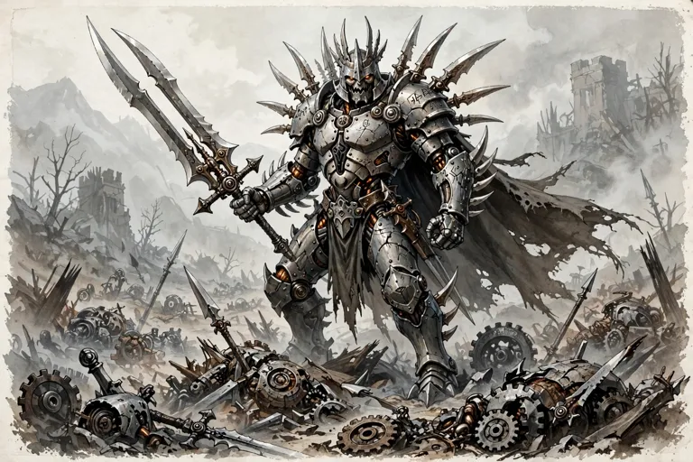

*Picture: GENERATED — generated from the published stat block (Five Nations: adamantine warforged, two-bladed sword)*

## 5B-5. THE LORD OF BLADES — CR 12 — Five Nations, pp. 83–86 (block pp. 84–85)

**Dedup flag:** same individual as Batch 2 record A8, where he was named-but-unstatted on ECS / PGtE evidence. Five Nations prints the full block below; at merge, A8 folds into this entry. Named character construct — fully kitted as published (Possessions line).

> **THE LORD OF BLADES — CR 12**
> Warforged fighter 2/artificer 5/warforged juggernaut 5
> LE Medium construct (living construct)
> **Init** +1; **Senses** Listen +0, Spot +0
> **Languages** Common, Dwarven, Giant
> **AC** 24, touch 12, flat-footed 22
> **hp** 121 (12 HD); **DR** 2/adamantine
> **Immune** healing, fear, nonlethal damage, critical hits, mind-affecting spells and abilities (charms, compulsions, phantasms, patterns, and morale effects), death effects, necromancy effects, ability damage, ability drain, poison, sleep effects, paralysis, disease, nausea, fatigue, exhaustion, effects that cause the sickened condition, energy drain, breathe *[as printed — see the note at the head of this file]*
> **Resist** fire 10 (from armor)
> **Weakness** unusual physical construction (ECS 23); cannot heal lethal damage naturally
> **Fort** +11, **Ref** +4, **Will** +5
> **Speed** 20 ft. (4 squares)
> **Melee** slam +12/+7 (1d4+4) or
> **Melee** +1 keen/+1 keen adamantine two-bladed sword +11/+11/+6 (1d8+5/17–20) or
> **Ranged** mwk composite longbow with +1 bane arrow +12/+7 (1d8+5/×3 plus special)
> **Base Atk** +8; **Grp** +12
> **Atk Options** Cleave, Great Cleave, Greater Powerful Charge, Improved Bull Rush, Power Attack, Powerful Charge; armor blades, charge bonus, extended charge, superior bull rush
> **Combat Gear** embedded wand of *magic missile* (CL 7th; 30 charges), oil of *repair serious damage* (3d8+5 points), oil of *protection from energy* (sonic)
> **Artificer Infusions** (CL 5th; DC 12 + level of infusion): 3/day—2nd, 1st*; 1/day—3rd* (*See page 103 of the EBERRON Campaign Setting for available artificer infusions)
> **Abilities** Str 18, Dex 15, Con 16, Int 14, Wis 11, Cha 18
> **SQ** construct perfection, craft homunculus, craft reserve, disable traps, item creation, living construct traits, reserved, retain essence
> **Feats** Adamantine Body*, Brew Potionᴮ, Cleave, Craft Magic Arms and Armorᴮ, Craft Wondrous Itemᴮ, Exotic Weapon Proficiency (two-bladed sword), Great Cleave, Greater Powerful Charge*ᴮ, Improved Bull Rush, Legendary Artisan*, Power Attack, Powerful Charge*ᴮ, Scribe Scrollᴮ, Two-Weapon Fighting (*Feat described in the EBERRON Campaign Setting; ᴮ = bonus feat as printed)
> **Skills** Concentration +8, Craft (armorsmithing) +12, Craft (weaponsmithing) +12, Disable Device +7, Intimidate +14, Jump +19, Knowledge (arcana) +17, Search +7, Spellcraft +9 (+11 to decipher a spell on a scroll), Use Magic Device +9 (+11 to blindly activate a wondrous item, +13 to activate a spell on a scroll)
> **Possessions** combat gear plus +1 human bane adamantine armor blades, +1 keen/+1 keen adamantine two-bladed sword, masterwork composite longbow (+4 Str bonus) with 6 +1 dwarf bane arrows, 6 +1 elf bane arrows, 6 +1 gnome bane arrows, 6 +1 halfling bane arrows, 6 +1 human bane arrows, +4 composite armor plating of fire resistance, ring of improved jumping, 3 vials of mineral ointment (500 gp each; armor enchantment material component), pouch of diamond dust (250 gp; stone construct material component)
> **Hook** "The war is not over."
>
> **Armor Blades (Ex)** The Lord of Blades' body is covered with +1 human bane adamantine blades that deal 1d8+1 points of slashing damage (plus an additional 2d6+2 points of damage to humans) on a successful grapple attack. While the armor blades can't be removed, they can be affected by spells like any other weapon. (Most warforged juggernauts have adamantine armor spikes that deal piercing damage. The Lord of Blades' adamantine armor blades are unique variants.)
> **Charge Bonus (Ex)** The Lord of Blades gets an extra +2 bonus on his attack roll when charging (total bonus +4).
> **Construct Perfection (Ex)** See page 84 of the EBERRON Campaign Setting.
> **Craft Homunculus (Ex)** See page 32 of the EBERRON Campaign Setting.
> **Craft Reserve (Ex)** See page 31 of the EBERRON Campaign Setting.
> **Disable Trap** See page 31 of the EBERRON Campaign Setting.
> **Extended Charge (Ex)** The Lord of Blades' speed is 25 feet when making a charge.
> **Healing Immunity** See page 84 of the EBERRON Campaign Setting.
> **Item Creation (Ex)** See page 32 of the EBERRON Campaign Setting.
> **Living Construct Traits** See page 23 of the EBERRON Campaign Setting.
> **Reserved** The Lord of Blades takes a –5 penalty on Bluff, Diplomacy, Gather Information, and Sense Motive checks.
> **Retain Essence (Ex)** See page 32 of the EBERRON Campaign Setting.
> **Superior Bull Rush (Ex)** The Lord of Blades gains a +5 bonus on Strength checks when making a bull rush attempt, defending against a bull rush, or breaking down doors. In addition, when he makes a successful bull rush against an opponent, he deals an extra 1d8+5 points of damage with his +1 human bane adamantine armor blades (in addition to the normal results of the bull rush). If the bull rush was made as part of a charge, he deals an extra 2d6 points of damage (from the Greater Powerful Charge feat).

Narrative (pp. 83–84, summarized, not reproduced in full): the Lord of Blades, a powerful and charismatic warforged, gathers disenchanted warforged in the Mournland and preaches that the warforged will inherit the world; his lieutenants take blade-names (Saber, Falchion, Scimitar). Some tales say he led Cyre's warforged armies; darker legend claims he caused the destruction of Cyre itself. Tactics (p. 86): Power Attack at –4/+4 against poorly armored foes; charges and bull rushes; a trained warforged minion carries his longbow and readies it for him; before prepared battles he infuses himself with *armor enhancement* (resistance to electricity 10, 50 minutes), *stone construct* (DR 10/adamantine, 50 minutes or 50 points), *bull's strength*, and *shield of faith*.

**Kit note (components cross-reference):** his *embedded wand of magic missile* is an embedded warforged component in use — the wand component itself is an ECS item (Batch 2 components layer); not re-entered here.

## Thoon Elder Brain — CR 15 — Monster Manual V


*Picture: APOC-VTT monster library art — Monster Manual V*

**Partial — fullest block on file:**

Type: Usually NE Large aberration
Challenge Rating: 15
Source book(s): Monster Manual V
Description: Floating in the air is a purple, bulbous mass that looks like a giant brain with trailing tentacles. You sense its telepathic power as an oily wave washes across your consciousness.
[Partial — fullest available from APOC-VTT registry record; no roster stat block found. No stat lines invented.]

## Thri-Kreen — CR 1 — Monster Manual II


*Picture: APOC-VTT monster library art — Monster Manual II*

**Partial — fullest block on file:**

Type: Medium Monstrous Humanoid
Challenge Rating: 1
Source book(s): Monster Manual II
Description: Thri-kreen, often called mantis warriors, are intelligent humanoids with insectlike features. They prefer deserts and savannas, where they maintain a nomadic lifestyle as hunters. A thri-kreen looks like a bipedal praying mantis. Of the six limbs protruding from its midsection, two are used for walking, and each of the other four ends in a four-fingered hand. A sandy yellow exoskeleton covers an adult thri-kreen’s body. Two compound eyes, two antennae, and a complicated jaw structure that includes a pair of wicked mandibles give its head an insectlike appearance.
[Partial — fullest available from APOC-VTT registry record; no roster stat block found. No stat lines invented.]

## Tin Golem — CR 3 — Dragon Magazine / Constructs roster (web-sourced entry)


*Picture: Constructs roster picture index: Official book art — Dragon #341, p. 44 — "Lesser Golems" group illustration; tin golem cropped from the left figure; full plate also filed as lesser-golems-plate-dragon341-p44.png*

## 11. TIN GOLEM — CR 3 [WEB-ONLY]

**Source:** Dragon Magazine #341 (March 2006), "Lesser Golems: Automatons for Amateurs" by Campbell Pentney, pp. 43–44. Transcribed from the printed pages. Not in the local library. (The other five lesser golems in the same article are mindless — see the screening log.)

**Gate:** Intelligence 5, and the article says it outright: tin golems "are imbued with a very basic intelligence… They can also understand, follow, and even respond to basic instructions," with a printed **Speech (Ex)** quality. This is a golem published as a thinking, talking worker — in, on both prongs of the gate.

### Published stat block (as printed)

Medium Construct
Hit Dice: 3d10+23 (39 hp) *(as printed — the +23 does not match the standard construct size bonus for a Medium construct; reproduced as published, flagged, not corrected)*
Initiative: +0
Speed: 30 ft. (6 squares)
Armor Class: 19 (+7 natural, +2 shield), touch 10, flat-footed 17
Base Attack/Grapple: +2/+4
Attack: Masterwork heavy mace +5 melee (1d8+2)
Full Attack: Masterwork heavy mace +5 melee (1d8+2)
Face/Reach: 5 ft./5 ft.
Special Attacks: —
Special Qualities: Construct traits, craftsmanship, low-light vision, magic immunity, proficiency, speech
Saves: Fort +1, Ref +1, Will +1
Abilities: Str 14, Dex 10, Con —, Int 5, Wis 11, Cha 1
Skills: Climb +5, Craft (weaponsmithing) +6, Profession (miner) +6, Spot +3
Feats: Skill Focus (Craft [weaponsmithing]), Toughness
Environment: Any land
Organization: Solitary, pair, or gang (3–4)
Challenge Rating: 3
Treasure: None
Alignment: Always neutral
Advancement: 4–6 HD (Medium); 7–12 HD (Large)
Level Adjustment: —

**Kit (published):** masterwork heavy mace; shield (the +2 shield bonus in its AC line). Treasure: None.

**Craftsmanship (Ex):** Because tin golems have basic intelligence and their limbs are more flexible than typical constructs, tin golems are able to perform complex tasks such as woodcutting, weaponsmithing, or building. All tin golems have 6 ranks in two Craft or Profession skills chosen by their creator. These ranks are in addition to any ranks gained from Hit Dice or class levels.
**Magic Immunity (Ex):** A tin golem is immune to any spell or spell-like ability that allows spell resistance. In addition, certain spells and effects function differently: *rusting grasp* affects the creature normally; any magical attack that deals electricity damage slows the creature (as the spell) for 3 rounds with no saving throw allowed.
**Proficiency (Ex):** Tin golems do not have the powerful fists of other golems and are better suited to wielding weapons such as swords, maces, or axes. Tin golems are proficient with all simple and martial weapons and all shields (except tower shields).
**Speech (Ex):** Unlike most golems, tin golems are capable of speech, although their speech is halting and monotonous.

### Published description (verbatim)

"This creature has a humanoid shape formed from sheets of bent and molded tin. The body is shaped like armor and its limbs are formed of a flexible joints braced with metallic bands. The creature's facial features are angular and sharp, with eyes full of a cold calmness."

"Tin golems are often created as servants, slaves, or even companions rather than basic guardians. The complexity of a tin golem's creation means that they are imbued with a very basic intelligence. While tin golems are resilient and immune to magical effects they are better suited as couriers, artisans, or laborers than as warriors. They can also understand, follow, and even respond to basic instructions."

**Construction:** Body materials are inexpensive (400 gp) but crafting the body requires a DC 20 Craft (armorsmithing) or DC 20 Craft (weaponsmithing) check; the creator can also teach the golem up to two Craft or Profession skills in which the caster has at least 6 ranks, a process that takes three days per skill. CL 5th; Craft Construct, *fox's cunning*, *magic mouth*, *mending*, caster must be at least 5th level; Price 6,400 gp; Cost 3,400 gp + 240 XP.

## Titan — CR 21 — Monster Manual I


*Picture: GENERATED — monster library generated art — Monster Manual I*

**Partial — fullest block on file:**

Type: Huge Outsider (Chaotic, Extraplanar)
Challenge Rating: 21
Source book(s): Monster Manual I
Description: A titan is about 25 feet tall and weighs about 14,000 pounds. Titans speak Abyssal, Common, Celestial, Draconic, and Giant.
[Partial — fullest available from APOC-VTT registry record; no roster stat block found. No stat lines invented.]

## Toad — CR 0.1 — Monster Manual I


*Picture: Monster library art — Monster Manual I*

**Partial — fullest block on file:**

Type: Diminutive Animal
Challenge Rating: 1/10
Source book(s): Monster Manual I
Description: These diminutive amphibians are innocuous and beneficial, since they eat insects.
[Partial — fullest available from APOC-VTT registry record; no roster stat block found. No stat lines invented.]

## Triton — CR 2 — Monster Manual I


*Picture: Monster library art — Monster Manual I*

**Partial — fullest block on file:**

Type: Medium Outsider (Native, Water)
Challenge Rating: 2
Source book(s): Monster Manual I
Description: A triton has silvery skin that fades into silver-blue scales on the lower half of its body. A triton's hair is deep blue or blue-green. A triton is about the same size and weight as a human. Tritons speak Common and Aquan.
[Partial — fullest available from APOC-VTT registry record; no roster stat block found. No stat lines invented.]

## Troll — CR 5 — Monster Manual I, Monsternomicon Vol. 1


*Picture: Monster library art — Monster Manual I, Monsternomicon Vol. 1*

**Partial — fullest block on file:**

Type: Large Giant
Challenge Rating: 5
Source book(s): Monster Manual I, Monsternomicon Vol. 1
Description: Trolls walk upright but hunched forward with sagging shoulders. Their gait is uneven, and when they run, their arms dangle and drag along the ground. For all this seeming awkwardness, trolls are very agile. A typical adult troll stands 9 feet tall and weighs 500 pounds. Females are slightly larger than males. A troll's rubbery hide is moss green, mottled green and gray, or putrid gray. The hair is usually greenish black or iron gray. Trolls speak Giant.
[Partial — fullest available from APOC-VTT registry record; no roster stat block found. No stat lines invented.]

## Troll, Scrag — CR 5 — Monster Manual I


*Picture: Monster library art — Monster Manual I*

**Partial — fullest block on file:**

Type: Large Giant (Aquatic)
Challenge Rating: 5
Source book(s): Monster Manual I
Description: These cousins of the troll have the aquatic subtype. They dwell in any body of water in any climate. They have a base land speed of 20 feet and a swim speed of 40 feet and are found only in aquatic environments. They regenerate only if mostly immersed in water.
[Partial — fullest available from APOC-VTT registry record; no roster stat block found. No stat lines invented.]

## Trollkin — CR 0.5 — Monsternomicon Vol. 1


*Picture: APOC-VTT monster library art — Monsternomicon Vol. 1*

**Partial — fullest block on file:**

Type: Medium Humanoid (Trollkin)
Challenge Rating: 1/2
Source book(s): Monsternomicon Vol. 1
Description: The most civilized form of troll is the trollkin, and they boast a level of refinement that I doubt any other trolls will reach. Although many of our cultures are prejudiced towards them, I have found them capable of a peaceful coexistence with most other peoples - a peace that the trollkin are sometimes denied out of that prejudice. Trollkin are the most advanced of all trolls. Their culture is rich and diverse with a strong heritage based upon bloodlines.
[Partial — fullest available from APOC-VTT registry record; no roster stat block found. No stat lines invented.]

## Twilight Sisters — CR 12 — Monsternomicon Vol. 2


*Picture: APOC-VTT monster library art — Monsternomicon Vol. 2*

**Partial — fullest block on file:**

Type: Medium Fey (Grymkin)
Challenge Rating: 12
Source book(s): Monsternomicon Vol. 2
Description: Ifear that sometimes the tales of my exploits put others in needless peril, such as when some of my eager but inexperienced students attempt to replicate my successes. Such was the case with Ardam Martinbridge, a bright student at Corvis University, who overheard Alten Ashley’s tale of Tharn huntresses. Without seeking my advice, Ardam set forth to study them personally, hoping to write a paper on the topic. Apparently he soon got lost in the Glimmerwood as the sky’s last tinge of blue faded completely black, and a few stars glittered through the branches.
[Partial — fullest available from APOC-VTT registry record; no roster stat block found. No stat lines invented.]

## Vampire Spawn — CR 4 — Monster Manual I


*Picture: Undead roster picture index: official book art — official book art — Monster Manual I*

14. VAMPIRE SPAWN


**Source:** Monster Manual (3.5), pp. 253–254 — book copy in the local library (`MonsterManual1.pdf` / `MonsterManual1.txt`). SRD cross-check: https://www.d20srd.org/srd/monsters/vampire (book and SRD agree).

**Size/Type:** Medium Undead
**Hit Dice:** 4d12+3 (29 hp)
**Initiative:** +6
**Speed:** 30 ft. (6 squares)
**Armor Class:** 15 (+2 Dex, +3 natural), touch 12, flat-footed 13
**Base Attack/Grapple:** +2/+5
**Attack:** Slam +5 melee (1d6+4 plus energy drain)
**Full Attack:** Slam +5 melee (1d6+4 plus energy drain)
**Space/Reach:** 5 ft./5 ft.
**Special Attacks:** Blood drain, domination, energy drain
**Special Qualities:** +2 turn resistance, damage reduction 5/silver, darkvision 60 ft., fast healing 2, gaseous form, resistance to cold 10 and electricity 10, spider climb, undead traits
**Saves:** Fort +1, Ref +5, Will +5
**Abilities:** Str 16, Dex 14, Con —, Int 13, Wis 13, Cha 14
**Skills:** Bluff +6, Climb +8, Craft or Profession (any one) +4, Diplomacy +4, Hide +10, Jump +8, Listen +11, Move Silently +10, Search +8, Sense Motive +11, Spot +11
**Feats:** Alertnessᴮ, Improved Initiativeᴮ, Lightning Reflexesᴮ, Skill Focus (selected Craft or Profession skill), Toughness
**Environment:** Any
**Organization:** Solitary or pack (2–5)
**Challenge Rating:** 4
**Treasure:** Standard
**Alignment:** Always evil (any)
**Advancement:** —
**Level Adjustment:** —

*This feral-looking creature virtually drips with evil. Its garb is noble-looking, though in a state of disrepair. Its dark red mouth is dominated by a pair of vicious-looking canine teeth.*

Vampire spawn are undead creatures that come into being when vampires slay mortals. Like their creators, spawn remain bound to their coffins and to the soil of their graves.

Vampire spawn appear much as they did in life, although their features are often hardened, with a predatory look.

Vampire spawn speak Common.

## Vasha Rook — CR 1 — NPCs — ALL-150 (Shaun's cast)


*Picture: Roster picture file (npc roster pictures; named in the creature's roster entry)*

14. Vasha Rook — Human Rogue 2 / Fighter 1


**Alignment:** Neutral Evil | **Faction:** Kingdom of the Undead (living agent) | **Role:** Villain/Skill

**Abilities:** Str 13 (+1), Dex 15 (+2), Con 12 (+1), Int 14 (+2), Wis 10 (+0), Cha 8 (−1)
**HD:** 2d6+1d10+3; **hp** 17 (rogue 6+1, fighter 5+1, rogue 3+1) | **Init** +2 | **Speed** 30 ft.
**AC** 16 (+4 chain shirt, +2 Dex), touch 12, flat-footed 14
**BAB** +2 (+1 rogue, +1 fighter); **Grapple** +3
**Attack:** Masterwork short sword +5 melee (1d6+1, 19–20/×2; Weapon Finesse); hand crossbow +4 ranged (1d4, 19–20/×2, 30 ft.)
**Space/Reach:** 5 ft./5 ft.
**Special Attacks:** Sneak attack +1d6
**Special Qualities:** Trapfinding, evasion
**Saves:** Fort +3 (+2 fighter base, +0 rogue base, +1 Con), Ref +5 (+3 rogue base, +0 fighter base, +2 Dex), Will +0
**Skills:** Bluff +5 (6 ranks, −1 Cha), Disable Device +5 (3 ranks, +2 Int), Disguise +5 (6 ranks, −1 Cha), Gather Information +5 (6 ranks, −1 Cha), Hide +8 (6 ranks, +2 Dex), Listen +6 (6 ranks), Move Silently +8 (6 ranks, +2 Dex), Open Lock +5 (3 ranks, +2 Dex), Search +8 (6 ranks, +2 Int), Spot +6 (6 ranks), Tumble +8 (6 ranks, +2 Dex)
*Skill budget: rogue 1st (8 + Int 2 + human 1) ×4 = 44; fighter level (2 + Int 2 + human 1) = 5; rogue level (8 + Int 2 + human 1) = 11; total 60 ranks: nine skills at 6 ranks (54) + Disable Device 3 + Open Lock 3 = 60. Totals above match this allocation.*
**Feats:** Weapon Finesse (human bonus), Dodge (level 1), Mobility (fighter bonus), Combat Reflexes (level 3)
**Equipment:** Masterwork short sword (310 gp), chain shirt (100 gp), hand crossbow (100 gp) and 10 bolts, disguise kit (50 gp), masterwork thieves' tools (100 gp), 1 dose drow poison (75 gp, for a bolt she hopes never to need), potion of *cure moderate wounds* (300 gp), potion of *invisibility* (300 gp), signet-token of the Kingdom of the Undead (a finger-bone ring, worthless and priceless), three changes of clothes in three social classes. ~1,340 gp spent; ~1,160 gp in Kingdom pay buried in five caches outside the walls.

**Appearance:** An unremarkable woman in her late twenties — brown hair, brown eyes, average height, a face designed by nature for crowds. The only distinctive thing about her is that there is nothing distinctive about her, and she maintains that like a garden.
**Steampunk aesthetic:** Steampunk as camouflage: a chain shirt blackened to grey-brown, a hand crossbow with matte-oiled iron fittings, and three full wardrobes — gutter, market, and gallery — all cut from damp-toned cloth with dull buttons and leather straps, so nothing on her ever shines. Her one Kingdom touch is hidden: a funerary-brass clasp worked inside her collar, and her caches are buried in riveted, tar-sealed tins.
**Traits:** Professional, patient, cold. She does not hate the living; she has simply priced them.
**Mannerism/Voice Hook:** Never uses contractions when she is lying, and doesn't know she does it. Even voice: "I deliver messages. I do not open them. I do not remember them."
**Motivation:** The Kingdom has promised her what no living lord can: conversion on her own terms — vampirism, negotiated in writing, with her mind and rank intact — in exchange for ten years of service. She is in year six.
**Secret/Flaw:** She keeps a private ledger of every Kingdom asset she has identified in the Bastion — insurance, she calls it. If the Kingdom learns the ledger exists, her contract is void in the worst way. If the Bastion learns, it's the only thing that might save her neck.
**Background:** A Bastion-born courier (Pippa Underbough's former route-mate, though neither mentions it) recruited by a Kingdom spymaster posing as a mortician. By day she runs a legitimate message service from a market stall; by night she maps Watch patrol rotations and leaves chalk marks a Kingdom handler reads at dawn.
**DM Use Hook:** A recurring antagonist who should escape twice before she's caught: she surveils the party, sells their route to the Kingdom, and — if cornered — offers the ledger as her ransom. Her handler is a hook upward into the Kingdom's Bastion network.

---

## Vasuthant — CR 2 — Monster Manual III


*Picture: Undead roster picture index: official book art — official book art — Monster Manual III*

VASUTHANT — Monster Manual III, pp.182–183


- **Size/Type:** Small Undead
- **Hit Dice:** 2d12 plus 4 (17 hp)
- **Initiative:** +3
- **Speed:** Fly 30 ft. (perfect) (6 squares)
- **Armor Class:** 17 (+1 size, +3 Dex, +3 natural), touch 14, flat-footed 14
- **Base Attack/Grapple:** +1/+1
- **Attack:** Slam +2 melee (1d4)
- **Full Attack:** Slam +2 melee (1d4) and up to 4 enervating crushes (1d4 plus 1d4 Str)
- **Space/Reach:** 5 ft./5 ft.
- **Special Attacks:** Enervating crush, improved grab, reality distortion
- **Special Qualities:** +2 turn resistance, blindsight 60 ft., darkvision 60 ft., immunity to acid and cold, immunity to light, resistance to fire 5 and electricity 5, trap light, undead traits, unholy toughness
- **Saves:** Fort +0, Ref +3, Will +4
- **Abilities:** Str 10, Dex 16, Con —, Int 4, Wis 12, Cha 14
- **Skills:** Hide +9*, Listen +4, Spot +5
- **Feats:** Flyby Attack, Improved Grapple (B)
- **Environment:** Any
- **Organization:** Solitary
- **Challenge Rating:** 2 (as printed in its stat block — the block's low CR against its ability list is reproduced as published)
- **Treasure:** None
- **Alignment:** Always chaotic evil
- **Advancement:** 3–5 HD (Small); 6–9 HD (Medium); 10–16 HD (Large); 17–25 HD (Huge); 26–34 HD (Gargantuan); 35–48 HD (Colossal)
- **Level Adjustment:** —
- **Description:** "A spherical cloud of impenetrable darkness floats toward you. As it draws near, black tendrils reach out from the cloud's opaque core."

## Vermin Lord — CR 17 — Monster Manual III


*Picture: APOC-VTT monster library art — Monster Manual III*

**Partial — fullest block on file:**

Type: Large Monstrous Humanoid
Challenge Rating: 17
Source book(s): Monster Manual III
Description: The insectlike creature before you stands 12 feet tall on locust legs. It has four arms, two of which wield a sword and shield in chitinous hands while the others bear large, scorpionlike claws. Beneath its armor, its body is covered with green and black chitin. Pincers project from its mouth, and a scorpion's tail quivers behind it. As it steps forward, the beetlelike carapace on its back flickers open and closed, causing the great wasp wings beneath to rustle like dry leaves.
[Partial — fullest available from APOC-VTT registry record; no roster stat block found. No stat lines invented.]

## Vine Horror — CR 4 — Fiend Folio


*Picture: APOC-VTT monster library art — Fiend Folio*

**Partial — fullest block on file:**

Type: Medium-Size Plant (Aquatic)
Challenge Rating: 4
Source book(s): Fiend Folio
Description: Primitive, cruel, and elusive, vine horrors are sentient colonies of algae with the ability to assume a roughly humanoid form. They stalk swamps and similar areas, and they attack by surprise whenever possible. Vine horrors are often mistaken for green-skinned humanoids with coarse, rough features. A vine horror’s features appear smooth and somewhat unformed, and when it speaks, its voice often changes pitch in unusual and seemingly random patterns.
[Partial — fullest available from APOC-VTT registry record; no roster stat block found. No stat lines invented.]

## Voidwraith — CR 6 — Libris Mortis


*Picture: Undead roster picture index: official book art — official book art — Libris Mortis*

46. VOIDWRAITH — Libris Mortis p.131, CR 6

**Medium Undead (Air, Incorporeal)**
**Hit Dice:** 6d12 (39 hp) **Initiative:** +9 **Speed:** Fly 60 ft. (12 squares) (perfect) **Armor Class:** 22 (+5 Dex, +5 natural, +2 deflection) [as printed in the mirror — natural armor component on an incorporeal creature, *verify — web extraction*], touch 17, flat-footed 17 **Base Attack/Grapple:** +3/+4 **Attack:** Incorporeal touch +8 melee (1d4 plus 1d2 Con drain) **Full Attack:** Incorporeal touch +8 melee (1d4 plus 1d2 Con drain) **Space/Reach:** 5 ft./5 ft. **Special Attacks:** Steal breath **Special Qualities:** Airless aura, darkvision 60 ft., elemental turning vulnerability, incorporeal traits, inescapable craving, undead traits **Saves:** Fort +2, Ref +7, Will +6 **Abilities:** Str 12, Dex 21, Con —, Int 8, Wis 13, Cha 15 **Skills:** Hide +18, Listen +10, Spot +10 **Feats:** Improved Initiative, Lightning Reflexes, Weapon Finesse **Environment:** Any **Organization:** Solitary, pair, or gang (3–5) **Challenge Rating:** 6 **Treasure:** None **Alignment:** Always neutral evil **Advancement:** 7–9 HD (Medium); 10–12 HD (Large); 13–18 HD (Huge) **Level Adjustment:** —
> *This creature appears to be a formless cloud of darkness, broken only by two pinpoints of glowing red. A breeze blows toward it, as if it were drawing air into its body.*
Flavor/combat prose (read in full): an undead manifestation of elemental air that hungers for the breath of the living; fills ~5 ft. square, weightless; speaks Auran. Airless Aura (Su): adjacent creatures have no air and must hold their breath. Steal Breath (Su): touch, Fort DC 15 or 1d2 Con drain (air subtype –4), gains 5 temporary hp per drain; against a breath-holding target, each point drained also cuts remaining breath by 2 rounds. Inescapable Craving: Constitution.
**Kit:** Published treasure: **None.**
**APOC Note:** The air-elemental counterpart to the Cinderspawn/Desiccator — a stranded remnant that eats breath. In APOC's surface world of inert Fog, a voidwraith's personal vacuum is a local horror, not a weather effect — the Fog does not move for it or feed it. Kingdom of the Undead ambusher for enclosed badlands sites (mines, vaults) where breath is already scarce. Barred from the Bastion by the Melairshield.

## Warforged — CR 0.5 — Monster Manual III


*Picture: Constructs roster picture index: Official book art — Eberron Campaign Setting, p. 21 (captioned "Warforged")*

**Partial — fullest block on file:**

Cross-reference record A — WARFORGED (MM III monster version)


**Source:** Monster Manual III, pp. 190–191. **Do not duplicate** — the full race entry is **Batch 2** (Eberron Campaign Setting, pp. 20–24). This record exists for the parent merger.

- **What MM III adds:** a monster-format presentation of the same race — a sample **Warforged, 1st-Level Warrior**, CR **1/2**, LA +0, with the living construct traits referenced to p. 215.
- **Sample block (as published):** Medium Construct (Living Construct); HD 1d8+2 (6 hp); Init +0; Speed 30 ft. (6 squares); AC 15 (+5 Mithral Body), touch 10, flat-footed 15; BAB/Grapple +1/+2; Attack spear +2 melee (1d8+1/×3) or slam +2 melee (1d4+1) or spear +1 ranged (1d8+1/×3); Space/Reach 5 ft./5 ft.; SA —; SQ composite plating, light fortification, living construct traits; Saves Fort +4, Ref +0, Will –1; Str 13, Dex 11, Con 14, Int 9, Wis 8, Cha 6; Skills Intimidate +1, Jump +0; Feats Mithral Body; Environment Any land; Organization solitary, pair, or squad (4–20 plus 1 3rd-level sergeant); Treasure None; Alignment usually lawful neutral; Advancement by character class. (Base scores before racial adjustments: Str 13, Dex 11, Con 12, Int 9, Wis 10, Cha 8.)
- **Differences vs. the ECS presentation:** none in the racial traits — +2 Con, –2 Wis, –2 Cha; composite plating (+2 armor, 5% arcane spell failure); light fortification; favored class fighter; LA +0 — identical. The differences are presentational only: MM III assigns the CR 1/2 and the warrior sample (which spends its feat on Mithral Body, raising the sample's armor bonus to +5), and its descriptive text is written for Eberron's Last War aftermath ("most warforged in those lands serve as slave laborers… in other lands, they are free but sometimes the victims of discrimination"). Eberron lore is stripped at the merge; Shaun's APOC Note in Batch 2 governs.
- **Picture:** official illustration, Monster Manual III, p. 190. Extraction owed.
**Picture (final, at merge):** `pictures/warforged-mm3-p190.png` — OFFICIAL BOOK ART (Monster Manual III, p. 190 — cross-reference row; the entry's primary picture is the ECS plate in Part I)

## Waterveiled Assassin — CR 15 — Monster Manual IV


*Picture: APOC-VTT monster library art — Monster Manual IV*

**Partial — fullest block on file:**

Type: Large Elemental (Extraplanar, Water)
Challenge Rating: 15
Source book(s): Monster Manual IV
Description: The walls around you groan, buckle, and bulge outward as a torrent of water sprays out from a dozen rents. The water flows together, forming a monstrous shape. Bits of rock, dirt, and bones float within it, along with the shredded remnants of weapons, armor, and clothing. The shape rushes toward you like a tidal wave as it attacks.
[Partial — fullest available from APOC-VTT registry record; no roster stat block found. No stat lines invented.]

## Wicker Man — CR 11 — Fiend Folio


*Picture: APOC-VTT monster library art — Fiend Folio*

**Partial — fullest block on file:**

Type: Huge Construct
Challenge Rating: 11
Source book(s): Fiend Folio
Description: A wicker man is a huge, hollow structure of branches and vines crudely woven into the form of a human. A tall crown of twigs juts up from its featureless head, and its arms end in massive bundles of sharp branches that it uses to snatch up creatures and to toss them through the cage door in its chest. A wicker man is usually created for a festival by a druid or cleric in a community that reveres a deity such as Nerull.
[Partial — fullest available from APOC-VTT registry record; no roster stat block found. No stat lines invented.]

## Windghost — CR 15 — Monster Manual II


*Picture: APOC-VTT monster library art — Monster Manual II*

**Partial — fullest block on file:**

Type: Huge Aberration
Challenge Rating: 15
Source book(s): Monster Manual II
Description: Mysterious observers that float casually through the skies, windghosts are unfathomable creatures that inspire curiousity, puzzlement, and sometimes fear. The body of a windghost is conical. From top to base, it measures 24 feet. At its base is a gaping, circular mouth, 8 feet across and lined with rows of teeth. Its body tapers up to a rounded cap. A windghost’s rough and mottled hide is purplish gray in color, and it has milk-white eyes. The windghost has two 20-foot tentacles dangling from either side of its base. These appendages primarily serve to carry items.
[Partial — fullest available from APOC-VTT registry record; no roster stat block found. No stat lines invented.]

## Woldwrath — CR 16 — Monsternomicon Vol. 2


*Picture: APOC-VTT monster library art — Monsternomicon Vol. 2*

**Partial — fullest block on file:**

Type: Huge Construct (Elemental Construct)
Challenge Rating: 16
Source book(s): Monsternomicon Vol. 2
Description: Perhaps it is my competitive streak, but after reading Edrea’s report on the woldwatcher and hearing Alten’s description of the woldwyrd I felt compelled to discover evidence of these things myself. I had my opportunity as I accompanied several Fort Falk officers, at the request of the Scout General, on an expedition along Cygnar’s eastern border. I was apprising them of skorne tactics and relating intelligence I had gathered about this enemy during my captivity.
[Partial — fullest available from APOC-VTT registry record; no roster stat block found. No stat lines invented.]

## Worg — CR 2 — Monster Manual I


*Picture: Monster library art — Monster Manual I*

**Partial — fullest block on file:**

Type: Medium Magical Beast
Challenge Rating: 2
Source book(s): Monster Manual I
Description: A typical worg has gray or black fur, grows to 5 feet long and stands 3 feet tall at the shoulder. It weighs 300 pounds. More intelligent than their smaller cousins, worgs speak their own language. Some can also speak Common and Goblin.
[Partial — fullest available from APOC-VTT registry record; no roster stat block found. No stat lines invented.]

## Yagnoloth — CR 10 — Monster Manual II


*Picture: APOC-VTT monster library art — Monster Manual II*

**Partial — fullest block on file:**

Type: Large Outsider (Evil)
Challenge Rating: 10
Source book(s): Monster Manual II
Description: In the simplistic feudal hierarchy of Gehenna, yagnoloths are minor lords. Each rules over a territory, with vassal yugoloths at its beck and call. The rationale behind this arrangement is not clear, since yagnoloths are neither stronger nor brighter than many of their subjects. Whatever the reason, the ruling powers of Gehenna enforce the existing order, and the yagnoloths profit from it.
[Partial — fullest available from APOC-VTT registry record; no roster stat block found. No stat lines invented.]

## Yrthak — CR 9 — Monster Manual I


*Picture: Monster library art — Monster Manual I*

**Partial — fullest block on file:**

Type: Huge Magical Beast
Challenge Rating: 9
Source book(s): Monster Manual I
Description: A yrthak is blind. It senses sound and movement by means of a special organ on its long tongue. It emits powerfully focused beams of sound from the protrusion on its head. The creature is a yellowish-green color, with the wings and fin being more yellow and the head and body more green. The teeth are yellow. A yrthak is about 20 feet long, with a wingspan of 40 feet. It weighs about 5,000 pounds. Despite their intelligence, yrthaks do not speak.
[Partial — fullest available from APOC-VTT registry record; no roster stat block found. No stat lines invented.]

## Yuan-ti Abomination — CR 7 — Monster Manual I


*Picture: Monster library art — Monster Manual I*

**Partial — fullest block on file:**

Type: Large Monstrous Humanoid
Challenge Rating: 7
Source book(s): Monster Manual I
Description: Yuan-ti abominations resembled massive snakes, some 8 to 12 feet (2.4 to 3.7 meters) long and weighing approximately 200 to 300 pounds (91 to 140 kilograms), with scale-covered humanoid arms. Their scale patterns were variable according to tribe, but they had the wedge-shaped heads distinctive of venomous snakes.
[Partial — fullest available from APOC-VTT registry record; no roster stat block found. No stat lines invented.]

## Yuan-ti Pureblood — CR 3 — Monster Manual I


*Picture: Monster library art — Monster Manual I*

**Partial — fullest block on file:**

Type: Medium Monstrous Humanoid
Challenge Rating: 3
Source book(s): Monster Manual I
Description: This being looks much like a slim-hipped, lithe human with sharp features and unblinking eyes. A closer look, however, reveals a forked tongue, pointed teeth, and scaly patches on the neck and limbs. Yuan-ti purebloods appear human at first glance, with only very subtle snakelike features. A pureblood is about the same height and weight as a human.
[Partial — fullest available from APOC-VTT registry record; no roster stat block found. No stat lines invented.]

## Yugoloth, Mezzoloth — CR 6 — Monster Manual III


*Picture: APOC-VTT monster library art — Monster Manual III*

**Partial — fullest block on file:**

Type: Medium Outsider (Evil, Extraplanar, Yugoloth)
Challenge Rating: 6
Source book(s): Monster Manual III
Description: This six-limbed insectoid horror stares ahead unblinkingly through glowing red eyes. It holds a long trident in its claws. Mezzoloths are the most common foot soldiers in the yugoloth armies. They understand little beyond combat, but their skill in battle is fearsome. When they aren't fighting, they're imagining new ways to hurt their enemies and practicing their martial skills. A mezzoloth looks like a human-sized insect with heavy chitin and four limbs tipped with sharp claws. Its wideset eyes glow red when it's angry (which is almost always).
[Partial — fullest available from APOC-VTT registry record; no roster stat block found. No stat lines invented.]

## Yunwi Djunsti — CR 9 — Encyclopedia of Demons & Devils Vol. 1


*Picture: Demons roster picture index: LIBRARY (tier 1)*

Yunwi Djunsti — CR 9 [3RD-PARTY — Publisher: Fast Forward Entertainment]


**Source:** *The Encyclopedia of Demons & Devils* Vol. 1, book p. 205 (PDF p. 206). The book's last entry. "Book is 3.0-era d20 — reproduced as published."
**Classification evidence (verbatim from the page):** heading "Yunwi Djunsti (Tanar'ri)"; type line "Medium-size Outsider (Chaotic, Evil)"; "Challenge Rating: 9"; "Alignment: Always chaotic evil." A genuine demon entry in this book — rostered.

- **Yunwi Djunsti (Tanar'ri)**
- Medium-size Outsider (Chaotic, Evil)
- **Hit Dice:** 2d8 +2 (11 hp) *(space before "+2" as printed)*
- **Initiative:** +0
- **Speed:** 30 ft.
- **AC:** 16 (+6 natural)
- **Attacks:** Invisible Weapons +3 melee
- **Damage:** Club 1d6 +three times per x3 crit — ⚠ **PUBLISHED ERROR** note: damage line garbled as printed (verified at 300 dpi; same garble as the Yezerha-Ra dagger line above); reproduced as published.
- **Face/Reach:** 5 ft. by 5 ft./5 ft.
- **Special Attacks:** Summon tanar'ri
- **Special Qualities:** Damage reduction 30/ +3, SR 28, tanar'ri qualities *(space in "30/ +3" as printed)*
- **Saves:** Fort +4, Ref +3, Will +4
- **Abilities:** Str 13, Dex 11, Con 13, Int 9, Wis13, Cha 15 *(no space in "Wis13" as printed)*
- **Skills:** Hide +4, Open Lock +4, Pick Pocket +4, Disable Device +4
- **Feats:** Run
- **Climate/Terrain:** Any land and underground
- **Organization:** Solitary, 2-5 (gang)
- **Challenge Rating:** 9
- **Treasure:** Standard
- **Alignment:** Always chaotic evil
- **Advancement Range:** None

**Description (verbatim, book p. 205):** "This demon of North American Cherokee legend comes to the prime material plane as a 3-4 foot tall comely human. Each of these demons have long dark hair that flows down to the ground. They arrive in white leather clothing. They are summoned to do deviltry to the enemies of the summoner. Hair from the victim is part of the summoning ritual. The Yunwi Djunsti demon is summoned for a time period from one full moon to the next. Many times after the demon has served its purpose, it remains to work its tricks on the summoner in turn. Freed, the demon summons others of its type, and they make invisible lairs in the summoner's lands. They don't like humans, and they play vicious and deadly tricks on people who try to live near their demon dens." / "There are four different types of this demon, and each appears differently, depending on the geography of the area it is summoned into. When summoned into mountains or rocky lands, the demon is gray skinned and its hide is the texture of flint. When summoned in the desert, the demon has skin just like sand. When summoned in grassy or planted lands, the demon is green-skinned. When summoned in jungles or woods, the demon is very elf-like, with all the abilities of an elf." / "It's bad luck to view a Yunwi Djunsti, and those who look in the demon's eyes have –1 to all their DC checks for 24 hours. Many cultures know these common demons and call them the little people, making sacrifices to them in the form of fresh milk and the first cut of meat from any wild animal taken in hunting." *("DC checks" as printed)*

**Combat (verbatim):** "Rocky Yunwi Djunsti are able to attack with invisible hurled stones, doing 3d6 of damage. The stones turn to dust after striking. These demons are totally invisible in the sun's light, but they can be seen in moonlight." / "Desert Yunwi Djunsti can generate an invisible sandstorm, doing 3 points of damage every combat round until the demon is destroyed. These demons are able to move through the sand of the desert as fast as they can travel overland." / "Grassland Yunwi Djunsti can generate the tangle spell five times a day. These demons cannot be summoned to harm elves." — ⚠ **PUBLISHED ERROR** note: "tangle spell" as printed (verified at 300 dpi; evidently for "entangle"); reproduced as published. / "Jungle Yunwi Djunsti can summon a dire bear to fight by their side once a day. These demons will breed dire bears to have one bear per demon living in the area." / "The Yunwi Djunsti can do all their attacks and tricks while invisible." / "When the demon picks up a weapon, that weapon becomes invisible in its hands. This invisibility lasts on the weapon for 24 hours or longer if the demon keeps the weapon by its side."
**Summon Tanar'ri (Sp) (verbatim):** "Once per day, a Yunwi Djunsti can attempt to summon 1d2 dretch with a 20% chance of success."
**Gifts of the Yunwi Djunsti (verbatim):** "The demon enjoys helping the young and can be found acting as protectors of children in all lands. Children under 10 can see these demons and talk to them as friends. These children are often given valuable diamonds and emeralds as presents on their birthdays."

**APOC NOTE (Shaun's canon — separate from the published text above):** Third-party lore is reference only, not FR canon. In APOC the Yunwi Djunsti is mortal and trapped inside the scarred crystal sphere; planar travel is severed and summoning spells DON'T WORK, so its summon tanar'ri calls nothing and no ritual summons it; the Bastion's mythal bars demons absolutely.

---

## Zodar — CR 16 — Fiend Folio


*Picture: Constructs roster picture index: Official book art — Fiend Folio, p. 199 (captioned)*

ZODAR [3.0-format as published]

**Medium-Size Construct**
**Hit Dice:** 16d10+20 (108 hp)
**Initiative:** +3
**Speed:** 60 ft. (can't run)
**AC:** 28 (+3 Dex, +10 natural, +5 deflection), touch 18, flat-footed 25
**Base Attack/Grapple:** +12/+19
**Attack:** Slam +19 melee
**Full Attack:** 2 slams +19 melee
**Damage:** Slam 2d6+7
**Face/Reach:** 5 ft./5 ft.
**Special Attacks:** Constrict
**Special Qualities:** Burst of strength, construct traits, invulnerability, wish
**Saves:** Fort +5, Ref +8, Will +8
**Abilities:** Str 25, Dex 16, Con —, Int —, Wis 16, Cha 10
**Skills:** —
**Feats:** —
**Climate/Terrain:** Any land
**Organization:** Solitary
**Challenge Rating:** 16
**Treasure:** Magic items only
**Alignment:** Usually chaotic neutral
**Advancement:** 17–45 HD (Medium-size)

Incredibly powerful, enigmatic constructs of unknown origin, zodars resemble animated suits of polished black plate armor. Some are beautifully ornate, while others are plain and simply functional. They are made not of metal, but some sort of ceramic substance surrounding a solid mass of muscle capable of producing tremendous bursts of strength.
Zodars seldom, if ever, talk. A zodar never speaks more than one sentence during a typical human lifetime. Even then, the utterance may be no more than a sentence fragment, but whatever the zodar says is certain to be important. Every character within hearing understands the statement, regardless of what languages it knows (treat such characters as though affected by a *tongues* spell of instantaneous duration).
Occasionally, a zodar attaches itself to group of adventurers and accompanies them on their travels. It may participate in their adventures or it may simply tag along, silently observing. *[sic — "attaches itself to group" as printed.]*

## Zombie, Brine — CR 1 — Tome of Horrors Revised (Necromancer Games


*Picture: Undead roster picture index: official book art — official book art — Tome of Horrors Revised (Necromancer Games)*

Zombie, Brine


**Source:** Tome of Horrors Revised (Necromancer Games, 2005), p.376

```
ZOMBIE, BRINE
                          Medium Undead (Aquatic)                                                    This creature appears as a rotting humanoid dressed
                          Hit Dice:               4d12+3 (29 hp)                                  in tattered and ragged clothing. Its semi-bloated body
                          Initiative:             -1
                          Speed:                  30 ft. (6 squares; can’t run), swim 30 ft.
                                                                                                  glistens from the slimy mixture of water and seaweed
                          Armor Class:            13 (-1 Dex, +4 natural), touch 9, flat-         that hangs from its form. The creature’s rotting flesh
                                                  footed 13                                       is blue-green in color. No semblance of life burns in its
                          Base Attack/Grapple:    +2/+4                                           eyes.
                          Attack:                 Cutlass +4 melee (1d6+2) or slam +4 me-            Brine zombies are the remnants of a ship’s crew
                                                  lee (1d6+3)
                          Full Attack:            Cutlass +4 melee (1d6+2) or slam +4 me-         that has perished at sea. They are mindless crea-
                                                  lee (1d6+3)                                     tures, not very pleasant to look at, and relentless
                          Space/Reach:            5 ft./5 ft.                                     in their attacks on the living. The spark of evil
                          Special Attacks:        —                                               that brought them back from the ocean depths
                          Special Qualities:      Damage reduction 5/slashing, darkvision         drives them to seek the living so they may join
                                                  60 ft., resistance to fire 10, single actions
                                                  only, undead traits                             them in their watery graves. Brine zombies appear
                          Saves:                  Fort +1, Ref +0, Will +4                        much as they did in life.
                          Abilities:              Str 14, Dex 8, Con —, Int —, Wis 10,
                                                  Cha 1                                           Combat
                          Skills:                 Swim +10
                          Feats:                  Toughness                                         Brine zombies attack an opponent with their
                          Environment:            Any aquatic                                     cutlasses or fists in melee. If a brine zombie suc-
                          Organization:           Gang (2-4) or crew (6-11)
                          Challenge Rating:       1
                          Treasure:               None                                                              New Weapon
                          Alignment:              Always neutral evil                                 Cutlass: Martial weapon, one-handed me-
                          Advancement:            5-8 HD (Medium)                                   lee weapon, cost 15 gp, damage 1d4 (S)/1d6
                          Level Adjustment:       —
                                                                                                    (M), critical 19-20/x2, weight 3 lb., slashing.


                                                                                              376
                                          the     tome of horrors revised

               cessfully grabs an opponent, it dives overboard          Skills: A brine zombie has a +8 racial bonus on
               and attempts to drown the victim by pinning him/      any Swim check to perform some special action or
               her underwater.                                       avoid a hazard. It can always choose to take 10 on
                 Single Actions Only (Ex): Brine zombies have        a Swim check, even if distracted or endangered. It
               poor reflexes and can take only a single move         can use the run action while swimming, provided
               action or attack action each round. A brine zom-      it swims in a straight line.
               bie can move up to its speed and attack in the same      Copyright Notice
               round, but only if it attempts to charge.                Author Scott Greene.


                                                                 377
                                                       appendix a: templates
```

**Kit / Treasure (as published):** Treasure line: "None                                                              New Weapon" — no itemized gear is published for this entry; none invented.

**APOC Note** *(Shaun's — separate from the published text above)*
- Counts toward the **Kingdom of the Undead** faction in the badlands war (2701 DR).
- **The Bastion's Melairshield bars undead** — it cannot enter the Bastion of Last Hope.
- **Raw magic blights** the land around the caster in APOC — necromancy worked through raw magic carries that cost; alchemy is the cornerstone inside the walls.

---

## Zombie, Yellow Musk — CR 2 — Tome of Horrors Revised (Necromancer Games


*Picture: Undead roster picture index: official book art — official book art — Tome of Horrors Revised (Necromancer Games)*

Zombie, Brine


**Source:** Tome of Horrors Revised (Necromancer Games, 2005), p.376

```
ZOMBIE, BRINE
                          Medium Undead (Aquatic)                                                    This creature appears as a rotting humanoid dressed
                          Hit Dice:               4d12+3 (29 hp)                                  in tattered and ragged clothing. Its semi-bloated body
                          Initiative:             -1
                          Speed:                  30 ft. (6 squares; can’t run), swim 30 ft.
                                                                                                  glistens from the slimy mixture of water and seaweed
                          Armor Class:            13 (-1 Dex, +4 natural), touch 9, flat-         that hangs from its form. The creature’s rotting flesh
                                                  footed 13                                       is blue-green in color. No semblance of life burns in its
                          Base Attack/Grapple:    +2/+4                                           eyes.
                          Attack:                 Cutlass +4 melee (1d6+2) or slam +4 me-            Brine zombies are the remnants of a ship’s crew
                                                  lee (1d6+3)
                          Full Attack:            Cutlass +4 melee (1d6+2) or slam +4 me-         that has perished at sea. They are mindless crea-
                                                  lee (1d6+3)                                     tures, not very pleasant to look at, and relentless
                          Space/Reach:            5 ft./5 ft.                                     in their attacks on the living. The spark of evil
                          Special Attacks:        —                                               that brought them back from the ocean depths
                          Special Qualities:      Damage reduction 5/slashing, darkvision         drives them to seek the living so they may join
                                                  60 ft., resistance to fire 10, single actions
                                                  only, undead traits                             them in their watery graves. Brine zombies appear
                          Saves:                  Fort +1, Ref +0, Will +4                        much as they did in life.
                          Abilities:              Str 14, Dex 8, Con —, Int —, Wis 10,
                                                  Cha 1                                           Combat
                          Skills:                 Swim +10
                          Feats:                  Toughness                                         Brine zombies attack an opponent with their
                          Environment:            Any aquatic                                     cutlasses or fists in melee. If a brine zombie suc-
                          Organization:           Gang (2-4) or crew (6-11)
                          Challenge Rating:       1
                          Treasure:               None                                                              New Weapon
                          Alignment:              Always neutral evil                                 Cutlass: Martial weapon, one-handed me-
                          Advancement:            5-8 HD (Medium)                                   lee weapon, cost 15 gp, damage 1d4 (S)/1d6
                          Level Adjustment:       —
                                                                                                    (M), critical 19-20/x2, weight 3 lb., slashing.


                                                                                              376
                                          the     tome of horrors revised

               cessfully grabs an opponent, it dives overboard          Skills: A brine zombie has a +8 racial bonus on
               and attempts to drown the victim by pinning him/      any Swim check to perform some special action or
               her underwater.                                       avoid a hazard. It can always choose to take 10 on
                 Single Actions Only (Ex): Brine zombies have        a Swim check, even if distracted or endangered. It
               poor reflexes and can take only a single move         can use the run action while swimming, provided
               action or attack action each round. A brine zom-      it swims in a straight line.
               bie can move up to its speed and attack in the same      Copyright Notice
               round, but only if it attempts to charge.                Author Scott Greene.


                                                                 377
                                                       appendix a: templates
```

**Kit / Treasure (as published):** Treasure line: "None                                                              New Weapon" — no itemized gear is published for this entry; none invented.

**APOC Note** *(Shaun's — separate from the published text above)*
- Counts toward the **Kingdom of the Undead** faction in the badlands war (2701 DR).
- **The Bastion's Melairshield bars undead** — it cannot enter the Bastion of Last Hope.
- **Raw magic blights** the land around the caster in APOC — necromancy worked through raw magic carries that cost; alchemy is the cornerstone inside the walls.

---
